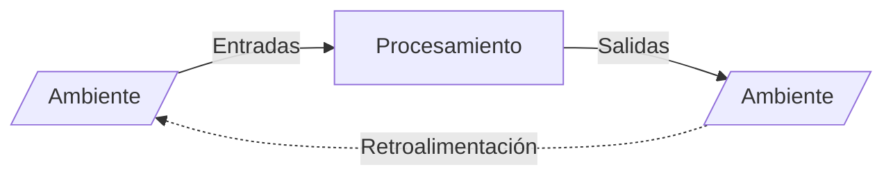

# Organización (concepto y sistemas abiertos)

> [!quote] Definición
> Una organización es un **sistema de actividades conscientemente coordinadas, formado por dos o más personas**, cuya cooperación recíproca es esencial para su existencia.

Solo existe cuando: **(1)** hay personas capaces de comunicarse, **(2)** dispuestas a actuar conjuntamente, **(3)** que desean obtener un objetivo común.

## La organización como sistema abierto
Sistema = conjunto de elementos relacionados dinámicamente que desarrollan una actividad para alcanzar un objetivo. Elementos:
- **Entradas (inputs):** recursos e insumos tomados del ambiente.
- **Procesamiento:** transforma las entradas en salidas.
- **Salidas (outputs):** resultado que vuelve al ambiente.
- **Retroalimentación (feedback):** acción de las salidas sobre las entradas para mantener el equilibrio.

El sistema abierto está en **continua interacción con el ambiente** y logra un **equilibrio dinámico**; sin el flujo continuo de entradas-transformación-salidas no sobrevive.

## Enfoque de Katz y Kahn (características de sistema abierto)
1. Importación – transformación – exportación de energía · 2. Ciclos de eventos · 3. **Entropía negativa** · 4. Información como insumo, retroalimentación negativa y codificación · 5. Estado de equilibrio y **homeostasis dinámica** · 6. **Diferenciación** · 7. **Equifinalidad** (distintos caminos, mismo estado final) · 8. Límites o fronteras.

## Complejidad y eras
Características de las organizaciones complejas: complejidad (horizontal y vertical), anonimato, rutinas estandarizadas, estructuras no oficiales, especialización, tamaño.

| Era | Período | Rasgo |
|---|---|---|
| Industrialización clásica | 1900–1950 | Estructura piramidal, burocracia; personas = recursos de producción |
| Industrialización neoclásica | 1950–1990 | Estructura matricial; personas = recursos vivos (ARH) |
| **Información / conocimiento** | 1990– | Cambios rápidos e imprevisibles; **el recurso más importante es el conocimiento** |

**Empresa:** iniciativa humana que reúne e integra recursos humanos y no humanos para autosostenerse y obtener ganancias produciendo bienes o servicios.

## 🔗 Relacionado
- [[Enfoque de Tavistock]] — otra manera de estudiar el sistema abierto
- [[Recursos organizacionales]] · [[Racionalidad de las organizaciones]]
- [[Ambiente organizacional]] · [[Niveles organizacionales (Chiavenato)]]
