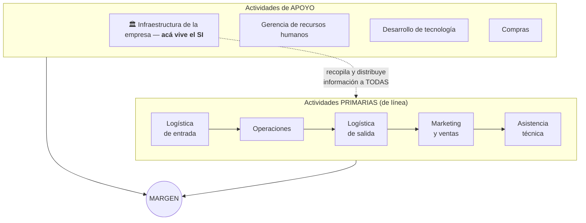

# El SI en la cadena de valor

La cadena de valor (Porter) distingue dos tipos de actividades:
- **De línea o básicas:** crean valor directamente (logística de entrada, operaciones, logística de salida, marketing y ventas, servicio/asistencia técnica).
- **De soporte:** apoyan a las anteriores para coordinarse y compartir información (infraestructura, RRHH, desarrollo de tecnología, compras).

Cada eslabón debe darle **"valor agregado"** a lo que se produce; el SI conecta los eslabones y les brinda la información necesaria.

## Puntos clave (respuesta a la P1)
1. **Ubicación:** "el SI de una empresa forma parte precisamente de la **infraestructura de la empresa**" → todas las actividades de línea precisan apoyo basado en el SI, y el SI **interactúa con todas las actividades**, básicas o de soporte, "en grado no trivial".
2. **Función:** todas las actividades **necesitan y generan información**; el SI la **recopila** y la **distribuye** a cada actividad.
3. **Propiedad global:** la información del SI básico "**no pertenece a ninguna actividad en particular; pertenece a la empresa considerada globalmente**".
4. **SI circunscritos:** si una actividad procesa volúmenes de información en un detalle que **nadie más necesita**, existen subsistemas circunscritos que no integran el SI básico pero terminan con **interfaces claras** hacia él.
5. **Coherencia:** el SI forma un conjunto coherente y coordinado con el resto de la infraestructura (sistema de control, estructura organizativa, sistema de planificación) y con los objetivos de la empresa.
6. **Vínculos:** el SI explota las influencias mutuas entre actividades (ej.: quejas de clientes → control de calidad); exige un **punto de vista global** y en casos extremos permite **reconfigurar la cadena de valor** → ventajas competitivas.

**Cuestionario:** responde la **P1** (junto a [[Sistema de Información (definición)]]).

## 🔗 Relacionado
- [[Sistema de Información (definición)]] · [[Tecnologías de la Información (rol)]]
- [[Contexto de la estrategia SI-TI (Edwards)]] — cadena de valor interna/externa como herramienta de evaluación
