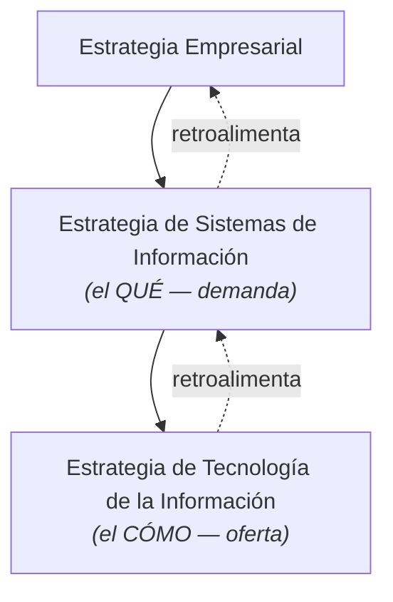

# Estrategia de SI vs Estrategia de TI (demanda y oferta)

| | **Estrategia de SI** | **Estrategia de TI** |
|---|---|---|
| Rol | **DEMANDA** | **OFERTA** |
| Pregunta | **¿QUÉ?** — qué necesidades de información y de aplicaciones tiene el negocio | **¿CÓMO?** — cómo satisfacer esa demanda con tecnología |
| Contenido | Necesidades de información y sistemas de la empresa y sus funciones; si hay varios negocios, una estrategia por negocio + una corporativa global. Objetivo: definir las necesidades de aplicaciones **en línea con los planes y aspectos críticos** | Cómo se satisfacen las necesidades **según las prioridades de la estrategia de SI** y la tecnología necesaria para desarrollar y operar las aplicaciones actuales y futuras |

La integración SI–estrategia empresarial debe incorporar métodos para evaluar el **impacto potencial** de los SI/TI sobre la organización y su entorno.

> [!tip] Regla de oro
> Primero la **demanda** (qué necesita el negocio), después la **oferta** (cómo proveerla). Al revés → los usuarios no se apropian del sistema. El mismo eje demanda/oferta ordena las [[Estrategias genéricas de gestión (Parsons)]].

**Cuestionario:** responde la **P2**.

## 🔗 Relacionado
- [[Tecnologías de la Información (rol)]] · [[Sistema de Información (definición)]]
- [[Alineamiento E.O. – E.SI-TI (esquema general)]] · [[Estrategias genéricas de gestión (Parsons)]]
