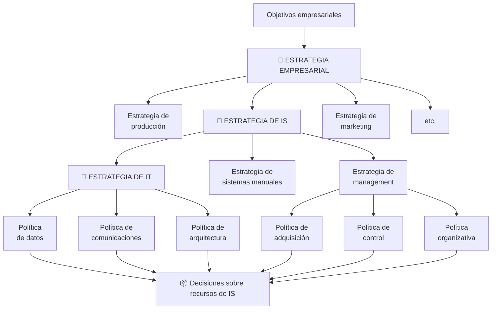

# Alineamiento E.O. – E.SI/TI

## La jerarquía del alineamiento

La estrategia de IS es **una estrategia funcional más** (como producción o marketing) derivada de la estrategia empresarial. De ella cuelgan la estrategia de IT, la de sistemas manuales y la de management, que se concretan en **políticas** → **decisiones sobre recursos de IS**.

## ¿Por qué alinear? (P3 — conclusión propia)

> [!important] Argumentos
> 1. **Por definición:** el SI existe "para desempeñar las funciones y procesos de negocio **de acuerdo con su estrategia**". Es un recurso más, **no un fin en sí mismo**.
> 2. **Por su ubicación en la cadena de valor:** como infraestructura que interactúa con TODAS las actividades, un SI desalineado propaga su ineficacia a toda la organización.
> 3. **Por la historia:** sin alineación se cae en la [[Evolución de la planificación de SI (4 fases históricas)|expansión anárquica]] — prioridades por facilidad técnica, novedad o poder del solicitante → inversiones enormes sin retorno estratégico.
> 4. **Por eficacia estratégica (Edwards):** unidades con estrategias distintas ([[Estrategias competitivas de Porter|bajo coste vs diferenciación]]) necesitan SI distintos; un sistema compartido impide que ambas desarrollen su estrategia con eficacia.
> 5. **Por el valor (Robson):** el valor está en el **uso de la información** para el negocio, no en la tecnología; invertir sin alineación es incurrir en costos sin garantizar beneficios.

## Antes del alineamiento: la estrategia general
La [[Planificación estratégica del negocio (Palom Izquierdo)|planificación estratégica del negocio]] define misión, análisis interno/externo, metas y programas de acción. Recién definidas metas y programas entran los conceptos tecnológicos: [[Estrategia de SI vs Estrategia de TI|SI = QUÉ, TI = CÓMO]].

**Cuestionario:** responde la **P3**.

## 🔗 Relacionado
- [[Plan de TI-SI (contenido)]] · [[Procedimiento de alineamiento (4 fases)]]
- [[Evolución de la planificación de SI (4 fases históricas)]] · [[Matriz de necesidades]]
