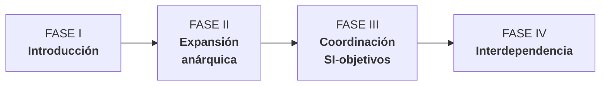

# Evolución de la planificación de SI — 4 fases (Gibson y Nolan, 1974)

| Fase | Qué pasa | Problema central |
|---|---|---|
| **I. Introducción** | Años 60: grandes ordenadores manejados solo por especialistas; objetivo: **reducir costes** mecanizando lo administrativo (contabilidad, nómina, facturación). Depto. de "**Proceso de Datos**" bajo servicios administrativos. Los usuarios piden; PD decide prioridades | 🧱 Nace el **"muro"** de incomunicación entre PD y la alta dirección: conexión con los objetivos del negocio **inexistente** |
| **II. Expansión anárquica** | Resueltas las mecanizaciones básicas, llueven pedidos más complejos. Multitud de aplicaciones transaccionales **desconectadas** | Prioridades con criterios equivocados: **facilidad de implementación, atractivo/novedad tecnológica, poder del departamento solicitante, costo**. El responsable de SI desconoce la estrategia |
| **III. Coordinación SI–objetivos** | Crisis (grandes inversiones + usuarios descontentos) → interviene la alta dirección; primero caóticamente (asignación directa), luego se instauran **procedimientos formales de planificación** | **"Derribar la pared"**: choca con resistencias culturales. El director de SI pasa de dictador de recursos a **coordinador** de un equipo interdepartamental |
| **IV. Interdependencia** | Estrategia de negocio y planes de TI/SI se formulan **de manera conjunta y simultánea**, retroalimentándose → **ventajas competitivas sostenibles** | Requiere gran madurez: muchas fracasan al saltar directo desde la anarquía sin la cultura necesaria (Vitale et al., 1988) |

> [!warning] Clave de examen
> El [[Procedimiento de alineamiento (4 fases)|procedimiento de Andreu]] es una metodología **"pasiva"** (Fase III): los SI se adaptan a una estrategia **ya definida**. Suele ser más seguro aplicarla primero para ir creando la cultura que permita llegar a la Fase IV (activa).

## 🔗 Relacionado
- [[Alineamiento E.O. – E.SI-TI (esquema general)]] · [[Procedimiento de alineamiento (4 fases)]]
