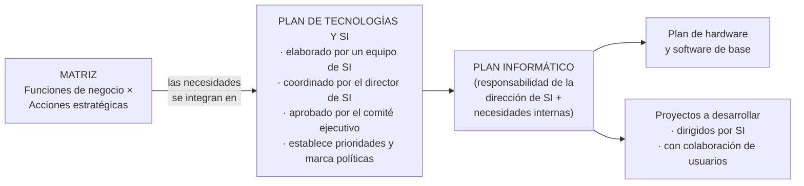

# Matriz de necesidades

Herramienta central del cruce estratégico: **filas = funciones de negocio por departamento**, **columnas = acciones estratégicas** de la empresa. Las intersecciones marcan **necesidades de información**.

- Los sistemas resultantes **deben servir a los departamentos** y **deben apoyar la estrategia**.
- Mecanismos de control: responsabilidad de las subdirecciones generales y del Comité de TI/SI.
- Ejemplo del cruce: estrategia "mejorar la atención al cliente" × proceso "gestión de ventas" → necesidad: *"mostrar al vendedor el historial de reclamos del cliente en tiempo real"*.

## 🔗 Relacionado
- [[Procedimiento de alineamiento (4 fases)]] · [[Alineamiento E.O. – E.SI-TI (esquema general)]]
