# Procedimiento de alineamiento del Plan de TI/SI (Andreu)

> [!quote] Qué debe lograr
> "Integrar las **necesidades de información** emanadas del **cruce de las directrices estratégicas** de la empresa **con las funciones y procesos de negocio** de las distintas unidades organizativas."

Metodología **"pasiva"**: los TI/SI se adaptan a una estrategia de negocio **ya definida**. Asume empresa mediana/grande con un SI inicial en funcionamiento.

```mermaid
flowchart TD
    F1["<b>FASE I — Presentación y compromiso del equipo</b><br/>I.1 Decisión de obtener el Plan; se crea el Comité TI/SI<br/>I.2 Formación del Grupo Base<br/>I.3 Identificación de áreas de análisis<br/>I.4 Equipo de trabajo definitivo + presentación del proyecto<br/>👥 Comité + Grupo Base → 📄 Equipo definitivo"]
    F2["<b>FASE II — Descripción de la situación actual (¿dónde estoy?)</b><br/>II.1 Funciones y procesos de negocio por área (validados por directores)<br/>II.2 Sistemas existentes: procesos y estructuras de datos (inputs/outputs)<br/>II.3 Crítica TÉCNICA y DE NEGOCIO. Validación<br/>II.4 Informe de sistemas existentes<br/>👥 Equipo + departamentos → 📄 Informe de sistemas existentes"]
    F3["<b>FASE III — Elaboración del Plan (¿a dónde quiero ir y cómo?)</b><br/>III.1 Preparación del equipo; posibles nuevas áreas<br/>III.2–III.3 Necesidades por áreas (importancia y urgencia); descripción sistemática<br/>III.4 Integración: estructura del SI emergente<br/>III.5 Validación (departamentos + Comité)<br/>III.6 Informe de la estructura del SI futuro<br/>III.7 3–4 ESCENARIOS alternativos + evaluación de recursos<br/>III.8 Elaboración y APROBACIÓN del Plan definitivo (Comité)<br/>👥 Equipo + deptos; propuestas: personal técnico; aprueba: Comité"]
    F4["<b>FASE IV — Programación de actividades</b><br/>IV.1 Descripción detallada; calendario concreto del PRIMER AÑO<br/>IV.2 Proyectos al presupuesto del período siguiente<br/>IV.3 Plan de evaluación y revisión (iteraciones)<br/>👥 Elabora: personal de SI · Aprueba: Comité → 📄 Calendario 1er año"]
    F1 --> F2 --> F3 --> F4
```

## Detalles finos por fase (nivel anexo)
- **Fase I:** arranca típicamente tras **quejas generalizadas** de los usuarios; sin compromiso explícito del Director General, nadie colabora. Incluir personal **no informático** garantiza la perspectiva de negocio.
- **Fase II:** catálogo de funciones en **dos niveles** (media docena de funciones macro por área + subprocesos), **validado por los directores funcionales**. Documentar **intervalos de decisión** (donde el software necesita decisión humana). Crítica **técnica** (rendimiento, arquitectura) y **de negocio** (grado de soporte real, quejas). Herramientas: **matrices** procesos×datos, **diccionario de datos**.
- **Fase III:** necesidades relevadas con [[Factores Críticos de Éxito (Rockart)|Factores Críticos de Éxito (Rockart)]], **atomización** de pedidos ("necesito un sistema nuevo" está prohibido: se desglosa en datos concretos) e identificación "al vuelo" de entidades y procesos. Integración: alinear con la cadena de valor, agrupar en subsistemas con **fronteras limpias**, catalogar sistemas aislados. Escenarios filtrados por **criterios generales** (asimilable organizativamente, digerible por SI, dentro de presupuesto, coherencia técnica, + infraestructura) y **criterios estratégicos** (dictados por la dirección).
- **Fase IV:** calendario **estricto solo para el primer año** (los años 2–5 quedan generales, porque la tecnología cambia). Para la aprobación final del cronograma **ya no es imprescindible el Director General** (las decisiones fuertes se tomaron en Fase III); presenta el subdirector a cargo de SI.

## Características clave (preguntas típicas)
- **Propiedad interna:** lo dirige **personal propio**; consultores solo como apoyo metodológico (el know-how queda en la empresa).
- **Participación activa de la alta dirección** de todas las áreas: no es "proyecto de los informáticos".
- **El filtro estratégico se aplica al FINAL** (Fase III), no al principio: aplicarlo temprano arriesga descartar necesidades vinculadas a procesos vitales.
- **Coste-beneficio "divorciado":** los **técnicos** estiman los **costes**; los **directivos de negocio** justifican y materializan los **beneficios**.
- **Aprendizaje organizativo** como objetivo explícito: el diálogo técnico↔negocio "derriba la pared".
- Empresas chicas: se simplifica fusionando roles, pero manteniendo informe inicial validado, esquema global del SI, plan con calendario y presupuesto, y el espíritu centrado en el negocio.
- Duración: 1–2 semanas a 4–5 meses; el **DOP** controla tiempos y disciplina documental (documentos homogéneos). Herramientas para **documentar y estructurar datos** (catálogos, diccionarios, matrices) — NO herramientas CASE ni de control de proyectos.

## 🔗 Relacionado
- [[Grupos de trabajo del plan]] · [[Plan de TI-SI (contenido)]] · [[Matriz de necesidades]]
- [[Evolución de la planificación de SI (4 fases históricas)]] · [[Cartera de aplicaciones (McFarlan)]] — se usa como diagnóstico y para priorizar
