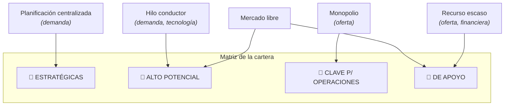

# Estrategias genéricas de gestión de SI/TI (Parsons)

> [!quote] Definición
> "**Marcos generales que guían** la identificación de las oportunidades de la TI, los recursos para desarrollar TI, **el ritmo al que se adoptan las nuevas tecnologías**, el nivel de impacto de la TI dentro de la empresa… las tendencias estructurales que siguen las empresas para aplicar la TI a sus negocios."

Sirven para **vincular la gestión de los SI/TI con la dirección general de la empresa**. Parsons identifica **seis** (basadas en la observación de empresas reales):

1. [[Planificación centralizada]] — demanda, impulsada por el negocio → estratégicas
2. [[Hilo conductor]] — demanda, impulsada por la tecnología → alto potencial
3. [[Mercado libre]] — el usuario decide demanda y aprovisionamiento → alto potencial y apoyo
4. [[Monopolio]] — oferta, control centralizado → clave para las operaciones
5. [[Recurso escaso]] — oferta, limitación financiera → apoyo
6. [[Mal necesario]] — estado disfuncional, sin cuadrante

## Proyección sobre la cartera

> [!tip] Demanda vs Oferta — la regla de oro
> **Demanda = el QUÉ** necesita el negocio (descubrir y priorizar necesidades). **Oferta = el CÓMO** se proveen y controlan los recursos tecnológicos.
> Cuadrantes **superiores** (futuro, oportunidades) → estrategias de **demanda**. Cuadrantes **inferiores** (presente, estabilidad y control) → estrategias de **oferta**. Una estrategia coherente **prioriza primero la demanda**; hacerlo al revés (planificar desde servidores o presupuesto) hace que los usuarios no se apropien del sistema.
> Eje horizontal de la proyección: planificación centralizada y monopolio = **centralizadas**; mercado libre y recurso escaso = **descentralizadas**.

> [!warning] El mayor error
> Intentar administrar **todos** los sistemas con una única regla universal. Cada cuadrante exige su estrategia.

**Cuestionario:** responde la **P5**.

## 🔗 Relacionado
- [[Cartera de aplicaciones (McFarlan)]] · [[Estrategia de SI vs Estrategia de TI]]
