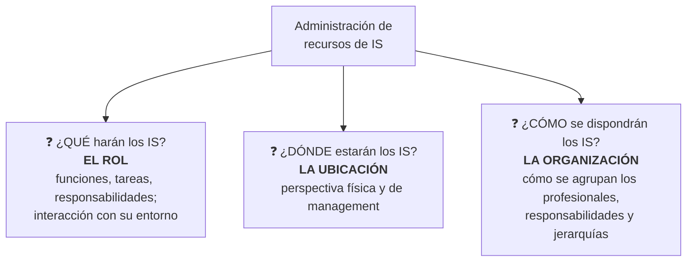

# Administración de los recursos de IS

> [!warning] Aclaración de la cátedra
> En esta unidad, **"IS" hace referencia al ÁREA de sistemas** (el departamento), **no a las aplicaciones**.

Consiste en resolver **tres temas específicos**:

| Tema | Nota |
|---|---|
| El **rol** | [[Rol de los IS]] |
| La **ubicación** | [[Ubicación de los IS]] · [[Centralizados vs no centralizados]] |
| La **organización** | [[Organización de los IS (enfoques estructurales)]] |

**Cuestionario:** responde la **P8**.

## 🔗 Relacionado
- [[Recursos organizacionales]] · [[Valor de la información e inversión en IS]]
