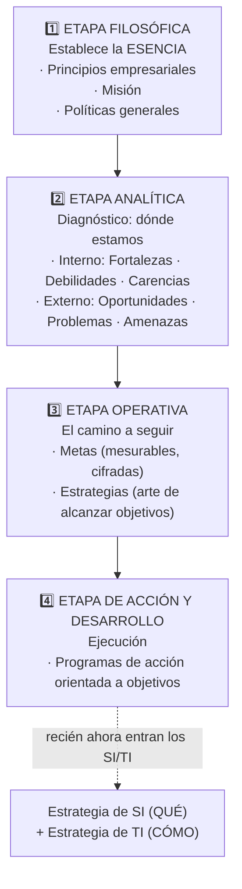

# Planificación estratégica del negocio (Palom Izquierdo)

Antes de que los SI/TI puedan alinearse con el negocio, la empresa debe haber diseñado su **estrategia general**. Palom Izquierdo distingue **cuatro etapas** esenciales:

## Detalles de cada etapa

### 1️⃣ Filosófica — la ESENCIA
- **Principios empresariales:** sistema de valores que guía los actos; reflejan las convicciones y el compromiso frente a la sociedad.
- **Misión:** objetivo central que da sentido y razón de ser. Debe ser **dinámica, orientada al futuro** y describir la dirección general.
    > ⚠️ **Dato clave:** la misión **no debe referirse a resultados económicos**, sino al **valor que la empresa proporciona a la sociedad**.
- **Políticas generales:** acuerdos que canalizan razonamientos, decisiones y acciones.

### 2️⃣ Analítica — DÓNDE ESTAMOS
| Frente | Positivas | Negativas |
|---|---|---|
| **Interno** (recursos de la organización) | **Fortalezas** — ventajas diferenciales a explotar | **Debilidades** — desventajas competitivas actuales · **Carencias** — recursos que faltan **para el futuro** |
| **Externo** (entorno) | **Oportunidades** — factores que pueden mejorar la situación | **Problemas** — impacto negativo actual · **Amenazas/Riesgos** — factores latentes de gran magnitud |

### 3️⃣ Operativa — EL CAMINO
- **Metas:** resultados importantes deseados, **específicos y mesurables** (cifrados).
- **Estrategias:** *"el arte o la manera de alcanzar los objetivos"* → elegir alternativas que aprovechen las **fortalezas** en las zonas de **oportunidad**.

### 4️⃣ Acción y desarrollo — EJECUCIÓN
**Programas de acción orientada a objetivos:** documentos detallados que reflejan **qué tareas** se harán, **en qué orden**, **quién es responsable**, **cómo**, **en qué plazos**, **con qué costo** y **qué resultado prevén**. Es el instrumento fundamental de organización y control.

## Tips de identificación (para el examen)
- "Sistema de valores / convicciones frente a la sociedad" → **Principio**
- "Objetivo central, razón de ser, orientado al futuro" → **Misión**
- "Documento con tareas, orden, responsables, plazos, costos" → **Programa de acción orientada a objetivos**
- "Algo interno que la empresa NO posee y necesitará para el futuro" → **Carencia**
- "Algo interno donde la empresa ya falla hoy" → **Debilidad**

## 🔗 Relacionado
- [[Alineamiento E.O. – E.SI-TI (esquema general)]] · [[Estrategia de SI vs Estrategia de TI]]
- [[Contexto de la estrategia SI-TI (Edwards)]] — el análisis interno/externo se retoma acá
