# ASI · U1 — Planificación Estratégica de los SI/TI (Súper Resumen)

> [!info] Datos de la unidad
> **Materia:** Administración de Sistemas de Información — 4° Nivel, ISI, UTN FRRe
> **Bibliografía:** Chiavenato, *Administración de Recursos Humanos*, cap. 1 y apertura de la Parte II (M1) · Andreu, Ricart y Valor, *Estrategia y Sistemas de Información*, caps. 2, 3 y 5 (M2) · Edwards, Ward y Bytheway, *Fundamentos de los Sistemas de Información*, caps. 4, 5 y 6 (M3) · Robson T4 cap. 9 "Management de recursos de IS" (M4) · Robson T3 cap. 7 "Valor de la información e inversión en IS" (M5). Detalle en [[Bibliografía U1]].
> **Cómo se armó:** cada concepto se verificó primero contra el libro (con página) y después se contrastó con los apuntes de alumnos (Apunte Supremo, Apunte Yoel, cuestionarios y finales). Donde un apunte contradice al libro, gana el libro y queda marcado con `⚠️`.
> Cada sección indica a qué pregunta responde con la etiqueta `[Pn]` (cuestionario II, 18 preguntas) o `[CI.n]` (cuestionario I, Chiavenato). Checklist: [[Preguntas]].

## 🗺️ Mapa de la unidad

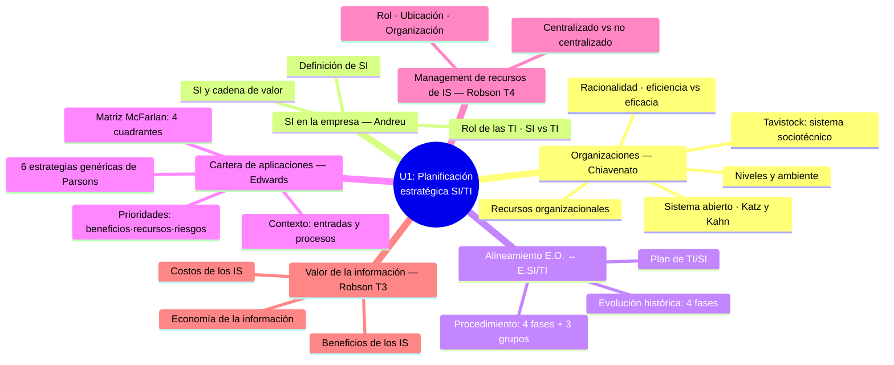

> [!tip] El hilo conductor de la unidad
> **Organización** (sistema abierto sociotécnico) → el **SI** es la actividad de soporte que la sostiene → la **estrategia de SI/TI** se deduce de la estrategia del negocio (**alineamiento**) → se gestiona con una **cartera de aplicaciones** y una **estrategia genérica** → se **administra** (rol, ubicación, organización) → y se **justifica** (costos, beneficios, valor).

---

# 1. Las organizaciones (Chiavenato)

> Preguntas del Cuestionario I de la unidad: `[CI.1]` esquema de Tavistock · `[CI.2]` recursos de la administración y su relación con los SI · `[CI.3]` racionalidad, eficacia y eficiencia · `[CI.4]` recursos de un SI. *(Fuente: Chiavenato, Administración de Recursos Humanos, 5ª ed., cap. 1 "Las organizaciones", pp. 7-53; los recursos organizacionales están en la apertura de la Parte II, pp. 126-132.)*

## 1.1 Concepto y sistemas abiertos

> [!quote] Definición (Chiavenato, p. 7)
> Una organización es un **sistema de actividades conscientemente coordinadas, formado por dos o más personas**, cuya cooperación recíproca es esencial para su existencia.

Solo existe cuando: **(1)** hay personas capaces de comunicarse, **(2)** dispuestas a actuar conjuntamente, **(3)** que desean un objetivo común. Existe para **superar las limitaciones individuales**.

**Organizaciones complejas** (pp. 9-10): complejidad (horizontal y vertical) · anonimato · rutinas estandarizadas · estructuras personalizadas no oficiales (organización informal) · especialización · tamaño.

| Era (Cuadro 1.2, p. 14) | Período | Rasgo |
|---|---|---|
| Industrialización **clásica** | 1900-1950 | Funcional, burocrática, piramidal; Teoría X; personas = factores de producción (*relaciones industriales*) |
| Industrialización **neoclásica** | 1950-1990 | Estructura **matricial**; transición; personas = recursos vivos (*ARH*) |
| **Información / conocimiento** | 1990- | Fluida, flexible, equipos interfuncionales; Teoría Y; cambio rápido e imprevisible; **el recurso más importante es el conocimiento**, no el capital financiero |

La organización es un **sistema abierto**: un sistema es un conjunto de elementos dinámicamente relacionados que desarrollan una actividad para un objetivo, con **4 elementos**: **entradas** (importación) → **procesamiento** (conversión) → **salidas** (exportación) + **retroalimentación** (acción de las salidas sobre las entradas para mantener el equilibrio).

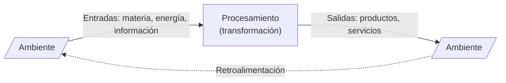

| | **Sistema cerrado** (mecánico, determinista) | **Sistema abierto** (orgánico) |
|---|---|---|
| Entradas/salidas | Pocas, conocidas, causa-efecto | Numerosas, indeterminadas |
| Fronteras | Cerradas | Abiertas y permeables |
| Ejemplos | Motores, máquinas | **Organizaciones y empresas**, seres vivos |

El sistema abierto logra un **equilibrio dinámico** en continua interacción con el ambiente y evita la **entropía** (desorden y desintegración). **Katz y Kahn** (pp. 20-23) le atribuyen 8 características: **(1)** importación-transformación-exportación de energía · **(2)** ciclos de eventos · **(3)** **entropía negativa** · **(4)** información como insumo, retroalimentación negativa y codificación · **(5)** estado de equilibrio y **homeostasis** dinámica · **(6)** **diferenciación** · **(7)** **equifinalidad** (distintos caminos, mismo estado final) · **(8)** límites o fronteras.

> [!info] Empresa
> Toda iniciativa humana que reúne e integra recursos humanos y no humanos para lograr el **autosostenimiento** y obtener **ganancias** produciendo y comercializando bienes o servicios (p. 15).

**Participantes y objetivos** (pp. 27-33): los miembros son gerentes y empleados, proveedores, clientes y usuarios, gobierno y sociedad, en un proceso continuo de **colaboración-competencia** con límites flexibles. Los objetivos **orientan, legitiman, sirven de estándar de evaluación y de unidad de medida de la productividad**; la empresa tiene varios simultáneamente y son dinámicos.

→ [[Organización (concepto y sistemas abiertos)]] · [[Enfoque de Katz y Kahn]] · [[Participantes y objetivos organizacionales]]

## 1.2 El enfoque de TAVISTOCK — el sistema sociotécnico

> Preguntas: `[CI.1]`

> [!quote] Definición textual (Chiavenato, p. 27)
> "El enfoque sociotécnico concibe la organización, o una parte de ella, como una **combinación de tecnología** (exigencias de la tarea, ambiente físico, equipo disponible) y, al mismo tiempo, como **sistema social** (sistema de relaciones entre quienes realizan la tarea)."

Es **otra manera de estudiar el sistema abierto**, dando importancia a su **proceso de transformación**. Lo propusieron sociólogos y psicólogos del **Instituto Tavistock de Londres** (Trist y colaboradores).

Toda organización cumple una **doble función**:
- **Técnica:** coordinación del trabajo y ejecución de tareas con la tecnología disponible.
- **Social:** interrelacionar a las personas y hacerlas trabajar juntas.

Los dos sistemas **no pueden mirarse aislados**: cualquier modificación en uno repercute en el otro. La tecnología determina casi siempre las características de las personas que se necesitan.

> [!important] Eficiencia potencial vs real (Fig. 1.3, p. 24)
> El **sistema tecnológico** es responsable de la **eficiencia potencial**; el **sistema social**, de **convertirla en eficiencia real**.

**Esquema conceptual (CI.1)**, tres subsistemas:

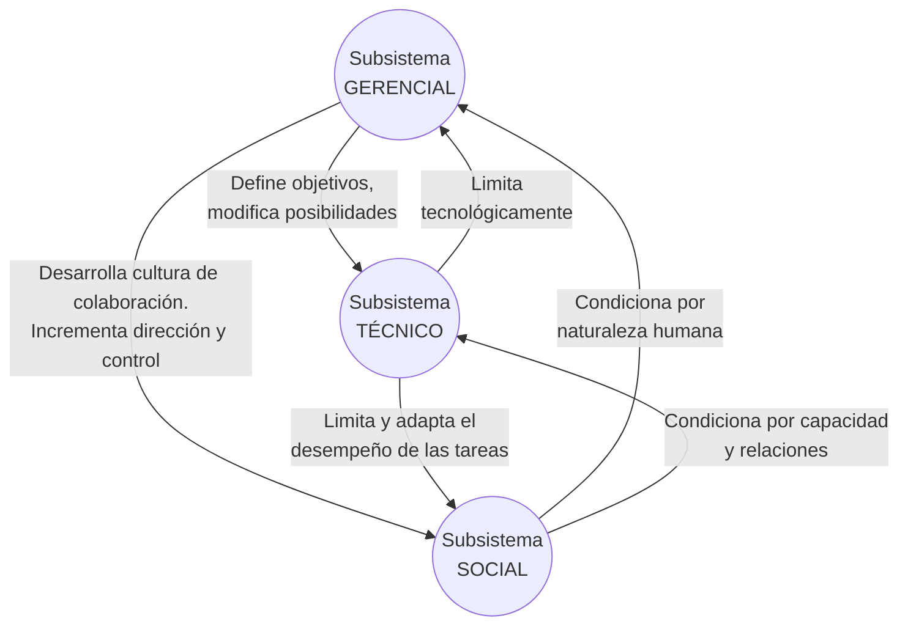

| Subsistema | Qué incluye | Rol |
|---|---|---|
| **Técnico o de tareas** | Flujo de trabajo, tecnología utilizada, roles que exige la tarea | Responde por el flujo de información técnica para los objetivos; **limita y adapta** al sistema social |
| **Gerencial o administrativo** | Estructura organizacional, políticas, procedimientos, reglas, recompensas y castigos, toma de decisiones | Garantiza la administración; **optimiza la relación entre el técnico y el social** hacia las metas |
| **Social o humano** | Cultura organizacional, valores y normas, necesidades personales, organización informal, motivación | El **grado de cooperación** determina los resultados operacionales |

**Fig. 1.4 (diagrama de Venn):** gerencial ("administración organizacional"), técnico ("conceptos de sistemas") y social ("ciencias del comportamiento"). Intersecciones: gerencial ∩ social = **relaciones de tareas** · gerencial ∩ técnico = **desempeño de tareas** · social ∩ técnico = **procesos de tareas** · centro = **riesgo, complejidad, incertidumbre**.

> [!important] Idea central de Tavistock
> Todo sistema de producción necesita una **organización tecnológica** (equipos y procesos) *y* una **organización del trabajo** (las personas). La tecnología condiciona y limita la organización del trabajo, pero ésta tiene características sociales y psicológicas **propias e independientes** de la tecnología. Los objetivos solo se logran si hay **integración** de los subsistemas.

> [!note] Sobre el esquema con flechas
> Es la síntesis de los alumnos del cuestionario: las flechas G→T, G→S, T→S y S→T son casi textuales del libro (p. 26); T→G y S→G son lecturas de los alumnos. La figura del libro es el Venn.

→ [[Enfoque de Tavistock]]

## 1.3 Los recursos organizacionales

> Preguntas: `[CI.2]` `[CI.4]`

> [!quote] Definición textual (Chiavenato, p. 127)
> "Los recursos son **medios que las organizaciones poseen para realizar sus tareas y lograr sus objetivos**: son bienes o servicios utilizados en la ejecución de las labores organizacionales." **Sin recursos no pueden lograrse los objetivos.**

La visión tradicional (naturaleza, capital, trabajo) es "demasiado simplista": trata al proceso productivo como sistema cerrado. Los recursos organizacionales se clasifican en **cinco grupos** (Fig. II.1):

| Recurso | Contenido | Clave | Lo administra | Equivalencia |
|---|---|---|---|---|
| **Físicos o materiales** | Espacio físico, terrenos, edificios, proceso productivo, tecnología, métodos | **Operaciones básicas** | Producción | *Materials* |
| **Financieros** | Capital, flujo de caja, créditos, ingresos, inversiones, financiación | **Garantizan los medios para adquirir los demás**; definen en parte la eficacia | Finanzas | *Money* |
| **Humanos** | Personas, en todos los niveles | **Único recurso vivo y dinámico**; decide el manejo de los demás; presente en todas las áreas y niveles | RRHH | *Man* |
| **Mercadológicos** (comerciales) | Mercado de clientes, investigación de mercado, ventas, promoción, publicidad, precios | **Sin ellos de nada sirven los demás**: sin clientes se pierde la razón de existir | Marketing | *Marketing* |
| **Administrativos** | Medios con los que se **planean, dirigen, controlan y organizan** las actividades; **toma de decisiones y distribución de la información necesaria**; coordinación e integración | Medios de coordinación e integración del resto | Administración general | *Management* |

> [!tip] Mnemotecnia propia
> Las 5 M de la figura: **M**aterials, **M**oney, **M**an, **M**arketing, **M**anagement.

**Recursos de la administración y los SI `[CI.2]`:** los recursos administrativos incluyen la **toma de decisiones** y la **distribución de la información**; el SI (Andreu, Ricart y Valor) recopila, elabora y distribuye información y **apoya la toma de decisiones** → el SI es el **instrumento** con que se cumplen esas funciones y se integran los demás recursos. *Chiavenato no nombra al SI en esta sección: la relación es la unión de las dos fuentes.*

**Recursos de un SI `[CI.4]`:** según Robson T4 (cap. 9, p. 18) el recurso de IS "constituye **un negocio en sí mismo**" y su administración implica los mismos aspectos que la de una empresa. La respuesta de los alumnos enumera **Hardware, Software, Recursos Humanos y los mecanismos para administrarlos**; esa enumeración **no está en los libros**.

> [!warning] Ojo con los apuntes de alumnos
> El **DSS** de la respuesta de CI.2 es un agregado (viene de Robson T3), no de Chiavenato. Y los recursos organizacionales **no son del cap. 1**: son de la Parte II del libro.

→ [[Recursos organizacionales]]

## 1.4 La racionalidad de las organizaciones

> Preguntas: `[CI.3]`

> [!quote] Definición textual (Chiavenato, p. 33)
> "La racionalidad implica **adecuar los medios utilizados a los fines y objetivos que se desean alcanzar**."

- En la **teoría burocrática** equivale a **eficiencia**: escoger los medios más eficientes, considerando **solo los objetivos organizacionales**, mediante **normas y reglamentos**.
- Se basa en **causa y efecto**: un procedimiento es racional si es **coherente con el objetivo**.
- Se emplea para **reducir medios** (uso mínimo de recursos) o cuando **los fines determinan el comportamiento** (adecuación de recursos).
- **La eficiencia es resultado de la racionalidad**: fijados los objetivos, la racionalidad descubre los medios más adecuados. **E = P / R**.
- Dimensiones múltiples que pueden **entrar en conflicto**: **económica, legal, social, política, técnica**.
- Una organización racional **no implica miembros que actúen racionalmente** (engranajes de una máquina).

### Eficiencia vs Eficacia (¡clásico de examen!)

| | **Eficiencia** | **Eficacia** |
|---|---|---|
| Fórmula del libro | **Cómo** se hacen las cosas | **Para qué** se hacen; qué resultados y objetivos se logran |
| En una frase | Hacer **bien** las cosas | Hacer las cosas **correctas** |
| Se enfoca en | Los **medios** | Los **fines y resultados** |
| Medida | Relación técnica **entradas/salidas**, costos-beneficios; utilización de recursos | Capacidad de **satisfacer una necesidad social**; logro de resultados |
| En SI (Robson) | Producir un sistema al menor costo posible | Elegir **qué** sistema construir (*efectividad*) |

Toda organización debe considerarlas **simultáneamente**, pero **no siempre van de la mano** (Cuadro 1.4): se puede ser eficiente y no eficaz (éxito precario), eficaz y no eficiente (objetivos logrados con desperdicio), ninguna de las dos, o **ambas (el ideal)**.

**Relación racionalidad - eficiencia - eficacia `[CI.3]`:** la racionalidad es adecuar medios a fines; la **eficiencia es su resultado** (los medios); **el logro de los objetivos no es competencia de la eficiencia sino de la eficacia**, que verifica que lo bien hecho sea lo que debía hacerse.

> [!warning] Ojo con los apuntes de alumnos
> La respuesta del cuestionario propone **pasos** ("primero adaptar medios a fines, y una vez alcanzados aplicar técnicas en búsqueda de la eficiencia") y liga la racionalidad a la eficacia. **No está en el libro**: para Chiavenato la racionalidad busca la eficiencia desde el principio y la eficiencia es su resultado. Tampoco es del libro que la racionalidad "decide qué objetivo se quiere lograr" (Apunte de Yoel): los objetivos se fijan primero.

**Eficacia organizacional** (pp. 48-52): la eficacia administrativa (moral, baja rotación, buenas relaciones, adaptación…) lleva a la eficacia organizacional, que requiere tres condiciones: **(1)** alcance de objetivos empresariales, **(2)** mantenimiento del sistema interno, **(3)** adaptación al ambiente externo.

→ [[Racionalidad de las organizaciones]] · [[Eficiencia vs Eficacia]]

## 1.5 Ambientes y niveles organizacionales

> [!quote] Ambiente (p. 39)
> Todo lo que rodea a la organización y le proporciona recursos; también es fuente de contingencias y amenazas.

- **Macroambiente (general):** factores económicos, tecnológicos, sociales, políticos, legales, culturales, demográficos; **escapan al control y la previsión** de las organizaciones.
- **Microambiente (de tarea):** el más próximo; de él se obtienen las entradas y en él se colocan las salidas. Contiene **proveedores, clientes, competidores y organismos reguladores**. Es "una espada de dos filos".
- Tres características del ambiente: **complejidad creciente → cambio permanente → incertidumbre**.

| Ambiente de tarea | Estable | Inestable |
|---|---|---|
| **Homogéneo** | Cuad. 1: simple y previsible → estructura sencilla, modelo burocrático | Cuad. 3: simple pero imprevisible → estructura sencilla, modelo **adhocrático** |
| **Heterogéneo** | Cuad. 2: complejo y previsible → estructura diferenciada, modelo burocrático | Cuad. 4: **complejo e imprevisible** (el más retador) → diferenciada, **adhocrático** |

La dinámica (estable/estático ↔ cambiante/inestable) y la complejidad (homogéneo ↔ heterogéneo) son *continuums*. Las organizaciones se están alineando hacia el **cuadrante 4**.

| Nivel (Chiavenato, pp. 37-38) | Características | Lógica / busca | Beneficio SI asociado (Silk, en Robson T3 p. 44; se cruza en §9.3) |
|---|---|---|---|
| **Institucional (estratégico)** | Directores y altos ejecutivos; decisiones, objetivos y estrategias; **periférico, orientado al exterior**; enfrenta la **incertidumbre** | Sistema **abierto**; busca **eficacia** | *Avance estratégico* / competitividad |
| **Intermedio (táctico)** | Mandos medios; **articula** cúpula y base, convierte estrategias en programas de acción, **amortigua la incertidumbre** | Entre ambos | *Efectividad* (ej. DSS) |
| **Operacional (núcleo técnico)** | Tareas y operaciones diarias; rutinas y procedimientos estandarizados; **certeza y previsibilidad** | Sistema **cerrado**; busca **eficiencia** | *Eficiencia* |

> [!note] Sobre la última columna
> Es de Robson/Silk, no de Chiavenato: la matriz es de 3x3 (el libro ejemplifica con un DSS, beneficio de efectividad percibido en el nivel táctico) y la asociación diagonal es una simplificación. Chiavenato no habla de "corto" o "largo plazo".

→ [[Ambiente organizacional]] · [[Niveles organizacionales (Chiavenato)]]

---

# 2. Los SI en la empresa (Andreu, Ricart y Valor)

> Preguntas: `[P1]` `[P2]`
> Fuente: Andreu, Ricart y Valor, *Estrategia y Sistemas de Información*, **cap. 2** (pp. 11-23), **cap. 3** (pp. 25-37) y **cap. 4** (pp. 39-40). La distinción *estrategia de SI / estrategia de TI* es de **Edwards, cap. 4** (pp. 32-35).

## 2.1 Definición de Sistema de Información

> Preguntas: `[P1]`

> [!quote] Definición textual (¡memorizar!) — Andreu, p. 13
> "El **conjunto formal de procesos** que, operando sobre una **colección de datos estructurada de acuerdo con las necesidades de una empresa**, recopila, elabora y distribuye (parte de) la información necesaria para la **operación** de dicha empresa y para las actividades de **dirección y control** correspondientes, apoyando al menos en parte, la **toma de decisiones** necesaria para desempeñar las **funciones y procesos de negocio** de la empresa **de acuerdo con su estrategia**."

**De dónde sale (Fig. 2.1):** del flujo de información entre las partes de la empresa y con su entorno. **Transacciones** = actividades operativas básicas que a menudo involucran interacciones con el entorno; sirven para **coordinar acciones operativas** y **registrar** una base de información. La información se necesita en todo el ciclo **planificación → diseño y ejecución de acciones → control**.

| Elemento | Qué aclara Andreu (pp. 13-15) |
|---|---|
| **Formal** | Solo la parte **claramente definida**, que la empresa conoce y sabe usar. Los SI informales importan, pero son **menos estudiables, planificables y dirigibles** |
| **Colección de datos estructurada** | Los datos reflejan la **percepción de quienes los usan** → los **usuarios participan en el diseño** de la estructura de datos (la futura **BD**, "componente muy importante de todo SI") |
| **Operación + decisiones + control** | No solo coordinar acciones operativas: también **ayudar a decidir** y **ejercer el control** |
| **Funciones, procesos y estrategia** | El SI está **al servicio del negocio**: es *uno más* de los elementos que la empresa diseña para sus objetivos y se **coordina explícitamente** con ellos |

> [!important] El "para qué"
> La definición se centra en el **PARA QUÉ** del SI, **más que en el cómo o el qué** (p. 15): que fluya la información que coordina lo operativo; que llegue **a tiempo y organizada** para decidir con conocimiento de causa; y que quien controla detecte **la primera desviación relevante entre lo previsto y lo real**. Es **perspectiva de negocio, no tecnológica**.

**Implicaciones de la definición (Resumen, p. 23; cap. 4, p. 39):**
1. El SI es un sistema más **al servicio de la empresa y sus objetivos**: **no es independiente de su estrategia**; se planifica y diseña para contribuir a ponerla en práctica (puede diseñarse **después** de la estrategia o **al mismo tiempo**; apoyo **pasivo** o elemento **activo**).
2. Hay que distinguir el **SI básico** de los **subsistemas circunscritos**. El básico forma parte de la **infraestructura**, no pertenece a ninguna unidad organizativa → **punto de vista global**.
3. El SI es **interdependiente** con los demás sistemas de la infraestructura y forma con ellos un **conjunto equilibrado** → **amplitud de miras** (más que la circunscrita a los SI).
4. Estructura y funciones coherentes con la estrategia; planificación y diseño con **acceso a los objetivos estratégicos** (no "dejar hacer a los expertos en tecnología"); **equilibrio operativo** con el resto de sistemas (SI posiblemente **más modestos** que lo técnicamente factible); gestión desde una **perspectiva amplia** → **involucra a la dirección**.

## 2.2 El SI en el contexto de la cadena de valor

> Preguntas: `[P1]`

**La cadena de valor (Porter)** es, para Andreu, un **esquema descriptivo** de las actividades de la empresa (Fig. 2.2, p. 16):
- **Actividades de línea o básicas:** tienen que ver **directamente con la creación de valor** (logística de entrada, operaciones, logística de salida, comercialización y ventas, servicio).
- **Actividades de soporte:** aquellas en las que las anteriores **se apoyan para coordinarse y compartir información** (infraestructura de la empresa, dirección de RRHH, desarrollo de tecnología, compras).

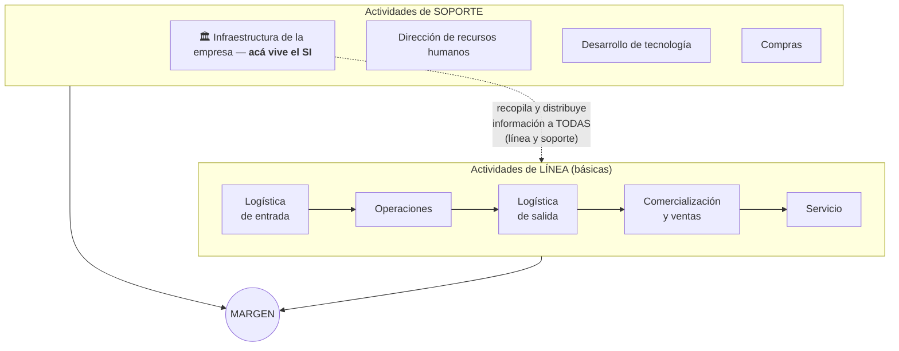

**Respuesta a la P1 — ubicación y función (Fig. 2.2-a, pp. 15-18):**
1. **Ubicación:** de la definición, *el SI forma parte precisamente de la **infraestructura de la empresa*** (soporte) → **todas las actividades de línea precisan apoyo basado en el SI**.
2. **Alcance:** como las actividades de soporte **"se apoyan entre sí"**, el SI **interactúa con todas las demás** (básicas o de soporte) **"en grado no trivial"**.
3. **Función:** todas las actividades **necesitan y generan información**; el SI **recopila** la que generan unas y necesitan otras y **la distribuye** a cada actividad.
4. **Coordinación** a todos los niveles: **básicas entre sí** (pedidos a producción en una empresa que fabrica sobre pedido), **básicas con soporte** (cualquier actividad de control) y **soporte entre sí** (seguimiento del personal de actividades de soporte). Papel **central**.
5. **Propiedad global:** la información "**no pertenece a ninguna actividad en particular; pertenece a la empresa considerada globalmente**" (p. 18).
6. **Vínculos** (*influencias mutuas, a veces indirectas, entre actividades*): ej.: recopilar las **reclamaciones de clientes** orienta el **control de calidad** en operaciones. Exige **punto de vista global**; **en casos extremos permite reconfigurar la cadena de valor** → nuevos enfoques y **ventajas competitivas**. Por eso el SI influye también en el **diseño de la organización** (idea cercana a la **reingeniería de procesos de negocio**: actividades relacionadas por vínculos mejorables radicalmente con TI, con un **cliente** identificado).

> [!tip] Conclusión sugerida para P1
> El SI es **infraestructura** de la empresa: da apoyo a las actividades de línea e interactúa con todas; **recopila, distribuye y coordina** la información entre ellas; esa información es **de la empresa** (no de un área), por lo que su planificación es **global**, alineada con la estrategia y responsabilidad de la **dirección**. La **TI** no define esa ubicación: es el medio de implementación (§2.3).

**SI básico vs subsistemas circunscritos (Figs. 2.2-b a 2.2-d, pp. 18-20):**
- **Circunscritos:** una actividad procesa volúmenes de información en **un grado de detalle que nadie más necesita**. **No forman parte del SI básico**, aunque se implementen con TI: se planifican, diseñan, financian y usan **desde la perspectiva de esa actividad** ("como un torno o un horno"). Ejemplos: ordenadores que **gobiernan máquinas-herramienta** o controlan una **refinería en tiempo real**.
- **Criterio:** que sean **lo más independientes posibles** de la información que otras actividades usan (inputs/outputs). **Contabilidad NO** es circunscrita: todos los apuntes se generan en otras áreas.
- Si usan/generan información para otras actividades **en volúmenes poco importantes**, acaban con **interfaces claras** con el SI básico (2.2-b). Si **se solapan** y coordinan varias actividades, **su conjunto es parte del SI básico** (2.2-c; típico en **bancos y aseguradoras**); pueden **coexistir** con un SI básico grande (2.2-d). Depende del **grado de detalle** con que se describa la cadena.
- **Terminología:** **SI** = el básico; **TI/SI** = todos los subsistemas, incluidas las aplicaciones específicas de TI a actividades concretas.

**El SI y los demás sistemas de la empresa — el *equilibrio* (2.4, Fig. 2.3, adaptada de Hax y Majluf, 1984):** la infraestructura = **sistema de planificación · sistema de control · estructura de la organización · sistemas de información/comunicación · sistemas de compensación e incentivos** (sobre **aspectos humanos** y **cultura**). Hay **interdependencia total**. El SI debe ser **coherente internamente** (equilibrio) **y con los objetivos** de la empresa. **Todo cambio** en un elemento rompe el equilibrio y dispara un "retorno al equilibrio": los cambios deben ser **muy equilibrados** o **muy modestos y espaciados**.

> [!warning] Ojo con los apuntes de alumnos
> - El **margen** como "valor creado menos costos" (Supremo) es de Porter: Andreu solo lo dibuja. La P1 se responde con lo que dice **Andreu**.
> - Una versión anterior hablaba de "dirección general / funcional / operativa" soportadas por el SI: **no está en el libro**.

## 2.3 El rol de las TI y su relación con los SI

> Preguntas: `[P2]`

> [!quote] Idea central (Andreu, cap. 3, pp. 25-27)
> La **necesidad inicial se plantea en términos de SI**; por eso la influencia de la tecnología en la implementación, diseño y planificación del SI es **"solamente coyuntural"**. Pero sería **poco realista** decir que la tecnología es irrelevante: **es relevante y puede llegar a serlo mucho**.

**TI** (definición de los apuntes): *conjunto de recursos tecnológicos utilizados para implementar los SI* (de mínima: **aplicaciones, comunicaciones y dispositivos** de acceso). Andreu las llama "la informática y afines". *(La fórmula exacta no está textual en el cap. 3.)*

**Relación SI ↔ TI (respuesta a la P2):**
1. **Punto de contacto:** la TI da **soluciones claras** a problemas de **todo SI**: **almacenar y acceder** a datos según pautas difíciles de anticipar; **tratar datos rápido y con pocos errores**; **comunicaciones automáticas**.
2. **Pero implementar SI con TI no fue un "camino de rosas"** (Fig. 3.1): no entender lo que la TI puede hacer lleva a implementaciones "ridículas".
3. **La tecnología NO es neutral:** aporta **su propia "idiosincrasia"** → muchas veces **no se puede hacer lo mismo que antes, solo con otra tecnología**. No hay que sucumbir indefectiblemente, pero sí **tenerla en cuenta**.
4. **A veces conviene prescindir de la tecnología** si sus aportaciones **no justifican los sacrificios de adaptación**.
5. **Replantear cómo se hacen las cosas** puede dar: **(1)** mejores maneras de hacerlas, o **(2)** forzar a hacerlas **peor** (*más eficientes, quizá menos efectivas*).
6. **Alguien en la estructura organizativa debe responsabilizarse de estar al día** de las cambiantes posibilidades de las TI, con **actitud crítica desde las necesidades de SI** (= de la empresa).
7. **Dos extremos a evitar** (§3.7): dejarse llevar por **modas** (hacer lo mismo con nueva tecnología) o **cambiar la forma de trabajar solo porque la tecnología lo exige**. *"No hablemos de real time sino de **real enough time**"*.

> [!tip] Las 4 afirmaciones del Cuestionario II (P2)
> Los alumnos listan: (a) **no neutral**, (b) **a veces conviene prescindir**, (c) **replantear la implementación**, (d) **alguien al día**. **Las cuatro están en el libro** (p. 26-27). Para redondear agregá: **definición de TI**, **necesidad planteada en términos de SI**, **punto de contacto inicial** y los **dos resultados** (mejor / peor).

**Aportes históricos de las TI a los SI (Resumen §3.7, p. 36-37):**

| Aporte | Idea clave |
|---|---|
| **1. Base de Datos (§3.2-3.4)** | **Todos los datos en un único lugar, sin redundancias, con una estructura única "natural" y acceso "natural"**. Da **disciplina** (depura datos), **visión global única** (consenso entre departamentos) y **estructura el SI** alrededor de la BD → los **responsables de negocio participan en su diseño**. Aire **centralizador recomendable** (los datos son de la empresa). **Descentralización a partir de la BD:** PC y herramientas personales conectados a la BD central (**cliente-servidor**); las colecciones **locales** quedan circunscritas al usuario y **no deben usarse para tratamientos de alcance empresarial** |
| **2. Secuencias de proceso vs intervalos de decisión → DSS (§3.5)** | ver cuadro abajo |
| **3. Aprendizaje organizativo (§3.6)** | Incorporar TI **rompe el equilibrio** (Fig. 2.3): hay que **anticiparse** (cambios incrementales) o fracasa. Es **multidimensional** (SI, control, estructura…) y exige **dirección involucrada** (no delegar en técnicos). **Gibson y Nolan (1974)**, según Andreu cap. 3: **Inicio, Contagio, Control, Madurez** (luego seis); control laxo en Contagio, estricto en Control. Etapas posteriores (Venkatraman, 1991): **reingeniería de procesos** e **innovación en la estructura de sectores** |
| **4. Procesos de negocio / reingeniería** | La TI ayuda a **identificar procesos de negocio y mejorarlos sustancialmente** (proceso de negocio: *conjunto estructurado y medible de tareas relacionadas, con un resultado concreto para algún cliente o mercado*) |

| | **Secuencia de proceso** | **Intervalo de decisión** |
|---|---|---|
| Qué es | Procedimiento de datos **muy bien definido y estable** | Toma de decisiones cuyas necesidades de datos **no se pueden estructurar ni anticipar** con precisión (cambian rápido); **no mecanizable** por requerir al decisor |
| TI | **Se automatiza totalmente** | **DSS**: **ayudar** al decisor (no reemplazarlo); el sistema experto cumple el mismo papel |
| Busca | **Eficiencia** | **Eficacia** |
| Diseño | Convencional | Flexible, **prototipo / aproximaciones sucesivas**, con el **decisor participando** |

Ejemplo (nota al pie, p. 64): el SI da la **lista de impagados**, un **humano decide** si se lanza el apremio, y luego el sistema **imprime las cartas**. → [[DSS e intervalos de decisión]]

**Implicaciones para la dirección (cap. 4, pp. 39-40):** **TI/SI es responsabilidad de la dirección** —incluidos los temas técnicos, aunque se resuelva con "un técnico puro de toda confianza" o directivos que entiendan la tecnología—; las TI pueden apoyar actividades **fuera del SI básico** con implicaciones **estratégicas** → **planificación de TI/SI**. *"Eludirlas no dará luego ningún derecho a quejarse de lo mal que funciona el binomio TI/SI."*

### Estrategia de SI vs Estrategia de TI (Edwards, cap. 4, pp. 32-35 y 46-49) — pregunta de finales

> Preguntas: `[P2]` · final: *"Diferencia estrategia SI y TI"* (3 mesas)

| | **Estrategia de SI** | **Estrategia de TI** |
|---|---|---|
| Lado | **DEMANDA** | **OFERTA** |
| Pregunta | **¿QUÉ?** | **¿CÓMO?** |
| Define | **Necesidades de información y de sistemas** y funciones que la integran; **qué sistemas precisa** la empresa, **en línea con los planes y aspectos críticos**; a partir del análisis de la empresa, su entorno y su estrategia de negocio. Una por negocio + una corporativa | **Cómo satisfacer** esas necesidades **según las prioridades de la estrategia de SI** y la tecnología para **desarrollar y operar** las aplicaciones actuales y futuras: cómo **adquirir, utilizar, controlar y gestionar** recursos **tecnológicos y humanos**, qué actividades y cómo organizarlas |
| Resultado (p. 35) | **Necesidades y prioridades** de información | **Infraestructura de medios y servicios** de distribución |

Juntas dan una **cartera de futuras aplicaciones**. **Primero la demanda, después la oferta** (p. 49); *"decidir lo que queremos hacer antes de decidir cómo hacerlo"*. Si manda la **oferta de TI**, los **usuarios no son propietarios de la estrategia** (ejemplo de la facturación compartida por tres unidades, pp. 46-47).

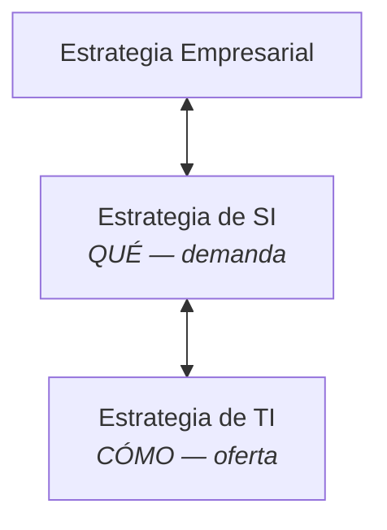

> [!warning] Ojo con la respuesta de los alumnos en los finales
> *"SI = demanda de aplicaciones / TI = oferta de aplicaciones disponibles"*: el eje demanda/oferta está bien, pero el libro **no** habla de "aplicaciones disponibles": la estrategia de TI define **cómo se desarrollan las aplicaciones y cómo se adquieren, usan, controlan y gestionan los recursos tecnológicos y humanos**, **a partir de las prioridades de la estrategia de SI**. Agregá siempre **QUÉ / CÓMO**.

> [!warning] Ojo con los apuntes de alumnos
> - Supremo y Yoel titulan "El Rol de las TI — ROBSON": es **Andreu, cap. 3**, no Robson.
> - No mezclar **P2 (relación SI ↔ TI: el SI es el para qué, la TI el medio)** con **estrategia SI / TI (qué / cómo, demanda / oferta)**: la primera es de **Andreu**, la segunda de **Edwards**.

→ Complementos: [[Estrategias competitivas de Porter]] (bajo coste vs diferenciación → distintas estrategias de SI/TI por unidad; Edwards, pp. 46-47) · [[DSS e intervalos de decisión]].

---

# 3. Alineamiento E.O. ↔ E.SI/TI (Andreu)

> Preguntas: `[P3]` · Final: "Concepto alineamiento" *(Fuente: Andreu, Ricart y Valor, cap. 5 "Procedimientos de alineamiento de los Planes de Tecnologías y Sistemas de Información con la estrategia de negocio", pp. 43-76; Edwards, cap. 4, para los argumentos de P3.)*

## 3.1 La jerarquía del alineamiento

> Preguntas: `[P3]` · Final: concepto de alineamiento

> [!quote] Concepto de alineamiento
> **Alinear** es **deducir explícitamente el Plan de TI/SI del plan estratégico vigente** (Andreu, p. 50), con un procedimiento sistemático que **integra las necesidades de información** surgidas del **cruce de las directrices estratégicas con las funciones y procesos de negocio** de las unidades organizativas (p. 52).
>
> **Respuesta de final:** el alineamiento de las estrategias organizacionales con las de SI/TI tiene como objetivo **desagregar las necesidades de información por departamento, por funciones y por acción estratégica**, para asegurar que cada estrategia de SI/TI esté alineada y contribuya a las estrategias generales de la organización.

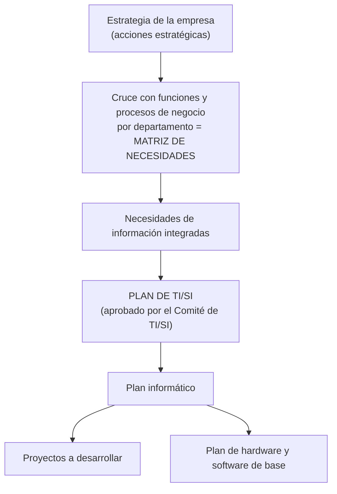

- **Pasivo:** el plan de TI/SI **sigue** a una estrategia ya definida (el procedimiento de Andreu, cap. 5). **Activo:** SI/TI se integran **al formular** la estrategia (Fase IV, Parte III del libro).
- La responsabilidad de elaborar el Plan es de la **dirección de la empresa**, con participación técnica (p. 52).

> [!tip] Esquema de los cuestionarios (P3) — **no es de Andreu**
> Los alumnos responden la P3 con este árbol (no figura en Andreu cap. 5 ni en Edwards cap. 4; viene de material de cátedra/alumnos). La estrategia de SI es **una estrategia funcional más** (como producción o marketing) derivada de la estrategia empresarial:
>
> **Objetivos organizacionales → Estrategia empresarial → [Estrat. de producción | Estrategia de SI | Estrat. de marketing]**; de la Estrategia de SI cuelgan **Estructura de TI** (políticas de datos, comunicaciones y arquitectura), **Estructura de sistemas manuales** (adquisición, control) y **Estrategia de management** (política organizativa).

## 3.2 ¿Por qué deben alinearse los SI con la estrategia?

> Preguntas: `[P3]`

> [!important] Respuesta corta
> Porque el SI **no es un fin en sí mismo**: existe para apoyar las **funciones y procesos de negocio "de acuerdo con su estrategia"**. Sin alineamiento se gasta con criterios ajenos al negocio (expansión anárquica) y se pierde competitividad; con alineamiento, cada inversión en TI/SI responde a una necesidad estratégica.

| # | Argumento | Fuente |
|---|---|---|
| 1 | **Por definición:** el SI apoya la toma de decisiones necesaria para desempeñar las funciones y procesos de negocio **de acuerdo con su estrategia** | Andreu, p. 12 |
| 2 | **Por su lugar en la cadena de valor:** es **actividad de soporte** (infraestructura): su función es dar soporte a las estrategias (respuesta de los alumnos en el cuestionario) | Cuestionarios (P3) |
| 3 | **Por la "pared":** si no se alinea, el depto. de SI asigna recursos por **facilidad de implementación, atractivo tecnológico, poder del solicitante o coste**, criterios que "no tienen por qué ser coherentes con los objetivos estratégicos" | Andreu, p. 46 |
| 4 | **Por sus costos:** la falta de estrategia coherente de SI/TI genera 7 problemas: ventajas para competidores; objetivos inalcanzables por límites de los sistemas; sistemas no integrados; implantaciones tardías y caras por no definir necesidades; prioridades cambiantes; tecnologías que no se integran; falta de criterio para evaluar inversiones y priorizar | Edwards, cap. 4, pp. 32-33 |
| 5 | **Por eficacia estratégica:** unidades con estrategias distintas (**bajo coste** vs **diferenciación**) necesitan SI distintos; un sistema compartido impide que **ninguna** desarrolle su estrategia con eficacia | Edwards, pp. 46-47 |
| 6 | **Por ventaja competitiva:** sin integrar SI/TI al formular la estrategia es difícil lograr ventajas **sostenibles** | Andreu, pp. 48-49 |
| 7 | **Por valor de la inversión:** "adecuación estratégica" es un criterio de valor al priorizar inversiones en IS | Robson T3, cap. 7 |

> [!example] Cierre sugerido para P3
> Ver la conclusión armada en la sección de cierres (§10): el SI es un recurso al servicio de la estrategia; sin alineación se cae en la expansión anárquica; con alineación, cada peso invertido responde a una necesidad real del negocio.

## 3.3 Evolución histórica de la planificación de SI (Andreu; esquema análogo al de Nolan)

> Preguntas: `[P3]` (apoyo)

> [!warning] Atribución
> Las **4 fases de planificación** son el esquema **de Andreu, Ricart y Valor** (cap. 5, p. 43), **"parecido"** al de Nolan (Gibson y Nolan, 1974), no idéntico. Las etapas propias de **Nolan** son **Inicio, Contagio, Control y Madurez** (cap. 2, p. 34; luego ampliadas a seis). La Fase II corresponde al **Contagio** (nota p. 44).

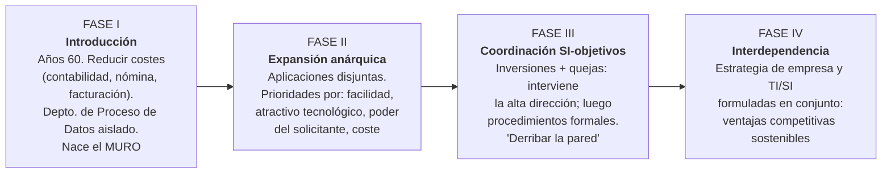

| Fase | Rasgo clave (Andreu, pp. 43-50) |
|---|---|
| **I** | Sin planes formales; planes = desarrollar **peticiones de usuario**, priorizadas por coste-beneficio económico. SI depende de servicios administrativos; **barrera de comunicación** con la dirección |
| **II** | Aplicaciones transaccionales **disjuntas**; el depto. de SI asigna recursos con criterios **incoherentes** con la estrategia, que desconoce |
| **III** | Primero **intervención directa** de la alta dirección (dilución de responsabilidades), luego **procedimientos formales**; el responsable de SI pasa a **coordinador** del equipo interdepartamental |
| **IV** | **Integrar** las posibilidades de SI/TI con la estrategia **al formularla** (método **activo**) |

> [!warning] Aclaración de examen
> El procedimiento del cap. 5 es **pasivo** (Fase III): es adecuado si las TI no son estratégicas ni lo serán a medio plazo, o como **etapa previa** en empresas con poca cultura de planificación. Lo habitual es llegar al activo **por vía evolutiva**. Incluso el pasivo es difícil sin: **1)** cultura sensible al potencial de las TI y **2)** conocimiento en SI de los objetivos de la empresa (Vitale et al., 1988; Andreu, p. 50). Muchas empresas siguen en la Fase II.

## 3.4 El Plan de TI/SI: ¿qué debe incluir?

> Preguntas: `[P3]` (apoyo)

> [!quote] Definición de planificación (Andreu, p. 43)
> "Procedimiento **sistemático de toma de decisiones** sobre *qué hacer en el próximo futuro con los sistemas de información*."

Según Andreu (p. 51), el Plan de TI/SI debe incluir:
1. **Lista de proyectos** a desarrollar en los próximos **3-5 años**.
2. **Situación de partida:** reconocimiento explícito del estado de las TI/SI, con juicio crítico **técnico y de negocio**.
3. **Prioridad de cada proyecto:** importancia para el **negocio** (lo más relevante) **y** aspectos técnicos.
4. **Primer año:** detalle suficiente para evaluar recursos e incluirlo en el **presupuesto anual** (años siguientes: aproximación).
5. **Mecanismos de evaluación** para control y seguimiento: **calendario y presupuesto** detallados.
6. **Lista de actividades** de la empresa donde la TI puede aumentar **eficacia o eficiencia**.

> [!important] El Plan es "muy poco tecnológico"
> Los detalles técnicos entran **solo cuando es estrictamente necesario**; la perspectiva es **de negocio** (p. 52). Las actividades del procedimiento son **qué hacer, no cómo hacerlo**. El equipo debe representar **todas las áreas**, o el plan queda sesgado.

> [!tip] Mnemotecnia (Presentación de alumnos)
> 4 bloques: **lista de proyectos · situación de partida · detalle del primer año · mecanismos de control** (+ lista de actividades). Es un reagrupamiento de los mismos 6 puntos.

## 3.5 Esquema general: los 3 grupos de trabajo

> [!quote] Qué debe lograr el procedimiento (Andreu, p. 52)
> "Integrar las **necesidades de información** emanadas del **cruce de las directrices estratégicas** de la empresa **con las funciones y procesos de negocio** de las distintas unidades organizativas."

| Grupo | Quiénes | Responsabilidades |
|---|---|---|
| **Comité de TI/SI** | Máximo responsable de la compañía + responsables de áreas funcionales + director de SI | **Responsabilidad última**: supervisa el proyecto, explicita el compromiso, da **criterios estratégicos** para prioridades y recursos y **aprueba el Plan** |
| **Equipo de trabajo** | Personal de Sistemas + de departamentos usuarios; dirigido formalmente por el **director de SI**, día a día por el **DOP** (Director Operativo de Proyecto) | **Trabajo operativo** de elaboración del Plan |
| **Grupo base** | Subdirector general a cargo de SI + director de SI + DOP + (eventual) consultores externos | **Facilita la negociación entre usuarios**, asegura la **consistencia** de los desarrollos y **supervisa al equipo** con más asiduidad que el Comité; "manda" sin línea jerárquica explícita |

- El organigrama del libro (Fig. 5.6) es **ilustrativo**; el DOP "en general" es del depto. de Sistemas, no necesariamente (p. 55).
- **Quién desarrolla / aprueba por fase:** I: Comité + grupo base · II: equipo + departamentos (valida cada subdirector general) · III: equipo + departamentos; propuestas del personal técnico de SI; **aprueba el Comité** · IV: personal de SI; **aprueba el Comité**.

> [!info] Glosas de clase (Supremo/Yoel), no del libro
> El DOP "pertenece a la gerencia de primera línea" y puede haber varios; en el grupo base "nunca puede estar el gerente general" y los asesores tienen autoridad de staff; el "subdirector a cargo de SI" puede ser, p. ej., un gerente administrativo si SI no es un área definida.

## 3.6 El procedimiento: las 4 fases

> Preguntas: `[P3]` (apoyo)

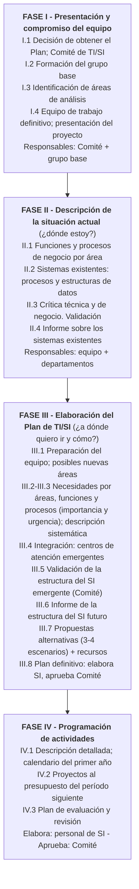

**Puntos finos (Anexo, pp. 61-73):**
- **Fase I:** la alta dirección debe decidir **explícitamente** y comprometerse; suele surgir tras **quejas generalizadas** sobre los SI (síntoma de falta de planificación, responsabilidad de la dirección general).
- **Fase II:** funciones agregadas (no más de media docena por área) + procesos/subprocesos, **validados por los directores funcionales**; por proceso: subsistema, **inputs**, **outputs**, implementación; matrices proceso x dato y **diccionario de datos**; documentar **intervalos de decisión**. **Crítica doble:** **de negocio** (grado de soporte, conveniencia de las estructuras de datos, puntos fuertes y débiles, áreas de mejora) y **técnica** (tecnología, interrelaciones, rendimientos, volúmenes y frecuencias). La valida el subdirector general de cada área.
- **Fase III:** inventario de necesidades **no cubiertas o mal cubiertas** (atomizarlas; apoyarse en FCE de Rockart) → **estructura del SI emergente** (procesos fundamentales, entidades nuevas, procesos parecidos, fronteras, subsistemas aislados, necesidades vagas = intervalos de decisión) → validación en **reuniones departamentales + Comité pleno** → **máximo 3 o 4 escenarios** filtrados por criterios **generales** (integración, asimilables, digeribles para SI, costo, coherencia técnica) y **estratégicos** (3 o 4 dados por la dirección) → elección por el **Comité**: plan **consensuado a 3-5 años**.
- **Fase IV:** el **DOP** arma la lista de proyectos y propone recursos (aprueban el director de SI y el subdirector a cargo de SI); el **calendario del primer año** va al Comité (no es imprescindible el director general). Las **iteraciones** son siempre necesarias.

## 3.7 Características clave del procedimiento (preguntas típicas)

> Preguntas: `[P3]` (apoyo) · Final: concepto de alineamiento

- **Proceso "de la empresa":** lo dirige y lleva a cabo **personal propio**; consultores externos solo como apoyo metodológico o control (el know-how queda en la empresa).
- **Participación activa de las más altas instancias** de todas las áreas; la alta dirección lo hace suyo explícitamente.
- **Las dos dimensiones de la matriz entran en momentos distintos:** **filas** (funciones y procesos) desde el principio; **columnas** (criterios estratégicos) **hacia el final**. El "filtro estratégico" temprano arriesga descartar necesidades ligadas a otras más importantes y deja un SI incompleto e incoherente.
- **Coste-beneficio en dos fases y por personas distintas:** el **costo** lo estima el personal técnico de SI; el **beneficio**, el personal "de negocio".
- **Aprendizaje organizativo** como objetivo explícito: diálogo técnicos-directivos poco común.
- **Empresas chicas:** se simplifica, pero se mantienen **5 hitos**: descripción y crítica validada de los sistemas existentes · esquema global del nuevo SI · descripción detallada del Plan · calendario y presupuesto del próximo período · el "espíritu" centrado en el negocio.
- **Duración:** de **1-2 semanas a 4-5 meses**; el DOP planifica y controla para evitar alargamientos.
- **Herramientas:** para **documentar y estructurar** datos (catálogos de entidades, relaciones, matrices); **no** son herramientas de control de proyectos ni CASE.

> [!warning] Ojo con los apuntes de alumnos
> Las "4 entradas clave" (entorno empresarial externo/interno, entorno externo/interno de SI/TI) que aparecen al comienzo del "Esquema general" en los apuntes son de **Edwards (cap. 4)**, no de Andreu. Y "derivar las estrategias de SI y de TI desde la matriz" es una lectura de la cátedra: en el libro la matriz alimenta el **Plan de TI/SI**.

### La Matriz de Necesidades

> Final: concepto de alineamiento

Cruza **funciones y procesos de negocio por departamento (filas)** con la **estrategia de la empresa / acciones estratégicas (columnas)** (Andreu, Fig. 5.5, pp. 53, 59, 71; la figura está impresa girada 90°). Las marcas en las intersecciones son **necesidades de información**, que **se integran en el Plan de TI/SI** → del cual derivan el **Plan informático**, el **Plan de hardware y software de base** y los **proyectos a desarrollar** (dirigidos por SI con colaboración de los usuarios). Los sistemas **deben servir a los departamentos y apoyar la estrategia**; el control es responsabilidad de las subdirecciones generales y del Comité.

> [!example] Ejemplo del libro (Fig. A5.1, p. 64) — filas del **área comercial**
> **Preparación del plan de marketing** (estudios de mercado, desarrollo de productos, posicionamiento, diseño de esfuerzos comerciales, planes de venta) · **Administración de crédito a clientes** · **Gestión de ventas**.

> [!tip] Para el final
> Si te piden "concepto de alineamiento", mencioná los **tres ejes de desagregación**: **departamento**, **función** (de negocio) y **acción estratégica**; es la matriz. Ver [[Matriz de necesidades]].

---

# 4. El contexto de la estrategia de SI/TI (Edwards, Ward y Bytheway)

> [!quote] Estrategia (Edwards, cap. 4, p. 32)
> Un **conjunto integrado de acciones encaminadas a incrementar a largo plazo la prosperidad y las fortalezas de la empresa**; su planificación es **responsabilidad de la dirección**.

La estrategia empresarial se formula analizando **inputs internos y externos**; la **definición de requisitos** (*qué* hay que hacer) se traslada a **soluciones basadas en tecnología** (*cómo* satisfacer las necesidades). Los SI/TI **pueden y deben** considerarse al formular la estrategia empresarial: pueden **hacerla realidad**. Los **dos componentes** de la estrategia de SI/TI: **estrategia de SI** (el **QUÉ**: necesidades de información y de sistemas, una por negocio + una corporativa) y **estrategia de TI** (el **CÓMO**: tecnología, recursos y organización para satisfacerlas según las prioridades).

> [!warning] Sin estrategia coherente de SI/TI (p. 31-32) → 7 problemas
> (1) otros ganan **ventajas** sobre la empresa · (2) objetivos **inalcanzables** por limitaciones de los sistemas · (3) **sistemas no integrados** · (4) implantaciones **tardías, caras y sin beneficios** · (5) **prioridades y planes cambiantes** (conflictos usuarios–SI) · (6) **tecnologías no integradas** que limitan · (7) **sin medios** para fijar niveles de recursos y **establecer prioridades** con congruencia. Resultado: **gasto superior al necesario para menos beneficios**.

## 4.1 Las entradas (inputs) clave

La planificación estratégica de SI/TI recibe **cuatro entradas** (Fig. 4.2, pp. 33-39):

| Input | Qué se analiza |
|---|---|
| **1. Entorno empresarial externo** | **Fuerzas de la industria** (economía, oferta-demanda, estructura y base competitiva, presiones); papel real o potencial de los SI/TI para **alterar la industria** → **oportunidades y riesgos** |
| **2. Entorno externo de los SI/TI** | **(a) Nuevas tecnologías** (avances y tendencias; **toda tecnología nueva trae riesgo y curva de aprendizaje**) y **(b) utilización de la tecnología** (cómo la usan competidores, clientes y proveedores; **otras industrias** como fuente de ideas) |
| **3. Entorno interno de la empresa** | Qué hace, cómo lo hace y cómo está organizada y dirigida: **misión y objetivos** · **actividades** (procesos principales, con independencia de la estructura formal) · **fortalezas y debilidades** (dónde orientar los SI/TI) · **estructura organizativa y estilo de dirección** (cómo se toman las decisiones) |
| **4. Entorno interno de los SI/TI** | **Recursos de sistemas y de información** (los sistemas en uso = *cartera de aplicaciones actuales*, evaluados por su eficacia futura) y **ventajas y recursos de los SI/TI** (tecnología **y** equipo humano, habilidades, cultura del departamento de SI/TI) |

**Salidas:** estrategia de **SI (QUÉ)** y **prioridades de necesidades**, estrategia de **TI (CÓMO)** y **arquitectura de los servicios**, y una **cartera de futuras aplicaciones** (que se clasifica en el análisis de cartera, §5). Las **oportunidades de los SI/TI** realimentan la estrategia empresarial. **GIGO:** entradas completas, fiables y relevantes → buenos cursos de acción.

> [!warning] Dato de examen (p. 37)
> La mayoría de las empresas que obtuvieron **ventajas estratégicas** de un SI/TI **NO usaron la última tecnología** (demasiado arriesgado): **innovaron en sentido comercial** con tecnología **adecuada, probada y bien establecida**.

> [!warning] Ojo con los apuntes de alumnos
> El apunte Supremo omite los títulos de los entornos **de SI/TI** y parece que "nuevas tecnologías" y "utilización de la tecnología" cuelgan del entorno empresarial externo. En Edwards son **cuatro entradas separadas**.

## 4.2 Los procesos para gestionar la estrategia

Tres etapas (Fig. 4.3, pp. 40-43) y **dos enfoques** (**formal** e **informal**; su equilibrio impulsa la creatividad hacia los niveles inferiores):
1. **El vector estratégico:** define **los objetivos y selecciona los medios**; debe ser asumido por los niveles más altos.
2. **La definición de la estrategia:** estrategias específicas **por área** (marketing, distribución, fabricación, I+D) → **planes viables**.
3. **La implantación:** ejecutar los planes; implica a **toda** la organización; con **realimentación y control** para que la adaptación local no desvíe la estrategia.

- Los procesos **informales no deben ser ahogados**: muchos usos innovadores de SI/TI con ventaja competitiva nacieron como **ideas oportunistas de niveles bajos**.
- **Alta dirección:** inicia el proceso, marca la dirección y pide información de avance; los **directivos de línea** incorporan los planes de SI/TI a sus planes funcionales.
- **Unidad de negocio** (Fig. 4.4): el nivel adecuado para desarrollar la estrategia de SI/TI. Vende un conjunto distintivo de productos/servicios, sirve a clientes específicos y compite con competidores definidos; se mira **qué hace** la organización, no **cómo está estructurada**.
- **Porter:** éxito por **bajo coste** o **diferenciación** → estrategias distintas exigen SI/TI distintos; **un sistema compartido entre unidades con estrategias diferentes puede impedir que ambas las desarrollen eficazmente** (ejemplo del sistema de facturación en 3 unidades, pp. 45-47). Estrategia global = **conjunto de estrategias de las unidades** + necesidades corporativas. Si la estrategia se decide por la **oferta de TI** (economías de corto plazo) y no por la **demanda de SI**, los usuarios **no la sienten propia**.
- **Por qué fracasan** los estudios estratégicos (primera iteración, p. 47): (1) **no hay compromiso del director general**; (2) proceso **demasiado largo o caro**; (3) **contenido abrumador** y difícil de interpretar; (4) el plan **no enumera recursos ni financiación**.
- **Tres formas** de hacerlos (p. 48): **unidad especial de planificación** de SI/TI · **consultores** · **comisión de trabajo guiada por un directivo respetado** (la más difícil, pero **la mejor**: la estrategia pertenece a la organización).
- **Horizonte:** acorde al de la empresa; lo más adecuado suele ser un plan de SI/TI de **2 a 3 años**, **recurrente y actualizado** (p. 49). **Formación previa** para todos: qué está en juego, cómo lograrlo, qué productos se esperan.

## 4.3 Puente con el cap. 5: de la demanda a la cartera

El esquema del cap. 5 (Fig. 5.1, pp. 51-55) fija **qué** se necesita antes de **cómo** (lado de la **demanda**): **evaluar la situación actual** ("dónde estamos") + **reconocer creativamente oportunidades** ("dónde podríamos estar") + **valorar analíticamente las prioridades** ("dónde queremos estar"). Usa análisis de la industria, **cadena de valor** (externa e interna), **FCE** y necesidades de información, y desemboca en una **cartera de necesidades**: revisión del valor de inversiones actuales/pasadas + necesidades conocidas a corto plazo + oportunidades potenciales a largo plazo. El cap. 6 pasa a la **oferta**: cómo gestionar esa cartera (§5 a §7). *(El procedimiento de Andreu: §3.)*

---

# 5. Análisis de la cartera de aplicaciones (Edwards / McFarlan)

> Preguntas: `[P4]`

> [!quote] Definición (síntesis de Edwards, cap. 6, p. 96)
> Esquema de clasificación **desarrollado originalmente por McFarlan** que permite **analizar el conjunto de sistemas de información** (actuales, planificados y potenciales) **según su contribución al éxito de la empresa**, no según cómo se suministran. Toma la forma de una **matriz** y clasifica cada aplicación como **de alto potencial, estratégica, clave para las operaciones o de apoyo**, según sus **contribuciones presentes y futuras tal como las percibe la dirección**.

**Ideas clave:**
- Las aplicaciones se gestionan como una **cartera** (como productos, clientes o inversiones), según sus **valores comerciales presentes y futuros**. Entran **todas**: existentes, en desarrollo o **solo una idea**. La posición de una aplicación **puede variar de una empresa a otra**.
- Permite ver el **equilibrio de las inversiones** (dónde van los recursos y esfuerzos); si no se ajusta a los objetivos, se **reasignan**. Típico error: querer concentrarse en estratégicas y clave y **dispersar el esfuerzo en apoyo**.
- Su fuerza no es dar una receta, sino ser un **vehículo para una discusión constructiva e informada** (alta dirección, mandos medios, usuarios, profesionales de SI) y alcanzar acuerdos.
- Se usa para **diagnosticar** los sistemas actuales y para **formular/priorizar** los nuevos.
- Analogía con la **matriz del Boston**: alto potencial = **niños difíciles** · estratégicas = **estrellas nacientes** · clave = **vacas lecheras** · apoyo = **perros** (p. 98).

## 5.1 La matriz: 4 cuadrantes

*(Fig. 6.1, p. 97: fila superior = **futuro**; fila inferior = **presente**.)*

| 🎯 **ESTRATÉGICAS** Aplicaciones **críticas para ejecutar la estrategia futura** de la empresa | 🚀 **DE ALTO POTENCIAL** Aplicaciones que **pueden ser importantes** para lograr el éxito de la empresa **en el futuro** |
|---|---|
| 🔑 **CLAVE PARA LAS OPERACIONES** Aplicaciones de las que **depende actualmente** el éxito de la organización | 🧰 **DE APOYO** Aplicaciones **valiosas pero no críticas** para el éxito de la empresa |

> Ejes de Parsons sobre esta misma matriz (Fig. 6.3): **vertical** = Demanda (arriba) ↕ Oferta (abajo) · **horizontal** = Centralizada (izquierda) ↔ Descentralizada (derecha).

| Cuadrante | Enfoque | Ejemplos del libro (Fig. 6.2) | Fuerzas motrices | Requisitos |
|---|---|---|---|---|
| **Estratégicas** | **Orientación al negocio**; relación clara con los **FCE**; riesgo principal: perder la oportunidad | EDI con mayoristas y minoristas, MRP II, análisis de mercado y previsión de ventas, análisis de rentabilidad de productos | **Necesidades del mercado / presiones competitivas desde el exterior**; objetivos, FCE y visión de la dirección; **obtener y mantener una ventaja** | **Desarrollo rápido**; **solución flexible**; enlace con una **iniciativa de negocio** |
| **Alto potencial** | **I+D**: experimentación controlada para identificar beneficios, oportunidades y costes | Sistema experto para diagnóstico de defectos, planificación de RRHH, diseño asistido por computador | **Nueva idea u oportunidad tecnológica**; iniciativa individual de alguien **dispuesto a liderarla**; demostrar su capacidad de generar valor | **Rápida evaluación de prototipos** (rechazar fracasos antes de desperdiciar recursos); comprender potencial e implicaciones económicas; decidir el siguiente paso |
| **Clave para las operaciones** | **Dominio tradicional** de los SI/TI | Lista de materiales, control de stock, análisis de coste de productos, BD de personal, cuentas a cobrar/pagar | **Mejorar el rendimiento** de actividades existentes (velocidad, exactitud, eficacia, economía); **integrar sistemas y datos**; **evitar desventajas** o que un riesgo del negocio sea crítico | **Alta calidad y larga vida**; **gestión eficiente de datos**; equilibrar **coste–beneficio–riesgo** con análisis objetivo de alternativas |
| **De apoyo** | **Análisis económico de la inversión**; abunda el **software estándar** (genérico entre industrias) | Presupuestos, contabilidad general, nóminas, proceso de textos, correo electrónico | **Productividad/eficiencia de tareas específicas** (a menudo localizadas); **requisitos legales**; uso eficiente de fondos y recursos de SI/TI | **Coste ínfimo**, soluciones a largo plazo → **paquetes** (sacrificando necesidades del usuario); evitar obsolescencia; análisis coste-beneficio objetivo |

> [!tip] Palabras clave para identificar cuadrante en el examen
> - "integrar datos", "evitar desventajas", "depende el funcionamiento actual" → **Clave para las operaciones**
> - "tareas localizadas", "requisitos legales", "paquetes de costo ínfimo" → **De Apoyo**
> - "prototipos", "idea / oportunidad tecnológica", "I+D" → **Alto Potencial**
> - "presiones competitivas externas", "FCE", "desarrollo rápido" → **Estratégica**

> [!warning] Ojo con los apuntes de alumnos (P4)
> Las definiciones de alumnos de **estratégicas** ("…sino solo es clave para las operaciones") y **alto potencial** ("…difícil o imposible por falta de tecnología o condiciones de mercado") llevan frases que **no están en la Fig. 6.1**. Y **"apoyo = aplicación externa a la organización"** (apunte Supremo, ej. AFIP) **no es del libro**: apoyo = **valiosa pero no crítica**.

> [!quote] Final: "¿Qué es un cuadrante dentro de la cartera?"
> Cada cuadrante es una **clasificación** (estratégica, alto potencial, clave para las operaciones, de apoyo) en la que se **ubica cada aplicación** de la organización, y refleja **hacia dónde se aplican los recursos y esfuerzos**.

## 5.2 Migración entre cuadrantes (la cartera evoluciona)

El papel de los sistemas cambia con el tiempo y hay que **migrar de un segmento a otro** (p. 113). Las **5 transiciones del libro, en este orden**:

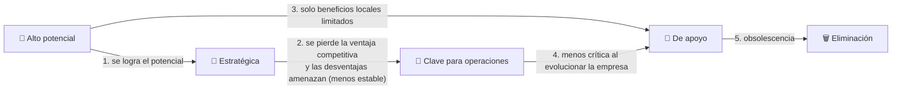

1. **Alto potencial → estratégica**, a medida que se logra el potencial.
2. **Estratégica → clave para las operaciones**, a medida que se pierde la ventaja competitiva y las desventajas amenazan (el sistema también se hace **menos estable**).
3. **Alto potencial → apoyo**, si solo produce **beneficios locales limitados** (si la idea se implanta sin valor estratégico "entra directamente en apoyo").
4. **Clave → apoyo**, al evolucionar la empresa y volverse **menos crítica**.
5. **Apoyo → eliminación**, por **obsolescencia** (principalmente los sistemas de apoyo).

> [!note] El ciclo de vida del producto
> Es el mismo recorrido que el del producto: **niño problema → estrella naciente → vaca → perro → eliminación**. En cada etapa cambian la gestión, los factores de éxito y los recursos. Al pasar de cuadrante **debe cambiar el enfoque** (Fig. 6.5: economía, organización, tecnologías, herramientas y métodos, aplicaciones). Gestionar igual un sistema cuya importancia cambió → **uso excesivo y desequilibrado de recursos**.

---

# 6. Las estrategias genéricas de gestión de SI/TI (Parsons)

> Preguntas: `[P5]`

> [!quote] Definición (Edwards, cap. 6, pp. 101-103)
> Parsons describe, tras observar la gestión de SI/TI en organizaciones reales, **seis estrategias** para **vincular la gestión de los SI/TI con la dirección general**. Son **marcos generales** que guían la identificación de **oportunidades de TI**, los **recursos para desarrollar TI**, **el ritmo al que se adoptan las nuevas tecnologías**, el **nivel de impacto de la TI** y las **tendencias estructurales** que siguen las empresas al aplicar TI; por eso se llaman **"genéricas"**.

> [!warning] ¿5 o 6? Contestá **seis**
> El libro dice **seis** y las lista. La **Tabla 6.5 solo tiene cinco columnas** (sin *Mal necesario*) y en la **Fig. 6.3** *Mal necesario* aparece **entre paréntesis**. Los alumnos (P5) lo ven "como situación, no como estrategia": razonable (se llega "por error, negligencia o escasez de recursos"), pero **para el examen: seis**.

| Estrategia | Concepto | Ventajas | Riesgos / desventajas | Tipo |
|---|---|---|---|---|
| **1. Planificación centralizada** | SI/TI **integrada con la estrategia corporativa** vía **unidad centralizadora y especializada a nivel de alta dirección** | Mejor comprensión de oportunidades y requisitos competitivos; **asignación óptima de recursos**; grandes inversiones | **Mucha dedicación de la alta dirección** (difícil de implementar); puede **distanciarse de la realidad operativa**; inhibir la innovación | **Demanda**, impulsada por el **negocio**; decisión **centralizada** |
| **2. Hilo conductor** *(leading edge)* | Se acepta que la TI **genera ventajas competitivas** → **estado del arte** de la tecnología frente a competidores | Explota las aportaciones de la tecnología; innovación | **Cara**; gasto en I+D y **pérdida de alguna inversión**; **dirección experta**; compromiso (no implicación a fondo) de la alta dirección; no sirve para todas las aplicaciones | **Demanda**, impulsada por la **tecnología** |
| **3. Mercado libre** | Los directivos-usuarios **saben qué es mejor** y **satisfacen sus necesidades a voluntad**; TI interna **compite** con proveedores externos | **Innovación dirigida por el usuario**; el usuario decide demanda **y** fuente | **Duplicidades de inversión**; tasas de desarrollo dispares; **sistemas aislados no integrados**; poco apoyo de la alta dirección | Usuario decide **demanda y fuente**; descentralizada |
| **4. Monopolio** | **Único proveedor interno** de SI/TI, de uso obligatorio | **Gasto global fácil de identificar y controlar**; servicio profesional y sistemas de calidad | **Innovación lenta**; necesita **capacidad ociosa**; se mide por satisfacción del usuario y cartera de pedidos pendientes | **Oferta**; **centralizado**; controla tecnología y recursos (no fondos) |
| **5. Recurso escaso** | **Presupuesto definido con antelación**; las aplicaciones **compiten** por los recursos; justificación financiera (ROI) | **Muy popular**; gestión cuidadosa con controles financieros | Trata a SI/TI como **centro de costes**; **no propicia usarlos como arma empresarial**; **no reconoce cambios en la demanda** | **Oferta** basada en limitación **financiera** (dirección financiera) |
| **6. Mal necesario** | SI/TI **solo para requisitos legales** e inversiones de alto rendimiento; **solo donde no hay alternativa** | — | Se llega por **error, negligencia o escasez excesiva**; **degrada paulatinamente la capacidad de competir**; alta rotación y desmoralización | No recomendada |

**Tabla 6.5 (p. 103) — resumen de la *base para la gestión*:**

| Estrategia | Base |
|---|---|
| Planificación centralizada | La coordinación centralizada de todas las necesidades conduce a **mejor toma de decisiones** |
| Hilo conductor | La tecnología puede crear **ventajas y riesgos** que merece la pena aceptar |
| Mercado libre | **El mercado toma las mejores decisiones**; los usuarios responden por los resultados; la integración no es crítica |
| Monopolio | La información es un **input** y un **recurso integrado** disponible para todos |
| Recurso escaso | La información es un **recurso limitado**; su despliegue debe estar claramente justificado |

## 6.1 Proyección sobre la cartera (Parsons) — ¡cruce favorito de examen!

*(Fig. 6.3, p. 108)*

| | **Centralizada** ◄──────► **Descentralizada** | |
|---|---|---|
| ⬆ **DEMANDA** | 🎯 **ESTRATÉGICAS** → **Planificación central** | 🚀 **ALTO POTENCIAL** → **Hilo conductor** y **Mercado libre** |
| ⬇ **OFERTA** | 🔑 **CLAVE PARA LAS OPERACIONES** → **Monopolio** | 🧰 **DE APOYO** → **Recurso escaso**, **Mercado libre** y *(Mal necesario)* |

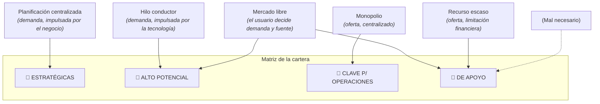

- **Planificación centralizada** (estratégicas) = **demanda** impulsada por el negocio; **monopolio** (clave) = **oferta**; **ambas centralizan la decisión**.
- **Hilo conductor** (alto potencial) = **demanda** impulsada por la **tecnología**.
- **Recurso escaso** (apoyo) = **oferta** basada en la **limitación de recursos financieros**.
- **Mercado libre** (alto potencial **y** apoyo): los **usuarios determinan la demanda y deciden la fuente de aprovisionamiento**. Mercado libre e hilo conductor = estrategias **para la innovación**: el primero se mueve por **necesidades de la empresa**, el último por **desarrollos de la tecnología** (p. 106).
- Los cuadrantes **superiores** (estratégico y alto potencial) buscan **oportunidades** (ventajas futuras y gestionarlas con éxito); los **inferiores** (clave y apoyo) **resuelven problemas actuales**: gestión meticulosa para **reducir riesgo y desventajas**. Por eso en cada cuadrante funcionan **una o dos** estrategias mejor (p. 108).

> [!tip] Demanda vs Oferta — la regla de oro
> **Demanda = el QUÉ** necesita el negocio. **Oferta = el CÓMO**: quién **controla la tecnología y los recursos** (no los fondos).
> - **Planificación central**: empresa y directivos de TI **planifican juntos** cómo responder a las aplicaciones prioritarias. **Monopolio**: TI **retiene la autoridad** y controla cómo los usuarios resuelven sus problemas dentro de la oferta preestablecida *(Yoel: "es TI quien define lo que ofrece, lo haya pedido o no el negocio")*.
> - Una estrategia coherente **prioriza primero la demanda** y después gestiona la oferta; si la estrategia nace de la **oferta de TI**, los usuarios **no la sienten propia** (p. 47).

**Cuál va con cuál (texto del libro, pp. 108-109):**
- **Estratégicas → planificación centralizada**: la **orientación al negocio** determina requisitos y enfoque; define el **riesgo** que conviene correr.
- **Alto potencial → hilo conductor y mercado libre**: "ambas arriesgadas, pero producirán innovación"; **planificar de más ahoga la innovación**.
- **Clave → monopolio**: restrictivo pero **ideal para reducir riesgos**; soluciones de calidad a largo plazo; integración de funciones y datos.
- **Apoyo → recurso escaso** (obliga a evaluar resultados antes de gastar) **y mercado libre** si los usuarios usan **sus propios fondos**.

**Cómo se usan (pp. 109-110):** **(1) para el diagnóstico** (entender y expresar cómo se gestionan hoy los SI/TI; hay **relación causa-efecto** entre las aplicaciones desarrolladas y las estrategias adoptadas) y **(2) para la formulación** (un **plan de migración** a partir de la cartera futura; evita la **trampa de la estrategia única**; **no se puede planificar todo centralizadamente**; a corto plazo conviene **más libertad + monopolio en áreas críticas + restricción rigurosa en apoyo**, que libera recursos para sistemas estratégicos; y evitan **partir de cero**).

> [!warning] El mayor error
> Históricamente la dirección adoptó **una sola** estrategia genérica para todo; hoy hacen falta **varias a la vez** para una **cartera completa y equilibrada** (p. 107). Con **recurso escaso** se **inhiben las aplicaciones estratégicas** (estrategia desconocida para usuarios y TI; beneficios difíciles de cuantificar).

> [!note] Evolución histórica (pp. 106-107)
> Departamentos con sistemas independientes (justificados por **ROI**) → **centralización/monopolios** (años 60-70; muchos restrictivos) → **PC** en los 80: los usuarios buscan sus soluciones → **mercado libre** y **centros de beneficios** (British Leyland, Imperial Metals, Debenhams) → **planificación centralizada** al entenderse el potencial estratégico de los SI/TI. Cuando domina el mercado libre **es muy difícil cambiar de estrategia** (salida: un **nuevo negocio**, ej. FirstDirect).

> [!quote] Final: "¿Qué son las estrategias genéricas?"
> **Marcos generales** en los que se enmarca la gestión de los SI/TI con la dirección general; cada una guía la identificación de **oportunidades de TI**, los **recursos para desarrollar TI**, el **ritmo de adopción** de nuevas tecnologías y el **nivel de impacto** en la empresa; son las **tendencias estructurales** con que las empresas aplican TI. *(Para nota: agregá las **seis** y el cruce con la cartera.)*

---

# 7. Evaluación de inversiones y prioridades (Edwards)

> Preguntas: `[P6]` `[P7]`

Siempre hay **competencia por los recursos financieros**; el modelo de cartera permite **justificar las inversiones según el contexto** de cada aplicación y **evitar la trampa de evaluar solo con argumentos financieros** (p. 114). En todos los casos se estiman **costes** (incluyendo **costes del usuario**, esfuerzo técnico, equipamiento y **ciclo de vida**; con **costes reales, no precios de transferencia**) y se definen **beneficios** en forma **financiera** (clave y apoyo) o como **FCE alcanzados** (estratégicas y alto potencial). **El mismo mecanismo que decide si una aplicación sigue adelante se usa para priorizarla** (p. 119).

## 7.1 Justificación por cuadrante

| Cuadrante | Justificación de la inversión |
|---|---|
| **De apoyo** | Mejorar **eficiencia** → **cuantificar y convertir en argumento financiero**; si usa recursos centrales escasos, estimar beneficios **antes** de comprometerlos; si es con presupuesto local, **decide la dirección del usuario**; el medio más económico suele ser un **paquete llave en mano** |
| **Clave para operaciones** | Costes y beneficios financieros **+ riesgo**: **la solución más económica puede no ser la más eficiente** → **estudio de viabilidad riguroso** (equilibrio coste–beneficio–riesgo); el monopolio excluye soluciones basadas **solo** en viabilidad económica |
| **Estratégicas** | Se estima hasta donde se pueda, pero las razones principales son **intangibles (FCE)**: **no se resuelve con un VAN detallado**. Éxito = **suerte** (que el objetivo no se mueva) + **juicio** de la alta dirección + **buena gestión** del desarrollo. Cuestiones: ¿el equipo directivo respalda?, ¿la organización cree que vale la pena?, ¿hay **recursos suficientes**? |
| **Alto potencial** | Los beneficios **se desconocen: el objetivo es aclararlos** (segmento **I+D**): fondos desde presupuesto **general de I+D** (no de SI/TI); **impulsor del producto** con presupuesto y calendario estricto; **re-justificar** cada dotación (evitar el "pozo sin fondo"); ningún proyecto se queda demasiado tiempo |

### Economía de la información — 3 tipos de aplicaciones según beneficios (Parker et al., citado por Edwards, p. 114)
- **Sustitutiva:** **máquinas por personas**; la **economía** (eficiencia) es la fuerza principal → **apoyo y clave**.
- **Complementaria:** mayor **productividad y eficacia**; el trabajo **se hace de otra forma** → **clave y estratégicas**.
- **Innovadora:** **obtener o mantener ventaja competitiva** → **estratégicas y alto potencial**.

### 5 técnicas para evaluar beneficios (Edwards, pp. 114-116)
1. **Análisis coste-beneficio** (tradicional; **desplazamiento del coste** por una forma más eficiente).
2. **Vínculos de valor** (mejora por **coordinación más precisa** entre áreas).
3. **Aceleración del valor** (**impacto del tiempo**; acelerar operaciones entre departamentos).
4. **Reestructuración del valor** (productividad por **cambio organizacional sustancial**).
5. **Innovación** (**negocios nuevos**; lo más difícil de valorar).

**Tabla 6.6 — relevancia por cuadrante (● = más relevante, – = ninguna):**

| Técnica | 🚀 Alto potencial | 🎯 Estratégica | 🔑 Clave | 🧰 Apoyo |
|---|---|---|---|---|
| Coste-beneficio | – | ● | ●●● | ●●●● |
| Vínculo del valor | ● | ●● | ●●●● | ●●● |
| Aceleración del valor | ●● | ●●● | ●●● | ●●● |
| Reestructuración del valor | ●● | ●●●● | ●● | ● |
| Innovación | ●●●● | ●●●● | ● | – |

> [!note] Origen
> Los tres tipos y las cinco técnicas son de **Parker, Benson y Trainor** (*Information Economics*), **expuestos por Edwards en el cap. 6**. **No** son de Robson T3.

## 7.2 Los 3 factores de prioridad

> Preguntas: `[P6]`

> [!important] Para evaluar prioridades hay que incluir **tres factores** (p. 120):
> 1. **Beneficios** → lo que es más importante **conseguir**
> 2. **Recursos** → lo que se **puede hacer** (dotar)
> 3. **Riesgos** → lo que **probablemente va a ocurrir**

**Factores de riesgo principales:** **tamaño y duración del proyecto** · **inestabilidad de la empresa** · **tasa de cambio de la organización** · **número de partes que comprende la organización** · **factores técnicos asociados a nuevas tecnologías**.

> [!warning] Ojo con los apuntes de alumnos (P6)
> La respuesta de alumnos agrega al final de los riesgos "factores para determinar prioridad entre segmentos: fortaleza o debilidad de la empresa". Eso **no es un riesgo**: es uno de los factores que dan **peso relativo** en la etapa 3 (§7.3). **Los riesgos son cinco.**

$$\text{Prioridad} \propto \frac{\text{Beneficios a obtener (ajustados para el riesgo)}}{\text{Consumos de recursos limitados}}$$

## 7.3 Etapas para determinar prioridades

> Preguntas: `[P7]`

El libro **no las numera**; las cuatro etapas, en el orden de su desarrollo (pp. 119-123):

1. **Evaluar todas las aplicaciones respecto a una tabla de ponderación estratégica** para **determinar a qué segmento pertenecen**. *(Alumnos: "tirar en la caja con divisiones" = ubicar en la matriz de cuatro cuadrantes.)*
2. **Definir prioridades dentro de cada segmento**, con criterio propio de cada uno (tabla de abajo), **considerando la infraestructura: la prioridad de un proyecto de infraestructura la heredan todas las aplicaciones que lo apoyan o contribuyen a él**. *(Alumnos: "ranking por sector".)*
3. **Definir prioridades dentro de la cartera (entre segmentos):** como cada tipo puntúa alto en cosas distintas, **la dirección decide el peso** de cada tipo de beneficio y luego prioriza con la secuencia **beneficios (ajustados por riesgo) / consumo de recursos limitados**; con eso **se asignan los recursos** y **se comunica el plan** a todos. *(Alumnos: "sacar las divisiones, todo entre todo".)*
4. **Revisión retrospectiva ("después del acontecimiento")**: sobre **suficientes proyectos**, para ver si las políticas y estrategias de gestión funcionan y **si se lograron los beneficios esperados** (**no una caza de brujas**). La diferencia entre empresas que triunfan y las que no: **evalúan las inversiones en SI/TI antes y después**. *(Alumnos: "(no necesariamente)" → el libro **sí** la exige, pero no proyecto por proyecto.)*

| Segmento | Criterio de prioridad dentro del cuadrante |
|---|---|
| 🧰 **Apoyo** | **Mayores beneficios económicos con menos recursos** (la más simple); fomenta cuantificar y buscar **paquetes** |
| 🎯 **Estratégicas** | **Más contribución a los objetivos con menos recursos**: **tabla de decisiones** en términos de **FCE** → puntuación estratégica (25 no es "mejor" que 24: importancia similar) |
| 🚀 **Alto potencial** | **Autogestionadas**: dependen de la **energía y entusiasmo de sus defensores** y de la fuerza con que se persiga; si impactan en muchos FCE, se elevan para obtener recursos de I+D; los recursos secundarios pueden ser un problema |
| 🔑 **Clave** | **La más compleja**: **economía + riesgos para el negocio actual + FCE + mejoras de infraestructura**; cada una recibe prioridad **antes** de mirar recursos; se compara **coste y recursos** con la importancia en las 4 categorías |

**Pesos entre segmentos (etapa 3):** estratégicas puntúan más en **FCE**, apoyo en **economía**, clave en **riesgos e infraestructura**. El peso depende de: **fortalezas/debilidades de la empresa** (defender la posición o innovar) · **fortalezas/debilidades de los sistemas actuales y del recurso de SI/TI** (servicio prestado en el pasado) · **experiencia de los usuarios** para definir necesidades e implantar · **confianza de la dirección** en su criterio (más confianza y madurez de planificación → **más peso de los FCE** frente a lo financiero) y **poder de la empresa en su industria**.

> [!warning] Ojo con los apuntes de alumnos (P7)
> Alto potencial: el libro dice **autogestionada por sus defensores**, no "respaldo de alta dirección". En la P7 los paréntesis ("tirar en la caja…", "ranking por sector", "sacar las divisiones…", "no necesariamente") **son mnemotecnias de alumnos**, no texto del libro.

> [!tip] Comodín
> **Infraestructura** (servidores, redes, BD): ejemplos del libro: una **red** que enlaza todas las oficinas o una **BD de clientes** para marketing, ventas y servicio. Se evalúa y prioriza **como un proyecto más** y su prioridad **se hereda** a las aplicaciones que la usan. Pregunta guía de riesgo: **"¿qué riesgo corremos si el proyecto de infraestructura no sigue adelante?"**

---

# 8. Management de recursos de IS (Robson, T4 Cap.9)

> Preguntas: `[P8]` `[P9]` `[P10]` `[P11]` `[P12]`

> [!tip] Se retoma en la U3
> El RUO vuelve en la Unidad 3 (Subsistema de aplicación) → [[RUO — Rol, Ubicación y Organización del área de SI-TI]] · [[SI delegados]] · [[Enfoques estructurales — detalle U3]].

> [!warning] ACLARACIÓN clave de la cátedra
> En esta unidad, **"IS" hace referencia al ÁREA de sistemas** (el departamento), **no a las aplicaciones**. Es una definición de **cómo disponer los RR. HH.**: algo **organizativo, no tecnológico**.

> [!info] Cómo se estudia
> Los términos son los de Robson: **ROL · UBICACIÓN · ORGANIZACIÓN**. Las páginas citadas son las del libro (T4, cap. 9). Las notas completas están en [[Administración de recursos de IS]], [[Rol de los IS]], [[Ubicación de los IS]], [[Centralizados vs no centralizados]] y [[Organización de los IS (enfoques estructurales)]].

## 8.1 ¿En qué consiste la administración de los recursos de IS?

> Preguntas: `[P8]`

Consiste en resolver **tres temas específicos** (tres preguntas):

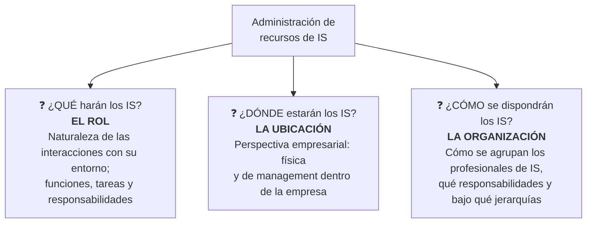

- **No son los únicos aspectos** de management de IS: se agrupan porque **reflejan lo que antes incluía el Departamento de Procesamiento de Datos**; el resto se trata en otros capítulos.
- Los IS son **un negocio en sí mismo** (Cash et al., 1992): clientes, canales de distribución y productos.
- **Consejo de la cátedra:** el **alineamiento** da el marco para el RUO; al resolver un caso, **plantear la organización, verificar si ayuda al rol y si está relacionada con la ubicación**. Para el TP: indicar qué decisiones se **centralizan, descentralizan o delegan**.

## 8.2 El ROL de los IS

> Preguntas: `[P9]`

**Rol = ¿qué harán los IS?** (naturaleza de las interacciones con su entorno; funciones, tareas, responsabilidades).

- El rol cambió: de **brindar apoyo empresarial** → a **permitir la transformación de la empresa**. Hay **dos visiones**: los **managers de IS** lo ven **estratégico y crítico**; el **nivel gerencial**, como **apoyo para la eficiencia** (Green-Armytage 1995; Saran 1996). Que sea estratégico o no es "cuestión de opinión personal".

**Roles de IS, relación con los usuarios y estructura (Fig. 9.1, p. 19) — evolución de arriba hacia abajo:**

| Rol de IS | Relación | Estructura |
|---|---|---|
| **Hacerles algo a ellos** | El grupo de IS **establece las reglas** | Enfoque **"tradicional"** |
| **Hacer algo para ellos** | **Orientación al servicio** | Guiada por **bases de datos** |
| **Hacer algo con ellos** | **Puentes y participación** | **Grupos de proyectos funcionales** |
| **Ayudarlos a que lo hagan por sí mismos** | **Influencia más que control** | **Centros de información** y apoyo para las decisiones |
| **Mantener un depósito de información** | **Puente** entre proveedores y usuarios de información | **Enfoque externo** |

**Cinco modelos para la estructura de los IS (Sullivan-Trainor, 1989) — OJO: son distintos de los 5 roles de arriba:**

| Modelo | Relación con los usuarios |
|---|---|
| **De servicio** | Formaliza la interacción como una **obligación de servicio** (atractivo para empresas que se "ponen al día" en management de IS) |
| **De participación** | **Separa las líneas funcionales** del modelo de servicio para lograr **estrecha correspondencia** IS ↔ usuarios |
| **De vendedor** | Los IS **se comercializan a sí mismos** y venden sus servicios; atrae a empresas interesadas en el **valor que aportan los IS** |
| **De expansión** | Los IS crean una **arquitectura flexible** que sustenta los sistemas comunes; **ideal para empresas grandes y en crecimiento** |
| **De ventaja estratégica** | Identificación IS ↔ usuarios tan estrecha que **los productos competitivos se desarrollan en forma conjunta** |

> [!warning] Ojo con los apuntes de alumnos
> "Ideal para empresas grandes y en crecimiento" es del modelo de **expansión**, no de ventaja estratégica (el Apunte Supremo lo pega mal).

**Los roles son actividades LÓGICAS, no departamentos (Fig. 9.2):** los IS tienen su **propia cadena de valor** (operaciones técnicas + actividades administrativas). En la práctica implican **funciones con ubicación distinta**: **compra del servicio** y **provisión del servicio** (de fuentes internas o externas), esta última dividida en **distribución** y **apoyo al servicio**.

**Roles de IS que deben estructurarse en forma diferenciada (management y provisión de):**
1. **Infraestructura de IS (operación y administración):** servicios centrales **efectivos y confiables**; capacidad, **seguridad** (backups, control de acceso, detección de errores); redes, BD, e-mail. Se enfatiza el **servicio**, no lo técnico.
2. **Investigación y desarrollo a largo plazo:** directivas de largo plazo **separadas de las preocupaciones actuales**; la estrategia de IS no se genera solo en IS (su equipo **forma parte** del grupo que la formula); función asesora **realista e innovadora**.
3. **Facilitar la informática a nivel de usuario final:** función de **apoyo / "asesora"** (persuadir, conceptualizar problemas, elegir tecnología, diseñar e implementar soluciones).

> [!note] Dilemas del management de IS
> - **Riendas totalmente flojas → anarquía**; **reglas sumamente estrictas → se anulan las respuestas adecuadas**.
> - ¿La estructura de IS debe *reflejar* la de la empresa o ser *distinta*? **Dos razones para tratarla distinto:** (1) cambiar los sistemas cuesta **más tiempo y dinero** que cambiar la estructura de la empresa; (2) demasiada **autonomía** puede impedir **reorganizar el negocio** más adelante.

## 8.3 La UBICACIÓN de los IS

> Preguntas: `[P10]` `[P11]`

**Ubicación = ¿dónde estarán los IS?**, física **y** de management. El debate pasó de "dónde están las máquinas" a **dónde ubicar la coordinación y el control**: **qué mantener centralizado y qué tipo de descentralización aplicar al resto**.

**Decisiones a tomar `[P10]`:** confrontar cada elemento contra la **estrategia de IS** y decidir **qué centralizar, cómo y en qué medida**. **King (1983)** propone tres aspectos:
- **Localización:** ubicación **física** del sistema (**hoy poco relevante**, por la relación precio/performance).
- **Control:** **nivel empresarial** donde se toman las decisiones (centralizado = **deciden los niveles superiores**).
- **Estructura:** responsabilidad en la **función de IS** o **transferida a los usuarios**.

**Tres tipos de ubicación:**

| Tipo | Concepto (Robson) | Ejemplo de la cátedra |
|---|---|---|
| **(Re)Centralizada** | Una función de **un único acceso**; un solo servicio | Sistema de gestión contable del estado provincial |
| **Descentralizada** | **Muchas funciones, cada una con acceso único**: mini-departamentos de procesamiento de datos | Sysacad de la UTN (una réplica por regional) |
| **Delegada** | Dispersión **geográfica y de management**; red de uniones laterales con **control significativo del usuario final** sobre procesamiento, desarrollo y entorno | Sistema de registración de expedientes de la UTN |

> [!important] Frase de examen
> **Son los delegados los que verdaderamente se oponen a los centralizados**, no los descentralizados (que pueden repetir los mismos atributos).

- Las empresas **combinan facetas de las tres**; esos sistemas mixtos son el **enfoque federal** (Edwards et al.).
- Formas de **supercentralización:** convertir IS en **centro de ganancias**, en **empresa separada** o **tercerizar**.

### Comparación centralizados vs no centralizados

> Preguntas: `[P11]` (control · entorno · costos)

*(Robson no trae una tabla única: esta ordena sus listas de ventajas, desventajas y entorno.)*

| Criterio | **CENTRALIZADOS** | **NO CENTRALIZADOS** (descentralizados / delegados) |
|---|---|---|
| **a) Grado de control** | **Mayor control** de las operaciones (producción, **integridad de acceso a BD**, seguridad); **un solo grupo** fija estándares, sin conflictos de responsabilidad; menos incompatibilidad; proyectos complejos; más fácil reclutar especialistas | Control **disperso** (localización, autoridad, contabilidad y control); en los **delegados** el control central se reemplaza por **cooperación y coordinación**; más autonomía del usuario final. Riesgo: **¿quién es responsable?** → **automatizar seguridad y management de red** |
| **b) Entorno requerido** | Recursos **costosos** y uso **limitado**; sistema para **senior management**; **servicio común** (sueldos); unidad de negocio **muy pequeña**; **integración vital**; **tiempo de respuesta no crítico**; objetivos de **eficiencia** | Requerimiento de **velocidad y flexibilidad**; **servicio único** de una parte de la empresa; objetivos de **efectividad**. Delegados: recursos de costo **relativamente bajo**, uso **alto y variado** |
| **c) Costos asociados** | **Economías de escala** (menos duplicación → ahorro general); PERO pueden **crecer sin control** y los **costos de comunicación** pueden ser altos (distancia huésped–cliente) | **Costos agregados por duplicación** e ineficiencia (más cuanto más delegados; costos más "ocultos"); PERO la informática departamental puede **bajar los costos de comunicación de datos** y el usuario **percibe mejor** el balance costo/beneficio |

**Otros contrastes útiles:**
- **Centralizados:** riesgo de **separarse del negocio real**, poca atención a un grupo particular, acceso **lento en horas pico**, planificación de capacidad más difícil.
- **Descentralizados vs delegados:** difieren en el **grado de dispersión del control y la autoridad**. La descentralización crea **"islas de tecnología"** (más duplicación, aislamiento del personal); la **delegación** pone los recursos **donde el negocio los necesita** (acercar los IS a sus clientes). La descentralización puede ser una **etapa** hacia la delegación.
- **Riesgos de los no centralizados:** **incompatibilidades futuras** (críticas en **RR. HH. e información**, no solo técnicas), límites ante la **complejidad**, **carrera de especialistas limitada**, **hostilidades** si el cambio se maneja mal. **Peligro mayor de los delegados:** perder la **visión unificada** de la empresa → mantener centralizadas ciertas funciones (Bacon: comunicaciones, administración de datos, estrategia y política de IS, recuperación ante desastres, sistemas financieros y de sueldos).

> [!warning] Ojo con los apuntes de alumnos
> La tabla de P11 en 3 columnas (centralizado / descentralizado / delegado) trae cosas que el libro **no** dice: que el delegado cuesta **menos** que el descentralizado (el libro: *cuanto más delegados, más duplicación*), "mayores hostilidades" del delegado, o "equilibrio eficiencia/eficacia" como su objetivo.

> [!tip] Cruce con la U6
> La ubicación condiciona la **seguridad**: con la delegación las cuestiones de seguridad pueden **no ser responsabilidad de nadie**, por eso hay que **automatizarlas** y **auditar estrictamente el cumplimiento de estándares** → [[Manejo del riesgo (4 estrategias)]] · [[Controles y contramedidas]].

## 8.4 La ORGANIZACIÓN de los IS — enfoques estructurales

> Preguntas: `[P12]`

**Organización = ¿cómo se dispondrán los IS?**: estructura **interna** de los IS, dondequiera que estén. Los enfoques **evolucionaron** (1960 → principios de 1990), **ninguno quedó obsoleto** y **pueden coexistir** (la variedad maximiza ventajas y minimiza desventajas); se eligen según la **estrategia de IS**.

| Enfoque (década) | Característica | Notas |
|---|---|---|
| **1. Tradicional** — centro de datos (1960) | Estructura **rígida**: **desarrollo, mantenimiento y operación separados**; operación por turnos; determinada por una función **financiera**; casi sin responsable sénior de la informática | **Máxima virtud:** amplia **especialización**. **5 desventajas:** **retraso**, **sistemas proscriptos** (más "elegancia" que uso), **inflexibles**, **gran demanda de preparación de datos**, **mantenimiento costoso**. Sirve para **alta complejidad técnica y gran volumen de datos** |
| **2. Estructura de base de datos** (1970) | Según las **necesidades de almacenamiento**: los datos se separan de las aplicaciones | Facilita el **acceso del usuario a los datos** bajo el administrador de la BD; la **preparación de datos pasa a los usuarios**; los IS **comienzan a conectarse** con ellos |
| **3. Grupos de proyectos funcionales** (princ. 1980) | **Analistas + programadores** en **grupos por proyectos empresariales**; las operaciones siguen "tradicionales" | **Primera estructura basada en la DEMANDA** (no en la oferta). Es una **matriz de management** (ambigua, "dos jefes"); sistemas más relevantes y usuario involucrado, PERO **"murallas chinas"** y **carga despareja**. Deja un **centro de datos corporativo** chico |
| **4. Centro de información y apoyo a decisiones** (mediados / fin 1980) | Función de IS organizada para **apoyar las decisiones de management** de los usuarios | Los IS ya no son responsables solo del procesamiento de datos sino del **manejo efectivo**; requiere **computación controlada por el usuario** y **management híbrido** |
| **5. Estructuras externas** (princ. 1990) | Centradas en el **ambiente**: líneas de **servicio al consumidor**; **acuerdos de servicio** (obligaciones de IS y percepciones de valor) | IS enfocados hacia **clientes reales**; **los IS son la empresa**: el negocio afecta a los IS y los IS al negocio. Las nuevas estructuras **transfieren autonomía** → ciclos más cortos, sistemas flexibles y menos prescriptivos |

> [!note] ¿5 o 6?
> Robson lista **seis** en la cronología, pero trata juntos *centro de información y apoyo de decisiones*: por eso P12 habla de cinco.

**Zmud (1984) y la elección:** opciones de diseño 3:2:2 (estructura: funcional / producto / matriz · proceso: mecanicista / orgánico · coordinación: formal / informal). La estructura debe ser **coherente** con la **madurez del management de IS y de la tecnología**, las **prioridades del negocio** y la **estrategia de IS** (también con la **actitud ante el riesgo** y la **capacidad de cambio** de la empresa).

> [!example] Cómo encarar el "organigrama" del final
> Identificá la estructura por el dibujo → leé en la **Fig. 9.1** (misma fila) el **rol** y la **relación** con los usuarios → decí en qué tipo de empresa aplica (madurez, estrategia de IS, riesgo, capacidad de cambio) y verificá que la organización **ayude al rol** y se **relacione con la ubicación**. *(Inferencia a partir del libro y del consejo de cátedra.)*

### Administración de los SI por nivel gerencial

> [!info] Fuente
> No está en el capítulo de Robson: es del **apunte de la cátedra** (U3).

| Qué se administra | Nivel | Quiénes |
|---|---|---|
| **La tecnología** | Gerencia de **primera línea** (operacional) | **CTO**, jefes de servidores, de proyectos, soporte |
| **El uso de los SI** | Gerencia **táctica** (media) | Subgerencias (seguridad, desarrollo, etc.) |
| **La información** | Gerencia **estratégica** | **CIO** |

*(Ver [[Niveles de administración del área de SI-TI]] en la U3 y [[Niveles organizacionales (Chiavenato)]].)*

---

# 9. Valor de la información e inversión en IS (Robson, T3 Cap.7)

> Preguntas: `[P13]`–`[P18]`

> [!abstract] La idea en una línea
> Formular la estrategia de IS es planificar una **asignación de recursos**; para que se vuelva acción hay que manejar **costos**, **beneficios** y su **balance (riesgo)**. *Costo/beneficio acá no es financiero.* Detalle en [[Valor de la información e inversión en IS]].

## 9.1 Las tres cuestiones para implementar la estrategia

> Preguntas: `[P13]`

> [!important] Llevar la estrategia de IS a la realidad (asignación de recursos) requiere el management de **tres conjuntos interrelacionados de cuestiones**  *(Robson T3, p. 11)*
> 1. Cuestiones relacionadas con los **COSTOS** de los IS
> 2. Cuestiones relacionadas con los **BENEFICIOS** de los IS
> 3. Cuestiones relacionadas con el **BALANCE entre costos y beneficios** (→ acá vive el **RIESGO**)

- Los términos **"costo" y "beneficio" no tienen sentido financiero** en este contexto (aclaración del libro).
- **Costo** = **renunciar a algún recurso o atributo que se considera importante**: capital, pero también esfuerzo, tiempo, entusiasmo, poder, compromiso y **la certeza** (no se sabe el verdadero resultado).
- **Beneficio** = **ganar algún recurso o atributo que se considera útil**: capital, poder, status, conformidad, certeza (mejor información para decidir, no conocer el futuro).
- El **riesgo** está en **toda** asignación de recursos de IS (el libro no le da sección aparte): **menos certeza = más riesgo**. El **balance del riesgo** se logra **concertando los criterios costo/beneficio**: entender direcciones estratégicas, perfiles de riesgo y técnicas para estimar el desempeño en plazos adecuados.
- **Arquitectura de la inversión** (Zmud et al., 1986): el panorama de costos, beneficios y balance que debe tener toda la empresa; parte de una **economía de información**.

> [!note] ¿Por qué "se renuncia a la certeza"?
> Al invertir en IS se abandona lo **familiar** (procesos conocidos y controlados) por lo **desconocido**: proyectos innovadores o de infraestructura con horizontes que exceden el conocimiento tecnológico actual (sin detalle previo ni base histórica). Contracara: automatizar lo que ya se domina va "de lo conocido a lo más conocido" y **baja** el riesgo.

> [!tip] Del "gasto" a la inversión (Fig. 7.5)
> Gasto como **pérdida** (pequeñas sumas, visión operativa, discontinuo, **manejo de costos**) → gasto como **inversión** (grandes sumas, visión estratégica, **continuo**, **manejo de beneficios**, planificación de capital). Es la **transición crítica del management de computación al de información** (Nolan).

## 9.2 Costos de los IS

> Preguntas: `[P14]`

> [!tip] Cruce con la U6
> La categoría **Seguridad** de la lista de control (prevención de daños y recuperación de desastres) se desarrolla en la Unidad 6 → [[Administración del riesgo]] · [[Plan de contingencias]].

- Componentes **tangibles e intangibles** → en la jerga: **visibles y ocultos**. Hay que **predecirlos y reducirlos** cuando corresponda, **sin sacrificar el nivel de beneficios netos**.
- **Compromiso permanente (Keen):** un desarrollo de **\$1M** compromete **\$4M en los 5 años siguientes** (por cada \$1 de desarrollo: \$0,20 de operación + \$0,40 de mantenimiento, por año). Esos **costos de continuidad** son automáticos y **no discrecionales** → el mejor ejemplo de **costos ocultos**.
- **Proporción visible/oculto (Fig. 7.1):** desarrollo interno ≈ 70% esperados / 30% ocultos; **software adquirido ≈ 30% / 70%**.
- **Pronósticos desacertados** (factor de error de 10 o más) → falta de confianza en los IS, se eligen proyectos inadecuados y los **mejores proyectos no se hacen** porque los recursos se agotaron. Causas: (1) pronosticar exige **conocer el proyecto en detalle** de antemano; (2) hace falta **base histórica**, inexistente en proyectos "primeros en su tipo". Muchas empresas ni saben cuánto gastan hoy.

### Lista de control de costos (Hochstrasser y Griffiths)

> Preguntas: `[P14]`

Lista que ayuda a **identificar, cuantificar y evaluar** los costos de los IS: **10 categorías** *(Robson T3, pp. 16-19)*.

| # | Categoría | Incluye |
|---|---|---|
| 1 | **Hardware** | Procesamiento + impresoras, soportes de almacenamiento, accesorios (visibles pero dispersos → difíciles de auditar) |
| 2 | **Software** | Paquetes (más baratos, con costos de evaluación/especificación) vs desarrollos internos (sumas enormes y desconocidas) |
| 3 | **Instalación** | Especialistas externos, **data entry**, conversión de datos |
| 4 | **Entorno** | Físico (cableado, muebles, aire acondicionado) + humano (seguridad, salud, costos legales) |
| 5 | **Funcionamiento** | Energía, comunicación de datos para trabajo remoto, suscripciones a servicios externos (BD on-line) |
| 6 | **Mantenimiento** | Planeado y previsible (contratos) vs menos predecible (personal interno); el software también "se averría" |
| 7 | **Seguridad** | Prevención de daños accidentales/deliberados; riesgos inevitables; **planes de recuperación de desastres** |
| 8 | **Red** | Software, hardware y management de redes, **adicionales** a las aplicaciones |
| 9 | **Capacitación** | **Los más desestimados**: educación de fondo, capacitación específica, apoyo y actualización continua (indocumentados) |
| 10 | **Amplios organizacionales** | Ítem globalizador: incompatibilidad, nuevas estructuras de salarios, costos transicionales y de management (= management de cambio organizacional) |

> [!warning] Ojo con los apuntes de alumnos
> Las respuestas del cuestionario (P14) coinciden con el libro. Lo que más se omite: **Red** y **Costos amplios organizacionales (de cambio)**.

### Niveles de inversión y auditoría de costos

> Preguntas: `[P15]`

**Management de los costos (7.1.3) — 3 pasos:** (1) **identificar TODOS los costos** (ocultos y aparentes), (2) **entender la contribución** de cada elemento al conjunto, (3) **establecer niveles apropiados**. Los **índices** (p. ej. "1 al 5% de las ventas") **son peligrosos**: gastar lo menos posible es riesgoso para la competitividad; importa más el **cambio del índice**, la **madurez** (Nolan), el **sector** y el **uso** de la información (el nivel de gasto no determina el éxito).

| | **Management de COMPUTACIÓN** | **Management de INFORMACIÓN** |
|---|---|---|
| Ve los costos de IS como | **Gasto operativo** | **Inversión de capital** (la información = recurso corporativo) |
| Foco de atención | **Reducir costos** para mejorar la eficiencia | **Maximizar los beneficios** |

> [!summary] Auditoría de los costos de IS `[P15]` (7.1.4)
> Involucra **identificar todos los costos y evaluar las inversiones del pasado**: saber **cuánto de lo invertido sigue siendo válido hoy**. Se facilita con un **balance (listado) de activos de IS**: registra el valor que tiene para la empresa lo resultante de los costos incurridos (los **datos y el software**, lo más valioso, **no se contabilizan como activos** por cuestiones impositivas pero **añaden valor**).
> **Listado de activos = valor REAL** · **registro/declaración de beneficios = valor PRETENDIDO** (Vowler: define los beneficios propuestos y sus razones, el valor total prometido y su plazo, y el gerente responsable).
> Es parte de la **transición del management de computación al de información** (si solo se administra "una computadora", el valor comercial de datos y software queda oculto). Las **herramientas automatizadas de auditoría** (crecen por el software ilegal y el robo de componentes) auditan **solo lo físico**: "necesaria pero no suficiente".

> [!warning] Ojo con los apuntes de alumnos
> Los **3 pasos** del management de costos (7.1.3) **no son** la auditoría: la auditoría (7.1.4) es identificar todos los costos + evaluar inversiones pasadas (listado de activos vs. registro de beneficios).

## 9.3 Beneficios de los IS — el valor de la información

> Preguntas: `[P16]` `[P17]`

> [!quote] Definición `[P16]`
> "Los beneficios de los SI son **las diversas formas en las que una empresa puede mejorar su situación como consecuencia de la manera en que se maneja la información**."

- El valor **no está en los sistemas mismos** sino en **cómo se usa la información** (salvo que proveen un activo capaz de generar información valiosa).
- El valor se acumula en **14 atributos de la información** (Angell y Smithson): **precisión, satisfacción del usuario, importancia, rentabilidad, calidad, funcionalidad, productividad, velocidad, capacidad de uso, confiabilidad, seguridad, volumen, flexibilidad, utilización**. Las actividades de IS **alteran esos atributos** y ese cambio es el beneficio.
- **Eficiencia** (hacer algo bien; producir lo mismo al **menor costo**: existe una **frontera de eficiencia** que se desplaza, no un óptimo) vs **efectividad** (hacer lo que está bien; balance beneficios/costos → tema de **management**, no técnico; requiere la **curva de valor**). **Estado óptimo** = punto de **mayor diferencia positiva entre valor obtenido y costo**; si el valor no excede el costo, **no se hace**.

### La fórmula del valor de la información

$$\text{Valor esperado de la información} = \text{Ganancia posible CON la información} - \text{Ganancia posible SIN la información}$$

Define el **límite superior**: el valor de la **información perfecta** (elimina todo riesgo de acciones futuras).

> [!warning] El error común al estimar el valor
> Es **la segunda etapa (el "SIN") la que suele olvidarse**: se atribuye toda la ganancia al sistema nuevo como si sin él la empresa no ganara nada ("los productos nuevos se roban de los antiguos"). La ganancia es un **término neto**: solo cuenta el **margen de mejora**.
>
> **Ejemplo de los cosméticos (Robson, Fig. 7.20):** 10 lanzamientos/año, cada uno cuesta \$1M; 10% de éxito con \$12M netos; 90% fracasa (se pierde \$1M).
> - **SIN** el sistema: 0,10×\$12M − 0,90×\$1M = **\$0,3M** por lanzamiento.
> - **CON** un sistema infalible (no altera las probabilidades: solo evita lanzar los fracasos): 0,10×\$12M + 0,90×0 = **\$1,2M**.
> - **Valor real de la información = \$1,2M − \$0,3M = \$0,9M** (el tope; no \$1,2M). Los \$0,3M se comparan con usos alternativos de los fondos.

> [!quote] El valor también es simbólico (Feldman y March)
> Mucha información se reúne **después** de decidir, para **legitimar**, para "ser visto" o por temor a "quedarse afuera": el valor de la información es también un tema **cultural y social** (poder, emoción, compromiso).

### Clasificación de beneficios genéricos

> Preguntas: `[P17]`

**(a) Tipos de beneficio genérico del negocio — Fig. 7.17 (Silk, p. 44).** *Respuesta a la P17:* **eficiencia, efectividad y competitividad (avance estratégico)**, cruzadas con el **nivel organizacional que percibe el beneficio**:

| Tipo de beneficio | **Eficiencia** | **Efectividad** | **Competitividad** (avance estratégico) |
|---|---|---|---|
| Orientado a | **Ahorro de costos** (tangible) | **Mayor RoA** | **Crecimiento del negocio** (intangible) |
| Justificación | **Dura** ← | | → **Blanda** |
| Nivel que típicamente lo percibe | Operacional | Táctico | Estratégico |

*Ejemplo del libro:* un **DSS** = efectividad percibida por el nivel **táctico**; "los sistemas estratégicos pueden ser para management operacional" (no es una regla de diagonal).

> [!warning] Ojo con los apuntes de alumnos
> La respuesta al cuestionario (P17) solo desarrolla eficiencia y efectividad; el tercer punto es basura de apunte ("Competitividad Close Your Eyes"). El tercer tipo es **competitividad / avance estratégico = crecimiento del negocio**.

**(b) Las tres eras de la información (Fig. 7.23, p. 59):** tres eras → beneficios distintos → **enfoques de evaluación distintos**.

| | **E1** | **E2** | **E3** |
|---|---|---|---|
| **Objetivo** | **Automatizar** | **Informar** | **Transformar** |
| **Beneficio genérico** | Eficiencia | Efectividad | **Explotación** |
| **Naturaleza** | **Dura** | *(intermedia; no figura)* | **Blanda** |
| **Escala** | B1 | B2 = B1 × 10 | B3 = B2 × 100 *(el cuadro también imprime B3 = B1 × 100)* |
| **Métrica** | Desplazamiento / **evitar costos**; intangibles = ganancias extra medidas con **encuestas** | Incluye **algún elemento de la era de la automatización** | Técnicas completas de **inversión de capital a largo plazo**; pocas medidas de E1, algunas de E2 |

*Lectura de los apuntes (Supremo):* operacional = E1 = eficiencia = dura · táctico = E2 = efectividad · estratégico = E3 = competitividad = blanda ("acto de fe"). Es una síntesis válida de las dos figuras; el libro no asigna niveles al cuadro de las eras.

**(c) Tangibles vs intangibles, directos vs indirectos.** Gran problema: **distinguirlos** y estimar los **intangibles**. Directos intangibles: difíciles de cuantificar; **indirectos** (estructura básica empresarial): aún más; los de la **infraestructura de IS**: imposibles. **Todos los beneficios intangibles se relacionan con el riesgo de alcanzar el logro** → inherentemente difíciles de medir.

> [!important] Regla del 30% (Clarke McKee/Prudential, 1991)
> **Más del 80% de las empresas** descubren que los beneficios intangibles son **al menos el 30%** del valor de sus inversiones en IS. Los más valorados: **mejora del servicio al cliente**, **mayor ventaja competitiva**, **información de management más oportuna** (Fig. 7.18); los más difíciles de medir: **cambio por innovación**, ventaja competitiva (Fig. 7.25). El management suele **controlar más los costos que los beneficios**.

*Ejemplo de cátedra/alumnos (no está en el libro) — sistema de mesa de entradas:*

| | **Tangibles** (medibles en \$) | **Intangibles** (cualitativos) |
|---|---|---|
| **Directos** | Reducción de tiempos de procesamiento | Procesamiento homogéneo de los trámites |
| **Indirectos** | Ahorros por no incrementar el personal | Mejora en la comunicación con el usuario interno/externo |

**(d) Inversiones según impacto y necesidad** *(el libro lista las 4 clases; la separación "impacto/necesidad" y los ejemplos son de los apuntes)*:

| Clasificación | Tipo | Característica | Ejemplos (alumnos) |
|---|---|---|---|
| **Según el impacto deseado** | **Valor operacional** | Mejora de productividad en **transacciones**; ganancia a **corto plazo**; reducir costos. Justificación financiera tradicional | Mesa de entradas; control de stock; liquidación de sueldos |
| | **Valor estratégico** | Aumentar potencial de **ingresos**; **largo plazo**; valor directo pero muy difícil de cuantificar (a veces se descubre cuando los competidores reaccionan) | Sistema de análisis de mercado; laboratorios de TICs móviles |
| **Según la necesidad** | **De umbral** | **Obligatorias para operar en la industria**; rendimientos difíciles de identificar (hasta rol financiero negativo) | App web para una comercial regional |
| | **De infraestructura** | **Mediano plazo**; **sin beneficios directos** pero posibilitan otras aplicaciones → se evalúan como **activos** | Migrar cableado a fibra óptica; aulas inteligentes; BD centralizada |

> [!tip] Comodín
> Si Finanzas rechaza servidores/BD "porque no muestran cuánta plata generan este año" → error teórico: **infraestructura** y **estratégicas** no se justifican con beneficio directo de corto plazo.

## 9.4 Economía de la información — factores generadores de valor

> Preguntas: `[P18]`

Marco (Parker y Benson) para que la empresa defina su propia relación **inversión en IS ↔ performance**. **Extiende** (no reemplaza) el análisis costo-beneficio: el **RoI extendido** suma **vinculación, aceleración y reestructuración del valor y valuación de la innovación**, e incorpora los factores que **aumentan** o **disminuyen** el atractivo de un proyecto (**valor** vs **riesgo/incertidumbre**), en **dos dominios** *(Fig. 7.32, Robson T3, p. 78)*:

| | **DOMINIO EMPRESARIAL** | **DOMINIO DE IT (tecnológico)** |
|---|---|---|
| **Factores POSITIVOS** (aumentan el atractivo) | **Adecuación estratégica** · **Ventaja competitiva** · **Información de management** · **Reacción competitiva** | **Arquitectura estratégica de los IS** |
| **Factores NEGATIVOS** (disminuyen el atractivo) | **Riesgo de proyecto u organizacional** | **Incertidumbre de decisión** *(la figura dice "de definición")* · **Incertidumbre técnica** · **Riesgo de infraestructura de los IS** |

> [!tip] Memoria rápida
> **Empresarial: 4 (+) y 1 (−). Tecnológico: 1 (+) y 3 (−).** 9 factores en total.

| Factor | Qué cuantifica |
|---|---|
| **Adecuación estratégica** (+) | Grado de **apoyo directo** a las estrategias empresariales (eficiencia donde los costos importan) |
| **Ventaja competitiva** (+) | Mejora de la posición competitiva (**foco externo**): márgenes, ventas, menores costos de suministro |
| **Apoyo a la información de management** (+) | Capacidad de apoyar **actividades básicas** (↑ventas, ↓costos de ventas o de management de producto) |
| **Reacción competitiva** (+) | Cómo afectaría **no hacerlo** ("ponerse a la par"; ej. SESAME de IBM) |
| **Riesgo del proyecto/organizacional** (−) | Qué tan bien posicionada está la empresa para llevarlo a cabo (brecha de conocimientos/recursos) |
| **Arquitectura estratégica de los IS** (+) | Valor de mantener la capacidad de IS lista para futuros proyectos ("costo de evitar el caos") |
| **Incertidumbre de decisión/definición** (−) | Cuánto se conocen los requerimientos de antemano (más cambio, más riesgo) |
| **Incertidumbre técnica** (−) | Conocimientos e innovaciones de HW/SW que requiere el proyecto |
| **Riesgo de infraestructura** (−) | Cambios fundamentales de infraestructura requeridos |

**Las 6 categorías de valor (Parker y Benson, p. 46)** — base para justificar inversiones: **(1)** rendimiento de la inversión · **(2)** adecuación estratégica · **(3)** ventaja competitiva · **(4)** apoyo de información para el management · **(5)** reacción competitiva · **(6)** arquitectura estratégica de los IS. *(= RoI + los 5 factores positivos.)*

**Ficha de evaluación (Fig. 7.33)** — 4 etapas tras crear y calificar la cartera: **(1)** ponderación estándar por factor (±) · **(2)** multiplicar puntajes por ponderación · **(3)** sumar por proyecto · **(4)** clasificar y seleccionar. **Ventajas ("7 C" de Wiseman):** composición, coherencia, claridad, comunicaciones, confianza, consenso, cultura. **Desventajas:** acordar calificaciones y ponderaciones es difícil, extenso y a veces imposible; sigue asumiendo que el **capital** es el recurso escaso principal.

**Medición de beneficios tangibles (7 etapas):** desglosar por funciones laborales → alteraciones por tarea → costo del proceso actual → efecto en costos indirectos → costo tras el cambio → costos futuros si no se cambia → **diferencia entre ejecutar el proceso a la manera vieja y a la nueva** = beneficio tangible esperado.

## 9.5 Técnicas de justificación financiera ("duras") y de riesgo

> [!info] Sin pregunta propia en el cuestionario; los apuntes de alumnos no la desarrollan (sale del libro, sección 7.3).

La contabilidad tradicional por sí sola **no basta** (corto plazo, evita el riesgo, no hace visibles todos los costos/beneficios) y los beneficios de IS tardan **2–3 años** en estabilizarse. Las técnicas "duras" siguen siendo necesarias porque (1) esos sistemas todavía se implementan y (2) muchos métodos **extienden** los tradicionales. Dentro de un **continuo de "dureza"** (Fig. 7.24):

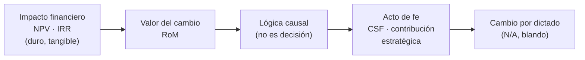

| Técnica | Fórmula / criterio |
|---|---|
| **ROI** (rendimiento de la inversión) | ROI = Beneficio anual / Monto de inversión (ingresos netos anuales promedio vs inversión) |
| **NPV / VAN** (valor neto presente) | PV del beneficio = Beneficio / (1+i)ⁿ · NPV = PV beneficios − PV inversión. **NPV ≥ 0 → invertir**; el más rentable = mayor NPV positivo. Tasa de descuento = costo de capital |
| **IRR / TIR** (tasa de rendimiento interna) | Tasa *i* que hace NPV = 0; se compara contra una **tasa crítica** (ej.: invertir solo si IRR ≥ 12%) |
| **Período de recuperación** (payback) | *Agotamiento:* Inversión − Beneficio acumulativo (hasta llegar a cero) · *Promedio:* Inversión / Beneficio anual promedio. Más corto = menos riesgo (pero baja el beneficio neto) |
| **Análisis de probabilidad de logro** | Única que considera el **riesgo** explícitamente; expande el ROI con **niveles de confianza**: **Certeza** (≥80%) · **Probabilidad** (≥50%) · **Esperanza** (solo si todo va bien) |
| **RoM** (rendimiento sobre el management, Strassmann) | RoM = valor agregado del management / costo del management. Éxito si **RoM > 1**. No hay correlación entre nivel de inversión en informática y rendimiento: el factor decisivo es el **management**, no el capital |
| **Contribución estratégica** (Silk) | Justificación **"por acto de fe"**: casi solo beneficios **intangibles**; "si contribuye a ampliar → invertir"; se aprueban los de fuerte vinculación con la estrategia (diferenciación o reducción de costos). Desventaja: difícil elegir entre dos proyectos, poco control de costos |

> [!note] Más allá de las cifras (7.4)
> **Justificar** (seleccionar) ≠ **evaluar** (seguimiento): casi ninguna empresa evalúa después de decidir. O'Brien: no siempre hace falta cuantificar todo (escalonada, portfolio, inseparabilidad). Hirschheim y Smithson: toda evaluación es **subjetiva y política**. La **efectividad del costo** y la **contribución estratégica** son las dos tensiones opuestas de la implementación de la estrategia.

> [!note] Actualización de flujos de fondos
> El dinero presente vale más que el mismo monto futuro → NPV e IRR usan una **tasa de descuento**.

---

# 10. Cierres y conclusiones para las preguntas "de elaboración"

> Preguntas: `[P1]` `[P3]`

> [!example] P1 — Ubicación y función de los SI/TI en la cadena de valor (conclusión sugerida)
> Según la definición de Andreu, Ricart y Valor, el SI es un conjunto **formal** de procesos que apoya la toma de decisiones para desempeñar las funciones y procesos del negocio **de acuerdo con su estrategia**. En la cadena de valor se ubica en la **infraestructura de la empresa** (actividad de soporte), desde donde **interactúa con todas las actividades** —básicas y de soporte— porque todas necesitan y generan información. Su **función** es recopilar la información generada por cada actividad y distribuirla a las que la necesitan, coordinando los **vínculos** entre eslabones; la información que maneja pertenece a la **empresa globalmente**, no a una actividad. Las TI son el recurso tecnológico que **implementa** el SI: primero la demanda (SI, el qué), después la oferta (TI, el cómo) (Edwards, cap. 4). Bien explotado, el SI puede incluso **reconfigurar la cadena de valor**.

> [!example] P3 — ¿Por qué alinear? (conclusión sugerida)
> Porque el SI **no es un fin en sí mismo**: existe para apoyar las funciones y procesos del negocio **de acuerdo con su estrategia** (Andreu, p. 12) y es actividad de **soporte** en la cadena de valor. Sin alineamiento el departamento de SI asigna recursos por facilidad técnica, atractivo tecnológico o poder del solicitante (la **"pared"** entre SI y negocio, Andreu p. 46) y se cae en los **7 problemas** de no tener una estrategia de SI/TI coherente (Edwards, pp. 32-33). Además, **estrategias de negocio distintas** (bajo coste vs diferenciación) exigen **SI distintos**. Alinear garantiza que **cada inversión en TI/SI responda a una necesidad real del negocio**; en la madurez (Fase IV) la alineación pasa a **interdependencia**: SI/TI se integran al formular la estrategia.

> [!tip] Cruces favoritos de examen (ver [[Comodines y cruces de examen]])
> **Cuadrante ↔ estrategia genérica** (§6.1) · **demanda ↔ oferta** (SI = qué, TI = cómo) · **rol ↔ relación ↔ estructura** (§8.2) · **centralizado ↔ delegado ↔ descentralizado** (§8.3) · **eficiencia ↔ eficacia** (§1.4) · **costos ↔ beneficios ↔ balance** (§9).
