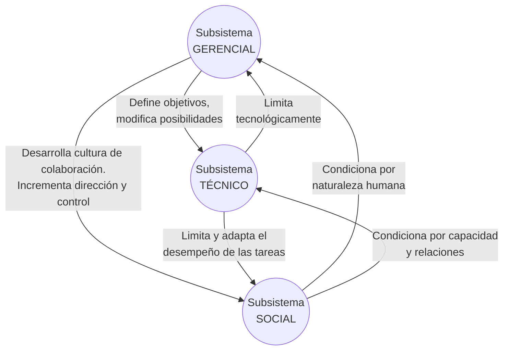

# Enfoque de Tavistock — el sistema sociotécnico

> [!quote] Definición textual (Chiavenato, p. 27)
> "El enfoque sociotécnico concibe la organización, o una parte de ella, como una **combinación de tecnología** (exigencias de la tarea, ambiente físico, equipo disponible) y, al mismo tiempo, como **sistema social** (sistema de relaciones entre quienes realizan la tarea)."

- **Otra manera de estudiar el sistema abierto**: dando importancia a su **proceso de transformación**, inmerso en el manejo de recursos (p. 24).
- Modelo propuesto por sociólogos y psicólogos del **Instituto Tavistock de Londres** (Trist y colaboradores): toda organización consta de una **combinación administrada de tecnología y de personas** que se relacionan recíprocamente (p. 25).
- La organización se ve entonces como **sistema abierto** (en interacción con su ambiente) y además como **sistema sociotécnico estructurado**.

## Doble función de toda organización (p. 25)
- **Técnica:** coordinación del trabajo y ejecución de tareas con la ayuda de la tecnología disponible.
- **Social:** manera de interrelacionar a las personas; modo de hacerlas trabajar juntas.

Los dos sistemas **no pueden mirarse aislados**, sino en el contexto de la organización en conjunto: **las modificaciones en uno repercuten en el otro**. La tecnología determina casi siempre las características de las personas que se necesitan (ingenieros y especialistas para tecnología computarizada, mano de obra para construcciones civiles).

> [!important] Eficiencia potencial vs real (Fig. 1.3, p. 24)
> - **Sistema tecnológico** (tareas, instalaciones, equipos, tecnología, métodos y procesos de trabajo) → responsable de la **eficiencia potencial**.
> - **Sistema social** (personas y sus características físicas y psicológicas, relaciones sociales en la organización formal e informal) → responsable de **convertir la eficiencia potencial en eficiencia real**.

## Los tres subsistemas (p. 26)

| Subsistema | Incluye | Rol |
|---|---|---|
| **Técnico o de tareas** | Flujo de trabajo, tecnología utilizada, roles que exige la tarea, otras variables tecnológicas | Responde por el flujo de información técnica necesaria para los objetivos. **Limita y adapta** al sistema social (hay que negociar con los trabajadores el desempeño de tareas) |
| **Gerencial o administrativo** | Estructura organizacional, políticas, procedimientos y reglas, sistema de recompensas y castigos, modo de tomar decisiones | Garantiza la administración y el desarrollo de la organización y su toma de decisiones; **optimiza la relación entre el técnico y el social** hacia las metas |
| **Social o humano** | Cultura organizacional, valores y normas, satisfacción de necesidades personales; organización informal, nivel motivacional, actitudes individuales | El **grado de cooperación** de individuos y grupos determina los resultados operacionales |

**Fig. 1.4 (Kingdon): tres círculos superpuestos.** Las zonas de intersección son las que suelen preguntar:

| Zona | Etiqueta en la figura |
|---|---|
| Círculo 1: **Sistema gerencial** | Administración organizacional |
| Círculo 2: **Sistema técnico** | Conceptos de sistemas |
| Círculo 3: **Sistema social** | Ciencias del comportamiento |
| Gerencial ∩ Social | **Relaciones de tareas** |
| Gerencial ∩ Técnico | **Desempeño de tareas** |
| Social ∩ Técnico | **Procesos de tareas** |
| Las tres (centro) | **Riesgo, complejidad, incertidumbre** |

## Esquema de interacciones (CI.1)

> [!note] De dónde sale cada flecha
> El esquema es la **síntesis de los alumnos** (Cuestionario I) de los párrafos de las pp. 26-27. Las flechas G→T, G→S, T→S y S→T están en el libro casi textuales. T→G ("limita tecnológicamente") y S→G ("condiciona por naturaleza humana") son **lecturas de los alumnos**: el libro dice que los objetivos económicos son modificados por consideraciones tecnológicas y que el grado de cooperación determina los resultados operacionales, pero no usa esas frases. La figura "oficial" del libro es el diagrama de Venn de arriba.

> [!important] Idea central (p. 27)
> Todo sistema de producción necesita una **organización tecnológica** (equipo y distribución de procesos) *y* una **organización del trabajo** (quienes desempeñan las tareas). La naturaleza de la tarea **incide** en la organización de las personas **pero no la determina**; las exigencias tecnológicas condicionan y limitan, pero la organización del trabajo tiene características sociales y psicológicas **propias, independientes de la tecnología**. Los objetivos organizacionales solo se logran si las tareas están suficientemente integradas y hay **complemento de los procesos sociotécnicos**.

**Cuestionario:** responde la **CI.1** (esquema conceptual del enfoque de Tavistock).

## 🔗 Relacionado
- [[Organización (concepto y sistemas abiertos)]] · [[Enfoque de Katz y Kahn]]
- [[Sistema de Información (definición)]] — el SI cruza lo técnico y lo social en la empresa
- [[Tecnologías de la Información (rol)]] — "la tecnología no es neutral"
- **Otras unidades:** [[Modelo humanista de diseño de cargos]] (U3: el subsistema social en el diseño del cargo)
