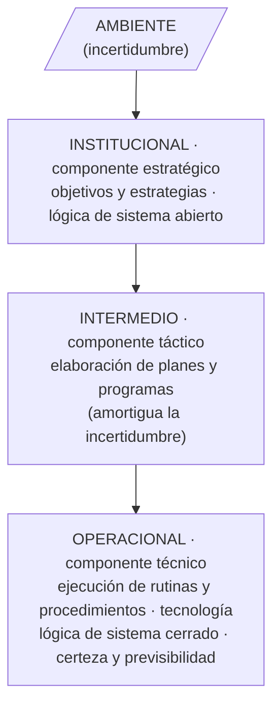

# Niveles organizacionales (Chiavenato)

> [!info] Planteo (Chiavenato, p. 37)
> **No toda la organización** se comporta como sistema abierto que interactúa con el ambiente: solo una parte. El **ambiente** genera desafíos **externos** y la **tecnología** impone retos **internos** (ambos son variables independientes; la estructura y el comportamiento organizacional son las dependientes). Para enfrentarlos, las empresas se desdoblan en **tres niveles**, cualquiera sea su naturaleza o tamaño.

| Nivel | Quiénes / dónde | Características | Lógica | Busca |
|---|---|---|---|---|
| **Institucional** (estratégico) | Directores, propietarios o accionistas y altos ejecutivos; la cima | **Toma decisiones y fija objetivos y estrategias.** Es **periférico y orientado al exterior** (interfaz con el ambiente). Enfrenta la **incertidumbre**: no tiene poder ni control sobre los eventos ambientales ni puede preverlos con precisión | **Sistema abierto** | **Eficacia** |
| **Intermedio** (táctico, mediador o gerencial) | Mandos medios; departamentos y divisiones; "línea de mediocampo" | **Articula** los niveles institucional y operacional: adecua las decisiones de la cima a las operaciones de la base y **transforma las estrategias en programas de acción**. **Amortigua** el impacto de la incertidumbre y lleva al nivel operacional programas, rutinas y procedimientos | Entre ambas | (el libro no lo asigna) |
| **Operacional** (núcleo técnico) | Áreas internas e inferiores: máquinas, instalaciones, líneas de montaje, oficinas, puntos de venta | Ejecuta las tareas y operaciones diarias, con **rutinas y procedimientos programados**, estandarizados, cíclicos y repetitivos. Opera con **certeza y previsibilidad** | **Sistema cerrado y determinista** | **Eficiencia** (máxima utilización de los recursos) |

- Las organizaciones son, a la vez, **sistemas abiertos** (por el nivel institucional, donde penetran las restricciones y contingencias ambientales) y **sistemas cerrados** (por el nivel operacional) (p. 38).
- Los tres niveles están **articulados y no tienen límites bien definidos**; forman parte de la **división del trabajo** organizacional (p. 38).
- Los **recursos humanos** están distribuidos en los tres niveles: dirección (institucional), gerencia y asesoría (intermedio), técnicos, auxiliares, operarios y supervisores de primera línea (operacional) (Parte II, p. 127).

## Cruce con los beneficios de los SI (Silk / Robson)

> [!warning] Es de Robson, no de Chiavenato
> Robson T3 cap. 7 (Fig. 7.17, p. 44, siguiendo a Silk) cruza el **beneficio genérico** (eficiencia, efectividad, avance estratégico) con el **nivel organizacional al que se percibe** (operacional, táctico, estratégico). Es una matriz de 3x3 (ejemplo del libro: un **DSS**, beneficio de efectividad percibido en el nivel táctico), no una regla uno a uno. La asociación habitual de la tabla es una **simplificación** útil para estudiar:

| Nivel | Beneficio habitual |
|---|---|
| Institucional (estratégico) | **Avance estratégico / competitividad** (intangible, justificación "blanda") |
| Intermedio (táctico) | **Efectividad** (mayor RoA; ej. DSS) |
| Operacional | **Eficiencia** (ahorro de costos, tangible, justificación "dura") |

> [!tip] Cruce completo nivel ↔ era ↔ beneficio ↔ management en [[Beneficios de los IS]] y [[Comodines y cruces de examen]].

> [!warning] No agregues el "plazo"
> No le atribuyas a Chiavenato que el nivel institucional es de "largo plazo" y el operacional de "corto plazo": el libro caracteriza los niveles por su relación con el **ambiente** (incertidumbre vs certeza, lógica de sistema abierto vs cerrado), no por el horizonte temporal.

## 🔗 Relacionado
- [[Beneficios de los IS]] · [[Organización (concepto y sistemas abiertos)]] · [[Ambiente organizacional]] · [[Eficiencia vs Eficacia]]
- [[Organización de los IS (enfoques estructurales)]] — administración de tecnología/uso/información por nivel
- **Otras unidades:** [[Niveles de administración del área de SI-TI]] (U3: mismo esquema estratégico / táctico / operativo dentro del área de SI-TI)
