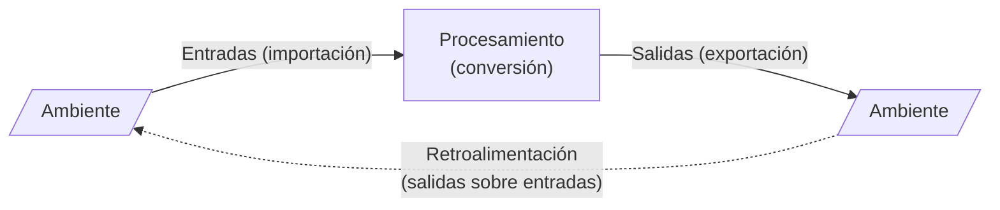

# Organización (concepto y sistemas abiertos)

> [!quote] Definición (Chiavenato, p. 7)
> Una organización es un **sistema de actividades conscientemente coordinadas, formado por dos o más personas**, cuya cooperación recíproca es esencial para su existencia.

Solo existe cuando: **(1)** hay personas capaces de comunicarse, **(2)** dispuestas a actuar conjuntamente, **(3)** que desean obtener un objetivo común (la definición viene de Barnard).

- Existen **para superar las limitaciones individuales**: lo que impide lograr muchos objetivos no es la capacidad intelectual o física, sino la falta de habilidad para trabajar con otros de manera eficaz (p. 8).
- Son **unidades sociales intencionalmente construidas y reconstruidas** para lograr objetivos específicos; nunca una unidad lista y acabada, sino "un organismo social vivo y cambiante" (p. 15).
- Con ánimo de lucro o sin él. **Empresa** = toda iniciativa humana que reúne e integra recursos humanos y no humanos (financieros, físicos, tecnológicos, mercadológicos) para lograr el **autosostenimiento** y obtener **ganancias** produciendo y comercializando bienes o servicios (p. 15).

## Organizaciones complejas (pp. 8-10)

Seis características de las grandes organizaciones:

| # | Característica | Idea |
|---|---|---|
| 1 | **Complejidad** (estructural) | Nace de la diferenciación **horizontal** (más división del trabajo) y **vertical** (más niveles jerárquicos): organizaciones *altas* vs *planas* |
| 2 | **Anonimato** | Importa que la tarea se haga, no quién la hace |
| 3 | **Rutinas estandarizadas** | Procedimientos y canales de comunicación; igual aparecen grupos informales |
| 4 | **Estructuras personalizadas no oficiales** | La organización **informal**, paralela a la formal |
| 5 | **Tendencia a la especialización** y proliferación de funciones | Separa la autoridad formal de la competencia técnica |
| 6 | **Tamaño** | Número de participantes y dependencias |

Al crecer, aumentan los niveles jerárquicos y se distancian los objetivos individuales de los de la cúpula (p. 8).

## Las tres eras (pp. 10-14, Cuadro 1.2)

| Era | Período | Estructura | Personas |
|---|---|---|---|
| **Industrialización clásica** | 1900-1950 | Funcional, burocrática, piramidal, centralizada (Teoría X); cambios lentos y previsibles | Factores materiales de producción → *Relaciones industriales* |
| **Industrialización neoclásica** | 1950-1990 | **Matricial** (departamentalización por productos o unidades estratégicas); transición | Recursos vivos → *Administración de RRHH* |
| **Información (o del conocimiento)** | 1990 en adelante | Fluida, flexible, descentralizada, **equipos interfuncionales** (Teoría Y); cambio rápido, imprevisible, turbulento | Seres proactivos y con inteligencia → *Administración de personas* |

> [!tip] La idea para la unidad
> En la era de la información **el recurso más importante ya no es el capital financiero sino el conocimiento** (p. 13). Es el puente natural hacia los SI/TI.

## La organización como sistema abierto (pp. 15-19)

**Sistema** = conjunto de elementos dinámicamente relacionados que desarrollan una actividad para alcanzar un objetivo o propósito, operando con datos, energía o materia del ambiente (p. 15).

**Los 4 elementos esenciales** (Fig. 1.1, p. 16):
- **Entradas (inputs) / insumos / importación:** recursos que el sistema toma del ambiente.
- **Procesamiento (operación):** núcleo que transforma las entradas en salidas.
- **Salidas (outputs) / resultados / exportación:** el producto que vuelve al ambiente.
- **Retroalimentación (feedback):** acción de las salidas sobre las entradas **para mantener el equilibrio** del sistema.

> [!note] Retroalimentación según Chiavenato (p. 17)
> **Positiva:** la salida (por ser mayor) estimula y amplía la entrada. **Negativa:** la salida (por ser menor) restringe y reduce la entrada. Sirve para que el sistema funcione dentro de ciertos límites. (En Katz y Kahn, la retroalimentación *negativa* es la que **corrige desvíos**: ver [[Enfoque de Katz y Kahn]].)

**Ambiente** = todo lo que rodea al sistema y le proporciona los recursos para su existencia; también es fuente de **contingencias y amenazas** (p. 17).

| | **Sistema cerrado** (mecánico, determinista) | **Sistema abierto** (orgánico) |
|---|---|---|
| Entradas y salidas | Pocas, bien conocidas, con relación causa-efecto | Numerosas, poco definidas; causa-efecto **indeterminada** |
| Fronteras | Cerradas; separación clara con el ambiente | Abiertas y permeables |
| Ejemplos | Motores, máquinas, la mayor parte de la tecnología | **Organizaciones y empresas**, sistemas vivos, el hombre |

No existe un sistema totalmente cerrado (sería hermético) ni totalmente abierto (se disiparía). El sistema abierto está en **continua interacción con el ambiente** y alcanza un **estado estable o equilibrio dinámico** mientras mantiene su capacidad de transformar energía; sin el flujo continuo de entradas-transformación-salidas no sobrevive. Al recibir insumos evita la **entropía** (tendencia del sistema cerrado al desorden y la desintegración). La organización es un **modelo genérico de sistema abierto** (p. 18).

La organización empresarial es además un **sistema sociotécnico**: no solo edificios, dinero y máquinas, sino personas que aplican tecnologías (p. 20) → [[Enfoque de Tavistock]].

## 🔗 Relacionado
- [[Enfoque de Katz y Kahn]] — las 8 características del sistema abierto
- [[Enfoque de Tavistock]] — otra manera de estudiar el sistema abierto
- [[Participantes y objetivos organizacionales]] · [[Recursos organizacionales]] · [[Racionalidad de las organizaciones]]
- [[Ambiente organizacional]] · [[Niveles organizacionales (Chiavenato)]]
