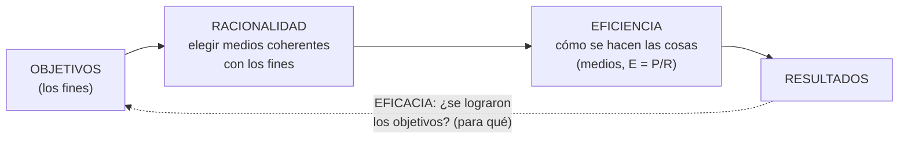

# Racionalidad de las organizaciones

> [!quote] Definición textual (Chiavenato, p. 33)
> "La racionalidad implica **adecuar los medios utilizados a los fines y objetivos que se desean alcanzar**."

- En el contexto de la **teoría de la burocracia**, esto significa **eficiencia**: una organización es racional si escoge **los medios más eficientes** para lograr los objetivos, considerando **solo los objetivos organizacionales** (no los individuales). Se logra mediante **normas y reglamentos** que rijan el comportamiento de los participantes **en la búsqueda de la eficiencia** (p. 33). Taylor (administración científica) se funda en esta racionalidad: encontrar *the best way*.
- Es **la exigencia primordial** de todas las actividades administrativas (p. 33).
- Se emplea en dos situaciones (pp. 33-34): **(a)** cuando el problema implica **reducir los medios** para obtener un fin (utilización mínima de recursos), o **(b)** cuando **los fines deseados determinan la forma de comportamiento** del sistema (adecuación de recursos). En (b) se busca lograr el objetivo específico **con los recursos disponibles y de la manera más eficiente**.
- **Racionalidad organizacional:** toda organización se comporta según una racionalidad que le es inherente, ligada a los **medios, métodos y procesos** con los que considera que alcanzará sus fines. Se basa en una presuposición de **causa y efecto**: una acción o procedimiento es racional si es **coherente con el objetivo** que se pretende (o con premisas aceptadas por la organización). Existe porque el comportamiento está **planeado y dirigido** hacia ciertos objetivos (p. 34).
- **La eficiencia es resultado de la racionalidad**: una vez establecidos los objetivos, a la racionalidad le compete **descubrir los medios más adecuados** para conseguirlos. **E = P / R** (productos o salidas sobre recursos o entradas) (p. 34).
- Los objetivos y la racionalidad van de la mano: "al establecer sus objetivos, las empresas **definen su racionalidad**; basadas en ésta, ponen en práctica **estrategias** que les permiten alcanzar los objetivos" (resumen del cap. 1, p. 53).

## Dimensiones múltiples (y sus conflictos), p. 34

| Racionalidad | Hay coherencia con… |
|---|---|
| **Económica** | La teoría económica y los presupuestos económicos de la empresa |
| **Legal** | Las leyes y la jurisprudencia vigentes |
| **Social** | Los valores y normas sociales |
| **Política** | El poder y la influencia política que se desean alcanzar |
| **Técnica** | La evidencia y los métodos científicos |

> [!warning] Punto clave
> La organización busca satisfacerlas **simultáneamente**, pero cumplir una **puede perjudicar a las otras**. Ejemplo del libro: escoger un producto por **racionalidad técnica** (búsqueda de eficiencia en la producción) puede sacrificar la **económica** (sube el precio), la **legal** (choque con una marca o patente) o la **social** (condiciones de trabajo adversas).

**Dicotomía organización-individuo:** que la organización sea racional **no implica que sus miembros actúen racionalmente** respecto de sus aspiraciones personales; cuanto más racional y burocrática, más automáticamente trabajan ("engranajes de una máquina") y se olvidan del propósito y significado de su comportamiento (p. 33).

## Relación racionalidad - eficiencia - eficacia (CI.3)

> **Pregunta del cuestionario:** ¿Qué significa la racionalidad? ¿Cuál es la relación entre racionalidad, eficacia y eficiencia?

| Concepto | Qué es para Chiavenato | Pregunta que responde |
|---|---|---|
| **Racionalidad** | Adecuar los medios a los fines; una vez fijados los objetivos, le compete **descubrir los medios más adecuados** | ¿Estos medios son coherentes con estos fines? |
| **Eficiencia** | **Resultado de la racionalidad**: uso adecuado de los recursos para lograr el fin | **Cómo** se hacen las cosas |
| **Eficacia** | **Logro de los objetivos**; verifica que lo bien hecho sea lo que debía hacerse | **Para qué** se hacen las cosas; qué resultados se logran |

**Respuesta modelo (anclada en el libro):** la racionalidad es adecuar los medios a los fines; en la teoría burocrática equivale a elegir los medios más eficientes y se logra con normas y reglamentos. La **eficiencia es su resultado** (fijados los objetivos, la racionalidad descubre los medios más adecuados). El **logro de los objetivos no compete a la eficiencia sino a la eficacia**, y ambas deben considerarse **simultáneamente**, aunque **no siempre van de la mano** → [[Eficiencia vs Eficacia]].

> [!warning] Ojo con los apuntes de alumnos
> La respuesta del Cuestionario I agrega que la racionalidad se liga a la eficacia ("adaptar los medios disponibles para lograr los fines") y propone **pasos**: *primero* adaptar los medios a los fines y, *una vez alcanzados*, aplicar técnicas para buscar la eficiencia. **Esa secuencia no está en el libro** y choca con él: para Chiavenato la racionalidad **busca la eficiencia desde el principio** (la eficiencia es su resultado, no una etapa posterior al logro de los fines). Lo que sí es textual es que la racionalidad se emplea tanto para **reducir recursos** como para **adecuar recursos a fines** (pp. 33-34). El Apunte de Yoel suma que la racionalidad "decide qué objetivo se quiere lograr": tampoco es del libro (los objetivos se fijan primero y la racionalidad elige los medios).

**Cuestionario:** responde la **CI.3**.

## 🔗 Relacionado
- [[Eficiencia vs Eficacia]] — la distinción que se desprende de acá
- [[Participantes y objetivos organizacionales]] — los fines a los que se adecuan los medios
- [[Organización (concepto y sistemas abiertos)]]
