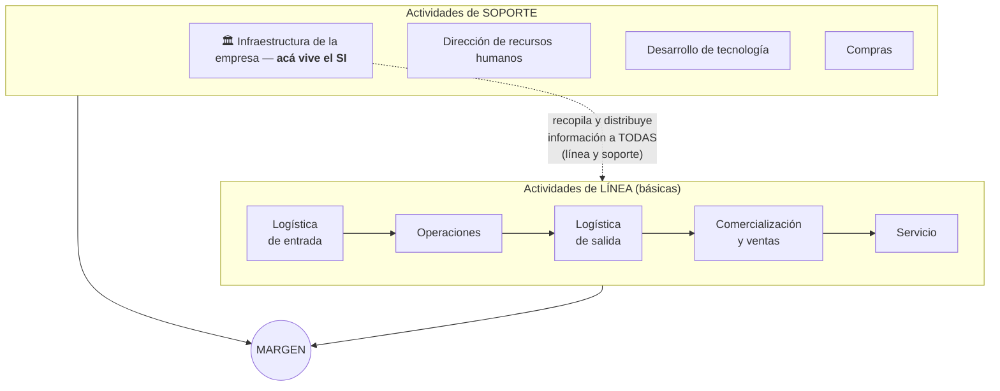

# El SI en la cadena de valor

**El SI forma parte de la *infraestructura de la empresa* (actividad de soporte) y, como todas las actividades necesitan y generan información, el SI las recopila y las distribuye: es el sistema que coordina la cadena de valor.** La información que maneja el SI "básico" **pertenece a la empresa considerada globalmente**, no a una actividad (Andreu, Ricart y Valor, cap. 2, pp. 15-18).

## La cadena de valor (Fig. 2.2, p. 16; concepto de Porter, 1985)
Andreu la usa solo como **esquema descriptivo** de las actividades de la empresa. Distingue dos tipos:
- **Actividades de línea o básicas:** tienen que ver **directamente con la creación de valor**. En el esquema del libro: *logística de entrada · operaciones · logística de salida · comercialización y ventas · servicio*.
- **Actividades de soporte:** aquellas en las que las anteriores **se apoyan para coordinarse, compartir información**, etc. En el libro: *infraestructura de la empresa · dirección de recursos humanos · desarrollo de tecnología · compras*.
- Todo converge en el **margen** (el esquema lo dibuja como la punta de flecha).

## Respuesta a la P1 — ubicación y función (Fig. 2.2-a, p. 17)
1. **Ubicación.** De la definición de SI (*"uno más de los sistemas de la infraestructura"*) se deduce que **el SI forma parte precisamente de la infraestructura de la empresa**. De ahí: **todas las actividades "de línea" precisan apoyo basado en el SI**.
2. **Alcance.** Como las actividades de soporte **"se apoyan entre sí"**, el SI **interacciona con todas las demás actividades** de cualquier empresa, básicas o de soporte, **"en grado no trivial"** (p. 16).
3. **Función: recopilar y distribuir.** Todas las actividades **necesitan y generan información**: el SI **recopila** la que generan unas y necesitan otras, y **la distribuye** a cada actividad.
4. **Función: coordinar.** El SI juega un **papel de coordinación** entre actividades **a todos los niveles**: **básicas entre sí** (ej.: hacer llegar los pedidos a producción en una empresa que fabrica sobre pedido), **básicas con soporte** (ej.: cualquier actividad de control) y **soporte entre sí** (ej.: seguimiento del personal de actividades de soporte). Su papel es **central** para el buen funcionamiento de esas interacciones.
5. **Propiedad global.** La información del SI, *"aunque generada o utilizada por actividades concretas, **no pertenece a ninguna actividad en particular; pertenece a la empresa considerada globalmente**"* (p. 18). → es una consecuencia directa de ubicarlo en la infraestructura.
6. **Vínculos.** La relevancia del SI es también notable en los **vínculos** (*influencias mutuas, a veces indirectas, entre actividades*): ej. recopilar sistemáticamente las **reclamaciones de clientes** orienta el **control de calidad** en operaciones. Exige un **punto de vista global**. **En casos extremos** los vínculos se explotan hasta **reconfigurar la propia cadena de valor** → nuevos enfoques para un mismo negocio y **ventajas competitivas** (p. 17).
7. **Y más fundamental:** el SI influye no solo en el funcionamiento, sino en el **diseño de la organización** (estructuras en las que se basa el funcionamiento). Se emparenta con la **reingeniería de procesos de negocio** (Hammer y Champy, 1993): *proceso de negocio* = conjunto de actividades relacionadas por vínculos susceptibles de **mejorarse radicalmente**, en particular con ayuda de las TI; todo proceso debe tener un **cliente** claramente identificado (p. 17).

> [!tip] Estructura de respuesta sugerida (P1)
> **Definición de SI** (para qué) → **cadena de valor: línea vs soporte** → **SI ∈ infraestructura** (soporte) → **línea necesita al SI; soporte se apoya entre sí → SI interactúa con todas** → **recopila + distribuye + coordina** → **la información es de la empresa**. Terminá con: *por eso el SI es de la dirección y exige visión global*. Las **TI** no aparecen en la ubicación: son el medio con que se implementa ([[Tecnologías de la Información (rol)]]).

## SI "básico" vs subsistemas circunscritos (Figs. 2.2-b, c, d; pp. 18-20)
- **SI básico** = el que forma parte de la **infraestructura de empresa** (el que se define en este capítulo). Es el que presenta **más dificultades** de planificación y diseño.
- **Subsistemas circunscritos:** una actividad puede procesar **volúmenes importantes de información en un grado de detalle que nadie más necesita**. Esos sistemas **no forman parte (estrictamente) del SI básico**, aunque se implementen con TI.
- **Cuidado con la confusión** (p. 18): como se implementan con informática, es fácil considerarlos parte del SI. Ejemplos de **circunscritos**: los **ordenadores que gobiernan las máquinas-herramienta** de una planta, o los de una **refinería que controla la producción en tiempo real** → se **planifican, diseñan, financian y utilizan desde la perspectiva de esa actividad**, *"como se haría con un torno o un horno"*.
- **Criterio:** que sean **lo más independientes posibles** de la información que otras actividades usan como *inputs* u *outputs*. **Contabilidad NO es circunscrita** (aunque el departamento lo crea): todos los apuntes se generan en otras áreas.
- Pueden usar o generar información para otras actividades **si lo hacen en volúmenes poco importantes**; entonces acaban teniendo **interfaces claras con el SI básico** (Fig. 2.2-b).
- **Depende del grado de detalle** con que se describa la cadena (p. 19): a más detalle, más subsistemas afectan a más de una actividad. Suele estar claro qué nivel es razonable (no tiene sentido tratar cada operación elemental de una refinería como actividad).
- **Fig. 2.2-c:** si los subsistemas particulares **se solapan** de modo que varias actividades se coordinan a través de ellos, **su conjunto es, de hecho, parte del SI básico** (típico en **bancos y aseguradoras**, donde el manejo de información es central).
- **Fig. 2.2-d:** aun así pueden **coexistir** subsistemas circunscritos con un SI básico grande en contacto directo con varias actividades.
- **Terminología (p. 20):** *SI* = el SI **básico**. Para referirse a **todos** los subsistemas, incluidas las **aplicaciones específicas de TI a actividades concretas**, el libro usa **TI/SI**.

## El SI y los demás sistemas de la empresa — el *equilibrio* (2.4, Fig. 2.3, pp. 21-22)
Fig. 2.3 (adaptada de **Hax y Majluf, 1984**) muestra la **infraestructura de la empresa**: **sistema de planificación · sistema de control · estructura de la organización · sistemas de información/comunicación · sistemas de compensación e incentivos**, sobre los **aspectos humanos** (individuales y de grupo) y la **cultura de la organización**.
- Los SI son **parte integrante** de la infraestructura (la figura incluye **también los SI informales**, que el libro había dejado de lado).
- Hay **interdependencia directa total** entre todos los sistemas (no solo a través de la estructura).
- **Doble coherencia:** *interna* (entre sistemas → un **"equilibrio"**, que se logra con ajustes y compromisos) y *con los objetivos* de la empresa (los objetivos se tienen en cuenta **explícitamente al definir** cada sistema).
- **Cualquier cambio** en un elemento (en particular el SI) produce un **desequilibrio** que dispara un proceso de **"retorno al equilibrio"** con implicaciones en el resto. Por eso los cambios deben ser **muy equilibrados** (desajustes mínimos) **o muy modestos y espaciados** (para que el conjunto se reequilibre solo). La mejor estrategia depende de cada empresa y de los aspectos humanos.

> [!warning] Ojo con los apuntes de alumnos
> - El **margen** como "diferencia entre el valor que la empresa crea para los clientes y los costos de sus actividades" (Apunte Supremo) es la definición de Porter: Andreu **solo dibuja** el margen en la figura, no lo define en el cap. 2. Sirve como contexto, pero **la P1 se contesta con lo que dice Andreu**.
> - "Cada eslabón debe dar valor agregado y el SI conecta eslabones" (Supremo) es una **glosa de alumno**, razonable, no cita textual.
> - Detalle de la figura: Andreu dibuja las actividades **de línea en la parte inferior** y las **de soporte arriba**, y agrupa visualmente "interrelaciones de producción" y "de mercado" (Fig. 2.2).

**Cuestionario:** responde la **P1** (junto a [[Sistema de Información (definición)]]).

## 🔗 Relacionado
- [[Sistema de Información (definición)]] · [[Tecnologías de la Información (rol)]]
- [[Contexto de la estrategia SI-TI (Edwards)]] — cadena de valor interna/externa como herramienta de evaluación
- [[Alineamiento E.O. – E.SI-TI (esquema general)]] — la misma infraestructura (planificación, control, estructura…) reaparece al alinear
