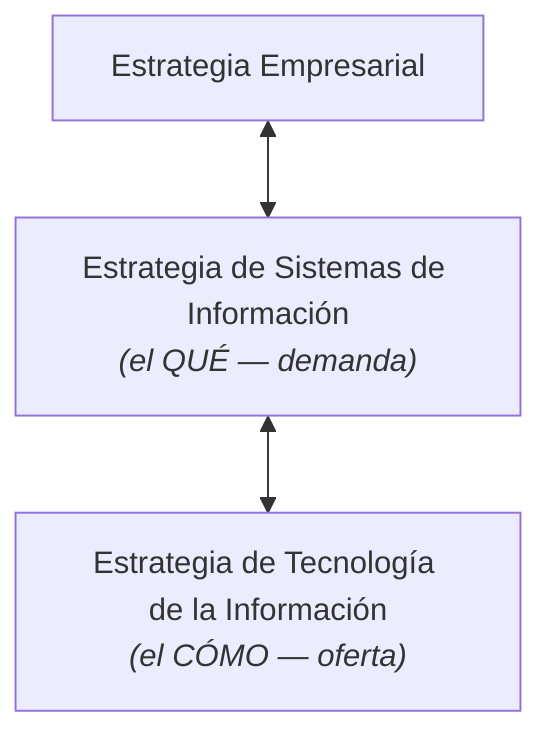

# Estrategia de SI vs Estrategia de TI (demanda y oferta)

**La estrategia de SI define QUÉ necesita la empresa (necesidades de información y de sistemas = la *demanda*); la estrategia de TI define CÓMO se satisfacen esas necesidades (tecnología, recursos, organización = la *oferta*), según las prioridades fijadas por la estrategia de SI.** (Edwards, Ward y Bytheway, cap. 4, pp. 32-35.)

> [!warning] Fuente
> Esta distinción **no está en Andreu cap. 2-3**: es de **Edwards, cap. 4** ("La integración de los sistemas de información y la estrategia empresarial"). Andreu usa **TI/SI** para el conjunto y habla de *plan de TI/SI*. Y ojo: *"SI vs TI"* también aparece como relación **SI ↔ TI** (el SI como el "para qué" y la TI como el medio de implementación): eso es la [[Tecnologías de la Información (rol)|P2 de Andreu]]. Acá se trata de las **estrategias**, que es lo que se pregunta en los finales.

> [!quote] Definiciones textuales (Edwards, cap. 4, p. 34)
> **Estrategia de SI:** *"define las necesidades de información y de sistemas que tiene la empresa, así como las funciones que la integran. Si la organización opera en más de un negocio, entonces cada negocio tendrá su estrategia y, además, habrá una estrategia para satisfacer las necesidades corporativas globales. [...] ha de definir **qué sistemas de información precisa la empresa** para el futuro próximo, sobre la base de un análisis de la propia empresa, su entorno y su estrategia de negocio. El objetivo es **definir las necesidades de aplicaciones de SI/TI, en línea con los planes y aspectos críticos de la empresa**."* Esas necesidades **cambian** y se **actualizan, revisan y priorizan** continuamente. La estrategia debe definir también **quién** es responsable de planificar, entregar e implantar los SI.
> **Estrategia de TI:** *"define **cómo se van a satisfacer las necesidades** en base a las **prioridades de la estrategia del SI** y a la **tecnología de la información necesaria para desarrollar y operar las aplicaciones actuales y futuras**."* Supone determinar **cómo desarrollar** las aplicaciones, **cómo adquirir, utilizar, controlar y gestionar** los recursos **tecnológicos y humanos**, **qué actividades** llevar a cabo y **cómo organizarlas** → bases para definir y ejecutar los proyectos que instalan cada aplicación.

| | **Estrategia de SI** | **Estrategia de TI** |
|---|---|---|
| Lado | **DEMANDA** (de aplicaciones y de información) | **OFERTA** (de recursos y de tecnología) |
| Pregunta (Fig. 4.2) | **¿QUÉ?** | **¿CÓMO?** |
| Define | Necesidades de información y de sistemas y las **funciones** que la integran; **qué sistemas** precisa la empresa | **Cómo** se satisfacen: desarrollo, adquisición, uso, control y gestión de recursos **tecnológicos y humanos**; actividades y organización |
| Punto de partida | **Análisis de la empresa, su entorno y su estrategia de negocio** | **Prioridades de la estrategia de SI** |
| Resultado (p. 35) | Estrategias de SI: **necesidades y prioridades de información** | Estrategias de TI: **infraestructura de medios y servicios de distribución** necesarios (para el departamento de proceso de datos) |
| Alcance | Una por **negocio** + una para las **necesidades corporativas globales** (p. 34) | (el libro no la desagrega por negocio en este capítulo) |

La **conjunción de ambos productos** es una **cartera de futuras aplicaciones de SI/TI** que satisface las necesidades del negocio (p. 35; Fig. 4.2).

*(Fig. 4.1, p. 33: las flechas van **en ambos sentidos**; en la Fig. 4.2 la estrategia de SI se rotula "QUÉ" y la de TI "CÓMO", y entre ambas circulan las **prioridades de necesidades** y la **arquitectura de los servicios**.)*

## Reglas que enseña el libro
> [!tip] Primero la demanda, después la oferta
> - Resumen del cap. 4 (p. 49): la estrategia *"debe **dar prioridad a la demanda** según las necesidades de la empresa, y luego asegurar que se **gestiona la oferta** de recursos y de tecnología de la mejor forma posible para satisfacer la demanda"*.
> - Cap. 5: el esquema de planificación está orientado **al lado de la demanda**, *"independiente de las consideraciones de la oferta"*: **"siempre es importante decidir **lo que queremos hacer antes de decidir cómo** hacerlo"**; el cap. 6 trata luego las estrategias **del lado de la oferta**.
> - **Responsabilidad de la dirección:** **equilibrar demanda y oferta** (apartado "El equilibrio entre demanda y oferta", p. 34): ajuste continuo basado en las prioridades del negocio y en las restricciones de recursos.

> [!example] Qué pasa si se invierte el orden (ejemplo de la facturación, pp. 46-47)
> Tres unidades de negocio con estrategias distintas comparten un sistema de facturación: *"la estrategia se ha basado en el punto de vista de **la oferta de TI** (aspectos económicos a corto plazo), en lugar de haberlo hecho bajo la perspectiva de **la demanda de SI**"* → costes que aumentan y beneficios que bajan. Y si la estrategia la determina la **optimización de la oferta de TI**, *"los usuarios de la empresa **no serán propietarios de la estrategia**, ni ésta satisfará sus necesidades"*. Ver [[Estrategias competitivas de Porter]].

**También en el libro (p. 32):** el fracaso de la estrategia de SI/TI viene, en parte, de la **incapacidad de la dirección para gestionar las demandas de información o de sistemas** en respuesta a las necesidades de la empresa **y/o** para **proporcionar sistemas y tecnología de manera coherente**, **y/o** de no hacer corresponder ambos aspectos.

## ¿Cómo la respondieron los alumnos en los finales?
> [!warning] Ojo con la respuesta de los alumnos (Finales; la pregunta aparece en **tres mesas**)
> *"La estrategia de SI está impulsada por las necesidades de información y expone una **demanda de aplicaciones**… La estrategia de TI comprende la **oferta de aplicaciones disponibles** para cumplir con la demanda de las estrategias de SI."*
> - **Está bien** el eje **demanda / oferta** y que la TI **responde** a la SI.
> - **Falta o es impreciso:** el libro **no** dice "oferta de aplicaciones disponibles", dice que la estrategia de TI define **cómo** se satisfacen las necesidades: **cómo desarrollar las aplicaciones y cómo adquirir, utilizar, controlar y gestionar los recursos tecnológicos y humanos** (p. 34). Conviene agregar **qué/cómo**, que la estrategia de TI se basa **en las prioridades de la estrategia de SI**, y que SI se define **a partir del análisis de la empresa, su entorno y su estrategia de negocio**.
> - **Respuesta modelo (3 líneas):** *Estrategia de SI = QUÉ: define las necesidades de información y de sistemas (demanda) en línea con los planes y aspectos críticos de la empresa. Estrategia de TI = CÓMO: define cómo satisfacerlas (oferta) según las prioridades de la estrategia de SI y la tecnología necesaria para desarrollar y operar las aplicaciones actuales y futuras. Primero la demanda, después la oferta.*

> [!note] Integración con la estrategia empresarial
> La integración de los SI con la estrategia empresarial debe incorporar **métodos para evaluar el impacto potencial** de los SI/TI sobre la organización y su entorno (p. 33), tan importante como considerar otros factores externos al formular la estrategia empresarial. Que la estrategia de SI/TI **se traduzca** en sistemas concretos depende de **la habilidad para traducir los requisitos empresariales en SI concretos** y de la **capacidad de la estrategia de TI para proporcionarlos** (p. 33).

**Cuestionario:** responde la **P2** (como complemento de [[Tecnologías de la Información (rol)]]) y se pregunta como **"Diferencia estrategia SI y TI"** en los finales.

## 🔗 Relacionado
- [[Contexto de la estrategia SI-TI (Edwards)]] · [[Tecnologías de la Información (rol)]] · [[Sistema de Información (definición)]]
- [[Alineamiento E.O. – E.SI-TI (esquema general)]] · [[Estrategias genéricas de gestión (Parsons)]] (el eje demanda/oferta reaparece al comparar estrategias de gestión)
