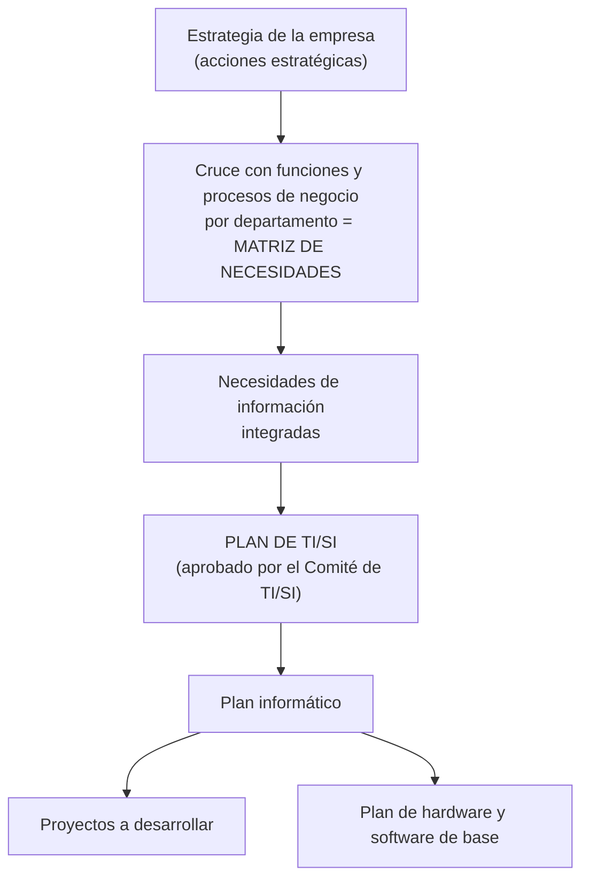
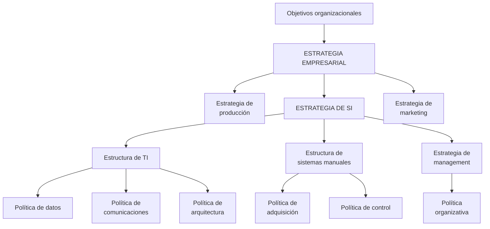

# Alineamiento E.O. – E.SI/TI

> [!quote] Concepto de alineamiento (pregunta de finales: "Concepto alineamiento")
> **Alinear** es **deducir explícitamente el Plan de TI/SI del plan estratégico vigente** de la organización (Andreu, p. 50), mediante un procedimiento sistemático que **integra las necesidades de información** surgidas del **cruce de las directrices estratégicas** con las **funciones y procesos de negocio** de las distintas unidades organizativas (Andreu, p. 52).
>
> **Respuesta de finales** (la que arman los alumnos): el alineamiento de las estrategias organizacionales con las de SI/TI tiene como objetivo **desagregar las necesidades de información de la organización por departamento, por funciones y por acción estratégica**, para asegurar que cada estrategia de SI/TI esté alineada y contribuya a las estrategias generales. Es exactamente lo que hace la [[Matriz de necesidades]].

## De la estrategia al Plan de TI/SI

- **Quién lo hace:** la responsabilidad es de la **dirección de la empresa**, con participación del estamento técnico (Andreu, p. 52).
- **Pasivo vs activo:** el procedimiento de Andreu (cap. 5) parte de una estrategia de negocio **ya definida** (método **pasivo**). Integrar SI/TI **en el momento de formular** la estrategia es el método **activo** (Fase IV; Parte III del libro). Ver [[Evolución de la planificación de SI (4 fases históricas)]].

> [!tip] SI = QUÉ, TI = CÓMO
> La derivación "necesidades de información → estrategia de SI (demanda) → estrategia de TI (oferta)" es la lectura de la cátedra/alumnos (Yoel) sobre la matriz. El libro de Andreu no usa esos términos en el cap. 5; la distinción está en Edwards (cap. 4) y se desarrolla en [[Estrategia de SI vs Estrategia de TI]].

## ¿Por qué alinear? (P3)

> [!important] Respuesta corta
> Porque el SI **no es un fin en sí mismo**: existe para apoyar las **funciones y procesos de negocio "de acuerdo con su estrategia"**. Sin alineamiento se gastan recursos con criterios ajenos al negocio (expansión anárquica) y se pierde competitividad; con alineamiento cada inversión en TI/SI responde a una necesidad estratégica.

| # | Argumento | Fuente |
|---|---|---|
| 1 | **Por definición:** el SI es el conjunto formal de procesos que apoya la toma de decisiones necesaria para desempeñar las funciones y procesos de negocio **de acuerdo con su estrategia** | Andreu, p. 12 |
| 2 | **Por su lugar en la cadena de valor:** el SI es **actividad de soporte** (infraestructura): su función es dar soporte a las estrategias de las demás actividades. Esta es la respuesta que dan los alumnos en el cuestionario | Cuestionarios (P3); ver [[El SI en la cadena de valor]] |
| 3 | **Por lo que pasa si no se alinea (la "pared"):** el depto. de SI asigna recursos por facilidad de implementación, atractivo tecnológico, poder del solicitante o coste, criterios que **"no tienen por qué ser coherentes con los objetivos estratégicos"**, que el responsable de SI suele desconocer | Andreu, p. 46 |
| 4 | **Por sus costos concretos:** la falta de una estrategia coherente de SI/TI da lugar a 7 problemas (ver abajo) | Edwards, cap. 4, pp. 32-33 |
| 5 | **Por eficacia estratégica:** unidades con estrategias distintas (**bajo coste** vs **diferenciación**, Porter) necesitan SI distintos; un sistema compartido hace que **ninguna** desarrolle su estrategia con eficacia | Edwards, pp. 46-47; [[Estrategias competitivas de Porter]] |
| 6 | **Por ventaja competitiva:** es difícil obtener ventajas sostenibles si el plan de TI/SI es solo pasivo; hace falta integrar las posibilidades de SI/TI al **formular** la estrategia | Andreu, pp. 48-49 |
| 7 | **Por el valor de las inversiones:** "adecuación estratégica" (grado en que el proyecto apoya directamente las estrategias empresariales) es un criterio de valor al priorizar inversiones en IS | Robson T3, cap. 7 |

> [!example] Los 7 problemas de no tener una estrategia de SI/TI coherente (Edwards, pp. 32-33)
> 1. Competidores, proveedores y clientes pueden obtener ventajas sobre la empresa.
> 2. Los objetivos empresariales se vuelven inalcanzables por las limitaciones de los sistemas.
> 3. Sistemas no integrados: duplicación de esfuerzo, inexactitud, retrasos, mala gestión de la información.
> 4. Implantaciones que se retrasan, exceden el coste y no logran los beneficios, por no haber definido las necesidades básicas del negocio.
> 5. Prioridades y planes que cambian continuamente: conflictos entre usuarios y personal de SI, baja productividad.
> 6. Tecnologías elegidas que no se integran o se vuelven una limitación.
> 7. Falta de medios para fijar niveles adecuados de recursos de SI/TI, evaluar inversiones y priorizar con coherencia.

## Esquema jerárquico de los cuestionarios (P3)

Los alumnos respondieron la P3 con este esquema. **No figura** en Andreu (cap. 5) ni en el cap. 4 de Edwards (según el texto verificable): proviene de material de cátedra/alumnos. Sirve como mapa de qué se deriva de qué.

*(Las flechas de las dos últimas ramas se leen de forma aproximada en el original escaneado.)*

> [!warning] Ojo con los apuntes de alumnos
> Las "4 entradas clave" (entorno empresarial externo e interno, entorno externo e interno de SI/TI) que los apuntes ubican al comienzo del "Esquema general del procedimiento" **son de Edwards (cap. 4), no de Andreu**. Ver [[Contexto de la estrategia SI-TI (Edwards)]].

## Antes del alineamiento: la estrategia general
La [[Planificación estratégica del negocio (Palom Izquierdo)|planificación estratégica del negocio]] define principios, misión, análisis interno/externo, metas y programas de acción. Sobre esa estrategia se aplica el procedimiento de alineamiento.

**Cuestionario:** responde la **P3**.

## 🔗 Relacionado
- [[Plan de TI-SI (contenido)]] · [[Procedimiento de alineamiento (4 fases)]] · [[Grupos de trabajo del plan]]
- [[Evolución de la planificación de SI (4 fases históricas)]] · [[Matriz de necesidades]]
