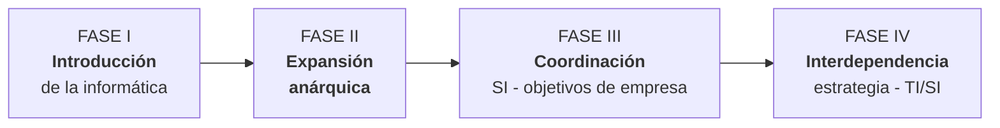

# Evolución de la planificación de SI — 4 fases (Andreu, cap. 5; análogo a Gibson y Nolan, 1974)

> [!quote] Qué dice el libro (Andreu, p. 43)
> La planificación de SI, entendida como **"procedimiento sistemático de toma de decisiones sobre qué hacer en el próximo futuro con los sistemas de información"**, ha seguido **cuatro fases diferenciadas**. *"Este esquema es **parecido** al introducido por Nolan (Gibson y Nolan, 1974)"* al estudiar el crecimiento de la informática en las empresas.

> [!warning] Atribución
> Las 4 fases de **planificación** (introducción, expansión anárquica, coordinación, interdependencia) son el esquema **de Andreu, Ricart y Valor**, solo *parecido* al de Nolan. Las etapas **propias de Nolan** son otras (Inicio, Contagio, Control, Madurez; ver abajo). Si el examen dice "Gibson y Nolan", pensá en el **modelo de Nolan**; si dice "las 4 fases de la planificación de SI", pensá en las **de Andreu**.

| Fase | Qué pasa | Problema central / consecuencia |
|---|---|---|
| **I. Introducción** (años 60) | Ordenadores enormes, manejados solo por especialistas. Objetivo de los directivos: **reducir costes** de proceso (contabilidad, nómina, facturación: procesos puramente administrativos). **No hay planes formales**: los "planes informáticos" son planes de desarrollo de **peticiones de usuario**, priorizadas por **coste-beneficio estrictamente económico** (Fig. 5.1) | **Aislamiento** del depto. de **Proceso de Datos (PD)**, dependiente de servicios administrativos. Nace el **"muro"** entre PD y la organización; la conexión entre objetivos y planes de SI es inexistente |
| **II. Expansión anárquica** | Mecanizados los procesos básicos, llegan pedidos más complejos y ligados al negocio. Aparecen **aplicaciones transaccionales disjuntas**, a veces unidas por otras aplicaciones "canal"; el depto. ya se llama **de SI**, pero sigue asignando recursos y prioridades | Criterios **no coherentes con la estrategia**, que el responsable de SI suele desconocer: **1) facilidad de implementación, 2) novedad/atractivo tecnológico, 3) poder de la unidad solicitante, 4) coste del desarrollo** (p. 46). Ejemplo del libro: aseguradora que trata como "mantenimiento rutinario" pedidos de Comercial con alto valor estratégico |
| **III. Coordinación SI-objetivos** | Grandes **inversiones** para mantener la instalación + **quejas de usuarios** hacen que la alta dirección encare los SI globalmente. Primero **interviene directamente** en la selección de proyectos (Fig. 5.2), lo que es incoherente con el rol del responsable de SI (**dilución de responsabilidades**). Se pasa a **procedimientos formales de planificación** (Fig. 5.3) | Hay que **"derribar la pared"**: no es fácil, está arraigada en la cultura y los procedimientos; puede requerir una **actuación explícita de la alta dirección**. El responsable de SI pasa de asignar recursos "según su parecer" a ser **coordinador del equipo interdepartamental** que elabora el Plan |
| **IV. Interdependencia estrategia-TI/SI** | La dirección busca **ventajas competitivas sostenibles** con las TI. Hay que **integrar las posibilidades de SI/TI con la estrategia en el momento de formularla** (Fig. 5.4), no solo apoyarla | Requiere un procedimiento **activo** (planificación en paralelo; Parte III del libro) y una **cultura** y **aprendizaje organizativo** previos |

## Pasivo vs activo (clave de examen)

| | **Pasivo / "clásico" (Fase III)** | **Activo (Fase IV)** |
|---|---|---|
| Relación | El plan de TI/SI **sigue** a la estrategia de negocio ya definida; solo **soporte** | Se **integra** la estrategia de TI/SI al formular la de negocio |
| Procedimiento | El del **cap. 5** (el que estudiás: [[Procedimiento de alineamiento (4 fases)]]) | Planificación **en paralelo** (cap. 7 en adelante; fuera de la bibliografía oficial cap. 2, 3 y 5) |
| Cuándo conviene (p. 50) | Si las TI **no son estratégicamente importantes** ni lo serán a medio plazo; o como **etapa previa** en empresas con poca cultura de planificación formal o aún incorporando las TI | Se busca **ventaja competitiva sostenible** (pp. 48-49); presupone un **aprendizaje organizativo** previo (p. 50) |

- Muchas organizaciones están todavía en la **fase de expansión anárquica** y sin metodología de planificación. Lo habitual es llegar al método activo **por vía evolutiva**, usando primero uno pasivo que cree la cultura necesaria (p. 50).
- Incluso el método pasivo es de difícil implantación si no existen: **1)** una cultura sensible al potencial de las TI y **2)** conocimiento, en el depto. de SI, de los objetivos de la empresa (**Vitale et al., 1988**, citado por Andreu, p. 50).

## Las etapas de Nolan (cap. 2, p. 34) — para no confundir

| Etapa de Nolan | Rasgo (según Andreu) |
|---|---|
| **Inicio** | Mecanización de pocas actividades muy estructuradas, bajo el liderazgo de pocas personas |
| **Contagio** | Generalización de las peticiones de soluciones informáticas por más personas y departamentos. Control **muy laxo** |
| **Control** | Se reconoce la necesidad de un control **más explícito** para evitar un crecimiento caótico. Control **muy estricto** |
| **Madurez** | Rara vez alcanzada: la nueva tecnología queda incorporada definitiva y efectivamente a los SI |

- Nolan identificó **cuatro** etapas y luego las amplió a **seis** (el libro no las detalla).
- No es obligatorio recorrerlas en secuencia, pero conviene **no apartarse mucho**: forzar varios aspectos a la vez genera desequilibrios disfuncionales.
- Lectura de Andreu: incorporar TI es **multidimensional** (afecta a SI, sistema de control, estructura organizativa...) y exige **coordinar** los avances; la dirección debe participar activamente.
- **Correspondencia** que marca el libro: la **Fase II** (expansión anárquica) equivale al estadio de **Contagio** (nota al pie, p. 44); superado el Contagio, aparecen los **sistemas de control** para asignar prioridades (≈ Fase III, p. 80).

> [!tip] Aporte de los alumnos (Presentación - Alineamiento estratégico)
> La presentación resume bien las 4 fases y coincide con el libro, pero **omite** el paso intermedio de la Fase III (intervención directa de la alta dirección, Fig. 5.2) y no menciona a Nolan. La etiqueta "Gibson y Nolan, 1974" para estas 4 fases aparecía en el vault pero **no es del libro**: Andreu solo dice que su esquema es *parecido* al de Nolan.

## 🔗 Relacionado
- [[Alineamiento E.O. – E.SI-TI (esquema general)]] · [[Procedimiento de alineamiento (4 fases)]]
- [[Plan de TI-SI (contenido)]] · [[Grupos de trabajo del plan]]
