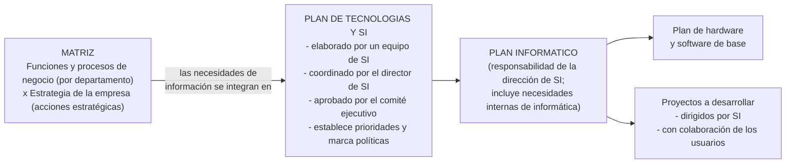

# Matriz de necesidades

> [!quote] Qué dice el libro (Andreu, pp. 52-53, Fig. 5.5)
> El procedimiento debe **integrar las necesidades de información** emanadas del **cruce de las directrices estratégicas de la empresa con las funciones y procesos de negocio de las distintas unidades organizativas**. Ese cruce es una **matriz**.

El libro no le da un nombre propio a la matriz ("las dos dimensiones de la matriz de la Figura 5.5"); **"matriz de necesidades" / "matriz de alineamiento estratégico"** es el nombre que usan la cátedra y los apuntes de alumnos.

| Eje | Contenido | Cuándo entra en el proceso |
|---|---|---|
| **Filas** | **Funciones y procesos de negocio**, agrupados por **departamento / área** | **Desde el primer momento** (Fase II) |
| **Columnas** | **Estrategia de la empresa**: **acciones estratégicas** y criterios de carácter estratégico | **Hacia el final** (Fase III, reunión del Comité), cuando los responsables de primer nivel juzgan globalmente las necesidades |
| **Celdas** | Marcas en las intersecciones = **necesidades de información** de esa función que sirven a esa acción estratégica | |

> [!note] Orientación de los ejes
> En el libro la Fig. 5.5 está impresa **girada 90°** (hay que dar vuelta la hoja). Leída derecha, las **filas** son las funciones de negocio por departamento y las **columnas** la estrategia de la empresa, como dice el texto (pp. 59 y 71). Los alumnos suelen nombrarlas al revés ("estrategias y departamentos"): lo que importa es el **cruce**, no memorizar cuál va en cada eje.

- Los proyectos **deben apoyar la estrategia**, y los sistemas resultantes **deben servir a los departamentos**.
- **Mecanismos de control:** responsabilidad de las **subdirecciones generales** y del **Comité de TI/SI** (Fig. 5.5).
- **Por qué las columnas entran tarde** (p. 59): es difícil juzgar cada necesidad suelta por su relevancia estratégica; hacerlo en conjunto es más natural. Introducir el **"filtro estratégico" demasiado pronto** arriesga descartar necesidades muy relacionadas con otras de más importancia estratégica, y llevaría a una estructura de SI **incompleta e incoherente**.
- **Criterios estratégicos** (columnas): la dirección debería dar **tres o cuatro** (p. 71). Ejemplos del libro: dar prioridad a un área funcional o proceso; preferir resultados a corto plazo; incluir el máximo de subsistemas que ayuden a un objetivo concreto (mejorar productividad, la comunicación entre áreas, el servicio al cliente); no dar prioridad a cierta área.

## Cómo se arma la fila (Fase II)
Por cada área se listan **pocas funciones macro** (no más de media docena) y, para cada una, **procesos y subprocesos** algo más detallados; la lista la **validan los directores funcionales** (p. 63).

> [!example] Ejemplo del libro (Fig. A5.1, p. 64): funciones y procesos del **área comercial**
> - **Preparación del plan de marketing:** estudios de mercado, desarrollo de productos, posicionamiento, diseño de esfuerzos comerciales, planes de venta.
> - **Administración de crédito a clientes.**
> - **Gestión de ventas.**

> [!example] Ejemplo ilustrativo propio (no es del libro)
> Acción estratégica **"mejorar el servicio al cliente"** x proceso **"Gestión de ventas"** -> necesidad de información: *"que el vendedor vea el historial de reclamos del cliente al tomar el pedido"*.

> [!info] Nota sobre la cadena de valor
> Andreu aclara (p. 63, nota 1) que en este capítulo se usan "funciones y procesos de negocio" y **no** el modelo de la **cadena de valor**, porque analizar la cadena completa es costoso y aquí la estrategia y la estructura organizativa ya vienen dadas. La cadena de valor se retoma en el cap. 7 (planificación en paralelo). Ver [[El SI en la cadena de valor]].

> [!warning] Ojo con los apuntes de alumnos
> Yoel/Supremo agregan que de la matriz "derivo las estrategias de SI y de ellas las de TI". Es una **lectura de la cátedra**: en el libro la matriz alimenta el **Plan de TI/SI**, que baja a Plan informático -> proyectos y plan de HW/SW de base. Ver [[Estrategia de SI vs Estrategia de TI]].

**Pregunta de finales:** "Concepto alineamiento" -> desagregar las necesidades de información **por departamento, por funciones y por acción estratégica** (ver [[Alineamiento E.O. – E.SI-TI (esquema general)]]).

## 🔗 Relacionado
- [[Procedimiento de alineamiento (4 fases)]] · [[Alineamiento E.O. – E.SI-TI (esquema general)]]
- [[Plan de TI-SI (contenido)]] · [[Factores Críticos de Éxito (Rockart)]] — técnica sugerida para relevar necesidades
