# Procedimiento de alineamiento del Plan de TI/SI (Andreu, cap. 5)

> [!quote] Qué debe lograr (Andreu, p. 52)
> "Integrar las **necesidades de información** emanadas del **cruce de las directrices estratégicas** de la empresa **con las funciones y procesos de negocio** de las distintas unidades organizativas."

- Es un procedimiento **pasivo**: parte de una **estrategia de negocio predefinida** y **deduce** de ella el plan de TI/SI (ver [[Evolución de la planificación de SI (4 fases históricas)]]).
- Es **una ilustración**, no el único procedimiento válido (p. 50): reúne las características que los autores juzgan esenciales. Describe **qué hacer, no cómo** (p. 52).
- Supone una empresa **mediana o grande** con un SI inicial en funcionamiento (formal o no); en empresas chicas se simplifica (ver abajo).

```mermaid
flowchart TD
    F1["<b>FASE I - Presentación y compromiso del equipo</b><br/>I.1 Decisión de obtener un Plan de TI/SI; Comité de TI/SI<br/>I.2 Formación del grupo base<br/>I.3 Identificación de áreas de análisis<br/>I.4 Equipo de trabajo definitivo; presentación del proyecto<br/>Responsables: Comité de TI/SI + grupo base"]
    F2["<b>FASE II - Descripción de la situación actual</b><br/>II.1 Funciones y procesos de negocio por área<br/>II.2 Descripción de los sistemas existentes: procesos y estructuras de datos<br/>II.3 Crítica técnica y de negocio. Validación<br/>II.4 Informe sobre los sistemas existentes<br/>Responsables: equipo de trabajo + departamentos"]
    F3["<b>FASE III - Elaboración del Plan de TI/SI</b><br/>III.1 Preparación del equipo; posibles nuevas áreas<br/>III.2 Necesidades de SI por áreas, funciones y procesos (importancia y urgencia)<br/>III.3 Descripción sistemática de necesidades<br/>III.4 Integración: centros de atención emergentes<br/>III.5 Validación de la estructura del SI emergente (Comité)<br/>III.6 Informe de la estructura del SI futuro<br/>III.7 Propuestas alternativas + evaluación de recursos<br/>III.8 Elaboración y aprobación del Plan definitivo (Comité)"]
    F4["<b>FASE IV - Programación de actividades</b><br/>IV.1 Descripción detallada; calendario del primer año; validación<br/>IV.2 Inclusión de proyectos en el presupuesto del período siguiente<br/>IV.3 Plan de evaluación y revisión<br/>Elabora: personal de SI - Aprueba: Comité de TI/SI"]
    F1 --> F2 --> F3 --> F4
```

> [!tip] Mnemotecnia de los apuntes (Yoel)
> Fase II = **¿dónde estoy?** · Fase III = **¿a dónde quiero ir y cómo lo voy a hacer?**. Son glosas de los alumnos, no del libro; sirven para ubicarse.

## Fase por fase (Anexo, pp. 61-73)

### Fase I - Presentación y compromiso (pp. 56, 62-63)
- **Objetivo:** constituir el equipo de trabajo y presentarlo a la organización.
- La **alta dirección** debe tomar **explícitamente** la decisión de elaborar el Plan y **comprometerse** a participar en las actividades que lo requieran; sin eso el proceso casi no tiene posibilidad de éxito.
- Suele surgir tras un período de **quejas generalizadas** sobre los SI ("esta gente de informática, que no da el servicio que debiera"): síntoma de poca o nula planificación, que es **responsabilidad de la dirección general**.
- Todos los estamentos deben saber que el Plan es **de toda la organización**: mucho del esfuerzo sale de los departamentos (tiempo para entrevistas y sesiones).

### Fase II - Situación actual (pp. 56, 63-67)
- Se describe la empresa en **dos dimensiones**: **a) el negocio** y **b) los sistemas existentes**.
- **Funciones y procesos de negocio por área:** en dos niveles (funciones agregadas, no más de media docena por área, y procesos/subprocesos); la lista la **validan los directores funcionales**. Ejemplo en [[Matriz de necesidades]].
- **Sistemas existentes**, con dos dimensiones: **datos** manejados y **procesos**. Por cada proceso: **agrupación por subsistema**, **inputs** (datos que usa), **outputs** (datos que crea o modifica) y **cómo está implementado** + procedimiento de tratamiento. Ayudan las **matrices proceso x dato** y el **diccionario de datos** (si no existe, es buena ocasión para empezarlo). Si hay **intervalos de decisión**, documentar la información y el proceso de decisión (ver [[DSS e intervalos de decisión]]).
- **Crítica doble:**

| Crítica **de negocio** (la que suele faltar) | Crítica **técnica** |
|---|---|
| Grado de **soporte** de cada subsistema a cada función/proceso | **Tecnología** básica empleada |
| Grado de **conveniencia** de las estructuras de datos | **Interrelaciones** entre subsistemas |
| **Puntos fuertes y débiles** percibidos | **Rendimientos** |
| **Áreas de mejora** según los usuarios (cómo y por qué) | **Volúmenes y frecuencias** |

- Se obtiene por **entrevistas** a usuarios y personal de SI. El análisis crítico lo **valida el subdirector general** responsable de cada área, en una reunión por área.

### Fase III - Elaboración del Plan (pp. 56-57, 67-73)
1. **Necesidades de información** (III.1-III.4): entrevistas por área para inventariar las necesidades **que los sistemas actuales no cubren o cubren mal**. Se recomienda **atomizar** las necesidades (pedir subsistemas completos solo si está muy claro qué significan), ir identificando **entidades de datos** y esbozar cómo generar la información. Ayuda el concepto de **factores críticos de éxito** ([[Factores Críticos de Éxito (Rockart)]]). Conviene mantener a las mismas personas de la Fase II y **rotar** a los de SI de área.
2. **Estructura del SI emergente** (análisis de gabinete): consejos de Andreu (pp. 68-69):

   - Identificar los **procesos de negocio fundamentales** y los sistemas asociados (y su lugar en la cadena de valor).
   - Detectar **entidades de datos nuevas** (¿conjuntos nuevos o nueva forma de estructurar los ya tratados?).
   - Agrupar **procesos de información parecidos** → candidatos a subsistema con identidad propia.
   - Analizar **fronteras** entre subsistemas (evitar interacciones complejas o poco claras).
   - Identificar **subsistemas aislados** (se separan del SI central; su interfaz se define en un equipo mixto usuario-SI).
   - Catalogar **necesidades vagas**: probablemente son **intervalos de decisión**, a tratar aparte.

   Se **valida** en dos pasos: **reuniones departamentales** y **reunión del Comité de TI/SI en pleno**.
3. **Propuestas alternativas** (III.7): los **especialistas técnicos** preparan **como máximo 3 o 4 escenarios** (horizonte de ~5 años) filtrados con criterios:

| Criterios **generales** (p. 71) | Criterios **estratégicos** (dados por la dirección, 3 o 4) |
|---|---|
| Evitar dificultades de **integración** entre subsistemas | Dar prioridad a un área funcional o proceso |
| Combinaciones **asimilables** organizativamente | Preferir resultados a **corto plazo** |
| **Digeribles** para el depto. de SI (su capacidad de absorción es un recurso escaso; riesgo, McFarlan) | Incluir el máximo de subsistemas para un objetivo concreto |
| Evitar las demasiado **costosas** | No dar prioridad a cierta área |
| **Coherencia técnica** (p. ej. misma parte de la BD) | |

   Hay que contemplar también la **infraestructura** informática necesaria.
4. **Aprobación** (III.8): reunión plenaria del **Comité de TI/SI**, que evalúa, elige y prioriza; es donde entran las **columnas** de la matriz. Resultado: **plan consensuado a 3-5 años**. Los responsables de área deciden **qué sistemas justifican su costo** y **qué prioridad** tienen; la alta dirección corrige la tendencia de cada área a "barrer para casa". Cada **coste** lo estima el equipo técnico de SI; cada **beneficio**, los usuarios (el análisis coste-beneficio hay que hacerlo "con extrema cautela" en TI/SI).

### Fase IV - Programación de actividades (pp. 57, 73)
- Es, en su mayor parte, **responsabilidad de los técnicos**. El **DOP** arma la **lista de proyectos** del Plan aprobado y propone la **asignación de recursos** (tiempo de personas, equipos), que aprueban el **director de SI** y el **subdirector general a cargo de SI**.
- El **calendario detallado del primer período** (normalmente un año) se somete al **Comité de TI/SI**; no hace falta la presencia del director general y lo presenta el subdirector a cargo de SI.
- **IV.3 Plan de evaluación y revisión:** mecanismos de revisión periódica del Plan.
- **Iteraciones:** la estructura aparece como estrictamente secuencial en la Fig. A5.2, pero en la práctica **siempre son necesarias** y a menudo insumen mucho tiempo (p. 73).

## Características esenciales (Andreu, 5.5, pp. 58-60)

> [!important] Lo que suelen preguntar
> - **Proceso "de la empresa":** dirigido y llevado a cabo por **personal propio**; los consultores externos, solo como ayuda metodológica o control (el know-how queda en la empresa).
> - **Participación activa de las más altas instancias** de todas las áreas; la alta dirección lo hace suyo de modo explícito.
> - **Las dos dimensiones de la matriz entran en momentos distintos:** **filas** (funciones y procesos) desde el principio; **columnas** (criterios estratégicos) **hacia el final**.
> - **Costo-beneficio en dos fases y por personas distintas:** el **costo** lo estima el personal técnico de SI; el **beneficio**, el personal "de negocio" (idealmente en marco estratégico).
> - **Aprendizaje organizativo:** el enfoque en funciones y procesos de negocio impone un diálogo técnico-directivo poco común. Conviene plantearlo como **objetivo explícito** del proyecto.

- **Empresas chicas:** el procedimiento se simplifica (el equipo puede reducirse a 1 o 2 personas que son a la vez director de SI, DOP y núcleo del Comité), pero deben mantenerse **5 hitos** (p. 57): **1)** descripción y crítica **validada** de los sistemas existentes; **2)** **esquema global** de la estructura del nuevo SI; **3)** **descripción detallada del Plan**; **4)** **calendario y presupuesto** del próximo período; **5)** el **"espíritu"**: centrado en el negocio y hecho por personal propio.
- **Duración:** de **1-2 semanas a 4-5 meses**; el DOP debe planificarlo y controlarlo para que no se alargue (pp. 57-58).
- **Herramientas:** sirven las de **documentar y estructurar** información (catálogo de entidades de datos, relaciones entre entidades, entre entidades y procesos, entre funciones de negocio y procesos con **grado de cobertura**). **No** hay que confundirlas con herramientas de control de proyectos ni con **CASE**. Los documentos deben ser **homogéneos** (p. 58).

> [!warning] Ojo con los apuntes de alumnos
> - Las **"4 entradas clave"** (entorno empresarial externo/interno y entorno externo/interno de SI/TI) que Yoel y Supremo ponen al inicio del "Esquema general" son de **Edwards (cap. 4)**, no de Andreu. Ver [[Contexto de la estrategia SI-TI (Edwards)]].
> - Yoel dice que la Fase IV se aplica solo al primer año "(entre 1 a 3 años)": el libro dice **primer año** (normalmente un año), y para los años siguientes alcanza con aproximaciones.

## 🔗 Relacionado
- [[Grupos de trabajo del plan]] · [[Plan de TI-SI (contenido)]] · [[Matriz de necesidades]]
- [[Evolución de la planificación de SI (4 fases históricas)]] · [[Cartera de aplicaciones (McFarlan)]] — diagnóstico y priorización
