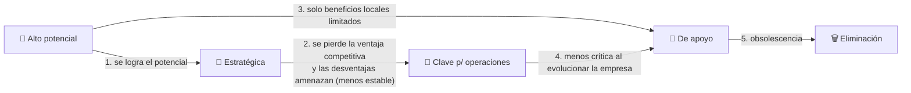

# Análisis de la cartera de aplicaciones (McFarlan)

> [!quote] Definición (síntesis de Edwards, cap. 6, p. 96)
> **Esquema de clasificación desarrollado originalmente por McFarlan** que **compara el papel de los SI/TI** entre organizaciones y facilita **el análisis del conjunto de sistemas** (actuales, planificados y potenciales). Toma la forma de una **matriz** y clasifica cada aplicación como **de alto potencial, estratégica, clave para las operaciones o de apoyo**, según sus **contribuciones presentes y futuras, tal como las percibe la dirección** de la empresa.
> Hasta entonces la mayoría de las clasificaciones se basaba en **cómo se suministran** los sistemas, no en **la contribución que hacen al éxito** de la empresa (p. 96).

## La matriz (Figura 6.1, p. 97)

| 🎯 [[Aplicaciones estratégicas\|ESTRATÉGICAS]] Aplicaciones que son **críticas** para ejecutar la **estrategia futura** de la empresa | 🚀 [[Aplicaciones de alto potencial\|DE ALTO POTENCIAL]] Aplicaciones que pueden ser **importantes** para lograr el **éxito de la empresa en el futuro** |
|---|---|
| 🔑 [[Aplicaciones clave para las operaciones\|CLAVE PARA LAS OPERACIONES]] Aplicaciones de las que **depende actualmente** el éxito de la organización | 🧰 [[Aplicaciones de apoyo\|DE APOYO]] Aplicaciones que son **valiosas pero no críticas** para el éxito de la empresa |

> [!tip] Cómo leer la matriz
> **Fila superior = FUTURO** (estratégicas, alto potencial) · **fila inferior = PRESENTE** (clave, apoyo). Columna izquierda = **críticas**; columna derecha = **importantes / valiosas pero no críticas**.

## Ideas clave (Edwards, pp. 95-98)
- Las aplicaciones se gestionan como una **cartera** (igual que la de productos, clientes o inversiones): se entiende cada una según sus **valores comerciales presentes y futuros**.
- Entran **todas**: algunos sistemas ya existen, otros están en desarrollo y otros son **solo una idea**, pero todos se ubican según su contribución **actual y futura, real o potencial**. Su posición **puede variar de una empresa a otra** (según madurez y objetivos estratégicos).
- Sirve para **mejorar la contribución de los sistemas actuales, asignar recursos con mayor eficacia** y **asegurar el mejor enfoque para las nuevas aplicaciones** (p. 96).
- Muestra el **equilibrio de las inversiones** (dónde se aplican y dónde se planifica aplicar recursos y esfuerzos). Si no se ajusta a los objetivos, **se reasignan**. Ojo: casi todas las empresas querrían concentrarse en estratégicas y clave, pero **el esfuerzo suele dispersarse en apoyo**; se remedia reduciendo recursos, comprando **paquetes**, incorporando personal externo o recortando la inversión global (p. 98).
- **Su fuerza no es dar una receta** de clasificación ni de gestión, sino ser **un vehículo para una discusión constructiva e informada** entre alta dirección, mandos intermedios, usuarios y profesionales de SI, y **alcanzar acuerdos** (p. 97).
- Se usa para **diagnosticar** los sistemas actuales y para **formular/priorizar** los nuevos (con las [[Estrategias genéricas de gestión (Parsons)|estrategias genéricas]]).

### La analogía con la matriz del Boston (p. 98)
El modelo tiene "muchas similitudes" con la **matriz del Boston Consulting Group**:

| Cuadrante | Analogía Boston |
|---|---|
| 🚀 Alto potencial | "**niños difíciles**" (niño problema) |
| 🎯 Estratégicas | "**estrellas nacientes**" |
| 🔑 Clave para las operaciones | "**vacas lecheras**" |
| 🧰 De apoyo | "**perros**" (hay que tenerlas, pero no son críticas) |

## Migración entre cuadrantes (la cartera evoluciona, p. 113)
El papel de los sistemas **evoluciona en el tiempo** y es necesario **migrar de un segmento a otro**. Las 5 transiciones del libro, **en este orden**:

1. **De alto potencial a estratégico**, a medida que se logra el potencial.
2. **De estratégico a clave para las operaciones**, a medida que se pierde la ventaja competitiva y las desventajas amenazan (el sistema también se hace menos estable).
3. Las oportunidades de **alto potencial** pueden producir **solo beneficios locales limitados** de la categoría de **apoyo**.
4. Los sistemas **clave** pueden ser **menos críticos** a medida que la empresa evoluciona y reclasificarse **"de apoyo"**.
5. Finalmente, algunas aplicaciones, **principalmente las de apoyo**, quedan **obsoletas** y hay que **eliminarlas**.

> [!note] El ciclo de vida del producto
> El libro compara esta evolución con la de los productos: **niño problema → estrella naciente → vaca → perro → eliminación** (p. 113). En cada etapa cambia la gestión, los factores de éxito y los recursos necesarios.

- Una idea de alto potencial puede **rechazarse** y, si llega a implantarse sin aportar valor estratégico, "**entraría directamente en la categoría de apoyo**" (p. 98).
- Al pasar de un cuadrante a otro **debe cambiar el enfoque** de desarrollo y gestión. La **Figura 6.5** (p. 113) lo muestra como capas que se mueven con la aplicación: **economía, organización, tecnologías, herramientas y métodos, aplicaciones**. Si los sistemas se siguen gestionando igual aunque cambie su importancia, hay un **uso excesivo y desequilibrado de recursos** y los sistemas "yerran" en satisfacer las necesidades (p. 114).

> [!tip] Palabras clave para identificar cuadrante
> "integrar datos", "evitar desventajas", "depende el funcionamiento actual" → **Clave** · "tareas localizadas", "requisitos legales", "paquetes de costo ínfimo" → **Apoyo** · "prototipos", "idea / oportunidad tecnológica", "I+D" → **Alto potencial** · "presiones competitivas externas", "FCE", "desarrollo rápido" → **Estratégica**.

> [!example] Ejemplos de la Figura 6.2 (empresa de fabricación, p. 97)
> **Estratégicas:** EDI con mayoristas y minoristas · MRP II · análisis de mercado y previsión de ventas · análisis de rentabilidad de productos.
> **Alto potencial:** sistema experto para diagnóstico de defectos · planificación de recursos humanos · diseño de productos asistido por computador.
> **Clave:** lista de materiales · control de stock · análisis de coste de los productos · base de datos de personal · cuentas a cobrar y a pagar.
> **Apoyo:** presupuestos · contabilidad general · nóminas · proceso de textos · correo electrónico.

> [!warning] Ojo con los apuntes de alumnos
> En la respuesta de la P4 (Cuestionario II) las definiciones de **estratégicas** y **alto potencial** llevan frases extra ("sino solo es clave para las operaciones"; "su desarrollo por falta de tecnología… es difícil o imposible") que **no figuran en la Figura 6.1** del libro. La del libro es la de la tabla de arriba. Lo de "estratégica = me coloca en posición ventajosa frente a la competencia" (Supremo) es coherente con Edwards, pero es **paráfrasis de alumnos**. Y **"apoyo = aplicación externa a la organización"** (Supremo, con el ejemplo de AFIP) **no es la definición del libro**: apoyo = valiosa pero **no crítica**.

> [!quote] Pregunta de final: "¿Qué es un cuadrante dentro de la cartera de aplicaciones?"
> Respuesta de alumnos (Finales): cada cuadrante representa **una clasificación** (estratégica, alto potencial, clave para las operaciones, de apoyo) en la que **se ubica cada aplicación** de la organización, y **refleja hacia dónde se están aplicando los recursos y esfuerzos**. Coincide con Edwards (pp. 96-98).

**Cuestionario:** responde la **P4**.

## 🔗 Relacionado
- [[Aplicaciones estratégicas]] · [[Aplicaciones de alto potencial]] · [[Aplicaciones clave para las operaciones]] · [[Aplicaciones de apoyo]]
- [[Estrategias genéricas de gestión (Parsons)]] — qué estrategia le calza a cada cuadrante
- [[Prioridades de las aplicaciones]] · [[Clasificación de las inversiones en IS]]
