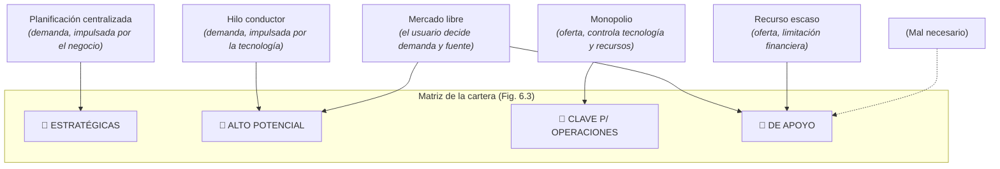

# Estrategias genéricas de gestión de SI/TI (Parsons)

> [!quote] Definición (Edwards, cap. 6, pp. 101-103)
> Parsons describe, "basándose en una observación exhaustiva de la gestión de los SI/TI en organizaciones reales", **seis estrategias por las que una organización puede vincular la gestión de los SI/TI con la dirección general de la empresa**. Son **marcos generales que guían** la identificación de las **oportunidades de la TI**, los **recursos para desarrollar TI**, **el ritmo al que se adoptan las nuevas tecnologías**, el **nivel de impacto de la TI** dentro de la empresa y **las tendencias estructurales** que siguen las empresas para aplicar la TI a sus negocios; por eso se las llama **"estrategias genéricas"**. Sugieren una comprensión básica de las **actitudes y los comportamientos** que cada una conlleva.

## Las seis (en el orden del libro)

1. [[Planificación centralizada]]
2. [[Hilo conductor]] *(leading edge)*
3. [[Mercado libre]]
4. [[Monopolio]]
5. [[Recurso escaso]]
6. [[Mal necesario]]

> [!warning] ¿Son 5 o 6? — contestá **seis**
> El libro dice **seis** y las lista (pp. 101-102). Pero la **Tabla 6.5** ("Las estrategias genéricas según Parsons") **solo tiene cinco columnas**: no incluye *Mal necesario*, y en la **Figura 6.3** aparece **entre paréntesis**. Los alumnos (P5, Cuestionario II) escriben "Mal necesario… no lo veo como estrategia sino como situación en que se cae". Tiene razón en el espíritu (el libro dice que "puede llegarse a ella **por error, por negligencia** o por excesiva escasez de recursos"), pero **para el examen: seis, y Mal necesario es la sexta**.

## Cuadro comparativo (Tabla 6.5, p. 103)

| | Planificación centralizada | Hilo conductor | Mercado libre | Monopolio | Recurso escaso |
|---|---|---|---|---|---|
| **Base para la gestión** | La coordinación centralizada de todas las necesidades conducirá a **mejor toma de decisiones** | La tecnología puede crear **ventajas y riesgos** que merece la pena aceptar | **El mercado toma las mejores decisiones**; los usuarios son responsables de los resultados comerciales; la integración no es crítica | La información es un **input para el negocio** y un recurso integrado disponible para todos | La información es un **recurso limitado** y su despliegue debe estar claramente justificado |
| **Requisitos de la organización** | Alta dirección formada e implicada; planificación de SI/TI integrada en la de la empresa | Compromiso de fondos y recursos; gestión innovadora; fuertes habilidades técnicas | Usuarios formados; responsabilidad de SI/TI a nivel corporativo o funcional; **voluntad de duplicar esfuerzos**; **pérdida de control** del presupuesto de TI | Aceptación de la filosofía por parte del usuario; **políticas para obligar a una sola fuente** de abastecimiento; buena previsión del uso de recursos | **Control presupuestario estricto**; políticas para controlar los SI/TI y los usuarios |
| **Papel interno de la TI** | Dar servicios para satisfacer las necesidades del negocio, **vinculada a sus directivos** | **Ampliar los límites** del uso de la tecnología en todos los frentes | **Centro competitivo** (probablemente de beneficio) para rentabilizar sus recursos | Satisfacer necesidades **a medida que surjan, pero no proactivo** | Obtener el mejor aprovechamiento de un recurso limitado; justificar proyectos en términos de **rentabilidad de la inversión** |
| **Papel de mandos intermedios y usuarios** | Identificar el potencial de los SI/TI para las necesidades de la empresa a todos los niveles | Utilizar la tecnología e identificar las ventajas | Identificar, conseguir y controlar las aplicaciones de SI/TI | Comprender las necesidades y **presentarlas a la unidad central** que las gestiona | Identificar y justificar los proyectos en términos de costes; **pasivo**, salvo que se identifiquen los beneficios |

## Proyección sobre la cartera (Figura 6.3, p. 108) — ¡cruce favorito de examen!

| | **Centralizada** ◄──────► **Descentralizada** | |
|---|---|---|
| ⬆ **DEMANDA** | 🎯 **ESTRATÉGICAS** → **Planificación central** | 🚀 **ALTO POTENCIAL** → **Hilo conductor** y **Mercado libre** |
| ⬇ **OFERTA** | 🔑 **CLAVE PARA LAS OPERACIONES** → **Monopolio** | 🧰 **DE APOYO** → **Recurso escaso**, **Mercado libre** y *(Mal necesario)* |

El libro lo resume así (p. 108):
- **Planificación centralizada** (estratégicas): estrategia de gestión de la **demanda impulsada por las necesidades del negocio**.
- **Monopolio** (clave): fundamentalmente **gestión de la oferta**. Ambas implican **centralización de la toma de decisiones**.
- **Hilo conductor** (alto potencial): gestión orientada a la **demanda impulsada por la tecnología**.
- **Recurso escaso** (apoyo): gestión de la **oferta basada en la limitación de los recursos financieros**.
- **Mercado libre** (alto potencial **y** apoyo): puede hacer que **los usuarios determinen la demanda y también decidan la fuente de aprovisionamiento**.
- Los cuadrantes **estratégico y de alto potencial** tratan de **buscar oportunidades** (identificar ventajas futuras y luego gestionar esas nuevas demandas con éxito); en **clave y apoyo** el enfoque es **resolver los problemas actuales**, por lo que es esencial una **gestión meticulosa para reducir riesgo y desventajas** (p. 108).

> [!tip] Demanda vs Oferta (Fig. 6.3 y p. 105)
> **Demanda = el QUÉ** necesita el negocio. **Oferta = el CÓMO**: quién controla la tecnología y los recursos (**no** los fondos).
> - **Planificación central** = **orientada a la demanda**: empresa y directivos de TI **planifican juntos** la mejor forma de responder a todas las peticiones de aplicaciones prioritarias.
> - **Monopolio** = **orientado a la oferta**: **controla la oferta de tecnología y recursos** para satisfacer necesidades siempre cambiantes (no significa que TI haga todo el trabajo, pero **retiene la autoridad** y controla cómo los usuarios resuelven sus problemas dentro de la estrategia de oferta preestablecida).
> - **Recurso escaso** = estrategia de **dirección financiera**: usuarios y TI deben **justificar las inversiones en términos financieros**; no es tan negativa como el *mal necesario*.
> - **Mercado libre** e **hilo conductor** = estrategias **para la innovación**: el primero **se mueve por las necesidades de la empresa**; el último **responde a los desarrollos de la tecnología** (p. 106).
> *(Yoel, de la cátedra: "en una estrategia orientada a la oferta, es TI quien define lo que ofrece, independientemente de si el negocio lo pidió o no".)*

## Cuál va con cuál (texto del libro, p. 108-109)
- **Estratégicas → planificación centralizada**: garantiza que la **orientación al negocio** determine los requisitos y el planteamiento de implantación; resuelve el **nivel de riesgo** que merece la pena correr.
- **Alto potencial → hilo conductor y mercado libre**: "ambas son arriesgadas, pero producirán innovación"; planificar de más **ahoga la innovación**.
- **Clave para las operaciones → monopolio**: potencialmente restrictivo pero **ideal para reducir riesgos**; calidad a largo plazo; centralizado y controlador.
- **Apoyo → recurso escaso** (controla las inversiones y obliga a evaluar los resultados antes de gastar) **y mercado libre** si los usuarios usan **sus propios fondos**.

## Cómo se usan (p. 109-110)
Facilitan una adecuada gestión de los SI/TI **de dos formas**:
- **Para el diagnóstico**: dan perspectiva para **evaluar la situación actual** y expresar cómo se gestionan hoy los SI/TI. Hay una **fuerte correlación (causa-efecto)** entre las aplicaciones desarrolladas y las estrategias adoptadas.
- **Para la formulación**: con la cartera futura y los puntos fuertes y débiles de las aplicaciones existentes, sirven para **identificar un plan de migración**. Permiten **evitar la trampa de una sola estrategia universal** ("necesitamos planificación centralizada" es atractivo pero superficial: **es imposible planificar todo de forma centralizada**). A corto plazo puede convenir **más libertad**, nuevas tecnologías donde se precisen y **control más rígido del monopolio en las áreas críticas**; una **restricción de recursos más rigurosa en apoyo** libera recursos para construir sistemas estratégicos. Además **evitan partir de cero**: es más fácil modificar planteamientos ya probados.

> [!warning] El mayor error
> Históricamente la dirección adoptó **una sola estrategia genérica** para todos los SI/TI, pero hoy **hacen falta varias, simultáneas**, para tener una **cartera completa y equilibrada** (p. 107).

## Evolución histórica (p. 106-107)
- Primeros días: departamentos con **sistemas independientes**, justificados por **ROI**. Al crecer la inversión, se **centralizó** (economías de escala, integración) → **monopolios** (años 60-70), que se volvieron restrictivos: colas de pedidos pendientes y usuarios frustrados.
- **PC a principios de los 80**: los usuarios buscan sus soluciones → fisura con el centro monopolista; la dirección senior pasó a un enfoque de **centro de beneficios**; varias empresas (British Leyland, Imperial Metals, Debenhams) evolucionaron hacia **mercado libre** y compañías de SI/TI independientes.
- Cuando domina el **mercado libre es muy difícil cambiar** a otra estrategia (solución: crear un negocio nuevo, p. ej. FirstDirect del Midland Bank).
- Con **recurso escaso**, Parsons advierte que **se inhibe el desarrollo de aplicaciones estratégicas** (estrategia empresarial desconocida para usuarios y para la unidad de TI; beneficios estratégicos difíciles de cuantificar).

**Cuestionario:** responde la **P5**.

> [!quote] Pregunta de final: "¿Qué son las estrategias genéricas?"
> Respuesta de alumnos (Finales): **marcos generales** en los que las empresas pueden enmarcar la gestión de los SI/TI con la dirección general de la empresa; cada una guía la identificación de oportunidades de TI, los recursos para desarrollar TI, el ritmo de adopción de nuevas tecnologías, el nivel de impacto en la empresa; son **las tendencias estructurales** que siguen las empresas para aplicar TI a sus negocios. **Coincide con Edwards (pp. 101-103).** Para nota: agregá **las seis** y el cruce con la cartera.

## 🔗 Relacionado
- [[Cartera de aplicaciones (McFarlan)]] · [[Estrategia de SI vs Estrategia de TI]] · [[Prioridades de las aplicaciones]]
