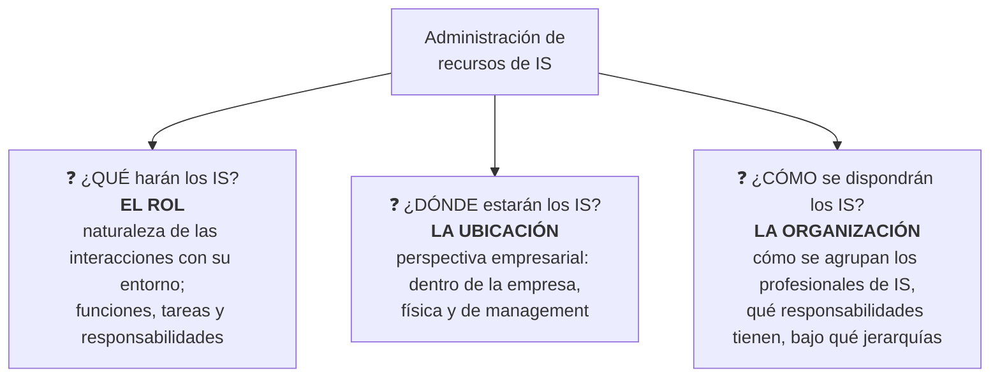

# Administración de los recursos de IS

> [!warning] Aclaración de la cátedra
> En esta unidad, **"IS" = el ÁREA de sistemas** (el departamento), **no las aplicaciones**. Es una decisión sobre **cómo disponer los RR. HH.**: **organizativa, no tecnológica**.

**Definición (Robson T4, cap. 9, intro):** administrar los recursos de IS es resolver **tres temas específicos**, que son tres preguntas. A cada una Robson le pone un nombre: **ROL**, **UBICACIÓN** y **ORGANIZACIÓN**.

| Tema | Pregunta | Palabra clave | Nota |
|---|---|---|---|
| **Rol** | ¿Qué harán? | Interacción con el entorno · funciones · tareas · responsabilidades | [[Rol de los IS]] |
| **Ubicación** | ¿Dónde estarán? | Física **y** de management → centralizada / descentralizada / delegada | [[Ubicación de los IS]] · [[Centralizados vs no centralizados]] |
| **Organización** | ¿Cómo se dispondrán? | Estructura **interna**: agrupamiento, responsabilidades, jerarquías | [[Organización de los IS (enfoques estructurales)]] |

> [!note] No son los únicos aspectos
> Robson aclara que estas tres áreas **no son los únicos aspectos** de management de IS sobre los que hay que decidir. Se agrupan porque **reflejan lo que en un momento estuvo incluido en las funciones del Departamento de Procesamiento de Datos** (hoy, de TI). A medida que la explotación de los IS se volvió más compleja, otros aspectos ganaron importancia y se tratan en capítulos aparte. *(Los alumnos lo recuerdan como "este análisis deja de lado una serie de aspectos importantes".)*

> [!quote] El "negocio de IT" (Cash et al., 1992)
> Los IS son **un negocio en sí mismo**: tienen **clientes** por los que hay que competir, **canales de distribución** que administrar y **productos** que desarrollar y fabricar. Por eso su administración implica los mismos aspectos que el management de una empresa. *(Robson T4, cap. 9, §9.1.)*

> [!tip] Cómo se articulan los tres (consejo de la cátedra, U3)
> - **El alineamiento** (U1) da el marco para decidir el RUO.
> - Al resolver un caso: **plantear la organización, verificar si esa organización ayuda al rol y si está relacionada con la ubicación**.
> - Para el TP: indicar **qué decisiones se centralizan, se descentralizan o se delegan**.

**Cuestionario:** responde la **P8**.

## 🔗 Relacionado
- [[Recursos organizacionales]] · [[Valor de la información e inversión en IS]] · [[Alineamiento E.O. – E.SI-TI (esquema general)]]
- **Otras unidades:** [[RUO — Rol, Ubicación y Organización del área de SI-TI]] (U3: hub del RUO con lo que agrega el apunte de la unidad) · [[Estructura del área de SI-TI (elementos de diseño)]] (U3)
