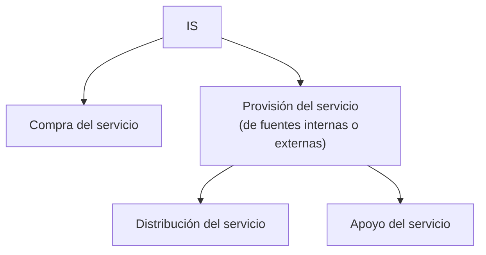

# El rol de los IS

**Rol = ¿qué harán los IS?** Es la **naturaleza de las interacciones del área con su entorno**: sus **funciones, tareas y responsabilidades**. (Robson T4, cap. 9, §9.1; las páginas citadas son las del libro.)

## Dos visiones sobre el rol (p. 18-19)
- El rol cambió: de **brindar apoyo empresarial** → a **permitir la transformación de la empresa** (T3, cap. 8), lo que exige **reingeniería** de los IS.
- Pero hay confusión sobre su importancia, y **depende de quién opina**:
  - Los **managers de IS** → función **estratégica y crítica**.
  - El **nivel gerencial** en su conjunto → función de **apoyo para la eficiencia**.
- Robson lo apoya con encuestas (Green-Armytage, 1995: opiniones divididas a la mitad; Saran, 1996: la visión estratégica **no es universal**) y concluye que si es estratégico o no "puede considerarse una cuestión de opinión personal".

## Los roles de IS desde el gerenciamiento — Fig. 9.1 `[P9]`
La **evolución de las funciones** modifica la relación IS ↔ usuarios y fija las **estructuras probables** (p. 19):

| Rol de IS | Relación con los usuarios | Estructura | Ejemplo (apunte de cátedra U3) |
|---|---|---|---|
| **Hacerles algo a ellos** | El grupo de IS **establece las reglas** | Enfoque **"tradicional"** | "Te paso este sistema, usalo así y listo" |
| **Hacer algo para ellos** | **Orientación al servicio** | Guiada por **bases de datos** | Sistema de sueldos hecho a medida para RR. HH. |
| **Hacer algo con ellos** | **Puentes y participación** | **Grupos de proyectos funcionales** | CRM desarrollado con vendedores y programadores |
| **Ayudarlos a que lo hagan por sí mismos** | **Influencia más que control** | **Centros de información** y apoyo para las decisiones | Dashboards / BI donde cada jefe arma sus reportes |
| **Mantener un depósito de información** | **Puente** entre proveedores de información y usuarios de información | **Enfoque externo** | Data warehouse / Big Data |

> [!tip] Cómo leer la tabla
> Se lee **de arriba hacia abajo = evolución**: se pasa de **imponer** (reglas del grupo de IS) a **servir**, **participar**, **guiar sin controlar** y, al final, **integrar información** de dentro y de fuera. La columna "Estructura" se desarrolla en [[Organización de los IS (enfoques estructurales)]]. La cátedra lo resume como el paso de **agente de control técnico a facilitador estratégico**.

## Cinco modelos para la estructura de los IS (Sullivan-Trainor, 1989) (p. 20)
Otra forma de categorizar los recursos de IS: centrarse en la **relación IS ↔ usuarios**. **No es la tabla de arriba** (son 5 modelos distintos de los 5 roles):

| Modelo | Qué es (Robson) | Ejemplo (Apunte Supremo, no es del libro) |
|---|---|---|
| **De servicio** | **Formaliza la interacción como una obligación de servicio**. Muy atractivo para empresas que sienten que todavía se están "poniendo al día" con el management de IS | Service Desk con SLA interno (incidente crítico en menos de 2 h; licencia en 24 h) |
| **De participación** | **Separa las líneas funcionales** del modelo de servicio para lograr **estrecha correspondencia** IS ↔ usuarios | Un *Business Relationship Manager* asignado a Banca Minorista que diseña el roadmap con el equipo de producto |
| **De vendedor** | Los IS **buscan comercializarse a sí mismos** y vender sus servicios al grupo de usuarios. Atrae a empresas que se interesan en el **valor que los IS aportan** al negocio | Catálogo de servicios con *showback / chargeback* |
| **De expansión** | Los IS crean una **arquitectura flexible** que sustenta los sistemas comunes y da cabida a aspectos de IS relacionados con los usuarios. **Ideal para empresas grandes y en crecimiento** | Plataforma de microservicios / APIs reutilizables por e-commerce y tiendas |
| **De ventaja estratégica** | La **identificación IS ↔ usuarios es tan estrecha** que los **productos competitivos se desarrollan en forma conjunta** | Equipo ágil transversal que lanza una funcionalidad que la competencia no tiene |

> [!warning] Ojo con los apuntes de alumnos
> - "**Ideal para empresas grandes y en crecimiento**" es del modelo de **EXPANSIÓN**. En el Apunte Supremo (y en la versión anterior de estas notas) aparecía pegado a *ventaja estratégica*: **error**.
> - **No confundir** los 5 **roles** de la Fig. 9.1 (hacerles algo a ellos…) con los 5 **modelos** de Sullivan-Trainor (servicio…). El libro los presenta por separado.
> - Distinción que agrega la cátedra: en **participación** trabajan codo a codo pero el área **sigue siendo soporte**; en **ventaja estratégica** la unión es total y el área es **socio estratégico**.

**Principios rectores (Strassmann, 1995):** el modelo que se adopte toma cuerpo a través del conjunto de decisiones que se tomen. Esos "principios rectores" equivalen a los **medios aceptables** de la definición de estrategia (**fines + medios**) y se articulan en las **políticas de management de IS**, que moldean la relación IS ↔ usuarios (ej.: adquisición de tecnología, descentralización, evaluación de riesgos, seguridad, desarrollo del personal, contrataciones, reutilización…).

## Los roles como actividades lógicas — Fig. 9.2 (p. 20-22)
- En principio se pueden separar las **operaciones** de IS (desarrollo, operación y mantenimiento de los sistemas) de las **actividades administrativas** (planificación, presupuesto, manejo del personal): **los IS tienen su propia cadena de valor**.
- La realidad es más compleja: los IS implican una serie de **funciones**, cada una con **ubicación diferente**:

> [!note] Son roles LÓGICOS, no departamentos
> Todas las tareas pueden ser realizadas por **un grupo (o una sola persona)** o repartirse entre varias áreas. Ej. de la cátedra: la compra de tecnología puede estar en Compras; el soporte, en una unidad descentralizada.

## Roles que deben estructurarse en forma diferenciada (management **y** provisión de) (p. 22-23)
1. **Infraestructura de IS (operación y administración):** servicios centrales **efectivos y confiables**; no solo **planificación de capacidad** sino **seguridad** (backups, control de acceso, detección de errores). Abarca **redes**, **bases de datos** y servicios compartidos (**e-mail**). Se enfatizan los aspectos del **servicio**, no los técnicos.
2. **Investigación y desarrollo a largo plazo:** las directivas a largo plazo, **separadas de las preocupaciones actuales**. La estrategia de IS **no se genera solo en el departamento de IS**: el equipo de management de IS **forma parte del grupo que la formula**; las **políticas de IS** sí están solo en la órbita de los IS. Permite una **función asesora realista e innovadora**.
3. **Facilitar la informática a nivel de usuario final:** función de **apoyo/"asesora"**: **persuadir** al usuario, permitirle **conceptualizar los problemas**, **seleccionar la tecnología**, **diseñar** soluciones e **implementarlas**.

## Dilemas del management de IS (p. 23)
- **Riendas totalmente flojas → anarquía**; **reglas sumamente estrictas → se anula la posibilidad de respuestas adecuadas**.
- ¿La estructura de IS debe **reflejar** la de la empresa o ser **distinta**? Enfoques posibles: *centralizada sin divisiones locales · control estricto de los niveles superiores · aconsejar en vez de dictar · dejar que los grupos tomen sus propias decisiones*.
- **Dos razones por las que los IS se tratan distinto** del resto de la estructura empresarial: (1) **cambiar los sistemas requiere más tiempo y dinero** que cambiar la estructura de la empresa; (2) **demasiada autonomía** puede impedir que la empresa **reorganice el negocio más adelante**. (Importa en fusiones y adquisiciones.)

**Cuestionario:** responde la **P9**.

## 🔗 Relacionado
- [[Administración de recursos de IS]] · [[Ubicación de los IS]] · [[Organización de los IS (enfoques estructurales)]]
- **Otras unidades:** [[Rol de IS — relaciones con los usuarios y estructuras]] (U3, mismos datos con los ejemplos de la cátedra)
