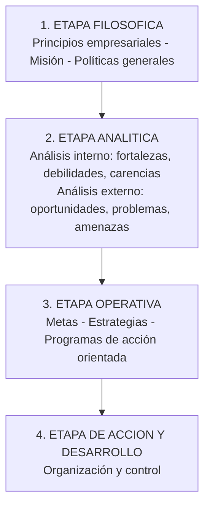

# Planificación estratégica del negocio (proceso integrado de 4 etapas)

> [!warning] Fuente
> Este contenido **no está en la bibliografía oficial** (Andreu, Edwards, Robson, etc.): proviene **solo del Apunte Supremo** (sección "Planificación estratégica", con el esquema "El proceso integrado de planificación estratégica"). El nombre **"Palom Izquierdo"** (que da nombre al archivo y se usaba como autor) **no aparece** en el texto de ese apunte ni en ningún otro material del repositorio: no se puede verificar. Tomalo como **material complementario** de los alumnos.

**Planificar** = determinar **de dónde venimos, en qué situación estamos, a dónde queremos ir y cómo y cuándo llegaremos**. No se ocupa de decisiones futuras sino del **impacto futuro de las decisiones actuales**. El objetivo no es tener un plan sino **instalar un proceso de planificación** como rutina de todo el equipo de dirección. La responsabilidad y el compromiso son de la **dirección general**.

Es el contexto previo al alineamiento: el [[Procedimiento de alineamiento (4 fases)]] de Andreu **parte de una estrategia de negocio ya formulada** (ver [[Alineamiento E.O. – E.SI-TI (esquema general)]]).

## Elementos de la planificación estratégica (Apunte Supremo)
- **Visión:** lo que los miembros desean que la organización llegue a ser en el mediano-largo plazo (aspiración). Debe ser precisa, simple y retadora.
- **Misión:** razón de ser; declaración general del "qué hacer" del negocio.
- **Valores:** reglas maestras que rigen el comportamiento; sistema de creencias.
- **Objetivos estratégicos:** lo que se espera obtener en un período; deben ser **cuantificables**, **específicos en calidad** y **específicos en tiempo**.
- **Estrategia:** conjunto de acciones/camino para alcanzar el objetivo. Responde a: **neutralizar amenazas, corregir debilidades, aprovechar oportunidades, explotar fortalezas**.
- **Acciones y tareas:** el "cómo" llegar a los objetivos.

## Detalle de cada etapa

### 1. Filosófica - la esencia
- **Principios empresariales:** sistema de valores que guía los actos dentro y fuera de la organización; convicciones de los directivos (compromiso con la sociedad, relaciones con terceros). Suelen ser implícitos; al asumirse en toda la organización forman la **cultura**.
- **Misión:** objetivo central que da sentido y razón de ser. Es **dinámica y orientada al futuro** (los valores son estáticos). Características: define el objetivo central; se **redefine cada 3 a 5 años**; es única y diferencial; **no se refiere a resultados económicos** sino a la **contribución y valor que proporciona a la sociedad**; abre puertas al futuro; motivadora; concisa.
- **Políticas generales:** acuerdos que **guían y canalizan** razonamientos, decisiones y acciones. Se escalonan en **generales**, **departamentales** y **operacionales**.

> [!info] Regla vs práctica vs política
> Una **regla** es definitiva y no se interpreta ("prohibido comer en la sala de servidores"). Una **práctica** (procedimiento) es la forma usual de hacer un trabajo. Una **política** es una orientación que fija las **fronteras** de la acción del gerente: define el **ámbito** donde se toman decisiones, pero **no da la decisión**; requiere interpretación. Ej. de los apuntes: "priorizar el reclutamiento interno al externo".

### 2. Analítica - dónde estamos

| Frente | Positivas | Negativas |
|---|---|---|
| **Interno** (por departamento y en conjunto) | **Fortalezas:** valor, capacidad o conocimiento **por encima del promedio**, cuya mejor utilización produce **mejores resultados** | **Debilidades:** valor o capacidad **por debajo del promedio** que obstaculiza los objetivos (no confundir con *imperfección*) · **Carencias:** algo, material o no, que **deberíamos poseer y no poseemos** |
| **Externo** (entorno actual y futuro) | **Oportunidades:** factores que pueden mejorar significativamente la situación | **Problemas:** factores con impacto negativo · **Amenazas/riesgos:** factores latentes de gran magnitud, a considerar siempre, sin importar su probabilidad |

- **Regla de oro:** máximo **5** fortalezas, debilidades y carencias por área de análisis.
- **Análisis externo:** factores de entorno (gobierno, economía, sociedad, tecnología, mercados, canales, productos, competencia); **nunca más de 10**, factor por factor. Se plantean **premisas de cambio** -> **efecto** en el exterior -> **implicación** concreta en la empresa (oportunidad, problema o amenaza) -> **intensidad** (escala 1 a 10).

### 3. Operativa - el camino
- **Metas/objetivos:** resultados importantes, **precisos y mensurables**. Todo lo anterior prepara su generación y todo lo posterior decide cómo alcanzarlos.
- **Estrategias:** elegir las más adecuadas requiere análisis y decisión entre alternativas. Cita a **Drucker**: *la mejor estrategia aprovecha los puntos fuertes de la empresa en zonas de oportunidad* (sin descuidar debilidades, carencias, problemas y amenazas). El apunte ilustra con una **matriz fortalezas x oportunidades** (Fig. 6) para identificar estrategias en un departamento informático.
- **Programas de acción:** concretan las estrategias en acciones, con **responsable**, **cómo**, **cuándo** y **costo**.

### 4. Acción y desarrollo - ejecución
- **Programas de acción orientados a objetivos:** documentos que reflejan **qué tareas**, **en qué orden**, **plazos**, **responsable**, **costo** y **resultados previstos**. Su valoración económica permite armar los **presupuestos**.
- Antes de aprobarlos, el grupo los examina: ¿son concretos?, ¿coherentes en fechas y pasos?, ¿comprensibles?, ¿orientados a un objetivo?, ¿cuál es la probabilidad de cumplimiento?, ¿hay reservas suficientes?, ¿los implicados los aceptan y están preparados?
- Fase de **organización y control**: técnicas para estructurar la organización y procedimientos para medir desviaciones entre metas y logros y tomar medidas correctivas.

## Tips de identificación (para el examen)
- "Sistema de valores / convicciones frente a la sociedad" -> **Principios**
- "Objetivo central, razón de ser, orientado al futuro" -> **Misión**
- "Aspiración de lo que se quiere llegar a ser" -> **Visión**
- "Documento con tareas, orden, plazos, responsable, costo y resultado" -> **Programa de acción orientada a objetivos**
- "Interno: algo que la empresa NO posee y debería poseer" -> **Carencia**; "interno: algo en lo que está por debajo del promedio" -> **Debilidad**
- "Externo: factor de gran magnitud, siempre a tener en cuenta" -> **Amenaza/riesgo**; "externo: ya impacta negativamente" -> **Problema**

> [!warning] No asumas que los SI/TI entran recién después de la etapa 4
> El material de los alumnos no ubica a los SI/TI dentro de estas 4 etapas. Para el enfoque **activo**, **Edwards (cap. 4)** sostiene que los SI/TI **pueden y deben tenerse en cuenta en la formulación** de la estrategia empresarial; en el enfoque **pasivo** (Andreu, cap. 5) la estrategia ya viene dada y de ella se deduce el plan de TI/SI. Ver [[Contexto de la estrategia SI-TI (Edwards)]] y [[Evolución de la planificación de SI (4 fases históricas)]].

## 🔗 Relacionado
- [[Alineamiento E.O. – E.SI-TI (esquema general)]] · [[Estrategia de SI vs Estrategia de TI]]
- [[Contexto de la estrategia SI-TI (Edwards)]] — el análisis interno/externo se retoma allí
