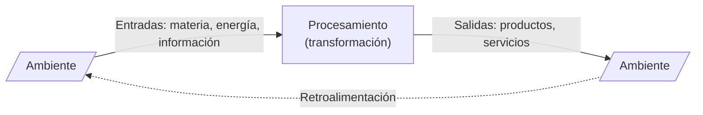

# ASI - Concepto de Organización y Sistemas Abiertos

Este concepto forma parte del estudio de las organizaciones como base para entender dónde operan los Sistemas de Información (SI).

## 🏢 Concepto de Organización

> [!quote] Definición (Chiavenato)
> Una organización es un **sistema de actividades conscientemente coordinadas, formado por dos o más personas**, cuya cooperación recíproca es esencial para su existencia.

Una organización solo existe cuando se cumplen tres condiciones simultáneas:
1. Hay personas capaces de comunicarse.
2. Están dispuestas a actuar conjuntamente.
3. Desean lograr un objetivo común.

---

## 🌀 La Organización como Sistema Abierto

La organización se concibe como un **sistema abierto** que interactúa constantemente con su entorno. Importa recursos (entradas), los procesa internamente y devuelve resultados (salidas) al ambiente, utilizando la retroalimentación para mantener un equilibrio dinámico (homeostasis).

### Características del Sistema Abierto:
- **Interdependencia con el entorno:** No puede existir de forma aislada; depende de la importación de recursos externos para sobrevivir.
- **Procesamiento de transformación:** Transforma las entradas en salidas (bienes, servicios, información).
- **Retroalimentación (Feedback):** Permite evaluar las salidas para ajustar las entradas and procesos, garantizando la viabilidad y adaptabilidad.

---

## 🔗 Relaciones Temáticas
- **Enfoque Sociotécnico:** Para entender cómo se estructura internamente este sistema abierto, ver [[1.2 - ASI - Enfoque Sociotécnico de Tavistock]].
- **Recursos:** Las entradas del sistema se clasifican en [[1.3 - ASI - Recursos Organizacionales]].
- **Racionalidad:** La adecuación de este procesamiento para lograr objetivos se analiza en [[1.4 - ASI - Racionalidad Organizacional y Eficiencia vs Eficacia]].
- **Contexto:** El entorno con el que interactúa se detalla en [[1.5 - ASI - Ambientes y Niveles Organizacionales]].

---
🏠 [[Bienvenido|Índice de Estudio]] | 📋 [[ASI U1 - Planificación Estratégica SI-TI (Súper Resumen)|Súper Resumen]] | ➡️ [[1.2 - ASI - Enfoque Sociotécnico de Tavistock|Siguiente: Enfoque Sociotécnico de Tavistock]]