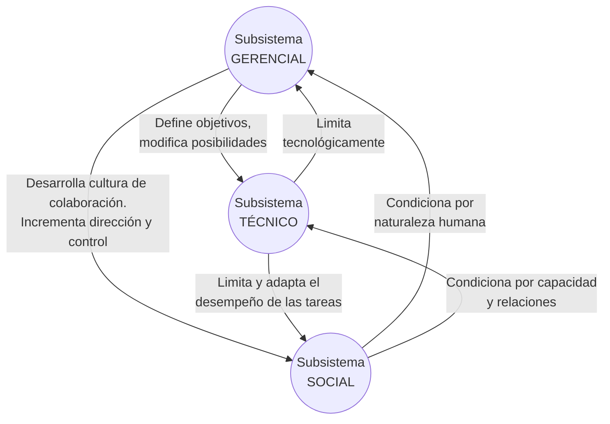

# ASI - Enfoque Sociotécnico de Tavistock

El enfoque sociotécnico concibe a la organización como una estructura dual que integra tanto la dimensión técnica como la humana.

## 🤝 El Sistema Sociotécnico

> [!quote] Definición
> El enfoque sociotécnico concibe la organización como una **combinación de tecnología** (exigencias de la tarea, ambiente físico, equipo disponible) y, al mismo tiempo, como **sistema social** (sistema de relaciones entre quienes realizan la tarea).

Toda organización cumple una **doble función**:
1. **Técnica:** Coordinación del trabajo y ejecución de tareas con la tecnología disponible.
2. **Social:** Interrelacionar a las personas y hacerlas trabajar juntas de manera cooperativa.

---

## 🏗️ Los Subsistemas Organizacionales

| Subsistema | Qué incluye | Rol |
|---|---|---|
| **Técnico o de tareas** | Flujo de trabajo, tecnología utilizada, roles que exige la tarea, instalaciones físicas. | Responde por el flujo de información técnica para conseguir los objetivos organizacionales. |
| **Gerencial o administrativo** | Estructura organizacional, políticas, procedimientos, reglas, recompensas/castigos, toma de decisiones. | Garantiza la administración; **optimiza la relación entre el sistema técnico y el social** orientándolos a las metas. |
| **Social o humano** | Cultura organizacional, valores, normas, satisfacción de necesidades, organización informal, motivación. | El grado de cooperación de individuos y grupos determina los resultados operacionales. |

> [!important] Idea central de Tavistock
> Todo sistema de producción necesita una **organización tecnológica** (equipos y procesos) *y* una **organización del trabajo** (las personas). La tecnología condiciona la organización del trabajo, pero esta última tiene características sociales y psicológicas **propias e independientes** de la tecnología. **No se pueden mirar de forma aislada**: cualquier modificación en uno repercute en el otro.

---

## 🔗 Relaciones Temáticas
- **Concepto Base:** Este enfoque analiza la estructura interna de la organización como sistema, ver [[1.1 - ASI - Concepto de Organización y Sistemas Abiertos]].
- **Recursos Humanos e Información:** El subsistema social se vincula directamente con los Recursos Humanos, y el gerencial con los Administrativos, detallados en [[1.3 - ASI - Recursos Organizacionales]].
- **Sistemas de Información:** El subsistema gerencial u operacional implementa el flujo de información a través de un SI, ver [[2.1 - ASI - Definición de Sistema de Información]].

---
Volver al índice: [[ASI U1 - Planificación Estratégica SI-TI (Súper Resumen)]]