# ASI · U1 — Planificación Estratégica de los SI/TI (Súper Resumen)

> [!info] Datos de la unidad
> **Materia:** Administración de Sistemas de Información — 4° Nivel, ISI, UTN FRRe
> **Bibliografía:** Andreu, Ricart y Valor (M1) · Edwards, Ward y Bytheway (M2) · Robson T4 Cap.9 "Management de recursos de IS" (M3) · Robson T3 Cap.7 "Valor de la información e inversión en IS" (M4) · Chiavenato (organizaciones)
> Cada sección indica a qué pregunta del cuestionario responde con la etiqueta `[Pn]`.

## 🗺️ Mapa de la unidad

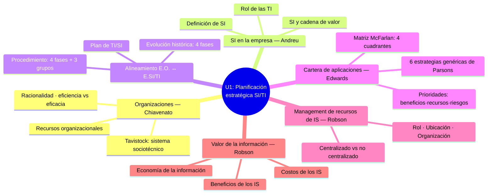

---

# 1. Las organizaciones (Chiavenato)

## 1.1 Concepto y sistemas abiertos

> [!quote] Definición
> Una organización es un **sistema de actividades conscientemente coordinadas, formado por dos o más personas**, cuya cooperación recíproca es esencial para su existencia.

Solo existe cuando: **(1)** hay personas capaces de comunicarse, **(2)** dispuestas a actuar conjuntamente, **(3)** que desean un objetivo común.

La organización es un **sistema abierto**: importa recursos del ambiente (entradas), los procesa y devuelve resultados (salidas), con **retroalimentación** para mantener el equilibrio dinámico.

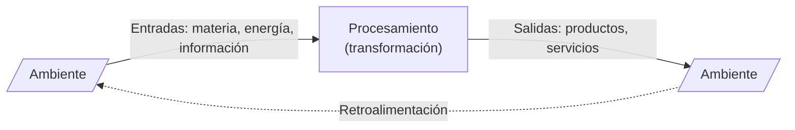

## 1.2 El enfoque de TAVISTOCK — el sistema sociotécnico

> [!quote] Definición textual
> "El enfoque sociotécnico concibe la organización como una **combinación de tecnología** (exigencias de la tarea, ambiente físico, equipo disponible) y, al mismo tiempo, como **sistema social** (sistema de relaciones entre quienes realizan la tarea)."

Toda organización cumple una **doble función**:
- **Técnica:** coordinación del trabajo y ejecución de tareas con la tecnología disponible.
- **Social:** interrelacionar a las personas y hacerlas trabajar juntas.

Los dos sistemas **no pueden mirarse aislados**: cualquier modificación en uno repercute en el otro.

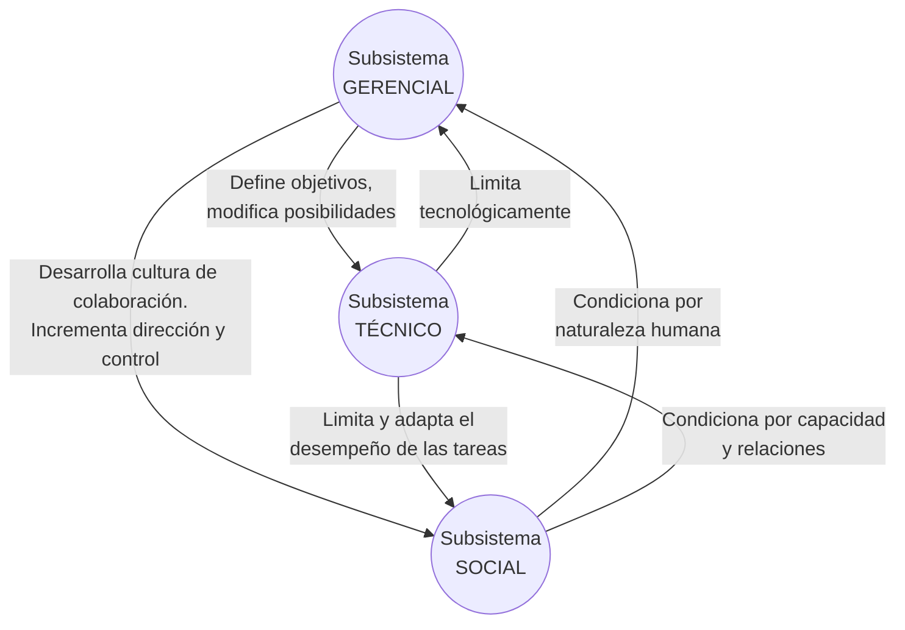

| Subsistema | Qué incluye | Rol |
|---|---|---|
| **Técnico o de tareas** | Flujo de trabajo, tecnología utilizada, roles que exige la tarea | Responde por el flujo de información técnica para conseguir los objetivos |
| **Gerencial o administrativo** | Estructura organizacional, políticas, procedimientos, reglas, recompensas/castigos, toma de decisiones | Garantiza la administración; **optimiza la relación entre el sistema técnico y el social** orientándolos a las metas |
| **Social o humano** | Cultura organizacional, valores, normas, satisfacción de necesidades, organización informal, motivación | El grado de cooperación de individuos y grupos determina los resultados operacionales |

> [!important] Idea central de Tavistock
> Todo sistema de producción necesita una **organización tecnológica** (equipos y procesos) *y* una **organización del trabajo** (las personas). La tecnología condiciona la organización del trabajo, pero ésta tiene características sociales y psicológicas **propias e independientes** de la tecnología.

## 1.3 Los recursos organizacionales

> [!quote] Definición textual (Chiavenato)
> "Los recursos son **medios que las organizaciones poseen para realizar sus tareas y lograr sus objetivos**: son bienes o servicios utilizados en la ejecución de las labores organizacionales."

| Recurso | Contenido | Clave para el examen |
|---|---|---|
| **Físicos o materiales** | Espacio físico, edificios, instalaciones, proceso productivo, tecnología, métodos de trabajo | Necesarios para las operaciones básicas |
| **Financieros** | Capital, flujo de caja, ingresos, créditos, inversiones | **Garantizan los medios para adquirir los demás recursos** |
| **Humanos** | Todas las personas, en todos los niveles | **Único recurso vivo y dinámico**; deciden el manejo de los demás |
| **Mercadológicos (comerciales)** | Mercado de consumidores, investigación de mercado, ventas, promoción, publicidad, precios | **Sin ellos, de nada sirven los demás**: sin clientes la empresa pierde su razón de existir |
| **Administrativos** | Planeación, organización, dirección y control; toma de decisiones; distribución de información; coordinación | **Acá vive el SI** como esquema de integración de la empresa |

Cada conjunto de recursos es administrado por una especialidad distinta (producción, finanzas, RRHH, marketing, administración general).

## 1.4 La racionalidad de las organizaciones

> [!quote] Definición textual
> "La racionalidad implica **adecuar los medios utilizados a los fines y objetivos que se desean alcanzar**."

- En la teoría burocrática, racionalidad = **eficiencia**: elegir los medios más eficientes para las metas, considerando **solo los objetivos organizacionales** (no los individuales), mediante **normas y reglamentos**.
- Se basa en una presuposición de **causa y efecto**: un procedimiento es racional si es coherente con el objetivo buscado.
- **La eficiencia es resultado de la racionalidad**: fijados los objetivos, la racionalidad descubre los medios más adecuados.
- Dimensiones múltiples que pueden **entrar en conflicto**: económica, legal, social, política y técnica (maximizar producción técnica puede sacrificar la racionalidad económica o social).
- Que la organización sea racional **no implica que sus miembros actúen racionalmente** respecto a sus aspiraciones personales.

### Eficiencia vs Eficacia (¡clásico de examen!)

| | **Eficiencia** | **Eficacia** |
|---|---|---|
| Pregunta | ¿Cómo hacer las cosas? (hacer **bien** las cosas) | ¿Qué cosas hacer? (hacer las cosas **correctas**) |
| Se enfoca en | Los **medios**, métodos, procedimientos | Los **fines**, resultados, objetivos |
| Medida | Relación técnica **entradas/salidas**; costos vs beneficios | Logro de resultados; capacidad de **satisfacer una necesidad social** |
| En términos de SI | Producir un sistema al menor costo posible | Elegir **qué** sistema construir (juicio de valor) |

La **eficacia organizacional** requiere tres condiciones: (1) alcance de objetivos empresariales, (2) mantenimiento del sistema interno, (3) adaptación al ambiente externo.

## 1.5 Ambientes y niveles organizacionales

- **Macroambiente (general):** factores económicos, tecnológicos, sociales, políticos, legales, culturales; escapan al control de la organización.
- **Microambiente (de tarea):** el más próximo; proveedores, clientes, competidores y organismos reguladores. Puede ser **estable/inestable** (dinámica) y **homogéneo/heterogéneo** (complejidad).

| Nivel (Chiavenato) | Características | Vinculación con SI (se cruza en §7.4) |
|---|---|---|
| **Institucional (estratégico)** | Sistema abierto, enfrenta **incertidumbre**, orientado al exterior | Beneficios de *avance estratégico* |
| **Intermedio (táctico)** | Articula cúpula y base, **amortigua la incertidumbre** | Beneficios de *efectividad* (DSS) |
| **Operacional (núcleo técnico)** | Sistema cerrado, **certeza**, rutinas y procedimientos | Beneficios de *eficiencia* |

---

# 2. Los SI en la empresa (Andreu, Ricart y Valor)

> Preguntas: `[P1]` `[P2]`

## 2.1 Definición de Sistema de Información

> [!quote] Definición textual (¡memorizar!)
> "El **conjunto formal de procesos** que, operando sobre una **colección de datos estructurada de acuerdo con las necesidades de una empresa**, recopila, elabora y distribuye (parte de) la información necesaria para la **operación** de dicha empresa y para las actividades de **dirección y control** correspondientes, apoyando al menos en parte, la **toma de decisiones** necesaria para desempeñar las **funciones y procesos de negocio** de la empresa **de acuerdo con su estrategia**."

Desglose de la definición:

| Elemento | Qué significa |
|---|---|
| **Formal** | Solo la parte claramente definida, que todos conocen y saben usar. Los SI informales son menos estudiables, planificables y dirigibles |
| **Colección de datos estructurada** | La BD está incluida en el SI y refleja las necesidades de quienes la usan (los usuarios deben participar en su diseño) |
| **Operaciones + decisiones + control** | No solo coordina acciones operativas (transacciones): también apoya decisiones y control |
| **Funciones, procesos y estrategia** | El SI está **al servicio del negocio**; es un elemento más que la empresa diseña para lograr sus objetivos y debe coordinarse explícitamente con ellos |

> [!important] El "para qué"
> La definición se centra en el **PARA QUÉ** del SI, no en el *cómo* ni en el *qué* (no habla de computadoras ni tecnología). Es una **perspectiva de negocio**, no tecnológica.

**Transacciones:** actividades operativas básicas de toda actividad empresarial, que a menudo involucran interacciones de la empresa con su entorno.

**Niveles de dirección a los que da soporte:** dirección general, dirección funcional (gerencia media) y dirección operativa. Un sistema de un nivel usa datos suministrados por los niveles más bajos más los generados por el propio nivel.

## 2.2 El SI en el contexto de la cadena de valor

> Preguntas: `[P1]`

La cadena de valor (Porter) distingue:
- **Actividades de línea o básicas:** crean valor directamente (logística de entrada, operaciones, logística de salida, marketing y ventas, servicio).
- **Actividades de soporte:** apoyan a las anteriores (infraestructura, RRHH, desarrollo de tecnología, compras).

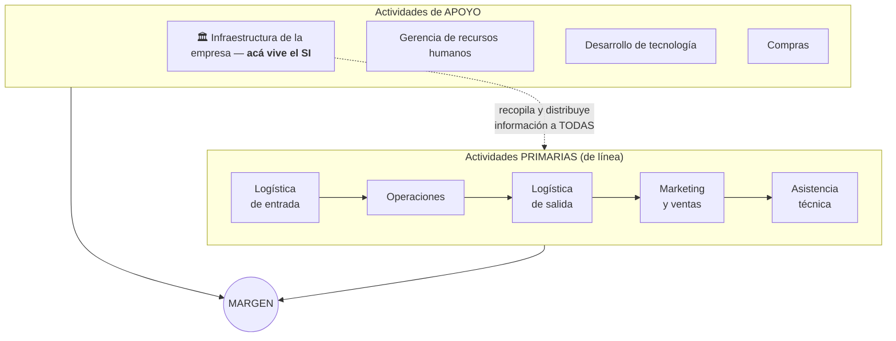

**Puntos clave (respuesta a P1):**
1. **Ubicación:** "el SI de una empresa forma parte precisamente de la **infraestructura de la empresa**" (actividad de soporte). Por eso, **todas las actividades de línea precisan apoyo basado en el SI**.
2. **Función:** todas las actividades (básicas o de soporte) **necesitan y generan información**. El SI **recopila** la información que genera cada actividad y **la distribuye** a las que la necesitan → coordina y conecta los eslabones para que cada uno agregue valor.
3. **Propiedad global:** la información que maneja el SI básico "**no pertenece a ninguna actividad en particular; pertenece a la empresa considerada globalmente**".
4. **SI circunscritos:** cuando una actividad procesa volúmenes de información en un detalle que nadie más necesita, existen **subsistemas circunscritos** a esa actividad, que no forman parte del SI básico pero terminan teniendo **interfaces claras** con él.
5. **Coherencia:** el SI forma un conjunto coherente y coordinado con el resto de la infraestructura (sistema de control, estructura organizativa, sistema de planificación) y con los objetivos de la empresa.
6. **Vínculos y ventaja competitiva:** el SI explota los "vínculos" (influencias mutuas entre actividades — ej.: quejas de clientes que mejoran el control de calidad). En casos extremos permite **reconfigurar la propia cadena de valor**, dando lugar a ventajas competitivas.

## 2.3 El rol de las TI y su relación con los SI

> Preguntas: `[P2]`

> [!quote] Definición
> Las **TI** son el **conjunto de recursos tecnológicos utilizados para la implementación de los SI**. De mínima: aplicaciones, comunicaciones y todo dispositivo necesario para acceder a la información.

**Relación SI ↔ TI (respuesta a P2):**

| | **Estrategia de SI** | **Estrategia de TI** |
|---|---|---|
| Rol | **DEMANDA** | **OFERTA** |
| Pregunta | **¿QUÉ?** — qué necesidades de información y aplicaciones tiene el negocio | **¿CÓMO?** — cómo satisfacer esa demanda con tecnología |
| Naturaleza | Determinación de la demanda de aplicaciones, alineada a los planes del negocio | Satisfacción de la demanda: hardware, software, redes para desarrollar y operar aplicaciones actuales y futuras |

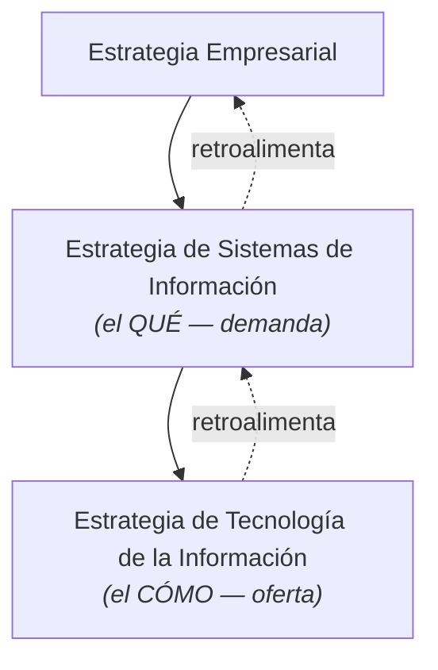

**Ideas fuerza sobre las TI:**
- La necesidad inicial se plantea **en términos de SI (negocio)**, no de tecnología; la influencia de las TI es "solamente **coyuntural**". Pero no son irrelevantes: pueden llegar a ser muy relevantes.
- **La tecnología no es neutral: aporta su propia "idiosincrasia"**. Al implementar un SI con TI, a menudo no se puede "hacer lo mismo que antes con otra tecnología". Dos situaciones posibles: (1) la tecnología aporta **mejores** maneras de hacer las cosas, o (2) **nos fuerza a hacerlas peor** (quizá más eficientes pero menos efectivas).
- Alguien en la estructura organizativa debe **responsabilizarse de estar al día** de las posibilidades cambiantes de las TI, con actitud crítica desde la perspectiva de las necesidades de SI.
- Aportes históricos de las TI: el concepto de **Base de Datos**, los **DSS** (ayudar al decisor, no reemplazarlo — "intervalos de decisión"), el **aprendizaje organizativo** y la **reingeniería de procesos**.

---

# 3. Alineamiento E.O. ↔ E.SI/TI (Andreu)

> Preguntas: `[P3]`

## 3.1 La jerarquía del alineamiento

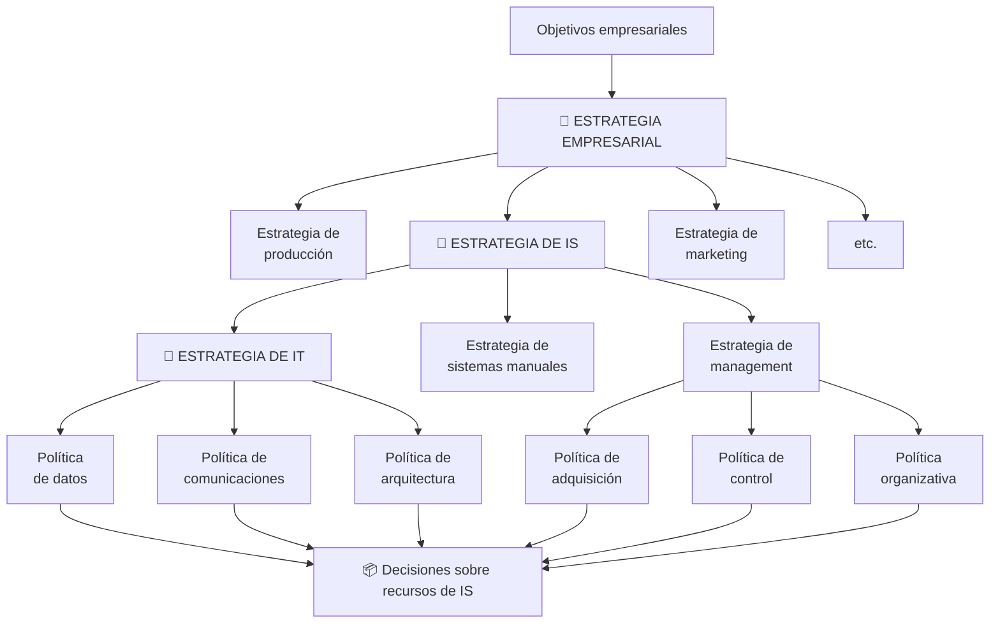

> [!tip] Cómo leer el esquema
> La estrategia de IS es **una estrategia funcional más** (como producción o marketing) que se deriva de la estrategia empresarial. De ella cuelgan la estrategia de IT, la de sistemas manuales y la de management, que se concretan en **políticas** → todas terminan en **decisiones sobre recursos de IS**.

## 3.2 ¿Por qué deben alinearse los SI con la estrategia?

> Preguntas: `[P3 — conclusión propia]`

> [!important] Argumentos para elaborar tu conclusión
> 1. **Por definición:** el SI existe "para desempeñar las funciones y procesos de negocio **de acuerdo con su estrategia**" (Andreu). Es un recurso más de la empresa, **no un fin en sí mismo** ni independiente de su estrategia.
> 2. **Por su ubicación en la cadena de valor:** al ser infraestructura que interactúa con TODAS las actividades, un SI desalineado propaga su ineficacia a toda la organización.
> 3. **Por la historia (evolución en 4 fases):** sin alineación se cae en la "**expansión anárquica**": prioridades decididas por facilidad técnica, novedad tecnológica o poder del departamento solicitante, en vez de por los objetivos del negocio → inversiones enormes que no sirven a la estrategia.
> 4. **Por eficacia estratégica (Edwards):** unidades de negocio con estrategias distintas (bajo coste vs diferenciación de Porter) necesitan SI distintos; un sistema compartido impedirá que ambas desarrollen su estrategia con eficacia.
> 5. **Por el valor (Robson):** el valor no está en la tecnología sino **en el uso de la información** para el negocio; invertir sin alineación es incurrir en costos sin garantizar beneficios.

## 3.3 Evolución histórica de la planificación de SI (Gibson y Nolan, 1974)

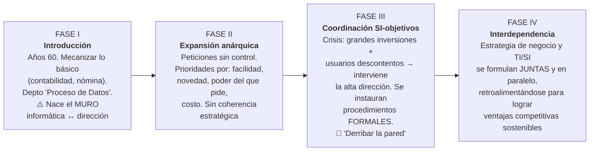

> [!warning] Aclaración de examen
> El procedimiento de alineamiento de Andreu es una metodología **"pasiva"** (Fase III): los SI se adaptan a una estrategia de negocio **ya definida**. Muchas empresas fracasan al intentar saltar directo a la Fase IV (activa) sin la madurez cultural necesaria; conviene aplicar primero la metodología pasiva para crear esa cultura.

## 3.4 El Plan de TI/SI: ¿qué debe incluir?

> [!quote] Definición de planificación
> "Procedimiento **sistemático de toma de decisiones** sobre *qué hacer en el próximo futuro con los sistemas de información*."

Un Plan de TI/SI debe incluir:
1. Una **lista de proyectos** a desarrollar en los próximos **3–5 años**.
2. **Referida a la situación actual** (punto de partida): juicio técnico Y de negocio de los sistemas existentes.
3. La **prioridad** de cada proyecto.
4. Para los proyectos del **primer año**: detalle suficiente para evaluarlos en recursos e incluirlos en el **presupuesto anual**.
5. **Mecanismos de evaluación y control**: calendario y presupuesto detallados.
6. Una **lista de actividades** de la empresa donde la TI pueda usarse para aumentar eficacia o eficiencia.

> [!important] El contenido del Plan es **muy poco tecnológico**: se elabora bajo una **perspectiva de negocio**, no tecnológica. Las actividades del procedimiento son *qué hay que hacer*, no *cómo hacerlo*.

## 3.5 Esquema general: los 3 grupos de trabajo

> [!quote] Qué debe lograr el procedimiento
> "Integrar las **necesidades de información** emanadas del **cruce de las directrices estratégicas** de la empresa **con las funciones y procesos de negocio** de las distintas unidades organizativas."

| Grupo | Quiénes | Responsabilidades |
|---|---|---|
| **Comité de TI/SI** | Director General + responsables de áreas funcionales + director de SI | **Responsabilidad última.** Supervisa el proyecto, explicita el compromiso organizacional, da **criterios estratégicos** para prioridades y recursos, y **aprueba el Plan** |
| **Grupo Base** | Subdirector general a cargo de SI + director de SI + DOP (+ consultores externos eventuales) | Supervisión táctica: **facilita la negociación entre usuarios**, asegura consistencia de los desarrollos, supervisa al equipo de trabajo |
| **Equipo de Trabajo** | Personal de Sistemas + personal de departamentos usuarios; dirigido por el director de SI, conducido en el día a día por el **DOP** | **Trabajo operativo**: entrevistas, relevamiento, análisis, documentación |

## 3.6 El procedimiento: las 4 fases

```mermaid
flowchart TD
    F1["<b>FASE I — Presentación y compromiso del equipo</b><br/>I.1 Decisión de obtener el Plan; se crea el Comité TI/SI<br/>I.2 Formación del Grupo Base<br/>I.3 Identificación de áreas de análisis<br/>I.4 Equipo de trabajo definitivo + presentación del proyecto<br/>👥 Responsables: Comité + Grupo Base → 📄 Equipo definitivo"]
    F2["<b>FASE II — Descripción de la situación actual (¿dónde estoy?)</b><br/>II.1 Funciones y procesos de negocio por área (validados por directores)<br/>II.2 Descripción de sistemas existentes: procesos y estructuras de datos<br/>II.3 Crítica TÉCNICA y DE NEGOCIO de los sistemas. Validación<br/>II.4 Informe de sistemas existentes<br/>👥 Equipo de trabajo + departamentos → 📄 Informe de sistemas existentes"]
    F3["<b>FASE III — Elaboración del Plan de TI/SI (¿a dónde quiero ir y cómo?)</b><br/>III.1 Preparación del equipo; posibles nuevas áreas<br/>III.2–III.3 Necesidades de SI por áreas (importancia y urgencia); descripción sistemática<br/>III.4 Integración: estructura del SI emergente<br/>III.5 Validación de la estructura (departamentos + Comité)<br/>III.6 Informe de la estructura del SI futuro<br/>III.7 Propuestas alternativas: 3–4 ESCENARIOS + evaluación de recursos<br/>III.8 Elaboración y APROBACIÓN del Plan definitivo (Comité)<br/>👥 Equipo + departamentos; propuestas: personal técnico; aprueba: Comité"]
    F4["<b>FASE IV — Programación de actividades</b><br/>IV.1 Descripción detallada del Plan; calendario concreto del PRIMER AÑO<br/>IV.2 Inclusión de proyectos en el presupuesto del período siguiente<br/>IV.3 Plan de evaluación y revisión (iteraciones posibles)<br/>👥 Elabora: personal de SI · Aprueba: Comité → 📄 Calendario del 1er año"]
    F1 --> F2 --> F3 --> F4
```

## 3.7 Características clave del procedimiento (preguntas típicas)

- **Propiedad interna:** lo lleva a cabo **personal propio** de la empresa; los consultores externos son solo apoyo metodológico (el know-how queda en la organización).
- **Participación activa de la alta dirección** de todas las áreas: no es "un proyecto de los informáticos".
- **El filtro estratégico se aplica al FINAL** (Fase III), no al principio: aplicarlo temprano arriesga descartar necesidades vinculadas a procesos vitales.
- **El análisis coste-beneficio se divide ("divorcio")**: los **técnicos de SI** estiman y se responsabilizan de los **costes**; los **directivos/usuarios de negocio** justifican y se responsabilizan de materializar los **beneficios**.
- **Aprendizaje organizativo** como objetivo explícito: el mayor valor es el diálogo técnico ↔ negocio que "derriba la pared".
- En empresas pequeñas puede simplificarse (fusionando roles), pero manteniendo: informe inicial validado, esquema global del SI, plan final con calendario y presupuesto, y el "espíritu" centrado en el negocio.
- Duración típica: de 1–2 semanas a 4–5 meses; el **DOP** controla los tiempos y la disciplina documental (documentos homogéneos).
- Herramientas: **documentar y estructurar datos** (catálogos, diccionarios de datos, matrices de necesidades) — NO herramientas CASE ni de control de proyectos.

### La Matriz de Necesidades

Cruza **funciones de negocio por departamento (filas)** con **acciones estratégicas (columnas)**. Las intersecciones marcan necesidades de información que **se integran en el Plan de TI/SI** → del cual derivan el **Plan Informático**, el **Plan de hardware y software de base** y los **proyectos a desarrollar** (dirigidos por SI con colaboración de usuarios). Los sistemas resultantes **deben servir a los departamentos y apoyar la estrategia**.

---

# 4. El contexto de la estrategia de SI/TI (Edwards, Ward y Bytheway)

> [!quote] Estrategia
> "Un **conjunto integrado de acciones encaminadas a incrementar a largo plazo la prosperidad y las fortalezas de la empresa**."

La estrategia empresarial se formula analizando inputs internos y externos; la definición de requisitos (*¿qué hacer?*) se traslada a soluciones tecnológicas (*¿cómo satisfacerlas?*). Los **dos componentes** de la estrategia de SI/TI: **estrategia de SI** (necesidades de información y aplicaciones por negocio; si hay varios negocios, una por negocio + una corporativa) y **estrategia de TI** (cómo satisfacerlas según prioridades).

## 4.1 Las entradas (inputs) clave

| Input | Qué se analiza |
|---|---|
| **Entorno empresarial externo** | Fuerzas de la industria; papel de los SI/TI para alterarla (oportunidades y riesgos). Dos aspectos: **(a) las nuevas tecnologías** (conocer avances y tendencias; toda tecnología nueva implica riesgo y curva de aprendizaje) y **(b) la utilización de la tecnología** (cómo la usan otros en la industria y en otras industrias) |
| **Entorno interno de la empresa** | **Misión y objetivos**; **actividades** (procesos principales); **fortalezas y debilidades** (dónde orientar los SI/TI para explotar fortalezas y corregir debilidades); **estructura organizativa y estilo de dirección** |

> [!warning] Dato de examen
> La mayoría de las empresas que obtuvieron **ventajas estratégicas** de un SI/TI **NO usaron la última tecnología** (demasiado arriesgado): innovaron en sentido **comercial** con tecnología **adecuada, probada y bien establecida**.

## 4.2 Los procesos para gestionar la estrategia

Tres etapas + dos enfoques (formal e informal; el equilibrio impulsa la creatividad hacia los niveles inferiores):
1. **El vector estratégico:** define los objetivos y selecciona los medios.
2. **La definición de la estrategia:** estrategias específicas por área → planes viables (con reflexión creativa e informal).
3. **La implantación:** ejecutar los planes; implica a toda la organización.

- Los procesos **informales no deben ser ahogados**: muchos usos innovadores de SI/TI surgieron como ideas oportunistas de niveles bajos.
- **Alta dirección** inicia el proceso y marca la dirección; los **directivos de línea** incorporan los planes de SI/TI a sus planes funcionales.
- **Unidades de negocio:** elegir una unidad coherente (productos, clientes y competidores propios) con visión externa de *qué hace*, no de *cómo está estructurada*. Porter: éxito por **bajo coste** o **diferenciación** → estrategias distintas exigen SI/TI distintos; **un sistema compartido entre unidades con estrategias diferentes impide que ambas las desarrollen eficazmente**.
- Por qué fracasan los estudios estratégicos (primera iteración): (1) no se logra el compromiso del director general, (2) el proceso es demasiado largo/caro, (3) genera contenido excesivamente detallado y difícil de interpretar, (4) el plan carece de enumeración de recursos y financiación.
- Tres enfoques para realizar los estudios: unidad especial de planificación de SI/TI, consultores, o comisión de trabajo guiada por un directivo respetado.

---

# 5. Análisis de la cartera de aplicaciones (Edwards / McFarlan)

> Preguntas: `[P4]`

> [!quote] Definición
> "El análisis de la cartera de aplicaciones es un **esquema de clasificación, desarrollado originalmente por McFarlan**, que permite **evaluar y administrar el conjunto de sistemas de información de una empresa** —tanto los actuales, como los planificados y los potenciales— **basándose en la contribución que hacen al éxito del negocio**, en lugar de enfocarse meramente en la forma en que se suministran operativamente."

**Ideas clave:**
- Las aplicaciones se tratan como **activos** de una cartera (igual que productos, clientes o inversiones), gestionadas según sus **valores comerciales presentes y futuros**, *tal como los percibe la dirección*.
- Todas entran en la matriz: sistemas existentes, en desarrollo o simples ideas.
- Permite ver el **equilibrio de las inversiones**: dónde se aplican recursos y esfuerzos; si no se ajusta a los objetivos, se reasignan.
- Su mayor fuerza: es un **vehículo para la discusión constructiva** entre alta dirección, mandos medios y profesionales de SI.
- En el alineamiento se usa dos veces: como **diagnóstico** de los sistemas actuales y en la **formulación/priorización** de los nuevos.

## 5.1 La matriz: 4 cuadrantes

*(Tal como aparece en el libro; fila superior = orientación al **futuro**, fila inferior = **presente**.)*

| 🎯 **ESTRATÉGICAS** Aplicaciones **críticas para ejecutar la estrategia futura** del negocio | 🚀 **DE ALTO POTENCIAL** Aplicaciones que **pueden ser importantes para lograr el éxito futuro** |
|---|---|
| 🔑 **CLAVE PARA LAS OPERACIONES** Aplicaciones de las que **depende actualmente el éxito** de la organización | 🧰 **DE APOYO** Aplicaciones **valiosas pero no críticas** para el éxito del negocio |

> Ejes de Parsons sobre esta misma matriz: **vertical** = Demanda (arriba) ↕ Oferta (abajo) · **horizontal** = Centralizada (izquierda) ↔ Descentralizada (derecha).

| Cuadrante | Filosofía / enfoque | Ejemplos | Fuerzas motrices (¿qué las impulsa?) | Requisitos (¿qué se les exige?) |
|---|---|---|---|---|
| **Estratégicas** | **Orientación al negocio**: deben relacionarse claramente con los **FCE** derivados de los objetivos | Comercio electrónico, ERP, análisis de mercado y predicción de ventas | **Necesidades del mercado y presiones competitivas** (desde el exterior); objetivos empresariales y visión de la dirección; lograr ventaja competitiva | **Desarrollo rápido** para concretar beneficios; **solución flexible** adaptable a cambios; enlace directo con una iniciativa de negocio |
| **Alto potencial** | **I+D**: experimentación controlada para identificar beneficios, oportunidades y costos | Sistemas expertos de diagnóstico, IA, planificación de RRHH | **Nueva idea u oportunidad tecnológica**; iniciativa individual con un "impulsor" dispuesto a liderarla | **Rápida evaluación de prototipos**; rechazar fracasos rápido; entender el potencial respecto a la estrategia |
| **Clave para las operaciones** | Dominio **tradicional** de los SI/TI ("vacas lecheras") | Facturación, control de stock, costo de productos, BD de personal, cuentas por pagar | **Mejorar rendimiento de actividades existentes** (velocidad, exactitud, economía); **integrar sistemas y datos** para evitar errores y duplicación; **evitar desventajas** y riesgos críticos | **Soluciones de alta calidad y larga vida**; gestión eficiente de datos; equilibrar costes con beneficios y riesgos mediante análisis objetivo |
| **De apoyo** | **Análisis económico de la inversión**; abunda el software estándar (genérico entre industrias) | Contabilidad, presupuestos, nóminas, correo electrónico | **Productividad/eficiencia de tareas específicas y localizadas**; **requisitos legales**; uso eficiente de fondos | **Costo ínfimo**, soluciones a largo plazo → **paquetes estándar** (sacrificando necesidades específicas del usuario); análisis coste-beneficio objetivo |

> [!tip] Palabras clave para identificar cuadrante en el examen
> - "integrar datos", "evitar desventajas", "depende el funcionamiento diario" → **Clave para las operaciones**
> - "tareas localizadas", "requisitos legales", "paquetes de costo ínfimo" → **De Apoyo**
> - "prototipos", "oportunidad tecnológica", "I+D" → **Alto Potencial**
> - "presiones competitivas externas", "FCE", "desarrollo rápido para ventaja" → **Estratégica**

## 5.2 Migración entre cuadrantes (la cartera evoluciona)

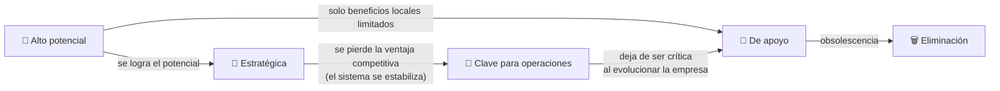

---

# 6. Las estrategias genéricas de gestión de SI/TI (Parsons)

> Preguntas: `[P5]`

> [!quote] Definición
> "**Marcos generales que guían** la identificación de las oportunidades de la TI, los recursos para desarrollar TI, **el ritmo al que se adoptan las nuevas tecnologías**, el nivel de impacto de la TI dentro de la empresa... las tendencias estructurales que siguen las empresas para aplicar la TI a sus negocios."

Sirven para **vincular la gestión de los SI/TI con la dirección general de la empresa**. Parsons identifica **seis**:

| Estrategia | Concepto | Ventajas | Riesgos / desventajas | Gestión de… |
|---|---|---|---|---|
| **1. Planificación centralizada** | SI/TI totalmente integrada con la estrategia corporativa, vía **unidad centralizadora a nivel de alta dirección** | Mejor comprensión de requisitos competitivos; asignación óptima de recursos; grandes inversiones | Requiere mucha dedicación de la alta dirección; puede alejarse de la realidad operativa | **Demanda** (impulsada por el negocio) |
| **2. Hilo conductor** *(leading edge)* | Aceptación de que la TI genera ventajas: usar el **"estado del arte"** | Innovación tecnológica; explota el potencial de la tecnología | Cara; gastos de I+D con pérdidas posibles; requiere dirección experta; compromiso (no implicación a fondo) de la alta dirección | **Demanda** (impulsada por la tecnología) |
| **3. Mercado libre** | Los directivos-usuarios saben qué es mejor y **satisfacen sus necesidades a voluntad**; TI interna compite con proveedores externos | Innovación dirigida por el usuario | **Duplicidades de inversión**; tasas de desarrollo dispares; **sistemas aislados no integrados** | Demanda **y** oferta decididas por el usuario |
| **4. Monopolio** | **Único proveedor interno** de SI/TI, de uso obligatorio | Gasto global fácil de identificar y controlar; servicio profesional, sistemas de calidad; reduce riesgos | Innovación lenta; necesita **capacidad ociosa** para responder a demandas; medir por satisfacción del usuario y cartera de pedidos pendientes | **Oferta** (control centralizado) |
| **5. Recurso escaso** | **Presupuesto definido con antelación**; las aplicaciones **compiten** por los fondos; justificación financiera estricta (ROI) | Gestión cuidadosa de recursos mediante controles financieros; muy popular | Trata a SI/TI como **centro de costes**; no propicia explotarlos como arma competitiva; no reconoce cambios de demanda | **Oferta** (limitación financiera) |
| **6. Mal necesario** | SI/TI solo para **requisitos legales** e inversiones de altísimo rendimiento; se usa solo si no hay alternativa | — | Se llega por error, negligencia o escasez extrema; **degrada paulatinamente la capacidad de competir**; desmoraliza | — |

## 6.1 Proyección sobre la cartera (Parsons) — ¡cruce favorito de examen!

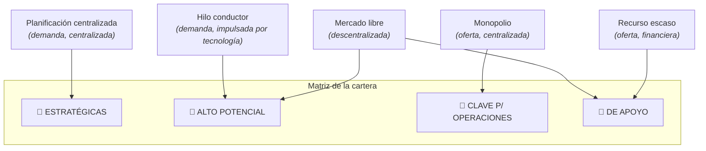

> [!tip] Demanda vs Oferta — la regla de oro
> **Demanda = el QUÉ** necesita el negocio (descubrir y priorizar necesidades). **Oferta = el CÓMO** se proveen y controlan los recursos tecnológicos.
> - Los cuadrantes **superiores** (Estratégicas, Alto potencial) buscan **oportunidades futuras** → estrategias de **demanda** (Planificación centralizada, Hilo conductor).
> - Los cuadrantes **inferiores** (Clave, Apoyo) resuelven el **presente** con estabilidad y control → estrategias de **oferta** (Monopolio, Recurso escaso).
> Una estrategia coherente **prioriza primero la demanda** y recién después gestiona la oferta. Al revés (planificar desde servidores o presupuesto sin mirar el negocio) → los usuarios no se apropian del sistema.

---

# 7. Evaluación de inversiones y prioridades (Edwards)

> Preguntas: `[P6]` `[P7]`

## 7.1 Justificación por cuadrante

En todos los casos: estimar **costes** (incluyendo costes del usuario y del ciclo de vida) y definir **beneficios** — en forma **financiera** (clave para operaciones y apoyo) o en términos de **FCE alcanzados** (estratégicas y alto potencial).

| Cuadrante | Justificación de la inversión |
|---|---|
| **De apoyo** | Mejorar **eficiencia** → cuantificar y convertir en **argumento financiero** |
| **Clave para operaciones** | Costes y beneficios financieros **+ riesgo**: la solución más económica puede no ser la más eficiente → estudio de viabilidad riguroso (equilibrio coste-beneficio-riesgo) |
| **Estratégicas** | Estimar hasta donde se pueda, pero las razones principales quedan **intangibles** (FCE). No se resuelve con VAN detallado. Éxito = suerte + juicio directivo + buena gestión |
| **Alto potencial** | Los beneficios **se desconocen: el objetivo es aclararlos** (es el segmento I+D). Fondos desde presupuesto de **I+D general** (no de SI/TI); "impulsor del producto" con presupuesto y calendario estricto; re-justificar cada dotación (evitar el "pozo sin fondo") |

### Economía de la información — 3 tipos de aplicaciones según beneficios (Parker)
- **Sustitutiva:** máquinas por personas — fuerza principal: la **economía** (eficiencia).
- **Complementaria:** mayor productividad y eficacia — el trabajo se hace **de otra forma**.
- **Innovadora:** obtener o mantener **ventaja competitiva**.

### 5 técnicas para evaluar beneficios (Edwards)
1. **Análisis coste-beneficio** (tradicional; desplazamiento de costos).
2. **Vínculos de valor** (mejora por coordinación entre áreas diferentes).
3. **Aceleración de valor** (impacto del tiempo: acelerar operaciones entre departamentos).
4. **Reestructuración de valor** (productividad por cambio organizacional sustancial).
5. **Innovación** (nuevos negocios; lo más difícil de valorar).

## 7.2 Los 3 factores de prioridad

> Preguntas: `[P6]`

> [!important] Para evaluar prioridades hay que incluir **tres factores**:
> 1. **Beneficios** → lo que es más importante **conseguir**
> 2. **Recursos** → lo que se **puede hacer** (dotar)
> 3. **Riesgos** → lo que **probablemente va a ocurrir**

$$\text{Prioridad} \propto \frac{\text{Beneficios a obtener (ajustados por el riesgo)}}{\text{Consumo de recursos limitados}}$$

## 7.3 Etapas para determinar prioridades

> Preguntas: `[P7]`

1. **Priorizar DENTRO de cada segmento** de la cartera (la lógica difiere por cuadrante):
   - *Apoyo:* mayor **beneficio económico** con menos recursos.
   - *Estratégicas:* mayor **contribución a los objetivos** (tabla de decisión con **FCE**) con menos recursos.
   - *Alto potencial:* **autogestionadas** — dependen del valor de la idea y de la energía de sus **defensores** (los recursos secundarios pueden ser problema).
   - *Clave para operaciones:* la más compleja — combinar **economía + riesgos para el negocio + FCE + mejoras de infraestructura** vs costo.
2. **Priorizar DENTRO de la cartera global:** el problema es que cada tipo "puntúa alto" en cosas distintas (estratégicas en FCE, apoyo en economía, clave en riesgo/infraestructura) → **la dirección decide el PESO** de cada tipo de beneficio y luego prioriza.
3. Los **pesos** dependen de: fortalezas/debilidades de la empresa (defender posición vs innovar), fortalezas/debilidades de los sistemas actuales y capacidad del recurso SI/TI, y experiencia de los usuarios para definir necesidades e implantar sistemas.
4. **Asignar recursos** según la secuencia de prioridades y **comunicar el plan** a todos los implicados (que se entiendan las razones de cada priorización).

---

# 8. Management de recursos de IS (Robson, T4 Cap.9)

> Preguntas: `[P8]` `[P9]` `[P10]` `[P11]` `[P12]`

> [!tip] Se retoma en la U3
> El RUO vuelve en la Unidad 3 (Subsistema de aplicación) → [[RUO — Rol, Ubicación y Organización del área de SI-TI]] · [[SI delegados]] · [[Enfoques estructurales — detalle U3]].

> [!warning] ACLARACIÓN clave de la cátedra
> En esta unidad, **"IS" hace referencia al ÁREA de sistemas** (el departamento), **no a las aplicaciones**.

## 8.1 ¿En qué consiste la administración de los recursos de IS?

> Preguntas: `[P8]`

Consiste en resolver **tres temas específicos**:

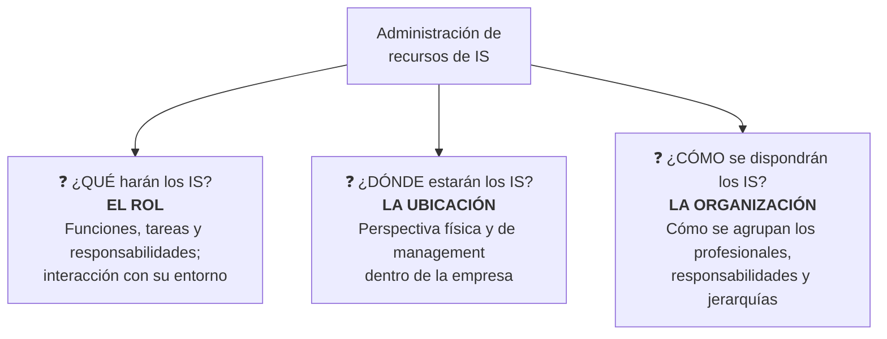

## 8.2 El ROL de los IS

> Preguntas: `[P9]`

- Cambio de rol: de **brindar apoyo** empresarial → a **permitir la transformación** de la empresa.
- Dos visiones divididas: función **estratégica y crítica** vs función de **apoyo para la eficiencia**.

**Modelos según la relación IS ↔ usuarios (evolución):**

| Modelo | Relación con los usuarios |
|---|---|
| **De servicio** | Formaliza la interacción como una **obligación de servicio** |
| **De participación** | Separa las líneas funcionales del servicio para lograr **estrecha correspondencia** IS-usuarios |
| **De vendedor** | Los IS **se comercializan a sí mismos** y venden sus servicios; atrae a empresas interesadas en el valor que aportan los IS al negocio |
| **De expansión** | Los IS crean una **arquitectura flexible** que sustenta sistemas comunes |
| **De ventaja estratégica** | Identificación IS-usuarios tan estrecha que **los productos competitivos se desarrollan en forma conjunta**; ideal para empresas grandes y en crecimiento |

**Roles de IS que deben estructurarse en forma diferenciada (management y provisión de):**
1. **Infraestructura de IS (operación y administración):** servicios centrales efectivos y confiables; planificación de capacidad, seguridad, control de acceso, detección de errores.
2. **Investigación y desarrollo a largo plazo:** directivas a largo plazo separadas de las preocupaciones actuales; función asesora realista e innovadora.
3. **Facilitar la informática a nivel de usuario final:** la función de **apoyo/asesora** de los IS.

> [!note] Dilemas del management de IS
> - Si se **aflojan las riendas** por completo → anarquía; si las reglas son **muy estrictas** → se anulan las respuestas adecuadas.
> - ¿La estructura de IS debe *reflejar* la estructura de la empresa o tener enfoque *distinto*? Dos razones para tratarlos diferente: (1) cambiar los sistemas cuesta **más tiempo y dinero** que cambiar la estructura de la empresa; (2) demasiada autonomía puede impedir reorganizar el negocio más adelante.
> - Los IS tienen su **propia cadena de valor**: compra del servicio y provisión del servicio (distribución + apoyo). Son actividades **lógicas**, no departamentos.

## 8.3 La UBICACIÓN de los IS

> Preguntas: `[P10]` `[P11]`

**Decisiones a tomar `[P10]`:** confrontar cada elemento contra la estrategia de IS y decidir **qué centralizar, cómo y en qué medida**, resolviendo tres aspectos:
- **Localización:** ubicación **física** del sistema.
- **Control:** **nivel empresarial** donde se toman las decisiones.
- **Estructura:** responsabilidad en la **función de IS o transferida a los usuarios**.

**Tres tipos de ubicación:**

| Tipo | Concepto | Ejemplo de la cátedra |
|---|---|---|
| **(Re)Centralizada** | Una función con **un único acceso**; decisiones, gestión y administración en un solo lugar | Sistema de gestión contable del estado provincial |
| **Descentralizada** | **Muchas funciones, cada una con acceso único**: mini-departamentos de PD que son **réplicas** de la centralización | Sysacad de la UTN (una réplica por regional) |
| **Delegada** | Dispersión **geográfica y de management**; red de uniones laterales con **control significativo del usuario final** sobre procesamiento, desarrollo y entorno. Las áreas son autónomas | Sistema de registración de expedientes de la UTN |

> Las empresas suelen combinar facetas de las tres categorías.

### Comparación centralizados vs no centralizados

> Preguntas: `[P11 — pregunta 11 del cuestionario]`

| Criterio | **CENTRALIZADOS** | **NO CENTRALIZADOS (descentralizados / delegados)** |
|---|---|---|
| **a) Grado de control** | **Mayor control** sobre las operaciones; un solo grupo fija estándares, sin conflictos de responsabilidad; menor incompatibilidad; manejo de proyectos complejos; más fácil reclutar especialistas | Control **disperso**: mayor autonomía e involucramiento del usuario final; los delegados generan **confusión sobre quién es responsable** → hay que automatizar seguridad y management de red |
| **b) Entorno requerido** | Sistemas para **senior management**; **servicio común** a las unidades (ej. liquidación de sueldos); unidad de negocio **muy pequeña**; **integración vital** de datos; tiempo de respuesta **no crítico**; objetivos de IS orientados a la **eficiencia** | Requerimiento de **velocidad y flexibilidad**; **servicio único** de una parte de la empresa (se administra ahí); objetivos de IS orientados a la **efectividad** |
| **c) Costos asociados** | **Economías de escala** (menos duplicación de esfuerzo, recursos y experiencia); gasto fácil de identificar; PERO pueden crecer sin control, y los **costos de comunicación** pueden ser altos (distancia huésped-cliente) | **Mayores costos agregados por duplicación** (muchos grupos chicos con los mismos problemas); ineficiencia; PERO la informática departamental puede **bajar costos de comunicación de datos**, y el usuario percibe mejor el balance costo/beneficio |

**Otros contrastes útiles:**
- Centralizados: riesgo de **separarse del negocio real** (prioridades propias), acceso lento en horas pico, planificación de capacidad difícil, poca atención a grupos particulares.
- Descentralizados vs delegados: difieren en el **grado de dispersión del control y la autoridad**. La descentralización crea "islas de tecnología"; la **delegación** pone los recursos donde el negocio los necesita (acercar los IS a sus clientes). Descentralización = menos énfasis en costos, más en **efectividad**. Riesgos de los no centralizados: incompatibilidades futuras (críticas en RRHH e información, no solo técnicas), límites ante la complejidad, carreras profesionales limitadas, hostilidades si el cambio se maneja mal.

## 8.4 La ORGANIZACIÓN de los IS — enfoques estructurales

> Preguntas: `[P12]`

Estructura **interna** de los IS, dondequiera que estén. Los enfoques **pueden coexistir** en una empresa (la variedad maximiza ventajas y minimiza desventajas); se eligen según la **estrategia de IS**.

| Enfoque | Característica | Notas |
|---|---|---|
| **1. Tradicional (Centro de datos / Depto. de PD)** | Estructura **rígida**: desarrollo, mantenimiento y operación **separados**; personal de operación por turnos; determinado por una función financiera | Desventajas: **retraso** (desarrollos de años), **sistemas proscriptos** (más "elegancia" técnica que usabilidad), **inflexibles**, **mantenimiento costoso**. Sirve para alta complejidad técnica y gran volumen de datos |
| **2. Estructura de base de datos** | Organiza los IS según las **necesidades de almacenamiento**: los datos se separan de las aplicaciones | Facilita el **acceso del usuario a los datos** bajo control del administrador de la BD; los usuarios desarrollan conciencia y habilidades de IS |
| **3. Grupos de proyectos funcionales** | Analistas + programadores combinados en **grupos por proyectos empresariales** | Primera estructura basada en la **DEMANDA** (no en la oferta). Forma de matriz de management (ambigua); sistemas más relevantes, usuario involucrado, PERO crea **"murallas chinas"** entre áreas |
| **4. Centro de información y apoyo a decisiones** | Función de IS organizada para **apoyar las decisiones de management** de los usuarios | Los IS responsables no solo del procesamiento de datos sino del **manejo efectivo** de los IS |
| **5. Estructuras externas** | Centradas en el **ambiente**: líneas de servicio al consumidor; **acuerdos de servicio** con la comunidad de usuarios (definen obligaciones y percepciones de valor) | Las nuevas estructuras transfieren autonomía para lograr ciclos más cortos, sistemas flexibles y menos prescriptivos. Los IS ya no son homogéneos |

### Administración de los SI por nivel gerencial

| Qué se administra | Nivel |
|---|---|
| **La tecnología** | Gerencia de **primera línea** (operacional) |
| **El uso de los SI** | Gerencia **táctica** |
| **La información** | Gerencia **estratégica** |

---

# 9. Valor de la información e inversión en IS (Robson, T3 Cap.7)

> Preguntas: `[P13]`–`[P18]`

## 9.1 Las tres cuestiones para implementar la estrategia

> Preguntas: `[P13]`

> [!important] Llevar la estrategia de IS a la realidad (asignación de recursos) requiere el management de **tres conjuntos interrelacionados de cuestiones**:
> 1. Cuestiones relacionadas con los **COSTOS** de los IS
> 2. Cuestiones relacionadas con los **BENEFICIOS** de los IS
> 3. Cuestiones relacionadas con el **BALANCE entre costos y beneficios** (→ acá vive el **RIESGO**)

- **Costo** = "renunciar a algún recurso o atributo que se considera importante": capital, pero también esfuerzo, tiempo, entusiasmo, poder, compromiso y **la certeza** (no se sabe el verdadero resultado).
- **Beneficio** = "ganar algún recurso o atributo que se considera útil": capital, poder, status, conformidad, certeza.
- El **riesgo** está presente en toda asignación de recursos de IS; el balance del riesgo se logra concertando los criterios costo/beneficio: entender direcciones estratégicas, perfiles de riesgo y técnicas para estimar el desempeño en plazos adecuados.

> [!note] ¿Por qué "se renuncia a la certeza"?
> Al invertir en IS se abandona lo **familiar** (procesos conocidos y controlados) por lo **desconocido**: proyectos innovadores con horizontes que exceden el conocimiento tecnológico actual, difíciles de pronosticar (sin detalle previo ni base histórica). A menor certeza, mayor riesgo. Excepción: automatizar lo que ya se domina va "de lo conocido a lo más conocido".

## 9.2 Costos de los IS

> Preguntas: `[P14]`

> [!tip] Cruce con la U6
> La categoría **Seguridad** de la lista de control (prevención de daños y recuperación de desastres) se desarrolla en la Unidad 6 → [[Administración del riesgo]] · [[Plan de contingencias]].

- Componentes **tangibles e intangibles** → en la jerga: **visibles y ocultos**.
- Hay que **predecir** los costos y reducirlos cuando corresponda, **sin sacrificar el nivel de beneficios netos**.
- **Compromiso permanente (Keen):** un proyecto de desarrollo de **\$1M** compromete **\$4M adicionales en 5 años** (\$0,20 de operación + \$0,40 de mantenimiento por cada dólar de desarrollo, por año). Estos "costos de continuidad" son automáticos y **no discrecionales** → el mejor ejemplo de costos ocultos.
- **Pronósticos desacertados** → falla de confianza en los IS, se eligen proyectos inadecuados, y los mejores proyectos no se hacen porque los recursos se agotaron. Causas: (1) pronosticar exige conocer el proyecto en detalle de antemano (rara vez ocurre); (2) se necesita **base histórica**, inexistente en proyectos "primeros en su tipo".

### Lista de control de costos (Hochstrasser y Griffiths)

> Preguntas: `[P14]`

| Categoría | Incluye |
|---|---|
| **Hardware** | Procesamiento, impresoras, almacenamiento, accesorios (visibles pero dispersos → difíciles de auditar) |
| **Software** | Paquetes (con costos de evaluación/especificación) vs desarrollos internos (sumas enormes y desconocidas) |
| **Instalación** | Especialistas externos, data entry, conversión de datos |
| **Entorno** | Físico (cableado, muebles, aire acondicionado) + humano (seguridad, salud, legales) |
| **Funcionamiento** | Energía, comunicación de datos remota, suscripciones a servicios externos (BD on-line) |
| **Mantenimiento** | Contratos de servicio (previsible) vs personal interno (menos predecible) |
| **Seguridad** | Prevención de daños accidentales/deliberados; riesgos inevitables; recuperación de desastres |
| **Red** | Software, hardware y management de redes (adicionales a las aplicaciones) |
| **Capacitación** | **Los más desestimados**: educación de fondo, capacitación específica, apoyo y actualización continua |
| **Amplios organizacionales** | Incompatibilidad, nuevas estructuras salariales, costos transicionales y de management |

### Niveles de inversión y auditoría de costos

> Preguntas: `[P15]`

| | **Management de COMPUTACIÓN** | **Management de INFORMACIÓN** |
|---|---|---|
| Ve los costos de IS como | **Gasto operativo** (overhead) | **Inversión de capital** (la información = recurso corporativo) |
| Foco de atención | **Reducir costos** para mejorar eficiencia | **Maximizar beneficios** |

> [!summary] Auditoría de los costos de IS `[P15]` — síntesis
> Involucra **(1) identificar TODOS los costos** (visibles y ocultos), **(2) entender la contribución de cada elemento** al conjunto, **(3) establecer niveles apropiados** y **(4) evaluar cuánto de las inversiones pasadas sigue siendo válido hoy**. Se facilita creando un **balance/listado de activos de IS**: registra el **valor real** que tiene para la empresa lo resultante de los costos incurridos (aunque datos y software no se contabilicen como activos impositivamente, agregan valor). Se relaciona con el **registro de beneficios** (valor **pretendido**) — diferencia clave: activos = valor *real*, beneficios = valor *pretendido*. Esta estimación es parte de la **transición del management de computación al de información**: si solo se administra "una computadora", el valor comercial de datos y software queda oculto. Herramientas automatizadas de auditoría (hardware/software) crecen también por la necesidad de evitar software ilegal y detectar robos.

## 9.3 Beneficios de los IS — el valor de la información

> Preguntas: `[P16]` `[P17]`

> [!quote] Definición `[P16]`
> "Los beneficios de los SI son **las diversas formas en las que una empresa puede mejorar su situación como consecuencia de la manera en que se maneja la información**."

- El valor **no está en los sistemas mismos** sino en **cómo se usa la información**.
- El valor surge de **atributos de la información**: precisión, satisfacción del usuario, importancia, rentabilidad, calidad, funcionalidad, productividad, velocidad, capacidad de uso, confiabilidad, seguridad, volumen, flexibilidad, utilización.
- **Eficiencia** (hacer algo bien / bajar costos con productividad y control de proyectos — existe una **frontera de eficiencia** que se desplaza constantemente, no un óptimo) vs **efectividad** (hacer *lo que está bien*; balance beneficios/costos → tema de **management**, no técnico; requiere establecer la **curva de valor**). El **estado óptimo** = punto de **mayor diferencia positiva entre valor obtenido y costo** ("calidad óptima").

### La fórmula del valor de la información

$$\text{Valor esperado de la información} = \text{Ganancia posible CON la información} - \text{Ganancia posible SIN la información}$$

Define el **límite superior**: el valor de la **información perfecta** (elimina todo riesgo de acciones futuras).

> [!warning] El error común al estimar el valor
> Las empresas **restan CERO** en "ganancia sin la información", como si sin el sistema nuevo la empresa no ganara nada. Falso: la empresa **ya genera una ganancia base** con su experiencia y sistemas viejos → si no la restás, **sobrevalorás** el sistema nuevo. **La ganancia siempre es un término neto** (solo el margen de mejora).
>
> **Ejemplo de los cosméticos (Robson):** 10 lanzamientos/año, cada uno cuesta \$1M; 10% éxito genera \$12M netos, 90% fracasa (pierde \$1M).
> - **SIN** el sistema: 0,10×\$12M − 0,90×\$1M = **\$0,3M** por lanzamiento.
> - **CON** un sistema infalible que evita lanzar los fracasos: 0,10×\$12M + 0,90×\$0 = **\$1,2M**.
> - **Valor real de la información = \$1,2M − \$0,3M = \$0,9M** (no \$1,2M).

### Clasificación de beneficios genéricos

> Preguntas: `[P17]`

**(a) Tangibles vs intangibles × directos vs indirectos:**

| | **Tangibles** (medibles en \$) | **Intangibles** (cualitativos) |
|---|---|---|
| **Directos** | Reducción de tiempos de procesamiento | Procesamiento homogéneo de los trámites |
| **Indirectos** | Ahorros por no incrementar el personal | Mejora en la comunicación con el usuario interno/externo |

*(Ejemplo del libro: sistema de mesa de entradas.)* **Regla del 30%:** para más del 80% de las empresas, los beneficios intangibles representan **al menos el 30%** del valor de las inversiones en IS. Los intangibles se relacionan con el **riesgo de alcanzar el logro** → inherentemente difíciles de medir. Evaluar intangibles indirectos de infraestructura es casi imposible; aún así el management suele controlar más los costos que los beneficios.

**(b) Según el nivel organizacional que percibe el beneficio (Silk) + eras de la información:**

| Nivel | Era | Objetivo | Beneficio genérico | Justificación | Escala |
|---|---|---|---|---|---|
| Operacional | **E1 — Automatizar** | Eficiencia | Ahorro de costos (**tangible**) | Técnica **"dura"** (costo-beneficio) | B1 |
| Táctico | **E2 — Informar** | Efectividad | Mayor **RoA** (ej. **DSS**) | Más "blanda" (encuestas + algo de capital) | B2 = B1×10 |
| Estratégico | **E3 — Transformar** | Avance estratégico / competitividad | Crecimiento del negocio (**intangible**) | **"Acto de fe"** (Silk), perspectivas de largo plazo | B3 = B1×100 |

**(c) Inversiones según impacto y necesidad (con ejemplos):**

| Clasificación | Tipo | Característica | Ejemplos |
|---|---|---|---|
| **Según el impacto deseado** | **Valor operacional** | Mejora de productividad en transacciones; ganancia a **corto plazo**; reducir costos | Mesa de entradas; control de stock; liquidación de sueldos |
| | **Valor estratégico** | Aumentar potencial de **ingresos**; horizonte **largo plazo**; valor directo pero muy difícil de cuantificar (a veces se descubre cuando los competidores reaccionan) | Sistema de análisis de mercado; EDI con clientes; laboratorios de TICs móviles |
| **Según la necesidad** | **De umbral** | **Obligatorias para operar en la industria**; rendimientos difíciles de identificar (hasta rol financiero negativo) | Cajeros automáticos para un banco; app web para una comercial regional |
| | **De infraestructura** | Horizonte **mediano**; **sin beneficios directos**, pero posibilitan otras aplicaciones → se evalúan como **activos** | Red corporativa de telecomunicaciones; migrar el cableado a fibra óptica; BD centralizada |

**(d) Las 6 categorías de valor en el uso de la información** (base para justificar inversiones):
1. **Rendimiento de la inversión** (análisis financiero costo/beneficio con valor neto en el tiempo)
2. **Adecuación estratégica** (apoyo directo a una estrategia declarada)
3. **Ventaja competitiva** (nueva empresa/producto, mayor participación de mercado)
4. **Apoyo de información para el management** (información sobre aspectos cruciales)
5. **Reacción competitiva** (alcanzar/aventajar la posición del competidor)
6. **Arquitectura estratégica de los IS** (inversión básica que posibilita aplicaciones estratégicas posteriores)

## 9.4 Economía de la información — factores generadores de valor

> Preguntas: `[P18]`

Marco de técnicas para que la empresa defina su propia relación **inversión en IS ↔ performance**. **Extiende** (no reemplaza) el análisis costo-beneficio tradicional, incorporando factores que aumentan (+valor) o disminuyen (−riesgo) la atracción de un proyecto, clasificados en **dos dominios**:

| **DOMINIO EMPRESARIAL** | **DOMINIO TECNOLÓGICO (informático)** |
|---|---|
| **Adecuación estratégica**: apoyo directo a las estrategias | **Arquitectura estratégica de los IS**: valor de mantener la capacidad de IS lista para futuros proyectos ("costo de evitar el caos") |
| **Ventaja competitiva**: mejora de la posición competitiva (foco externo) | **Incertidumbre de decisión**: ¿cuánto se conocen los requerimientos de antemano? Más cambio → más riesgo |
| **Apoyo a la información de management**: capacidad de apoyar actividades básicas (↑ventas, ↓costos) | **Incertidumbre técnica**: conocimientos e innovaciones de hardware/software requeridos |
| **Reacción competitiva**: cómo afectaría **no** hacerlo ("ponerse a la par") | **Riesgo de infraestructura**: cambios fundamentales de infraestructura requeridos |
| **Riesgo del proyecto u organizacional**: qué tan bien posicionada está la empresa para llevarlo a cabo | |

**Ficha de evaluación de resultados** — 4 etapas tras crear y calificar la cartera de proyectos: (1) ponderación estándar por factor (±), (2) multiplicar puntajes por ponderación, (3) sumar por proyecto, (4) clasificar y seleccionar. Desventaja: acordar calificaciones y ponderaciones es difícil y largo; sigue asumiendo que el capital es el recurso escaso principal.

## 9.5 Técnicas de justificación financiera ("duras") y de riesgo

Necesarias porque: (1) esos sistemas todavía se implementan, (2) muchos métodos de estimación **extienden** los tradicionales.

| Técnica | Fórmula / criterio |
|---|---|
| **ROI** (rendimiento de la inversión) | ROI = Beneficio anual / Monto de inversión (ingresos netos anuales promedio vs inversión) |
| **NPV / VAN** (valor neto presente) | PV del beneficio = Beneficio / (1+i)ⁿ · NPV = PV beneficios − PV inversión. **Si NPV ≥ 0 → invertir**; el más rentable = mayor NPV positivo |
| **IRR / TIR** (tasa de rendimiento interna) | Tasa *i* que hace NPV = 0; se compara contra una **tasa crítica** (ej.: invertir solo si IRR ≥ 12%) |
| **Período de recuperación** (payback) | *Agotamiento:* Recuperación = Inversión − Beneficio acumulativo · *Promedio:* Recuperación = Inversión / Beneficio anual promedio |
| **Análisis de probabilidad de logro** | Única que considera el **riesgo** explícitamente; expande el ROI con niveles de confianza: **Certeza ≥80% · Probabilidad ≥50% · Esperanza** (solo si todo va bien) |
| **RoM** (rendimiento sobre el management) | RoM = valor agregado del management / costo del management. El beneficio real de los IS viene de mejorar la **productividad del management** → medida más válida que el ROI |
| **Evaluación de la contribución estratégica** | Justificación **"por acto de fe"** (Silk): proyectos evaluados casi solo por beneficios **intangibles** y su grado de cumplimiento con la estrategia (diferenciación o reducción de costos); se aprueban los de fuerte vinculación estratégica |

> [!note] Actualización de flujos de fondos
> El dinero presente vale más que el mismo monto futuro → NPV e IRR usan una **tasa de descuento**. Además, los beneficios de un proyecto de IS tardan **2–3 años** en estabilizarse para poder medirse → la contabilidad tradicional por sí sola no basta.

---

# 10. Cierres y conclusiones para las preguntas "de elaboración"

> Preguntas: `[P1]` `[P3]`

> [!example] P1 — Ubicación y función de los SI/TI en la cadena de valor (conclusión sugerida)
> Según la definición de Andreu, Ricart y Valor, el SI es un conjunto **formal** de procesos al servicio de la **estrategia**. En la cadena de valor se ubica en la **infraestructura de la empresa** (actividad de soporte), desde donde **interactúa con todas las actividades** —básicas y de soporte— porque todas necesitan y generan información. Su **función** es recopilar la información generada por cada actividad y distribuirla a las que la necesitan, explotando los **vínculos** entre eslabones para que cada uno agregue valor; la información que maneja pertenece a la **empresa globalmente**. Las TI, por su parte, son el recurso tecnológico que **implementa** ese SI: la demanda (SI, el qué) precede a la oferta (TI, el cómo). Bien explotado, el SI puede incluso **reconfigurar la cadena de valor** y generar ventajas competitivas.

> [!example] P3 — ¿Por qué alinear? (conclusión sugerida)
> Porque el SI **no es un fin en sí mismo**: es un recurso de la empresa cuya única razón de ser es apoyar sus funciones, procesos y estrategia. La historia demuestra que sin alineación se cae en la **expansión anárquica** (prioridades por facilidad técnica, moda o poder político) que consume grandes inversiones sin retorno estratégico. Alinear garantiza que **cada peso invertido en TI/SI responda a una necesidad real del negocio** (perspectiva de negocio del Plan), que las prioridades reflejen los **FCE**, y que estrategias distintas tengan sistemas adecuados a cada una. En la madurez (Fase IV), la alineación se vuelve **interdependencia**: la tecnología deja de "ir detrás" del negocio y pasa a co-crear la estrategia y ventajas competitivas sostenibles.

---

