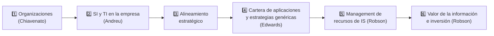

# 🏠 U1 — Planificación estratégica de los SI/TI

> [!info] Cómo usar esta wiki
> Cada concepto es una nota atómica conectada por wikilinks. Empezá por acá, seguí los links, y usá el **Graph View** filtrando por `tag:#ASI-U1`. La carpeta **99 Examen** tiene el [[Cuestionario U1 (18 preguntas)|cuestionario]] con cada pregunta linkeada a su respuesta, y los [[Comodines y cruces de examen|comodines]].

## 🧭 Recorrido sugerido

## 1️⃣ Organizaciones (Chiavenato)
- [[Organización (concepto y sistemas abiertos)]]
- [[Enfoque de Tavistock]] · [[Recursos organizacionales]] · [[Racionalidad de las organizaciones]]
- [[Eficiencia vs Eficacia]] · [[Niveles organizacionales (Chiavenato)]] · [[Ambiente organizacional]]

## 2️⃣ SI en la empresa (Andreu, Ricart y Valor)
- [[Sistema de Información (definición)]]
- [[El SI en la cadena de valor]]
- [[Tecnologías de la Información (rol)]]
- [[Estrategia de SI vs Estrategia de TI]]

## 3️⃣ Alineamiento estratégico
- [[Alineamiento E.O. – E.SI-TI (esquema general)]]
- [[Evolución de la planificación de SI (4 fases históricas)]]
- [[Plan de TI-SI (contenido)]]
- [[Procedimiento de alineamiento (4 fases)]] · [[Grupos de trabajo del plan]]
- [[Matriz de necesidades]]

## 4️⃣ Cartera de aplicaciones y estrategias genéricas (Edwards)
- [[Contexto de la estrategia SI-TI (Edwards)]]
- [[Cartera de aplicaciones (McFarlan)]]
  - [[Aplicaciones estratégicas]] · [[Aplicaciones de alto potencial]] · [[Aplicaciones clave para las operaciones]] · [[Aplicaciones de apoyo]]
- [[Estrategias genéricas de gestión (Parsons)]]
  - [[Planificación centralizada]] · [[Hilo conductor]] · [[Mercado libre]] · [[Monopolio]] · [[Recurso escaso]] · [[Mal necesario]]
- [[Prioridades de las aplicaciones]]

## 5️⃣ Management de recursos de IS (Robson T4)
- [[Administración de recursos de IS]]
- [[Rol de los IS]] · [[Ubicación de los IS]] · [[Centralizados vs no centralizados]]
- [[Organización de los IS (enfoques estructurales)]]

## 6️⃣ Valor de la información e inversión en IS (Robson T3)
- [[Valor de la información e inversión en IS]]
- [[Costos de los IS]] · [[Auditoría de costos de IS]]
- [[Beneficios de los IS]] · [[Error común al estimar el valor (caso cosméticos)]]
- [[Clasificación de las inversiones en IS]]
- [[Economía de la información]] · [[Técnicas de justificación financiera]]

## 🎓 Examen
- [[Cuestionario U1 (18 preguntas)]]
- [[Comodines y cruces de examen]]
- [[Súper Resumen U1 (documento único)]]
- [[Bibliografía U1]]

## 🧭 Otras unidades
- [[00 Home — U3 Subsistema de aplicación|🏠 Wiki U3 — Subsistema de aplicación]] (retoma el RUO de Robson)
- [[00 Home — U6 Seguridad y auditoría|🏠 Wiki U6 — Seguridad y auditoría]]
