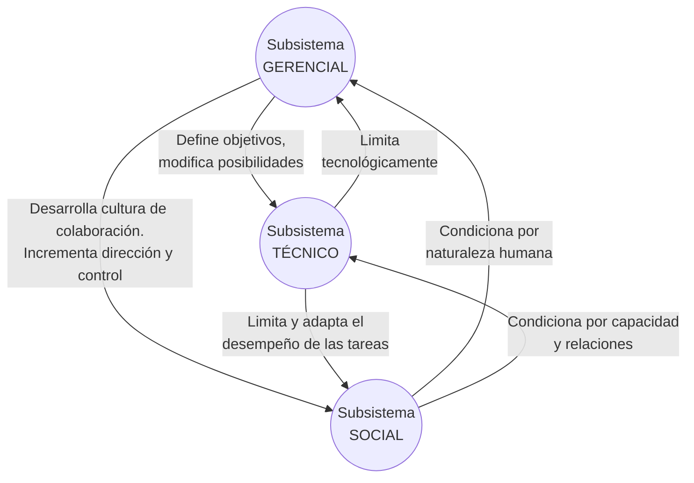

# Enfoque de Tavistock — el sistema sociotécnico

> [!quote] Definición textual
> "El enfoque sociotécnico concibe la organización, o una parte de ella, como una **combinación de tecnología** (exigencias de la tarea, ambiente físico, equipo disponible) y, al mismo tiempo, como **sistema social** (sistema de relaciones entre quienes realizan la tarea)."

Desarrollado por sociólogos y psicólogos del Instituto Tavistock de Londres (Trist y colaboradores): las organizaciones se analizan prestando atención a sus **procesos de transformación en el manejo de recursos**.

## Doble función de toda organización
- **Técnica:** coordinación del trabajo y ejecución de tareas con la tecnología disponible.
- **Social:** interrelacionar a las personas y hacerlas trabajar juntas.

Ambos sistemas **no pueden mirarse aislados**: se relacionan recíprocamente y **cualquier modificación en uno repercute en el otro**. La tecnología determina las características de las personas que la organización necesita (conocimientos, experiencia, habilidades).

## Los tres subsistemas

| Subsistema | Incluye | Rol |
|---|---|---|
| **Técnico o de tareas** | Flujo de trabajo, tecnología, roles que exige la tarea | Responde por el flujo de información técnica para los objetivos |
| **Gerencial o administrativo** | Estructura organizacional, políticas, procedimientos, reglas, recompensas/castigos, toma de decisiones | Garantiza la administración; **optimiza la relación técnico↔social** hacia las metas |
| **Social o humano** | Cultura organizacional, valores, normas, satisfacción de necesidades, organización informal, motivación | El grado de cooperación determina los resultados operacionales |

> [!important] Idea central
> Todo sistema de producción necesita una **organización tecnológica** (equipo y distribución de procesos) *y* una **organización del trabajo** (las personas). Aunque la tecnología condiciona la organización del trabajo, ésta tiene características sociales y psicológicas **propias, independientes de la tecnología**.

## 🔗 Relacionado
- [[Organización (concepto y sistemas abiertos)]]
- [[Sistema de Información (definición)]] — el SI cruza lo técnico y lo social en la empresa
- [[Tecnologías de la Información (rol)]] — "la tecnología no es neutral"
- **Otras unidades:** [[Modelo humanista de diseño de cargos]] (U3: el subsistema social en el diseño del cargo)
