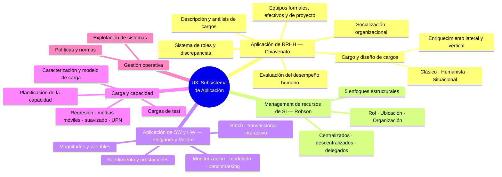
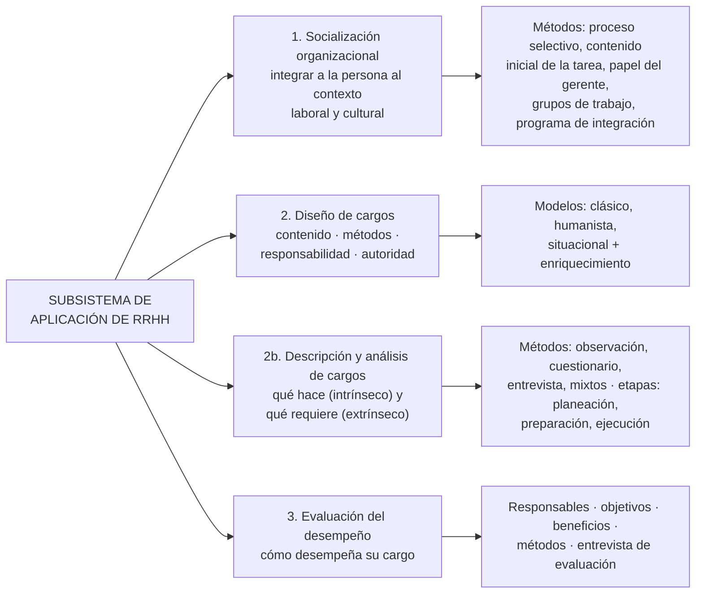
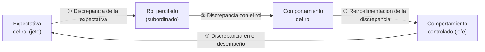
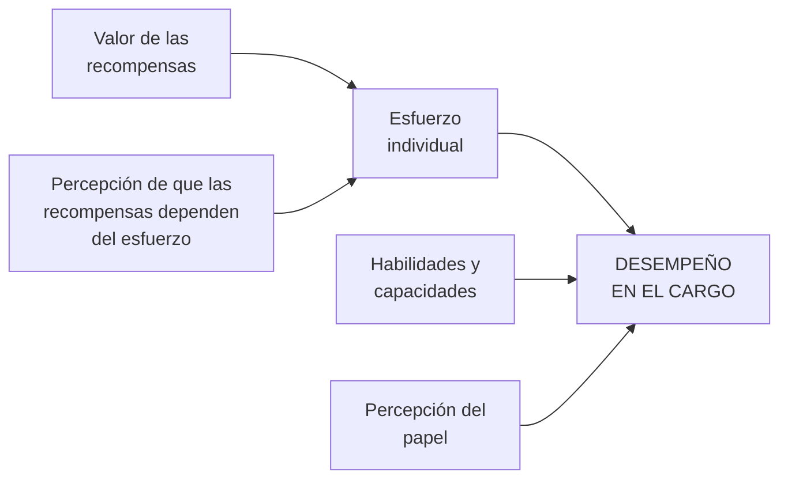
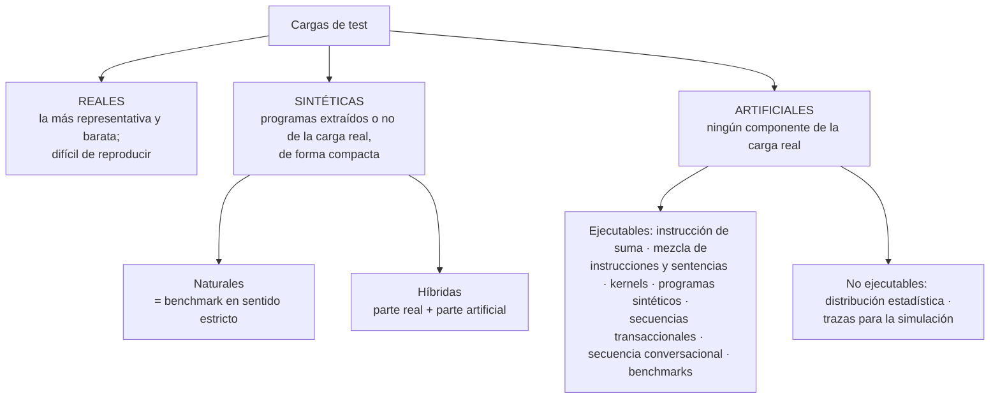

# ASI · U3 — La Administración de Recursos de SI/TI: Subsistema de Aplicación (Súper Resumen)

> [!info] Datos de la unidad
> **Materia:** Administración de Sistemas de Información — 4° Nivel, ISI, UTN FRRe
> **Bibliografía:** Chiavenato, *Administración de Recursos Humanos* (M1) · Robson T4 Cap. 9 "Management de recursos de IS" (M2) · Puigjaner y otros, *Evaluación y explotación de sistemas informáticos* (M3) · Molero, Juiz y Rodeño, *Evaluación y modelado del rendimiento de los sistemas informáticos* (M4). Detalle en [[Bibliografía U3]].
> **Material base:** apunte sistematizado [[Unidad III - Subsistema de Aplicación.pdf|Unidad III - Subsistema de Aplicación]] + cuestionario [[AdmSI-CUESTIONARIOS APLICACIÓN DE RECURSOS.pdf|Cuestionarios de estudio]].
> Cada sección indica a qué pregunta del cuestionario oficial responde con la etiqueta `[I.n]` (Parte I — Aplicación de RRHH) o `[II.n]` (Parte II — Aplicación de SI/TI). Checklist: [[Preguntas U3]].

## 🗺️ Mapa de la unidad

> [!tip] La idea que ordena toda la unidad
> **Aplicar** un recurso = **ponerlo a trabajar** dentro de la estructura existente, según normas y reglas, para que efectivamente produzca resultados. Para las **personas**: integrarlas (socialización), ubicarlas en un cargo (diseño, descripción y análisis) y evaluar cómo lo desempeñan. Para el **SW y HW**: dimensionar la carga, asignar recursos según las prestaciones requeridas y evaluar cómo rinden. En los dos casos el ciclo es **ubicar → hacer funcionar → evaluar**, y la evaluación es la que dispara nueva **provisión**.

---

# 1. El subsistema de aplicación de RRHH (Chiavenato)

## 1.1 Qué incluye el subsistema de aplicación

> Preguntas: `[I.2]`

El subsistema de aplicación es el **puente entre conseguir personas (provisión) y mantenerlas y motivarlas (mantenimiento)**, y asegura que cada persona ocupe un cargo.

> [!quote] Finalidad (apunte sistematizado)
> "Emplear los recursos humanos y designar al personal del área de acuerdo con los esquemas de trabajo y de explotación de la infraestructura de información." Define **cómo se hacen funcionar los recursos dentro de la estructura existente**, de acuerdo con ciertas normas y reglas, para que efectivamente estén trabajando.

> [!quote] Definición (Chiavenato)
> "Los procesos de aplicación de personas incluyen los **primeros pasos de la integración** de los nuevos miembros en la organización, el **diseño del cargo** que deben desempeñar y la **evaluación del desempeño** en el cargo."

**Cuadro sinóptico `[I.2]`:**

**Relaciones clave:**
- **Se nutre de la provisión** (las personas, después de reclutadas y seleccionadas, deben ser integradas, destinadas a sus cargos y evaluadas) y, a la vez, **es donde se detecta si hace falta aprovisionar** (movimientos de personal; según la carga, si hace falta HW → aplicación de SI/TI).
- Se alimenta de la **planificación estratégica** y de la **propia gestión** de los recursos aplicados.
- En el apunte también se incluyen dentro de la unidad los **equipos formales** (concepto, características, conformación).

→ [[Subsistema de aplicación de RRHH]]

## 1.2 Socialización organizacional

> Preguntas: `[I.1]`

> [!quote] Definición (Chiavenato)
> "Es el proceso **permanente** de inculcar en todos los empleados las **actitudes, normas, valores y patrones de conducta** —incluidos los relativos al cargo— que espera la organización y sus departamentos."

**En criollo:** es "enseñarle al nuevo cómo se juega acá" para que entrar no sea traumático.

**Aspectos clave:**

| Aspecto | Qué dice el material |
|---|---|
| **Finalidad** | Integrar al nuevo miembro de manera que su incorporación **no sea traumática** |
| **Importancia** | Aporta **estabilidad y eficacia**: las organizaciones dependen en gran medida de su habilidad para socializar a su personal |
| **Finalización** | Termina cuando el nuevo miembro **se siente a gusto** con la organización y su puesto y **aceptó sus normas y valores** |
| **Tensión** | La organización induce la adaptación del individuo (**socialización**) mientras el individuo intenta influir para lograr sus objetivos personales (**personalización**): suelen entrar en conflicto |
| **Puente** | El **plan de carrera** permite que la personalización conviva con lo que la organización necesita |

**Métodos para promover la socialización (los más utilizados):**
1. **Planeación del proceso selectivo** (para tramos finales): entrevistas que permiten al candidato, **antes de ser admitido**, conocer cómo funciona la organización.
2. **Contenido inicial de la tarea:** tareas **retadoras** que garanticen el éxito al comienzo y luego gradualmente más complejas (las tareas fáciles no dan oportunidad de éxito ni motivación).
3. **Papel del gerente:** representa la imagen de la organización; puede designar un **tutor**. Tres funciones básicas: dar una **descripción clara de la tarea**, **información técnica** para realizarla y **retroalimentación** sobre la calidad del desempeño.
4. **Grupos de trabajo:** la aceptación del grupo satisface necesidades sociales; el grupo funciona como **"escuela informal"**.
5. **Programas de integración:** entrenamiento intensivo inicial (1 a 5 días) sobre asuntos organizacionales, beneficios, presentación y deberes del cargo, con seguimiento a mediano plazo del tutor → [[Programa de integración]].

> [!warning] "Momentos" de la socialización
> El cuestionario pide "concepto, **momentos**, aspectos claves", pero el apunte sistematizado **no enumera momentos** con ese nombre. Una lectura defendible (elaboración propia, no textual): **antes del ingreso** (planeación del proceso selectivo) → **al ingreso** (contenido inicial de la tarea, papel del gerente/tutor, grupo, programa de integración) → **seguimiento** hasta que la persona se siente a gusto y aceptó normas y valores (allí termina y empalma con la evaluación del desempeño).

→ [[Socialización organizacional]]

## 1.3 La empresa como sistema de roles

> Preguntas: `[I.3]`

> [!quote] Definición (Chiavenato)
> "**Rol** es el conjunto de actividades y comportamientos que se solicitan a un individuo que ocupa determinada posición en la organización."

La empresa es una serie de roles y de **conjuntos de roles** (grupos superpuestos de personas cuyas expectativas giran en torno a un individuo) → **la empresa es un sistema de roles**.

**Proceso de desempeño del rol:** (1) el jefe explica lo que debe hacerse → **expectativa del rol**; (2) el empleado la interpreta con distorsiones → **rol percibido**; (3) actúa según su interpretación → **comportamiento del rol**; (4) el jefe evalúa → **comportamiento controlado** y lo compara con la expectativa.

| Discrepancia | Entre… | Causa típica |
|---|---|---|
| **1. De la expectativa** | Expectativa transmitida ↔ rol percibido | El subordinado no siempre entiende lo que explica el jefe |
| **2. Con el rol** | Rol percibido ↔ comportamiento del rol | No consigue ejecutar lo que entiende (capacitación, cuestiones personales) |
| **3. Retroalimentación de la discrepancia** | Comportamiento del rol ↔ comportamiento controlado | El jefe no siempre evalúa adecuadamente todo lo que hace el subordinado |
| **4. En el desempeño** | Comportamiento controlado ↔ expectativa del rol | El subordinado no siempre realiza lo que se le indica |

De aquí en adelante Chiavenato habla de **cargos** en lugar de roles (son conceptos distintos pero relacionados).

→ [[La empresa como sistema de roles]]

## 1.4 El cargo

> Preguntas: `[I.4]`

El concepto se fundamenta en tres nociones:

| Noción | Qué es | Pista |
|---|---|---|
| **Tarea** | Actividad individual del ocupante; típica de cargos **simples y rutinarios** | Lo que **hace** |
| **Atribución** | Actividad individual en cargos **más diferenciados**; implica **poder de decisión** y responsabilidad | Lo que **puede o debe decidir** |
| **Función** | Conjunto de tareas o atribuciones ejecutadas **de manera sistemática y reiterada** (si no se repite, no es función) | **Para qué** lo hace |

> [!quote] Definición (Chiavenato)
> "**Cargo:** conjunto de funciones (tareas o atribuciones) con **posición definida en la estructura organizacional**, es decir, en el organigrama. Constituye una unidad de la organización y consiste en un conjunto de deberes que lo separan y distinguen de los demás cargos."

- La posición en el organigrama define **nivel jerárquico, subordinación, subordinados y departamento**. El rectángulo del organigrama tiene un **terminal superior** (responsabilidad / subordinación) y uno **inferior** (autoridad / supervisión).
- **Puesto** = una ocurrencia de un cargo (un cargo puede tener muchos puestos). **Ocupante** = la persona designada.
- Para la organización, el cargo es la **base de la aplicación de las personas**; para la persona, una de las mayores **fuentes de expectativa y motivación**.
- **Cargo = funciones + rol** (el rol es la expectativa de conducta asociada al cargo, subjetiva).

→ [[Cargo (concepto)]]

## 1.5 Diseño de cargos

> Preguntas: `[I.5]`

Diseñar un cargo es establecer **cuatro condiciones fundamentales** (sus componentes):

| # | Componente | Pregunta | Ejemplo del apunte |
|---|---|---|---|
| 1 | **Contenido del cargo** | ¿Qué tareas o atribuciones debe cumplir? | — |
| 2 | **Métodos y procesos de trabajo** | ¿Cómo debe cumplirlas? | Un programador, mediante las metodologías definidas |
| 3 | **Responsabilidad** | ¿A quién reporta? (relación con el jefe) | Responde por los equipos portátiles asignados |
| 4 | **Autoridad** | ¿A quién supervisa o dirige? (relación con subordinados) | — |

El diseño de cargos es el **modelo que usan los administradores para proyectar cargos individuales y combinarlos** en unidades, departamentos y organizaciones. Los cargos **no son estables ni definitivos**: evolucionan con los cambios tecnológicos, económicos, sociales, culturales y legales.

→ [[Diseño de cargos]]

## 1.6 Modelos de diseño de cargos

> Preguntas: `[I.6]`

| Criterio | **Clásico o tradicional** | **Humanista (relaciones humanas)** | **Situacional o contingencial** |
|---|---|---|---|
| Lema | Cargos para **hacer, no para pensar** | Cargos para que las personas **se desarrollen y se motiven** | Cargos **según las circunstancias** (eficiencia + satisfacción) |
| Origen | Ingenieros de la **administración científica** | Escuela de relaciones humanas | Enfoque más amplio y complejo |
| Énfasis | En la **tarea y la tecnología**; contenido del cargo | En la **persona y el grupo social**; **contexto** del cargo | En las **diferencias individuales y la tarea**; convergen **estructura, tarea y persona** |
| Tareas | Simples, repetitivas, separación pensamiento (gerencia) / actividad (obreros) | El contenido casi no cambia; cambian las condiciones sociales | Ampliación continua del cargo mediante **enriquecimiento de tareas** |
| Recompensa | Salarial y material (incentivos) | Social y simbólica | Combinación de ambas |
| Supuesto sobre las personas | El trabajador como parte de la máquina; entrenamiento restringido a habilidades específicas | No es una máquina: necesita reconocimiento y relaciones sociales | **Autodirección y autocontrol**; objetivos planeados **en conjunto** con el gerente |
| Estabilidad | Supone estabilidad y permanencia | — | **Dinámico**: no supone estabilidad de objetivos ni procesos |
| Resultado esperado | **Eficiencia máxima**, más utilidades y salarios | Mayor moral, interacción y participación | El cargo como **verdadero factor de motivación** |

**Modelo situacional — lo que más se pregunta:**
- **3 estados psicológicos críticos:** la persona cree que su trabajo es **significativo**, se siente **responsable** por los resultados y **conoce los resultados** que obtiene.
- **5 dimensiones esenciales del cargo:** **variedad**, **autonomía**, **significado de la tarea**, **identidad con la tarea** y **retroalimentación**. Crean condiciones de **satisfacción intrínseca**.
- La satisfacción de necesidades individuales es un **subproducto deseable**, no el objetivo principal.

> [!warning] Hueco en el material
> El apunte (y los resúmenes de alumnos) anuncian "la siguiente tabla muestra las **ventajas esperadas** del modelo clásico y los **resultados reales**", pero la tabla es una imagen que **no está en el texto extraído**. Revisala en el PDF de cátedra.

→ [[Modelos de diseño de cargos]] · [[Modelo clásico de diseño de cargos]] · [[Modelo humanista de diseño de cargos]] · [[Modelo situacional de diseño de cargos]]

## 1.7 Enriquecimiento de los cargos

Consiste en **ampliar la responsabilidad, los objetivos y los desafíos** de las tareas del cargo. Sirve para preparar a alguien para un **plan de carrera** aunque siga un tiempo en el mismo cargo.

| Tipo | Qué agrega | Ejemplo del apunte |
|---|---|---|
| **Lateral u horizontal** | Responsabilidades **del mismo nivel**: más variedad de tareas u operaciones | A quien solo programa, sumarle diseño y pruebas |
| **Vertical** | Responsabilidades de **nivel más elevado**: planeación, organización e inspección | Darle responsabilidades superiores y delegar (o automatizar) sus tareas operativas |

- Principal dificultad: la **resistencia al cambio** ante el aumento de tareas y atribuciones (sobre todo si se privilegia el statu quo).
- Si la organización **no está madura** para un programa sincero de enriquecimiento, **es mejor no intentarlo**.

→ [[Enriquecimiento de cargos]]

## 1.8 Descripción y análisis de cargos

| | **Descripción del cargo** | **Análisis del cargo** |
|---|---|---|
| Se ocupa de | El **contenido**: qué hace, cuándo, cómo y por qué | Los **requisitos** que el cargo exige al ocupante |
| Aspectos | **Intrínsecos** | **Extrínsecos** |
| Producto | Enumeración de tareas, periodicidad, métodos y objetivos | Requisitos intelectuales, físicos, responsabilidades implícitas y condiciones de trabajo |
| Relacionado con | La "especificación" del cargo es lo que se exige al aspirante | Base para la **evaluación y clasificación de cargos** |

**Las 4 áreas del análisis:** (1) **requisitos intelectuales** (instrucción básica, experiencia, adaptabilidad, iniciativa, aptitudes); (2) **requisitos físicos** (esfuerzo, capacidad visual, destreza, constitución); (3) **responsabilidades implícitas** (supervisión de personal, material/equipos, dinero/documentos, contactos, información confidencial); (4) **condiciones de trabajo** (ambiente, riesgos).

**Es responsabilidad de línea y función de staff:** la línea aporta la información; el staff la obtiene, analiza y documenta.

| Método | Participación analista / ocupante | Ideal para | Ventaja estrella | Desventaja estrella |
|---|---|---|---|---|
| **Observación directa** | Activa / pasiva | Cargos simples, repetitivos, manuales | Veracidad de los datos; no interrumpe el trabajo | Costo elevado; sin contacto verbal faltan datos |
| **Cuestionario** | Pasiva / activa | Muchos cargos semejantes, rutinarios; **cargos de alto nivel** | **El más económico** y el que abarca más personas | Superficial o distorsionado; no sirve para cargos de bajo nivel |
| **Entrevista directa** | Activa / activa | Cualquier tipo y nivel | **Mejor calidad**; aclara dudas; el más flexible | Costo operativo elevado; confunde opiniones y hechos |
| **Mixtos** | Combinaciones | — | Compensan desventajas | — |

**Etapas del análisis:** **planeación** (cargos a analizar, organigrama, cronograma, elección de métodos, selección de factores por **universalidad** —presentes en al menos 75 %— y **discriminación**, dimensionamiento y gradación de factores) → **preparación** (analistas, material, disposición del ambiente, recolección previa) → **ejecución** (recolección, selección, redacción provisoria, ratificación del supervisor, redacción definitiva y aprobación).

**Objetivos:** base para reclutamiento, selección, capacitación, administración de salarios, evaluación del desempeño, guía del supervisor y del empleado, y datos de higiene y seguridad.

→ [[Descripción y análisis de cargos]] · [[Métodos de descripción y análisis de cargos]] · [[Etapas del análisis de cargos]]

## 1.9 Equipos formales y equipos de trabajo

Los equipos surgen como **necesidad organizacional**: las estructuras tienen componentes fijos; con un equipo el objetivo se alcanza **más rápido**.

| **Grupo de trabajo** | **Equipo de trabajo** |
|---|---|
| Interactúa para **compartir información y tomar decisiones** que ayuden a cada uno en sus tareas | Trabaja **intensamente** en un **objetivo común específico** (producto o servicio) |
| No hay necesidad ni oportunidad de esfuerzo colectivo | **Sinergia positiva**, responsabilidad **individual y mutua**, habilidades **complementarias** |

> [!quote] Definición (apunte sistematizado)
> "Un **equipo de trabajo** es una unidad de dos o más personas con **habilidades complementarias**, comprometidas con un **propósito común** y con una serie de **metas de rendimiento** y de expectativas que hay que cumplir."

- **Todo equipo es un grupo formal, pero no todo grupo formal es un equipo** (el personal de un departamento es grupo formal, no necesariamente equipo).
- **Características:** pequeño; habilidades complementarias; propósito común; metas de desempeño definidas; metodología compartida; responsabilidad ante los demás; **sinergia**.
- **Etapas de desarrollo:** **formación** → **tormenta o confusión** → **normatividad** → **desempeño** → **disolución** (solo en grupos temporales).

→ [[Equipos formales (grupos vs equipos)]]

## 1.10 Equipo efectivo de trabajo

> Preguntas: `[I.7]`

Los **equipos de alto desempeño** comparten estas características (apunte sistematizado):

| Característica | Qué significa |
|---|---|
| **Objetivos claros** | Todos entienden la meta común y qué se espera de ellos |
| **Habilidades relevantes** | Competencias técnicas **e interpersonales** |
| **Confianza mutua** | Fe en la capacidad, integridad y compromiso de los demás |
| **Unidad de compromiso** | Lealtad, energía y dedicación total a las metas del equipo |
| **Buena comunicación** | Claridad, fluidez y uso de la retroalimentación |
| **Habilidades de negociación** | Ajustan roles y resuelven diferencias con flexibilidad |
| **Liderazgo apropiado** | El líder guía y facilita, no impone |
| **Apoyo interno y externo** | Capacitación, incentivos, recursos y entorno que respalda |

> [!warning] Otra lista que circula
> Los cuestionarios resueltos por alumnos dan **12 características** distintas (propósito claro, informalidad, participación, escuchar, desacuerdo civilizado, decisiones por consenso, comunicaciones abiertas, roles claros, liderazgo compartido, relaciones externas, diversidad de estilo, autoevaluación). No contradicen la idea, pero **priorizá la lista de 8 del apunte sistematizado** y, si te sobra tiempo, nombrá algunas de la otra.

→ [[Equipo efectivo de trabajo]]

## 1.11 Equipos de proyecto

- **Proyecto:** esfuerzo **temporal** orientado a crear un producto o servicio **único**. **Project management:** conocimientos, habilidades, herramientas y técnicas aplicadas para satisfacer los requerimientos del proyecto.
- **Gerente de proyecto:** integra esfuerzos de distintas áreas, define la metodología, provee recursos, asegura contrataciones, evalúa progresos y establece medidas correctivas.
- **Conformación:** se crean **a partir de la tarea** (especialistas elegidos por su función; la afinidad nunca es determinante); se integran **una vez establecido el objetivo**; **no necesariamente comparten valores** ("multiculturales"); **existencia efímera**; **subordinados al objetivo** (la integración es un medio, nunca un fin).

→ [[Equipos de proyecto]]

## 1.12 Evaluación del desempeño humano

> Preguntas: `[I.8]`

> [!quote] Definición (Chiavenato)
> "Es la **apreciación sistemática del desempeño** de cada persona en el cargo o de su **potencial de desarrollo futuro**. Es un proceso para estimar o juzgar el valor, la excelencia y las cualidades de una persona."

- Es **responsabilidad de línea**. Lo que interesa es el **desempeño del cargo** (el comportamiento de rol), que es **extremadamente situacional**: el **valor de las recompensas** y la **percepción de que dependen del esfuerzo** determinan el esfuerzo individual, que a su vez depende de las **habilidades** y de la **percepción del papel**.
- Es un concepto **dinámico** y un medio para **localizar problemas** de supervisión, integración, etc. **No es un fin en sí misma**.

**¿Quién evalúa?** el **gerente** (con asesoría de staff de RRHH: línea + staff), el **empleado** (autoevaluación), **empleado y gerente** (APO participativa: objetivos por consenso → compromiso → negociación de recursos → desempeño → medición → retroalimentación), el **equipo de trabajo**, el **órgano de RRHH** (centralista, en desuso), un **comité de evaluación** (miembros permanentes y transitorios) y la **evaluación de 360°**.

**Objetivos fundamentales:** (1) permitir **medir el potencial humano**; (2) tratar a los RRHH como **recurso básico y ventaja competitiva**; (3) dar **oportunidades de crecimiento y participación** considerando objetivos empresariales e individuales. Hay además 12 objetivos intermedios (adecuación al cargo, entrenamiento, promociones, incentivo salarial, relaciones humanas, autoperfeccionamiento, etc.).

**Beneficiarios:** el **jefe**, el **subordinado**, la **empresa** (y la comunidad).

**Métodos tradicionales:**

| Método | Idea | Punto a recordar |
|---|---|---|
| **Escalas gráficas** | Formulario de **doble entrada**: factores (filas) × grados (columnas); escalas continuas, semicontinuas y discontinuas | El más usado y "sencillo"; sujeto a **subjetividad**, requiere corrección estadística |
| **Elección forzada** | Bloques de frases; el evaluador **debe elegir** las que más (y menos) se aplican | Creado para neutralizar el **efecto halo**; elaboración compleja; solo distingue buenos/medios/insuficientes |
| **Investigación de campo** | Entrevistas de un **especialista (staff)** con el **supervisor** | **El más completo**; vincula con capacitación y plan de carrera; costoso y lento |
| **Incidentes críticos** | Registra hechos **excepcionalmente positivos y negativos** | Ignora lo "normal" |
| **Comparación por pares** | Compara empleados de a dos | Muy sencillo y poco eficiente |
| **Frases descriptivas** | Como elección forzada pero **sin obligación** de elegir | Marca "+/S" y "−/N" |
| **Mixtos** | Combinaciones | — |

**Elemento integrador de la ARH:** da información a provisión, aplicación, mantenimiento, desarrollo y seguimiento. **La entrevista de evaluación** es la última etapa: de nada sirve evaluar si el empleado no conoce los resultados.

> [!warning] Detalles del material
> - El apunte enumera **5** métodos tradicionales (escalas gráficas, elección forzada, investigación de campo, incidentes críticos, mixtos) pero después desarrolla también **comparación por pares** y **frases descriptivas**. Nombrá los 5 y agregá los otros 2.
> - En "el gerente" como evaluador, el apunte y los resúmenes arrancan con "**existe una rígida centralización**" y luego describen el esquema línea-staff como flexible. Si te lo preguntan, quedate con la idea central: **evalúa el jefe (línea), con asesoría del staff de RRHH**.

→ [[Evaluación del desempeño humano]] · [[Responsables de la evaluación del desempeño]] · [[Métodos de evaluación del desempeño]]

---

# 2. El management de los recursos de SI (Robson)

> Preguntas: `[I.10]` `[I.11]` `[I.12]` `[I.13]` `[I.14]`

> [!info] Ya lo tenés en la U1
> El Robson T4 Cap. 9 se estudió en la Unidad 1 (§8 del [[ASI U1 - Planificación Estratégica SI-TI (Súper Resumen)|Súper Resumen U1]]). Acá va **la síntesis** más **lo que agrega el apunte de U3**. Hub: [[RUO — Rol, Ubicación y Organización del área de SI-TI]].

> [!warning] Aclaración de la cátedra
> En esta unidad **"IS" = el ÁREA de sistemas**, no las aplicaciones. Es una definición de **cómo disponer los RRHH**: algo **organizativo, no tecnológico**.

## 2.1 Qué es y de qué depende la estructura del área

El management de los recursos de SI consiste en **estructurar, organizar y administrar** los elementos **humanos, tecnológicos y procedimentales** del área de sistemas, buscando la **eficacia global**. Organizar = ordenar actividades comunes para la eficacia del conjunto → el resultado es una **estructura organizativa** (jerarquías, departamentos, coordinación, conducción, uso de tecnologías) con **efecto sinérgico**.

La estructura del área depende de: (1) **objetivos y decisiones** (grado de delegación o retención de autoridad), (2) **actividades**, (3) **distribución de recursos** (personal, presupuesto, infraestructura), (4) **red de comunicaciones**.

| Elemento | Pregunta |
|---|---|
| **Especialización del trabajo** | ¿En qué grado se subdividen las tareas? |
| **Departamentalización** | ¿Cómo se agrupan personas y tareas (función, producto, cliente…)? |
| **Cadena de mando** | ¿A quién informan individuos y grupos? |
| **Tramo de control** | ¿Cuántos dependen de un gerente? |
| **Centralización / descentralización** | ¿Dónde se toman las decisiones? |
| **Formalización** | ¿Qué grado de estandarización tienen los procesos? |

- **A descentralizar:** producción (desarrollo bajo el subgerente de desarrollo), organización interna y tareas operativas.
- **A centralizar:** manejo de fondos, objetivos estratégicos, inversiones y presupuestos, designación de cuadros superiores (el gerente de sistemas lo designa la gerencia general), niveles salariales.
- **El alineamiento** (U1) proporciona el marco para decidir el RUO.

→ [[Estructura del área de SI-TI (elementos de diseño)]]

## 2.2 RUO — los tres temas

> Preguntas: `[I.11]`

| Tema | Pregunta | Concepto |
|---|---|---|
| **Rol** | ¿**Qué** harán los SI/TI? | Naturaleza de las interacciones con el entorno: cómo se relaciona el área con las demás, qué funciones y responsabilidades tiene. Refleja el **tipo de relación con el negocio** |
| **Ubicación** | ¿**Dónde** estarán? | Perspectiva empresarial: ubicación **física y de management**; qué decisiones se centralizan, descentralizan o delegan |
| **Organización** | ¿**Cómo** se dispondrán? | Estructura **interna**: cómo se agrupan las personas, responsabilidades y jerarquías |

> [!tip] Dicho en clase
> Consejo de la profesora: **plantear la organización, verificar si esa organización ayuda al rol y si está relacionada con la ubicación**.

→ [[RUO — Rol, Ubicación y Organización del área de SI-TI]]

## 2.3 El rol de los SI-TI

> Preguntas: `[I.10]`

Dos visiones contrapuestas: función **estratégica y crítica** (managers de SI) vs **apoyo para la eficiencia** (nivel gerencial).

| Rol de IS | Relación | Estructura asociada | Ejemplo del apunte |
|---|---|---|---|
| **Hacerles algo a ellos** | El grupo de IS establece las reglas | Tradicional / funcional | "Te paso este sistema, usalo así" |
| **Hacer algo para ellos** | Orientación al servicio | Guiada por bases de datos | Sistema de sueldos a medida para RRHH |
| **Hacer algo con ellos** | Puentes y participación | Grupos de proyectos funcionales | CRM con vendedores y programadores |
| **Ayudarlos a que lo hagan por sí mismos** | Influencia más que control | Centros de información y apoyo a decisiones | Dashboards / BI |
| **Mantener un depósito de información** | Puente entre proveedores y usuarios de información | Enfoque externo | Data warehouse / Big Data |

**Cinco modelos según la relación SI-usuarios:** **de servicio** (obligación de servicio), **de participación** (codo a codo, pero el área sigue siendo soporte), **de vendedor** (el área "vende" sus servicios; caso AGUNSA), **de expansión** (arquitectura flexible común sobre la que cada área configura) y **de ventaja estratégica** (un solo equipo que **cocrea** productos competitivos).

**Roles que se estructuran en forma diferenciada (management y provisión de):** (1) **infraestructura de IS** (operación y administración: redes, BD, servicios compartidos, foco en el servicio); (2) **investigación y desarrollo a largo plazo** (separado de lo cotidiano; función asesora realista e innovadora); (3) **facilitar la informática a nivel de usuario final** (función "asesora", los IS como consultores). Son **actividades lógicas**, no departamentos.

→ [[Rol de los IS]] (U1) · [[Rol de IS — relaciones con los usuarios y estructuras]]

## 2.4 La ubicación de los SI-TI

> Preguntas: `[I.12]`

**Decisiones `[I.12]`:** confrontar los elementos de los SI con la **estrategia de SI** y resolver **qué centralizar, cómo y en qué medida**, considerando: **localización** (física), **control** (nivel donde se decide) y **estructura** (responsabilidades en la función de IS o transferidas a los usuarios). Como lo técnico ya está resuelto, el debate es de **management**: dónde ubicar la coordinación y el control.

| Tipo | Concepto | Ejemplo de la cátedra |
|---|---|---|
| **Centralizada** | Una función de **un único acceso**; se retienen **todas las decisiones** en un punto de la gerencia de SI | Administración contable-financiera del Estado provincial |
| **Descentralizada** | **Muchas funciones**, cada una con acceso único: mini-departamentos que son **réplicas** de la centralización; se delegan decisiones operativas, no hay desarrollo en las sucursales | Sysacad en cada regional (réplicas del Rectorado) |
| **Delegada** | Dispersa **geográficamente y en management**; red de uniones laterales con **control significativo del usuario final**; áreas **autónomas** | Sistema de registro de expedientes de la UTN |

> [!important] Clave conceptual
> **Son los SI delegados los que verdaderamente se oponen a los centralizados**, no los descentralizados (que pueden repetir los atributos de los centralizados). Descentralización y delegación difieren en el **grado de dispersión del control y la autoridad**.

→ [[Ubicación de los IS]] (U1) · [[SI delegados]]

## 2.5 Centralizados vs no centralizados

> Preguntas: `[I.13]`

| Criterio | **Centralizados** | **No centralizados** |
|---|---|---|
| **Grado de control** | **Mayor control** sobre operaciones, producción, integridad de BD y seguridad; menor incompatibilidad; manejo de proyectos complejos; más fácil reclutar especialistas | Control **disperso**; mayor autonomía del usuario; en los delegados la seguridad "no es de nadie" → **automatizar seguridad y management de red** |
| **Entorno requerido** | Recursos **costosos y uso limitado**; sistemas para **senior management** (EIS); **servicio común** (sueldos); unidad de negocio **muy pequeña**; **integración vital**; respuesta **no crítica**; objetivos de **eficiencia** | **Velocidad y flexibilidad**; **servicio único** de una parte de la empresa; objetivos de **efectividad**; delegados: recursos **extremadamente baratos** pero uso **alto y variado** |
| **Costos asociados** | **Economías de escala** (menos duplicación); pero costos de **comunicación** altos (distancia huésped-cliente) y riesgo de deshonestidad con la **contabilidad de usuarios** | **Duplicación** → altos costos agregados e ineficiencia; pero la informática departamental puede **bajar costos de comunicación**; el usuario **percibe mejor el balance costo/beneficio** |

**Desventajas de los centralizados:** separados del terreno real del negocio; poca atención a grupos particulares ("optimizan para el promedio"); acceso lento en horas pico; **planificación de capacidades** más difícil cuanto más centralizado.

**Beneficios de los no centralizados:** captura de datos **cercana al evento**; mayor autonomía e involucramiento; desarrollo **integrado con el negocio**. **Riesgos:** incompatibilidades futuras (las más críticas en **RRHH e información**), límites ante la complejidad, carreras limitadas (perfil generalista), hostilidad si el cambio se maneja mal. La descentralización crea **islas de tecnología**; la delegación pone los recursos **donde el negocio los necesita**.

→ [[Centralizados vs no centralizados]] (U1) · [[SI delegados]]

## 2.6 La organización de los SI-TI

> Preguntas: `[I.14]`

**Niveles de administración del área:**

| Nivel | Qué administra | Quién |
|---|---|---|
| **Administración de la información** | Estrategia general del área y su alineación con el negocio | Gerencia estratégica → **CIO** |
| **Administración del uso de los SI** | Qué sistemas se usan, por quién y para qué; políticas de uso, seguridad, desarrollo | Gerencias tácticas → subgerencias (seguridad, desarrollo…) |
| **Administración de la tecnología** | Infraestructura y operación técnica (versiones, configuración, servidores) | Primera línea → **CTO**, jefes de servidores, de proyectos, soporte |

**Los 5 enfoques estructurales** (pueden **coexistir**; se eligen según la **estrategia de IS**):

| Enfoque | Orientación | Rasgos y lo que agrega U3 |
|---|---|---|
| **1. Tradicional** (centro de datos / depto. de PD) | **Eficiencia técnica y control centralizado** | Desarrollo, mantenimiento y operación **separados**; operación por turnos; determinado por una función financiera. **Máxima virtud: amplio grado de especialización**; la estandarización genera burocracia. Desventajas: **retraso, sistemas proscriptos, inflexibles, mantenimiento costoso** |
| **2. Bases de datos** | **Integración y consistencia** de la información | Los datos se separan de las aplicaciones; facilita el **acceso del usuario a los datos** bajo control del DBA; el usuario empieza a tener conciencia de IS |
| **3. Grupos de proyectos funcionales** | **Demanda del negocio** | Analistas + programadores por área funcional; **primera estructura por demanda**; matricial (ambigua); **"murallas chinas"** y carga de trabajo despareja; el usuario se involucra y el personal de IS gana conciencia del negocio |
| **4. Centro de información y apoyo a decisiones** | Apoyar las **decisiones de management** de los usuarios | Fomenta la **computación controlada por el usuario** y el **management híbrido**; IS responsable del **manejo efectivo** de los IS |
| **5. Estructuras externas** | El **entorno** | Líneas de **servicio al consumidor** con **acuerdos de servicio**; los SI enfocados hacia los **clientes reales** |

Todas las nuevas estructuras buscan **transferir autonomía**: ciclos de desarrollo más cortos, sistemas más flexibles y menos prescriptivos.

→ [[Organización de los IS (enfoques estructurales)]] (U1) · [[Enfoques estructurales — detalle U3]] · [[Niveles de administración del área de SI-TI]]

---

# 3. El subsistema de aplicación de SI-TI

## 3.1 Qué conforma el proceso de aplicación de SW y HW

> Preguntas: `[II.1]`

> [!quote] Definición (apunte sistematizado)
> "Es el subsistema cuya finalidad es **disponer los recursos de SI/TI (hardware y software) en función de la carga de trabajo y de los niveles de servicio requeridos** para satisfacer el nivel de prestaciones de la organización." Consiste en las actividades de **asignar, configurar, planificar la capacidad, explotar y evaluar** los recursos de SW y HW.

| Tarea | Se resuelve con… |
|---|---|
| 1. **Dimensionar la carga de trabajo** | Análisis y representación de la carga → §4.1–4.4 |
| 2. **Asignar los recursos según las prestaciones requeridas** | Planificación de las prestaciones (capacidad) → §4.5–4.8 |
| 3. **Evaluar el funcionamiento de las prestaciones** | Evaluación de las prestaciones → §3.3–3.7 |

> [!tip] Dicho en clase
> "Existen diferentes cargas de trabajo y formas de procesamiento que difieren no solo en su tipo sino en las condiciones en que deben ejecutarse: **los sistemas también DIFIEREN EN SUS PRESTACIONES**" (comparación de sistemas que hizo la profesora).

→ [[Subsistema de aplicación de SI-TI]]

## 3.2 Rendimiento y prestaciones

> Preguntas: `[II.2]`

> [!quote] Definición (Puigjaner)
> "La evaluación del **rendimiento** de un sistema informático se define como la **medida de cómo un software determinado está utilizando el hardware** con una determinada combinación de programas, que constituyen lo que se denomina **carga del sistema**."

**Rendimiento (en criollo):** qué tan bien aprovecha el SW los recursos de HW bajo una carga dada.

**Prestaciones (concepto elaborado):** el **nivel de servicio** que el sistema efectivamente ofrece a sus usuarios —productividad, tiempo de respuesta, capacidad, disponibilidad…— medido con **índices de prestaciones** que **siempre van acompañados de la carga** bajo la que se obtuvieron.

> [!warning] Las fuentes no traen una definición textual de "prestaciones"
> El cuestionario pide **elaborar** ambos conceptos. Un resumen de alumnos define prestaciones como "el conjunto de funcionalidades / servicios que brinda un SI a sus usuarios"; el apunte usa "prestaciones" como sinónimo de **performance medida con índices** (productividad, tiempo de respuesta, etc.). Elaborá el concepto apoyándote en los **índices de prestaciones** (§3.4 y §3.6) y en que **son inseparables de la carga**.

→ [[Rendimiento y prestaciones]]

## 3.3 Evaluación de las prestaciones

> Preguntas: `[II.4]`

- **Concepto:** el conjunto de actividades que estudian el **comportamiento** de un sistema informático —qué hace el SW con el HW bajo una carga— mediante **técnicas de evaluación** (monitorización, modelado, benchmarking) que obtienen **índices de prestaciones**.
- **Objeto de estudio:** el **hardware**, el **software** y la **carga** (las aplicaciones que se ejecutan). El resultado es función de los tres.
- **Dificultades de la medición:** la **carga real cambia continuamente** y las variables/índices **varían de una instalación y configuración a otra**.
- **¿Por qué evaluar?** (objetivos): **comprobar** que el funcionamiento es el esperado; **encontrar los factores** que lo impiden (**cuellos de botella**); **predecir** el comportamiento con nuevas cargas (planificación de la capacidad).
- **¿Para qué fines?** Influye en decisiones de **diseño, implantación, compra y modificación**. Se evalúa cuando se quiere: **diseñar una máquina**, **diseñar un sistema informático**, **seleccionar y configurar** un sistema, **planificar la capacidad**, **sintonizar o ajustar** un sistema.

→ [[Evaluación de prestaciones]]

## 3.4 Qué debe medirse

> Preguntas: `[II.5]`

Magnitud = todo lo que puede medirse y expresarse con **número y unidad**. Se miden: **consumo de tiempo**, **utilización de recursos o dispositivos** y **trabajo realizado** por el sistema o sus componentes. Visión **externa** (usuario) e **interna** (responsable del sistema).

| **Variables externas** (perceptibles por el usuario) | **Variables internas** (del sistema — hace falta un monitor) |
|---|---|
| **Productividad (throughput):** trabajo útil por unidad de tiempo (trabajos/h, transacciones/s) | **Factor de utilización** de un componente (% de tiempo usado) |
| **Capacidad:** **máxima** cantidad de trabajo útil por unidad de tiempo | **Solapamiento** de componentes (% de uso simultáneo) |
| **Tiempo de respuesta:** desde la entrega del trabajo hasta la recepción del resultado | **Overhead** (% de uso en tareas del sistema no imputables a trabajos) |
| | **Factor de carga de multiprogramación** (respuesta en multi / en mono) |
| | **Factor de ganancia de multiprogramación** (tiempo total secuencial en mono / en multi) |
| | **Frecuencia de fallo de página** · **Frecuencia de swapping** |

**Variables de comportamiento** (más funcionales que de prestaciones): **fiabilidad** (trabajar bien en un intervalo; MTBF), **disponibilidad** (estar operativo en el instante t), **seguridad** (no perturbar otros sistemas ni personas), **performabilidad** (prestaciones por encima de cierto nivel en un instante) y **mantenibilidad** (facilidad de reparación).

> [!warning] Performabilidad, no "performance"
> Un cuestionario resuelto de alumnos escribe "performance" en la lista de variables de comportamiento. El apunte sistematizado dice **performabilidad**: usá esa.

→ [[Magnitudes y variables de medida]]

## 3.5 Magnitudes para controlar el comportamiento

> Preguntas: `[II.7]`

Opciones para **mejorar el comportamiento** (en todos los niveles que influyen):

1. **Ajuste de los parámetros del SO:** tamaño del **quantum**, **prioridad interna**, **factor de multiprogramación**, tamaño de la **partición de memoria**, tamaño de la **ventana** (conjunto de trabajo), **máxima frecuencia de fallo de página**, **índice de supervivencia de las páginas**, **número de usuarios simultáneos**.
2. **Modificación de los programas** (recodificar caminos más usados, agrupar módulos en la misma página/segmento) → **modifica la carga**.
3. **Modificación de las políticas de gestión del SO** (reemplazar la rutina de gestión de un recurso por otra más idónea).
4. **Equilibrado de la distribución de la carga**.
5. **Sustitución o ampliación de componentes** (cambiar la configuración).

> [!tip] De final
> "Un sistema que no presenta el nivel aceptable de rendimiento debe ser inmediatamente actualizado" → **Falso**: primero se **sintoniza** (ajuste de parámetros, programas, políticas, carga); la sustitución/ampliación es la última opción.

→ [[Mejora del comportamiento de un sistema]]

## 3.6 Sistemas de referencia batch, transaccional e interactivo

> Preguntas: `[II.8]`

| Sistema | Funcionamiento | Índices característicos |
|---|---|---|
| **Por lotes (batch)** | Ciclos continuos de CPU y disco hasta terminar | **Turnaround time** (desde que se lanza hasta que finaliza; equivale al tiempo de respuesta) · **Productividad** en trabajos por unidad de tiempo |
| **Transaccional** | El más común; las partes interactúan por transacciones de datos | **Tiempo de respuesta = reacción + ejecución + retorno** (desde que la transacción llega al sistema) · **Productividad** en transacciones/s |
| **Interactivo o por demanda** | Usuarios en terminales remotas; solicitudes y respuestas; **la nueva petición depende de la respuesta anterior** | **Tiempo de reflexión Z** (del usuario) · **Tiempo de respuesta = reacción + ejecución + retorno** (desde que el usuario finaliza la petición hasta que termina de recibir la respuesta) · **Productividad** en peticiones cumplidas por unidad de tiempo |

El interactivo se divide en **subsistema de terminales** (modela el tiempo de reflexión) y **subsistema central** (dispositivos físicos). **Z** = tiempo desde que un trabajo abandona el subsistema central hasta que vuelve a entrar.

→ [[Sistemas batch, transaccional e interactivo]]

## 3.7 Técnicas de evaluación — monitorización, modelado y benchmarking

**Técnicas de evaluación:** métodos y herramientas que permiten obtener los **índices de prestaciones** de un sistema que ejecuta una carga dada con ciertos valores de parámetros.

| Técnica | Qué es | Cuándo |
|---|---|---|
| **Monitorización** | Los **monitores** son herramientas de medición que permiten **seguir el comportamiento** de los principales elementos de un sistema sometido a una carga | El sistema **existe** y se quiere medir |
| **Modelado** | Representación del sistema | Hay algún elemento (HW o SW) **que no está instalado** |
| **Benchmarking** | **Comparar** sistemas frente a una **carga característica** de una instalación, básicamente por el **tiempo de ejecución**; medición sobre un **prototipo** | Selección / comparación |

→ [[Técnicas de evaluación de sistemas]] · [[Monitores]] · [[Benchmarking]]

## 3.8 Herramientas de medida en finales — monitores, top y ley de Amdahl

> [!warning] Fuera del apunte de U3
> Estas preguntas aparecen en **finales reales** (a veces bajo "Seguimiento de SI/TI" o "Técnicas analíticas"). El apunte de U3 solo define monitor, modelado y benchmarking; lo que sigue sale de **respuestas de alumnos en finales**, verificadas contra el apunte en lo que se pudo.

- **Monitor:** herramienta de medición que sigue el comportamiento de los elementos del sistema bajo una carga. Característica de una medida: **repetibilidad**. Según la **activación**: por **detección de acontecimientos/eventos** (un acontecimiento es un cambio de estado; se insertan *traps* en el SO) o por **muestreo** (se activa a intervalos fijos o aleatorios por interrupciones de reloj). Se usan también en el **subsistema de seguimiento** y como evidencia en **auditoría**.
- **NAGIOS** (V/F de final, **verdadero**): monitor de código abierto que vigila equipos (HW) y servicios (SW) y alerta cuando los parámetros exceden los márgenes definidos.
- **top:** **monitor software por muestreo** en tiempo real; muestra *load average* (1, 5 y 15 min), tareas, % de CPU (us, sy, id, wa…), memoria y swap, y por proceso PID, usuario, %CPU, %MEM, estado y tiempo. → [[Herramienta top]]
- **Ley de Amdahl:** el incremento de prestaciones obtenido al **mejorar una o varias partes** del sistema está limitado por la fracción de tiempo en que esa parte se usa. `A = 1 / ((1 − f) + f / k)`. **No es una técnica de evaluación**; su resultado sirve para **justificar un upgrade**. → [[Ley de Amdahl]]

---

# 4. Carga y capacidad

## 4.1 Carga del sistema

> Preguntas: `[II.3]`

> [!quote] Definición (Puigjaner)
> "Se denomina **carga** a todas las **demandas** que realizan los usuarios de un sistema (programas, datos, órdenes, etc.) **durante un intervalo de tiempo**."

**Dificultades de la carga real:**
- **Fluctúa continuamente** e **interactúa con su entorno** → las relaciones sistema–carga–prestaciones son muy complejas.
- **No permite repeticiones** para eliminar errores de medición → difícilmente sirve como carga de prueba.
- Los índices de prestaciones **son inseparables de la carga**: comparar sistemas solo tiene sentido con **la misma carga**.

**Solución:** **construir un modelo de la carga** (carga de prueba o de test) que reproduzca lo más fielmente posible la carga real, definido según los **objetivos del estudio**.

→ [[Carga del sistema]]

## 4.2 Caracterización de la carga

> Preguntas: `[II.6]`

> [!quote] Definición (Puigjaner)
> "La **caracterización de la carga** es el proceso de describir la carga real a través de un conjunto de parámetros, generando un **modelo** que refleje sus particularidades más importantes y su comportamiento."

- **¿Cuándo es un problema?** Cuando hay que medir un sistema existente o predecir su comportamiento: la carga **fluctúa** y **interactúa con el entorno**, así que hay que **modelarla y explicitarla**.
- Parámetros **cuantitativos** (surgen de la carga) y **cualitativos** (relacionados con variables de comportamiento y con el entorno organizacional).
- Una carga está **correctamente caracterizada** si, y solo si, el resultado es un conjunto de parámetros cuantitativos **seleccionados de acuerdo con los objetivos** → **primero se definen los objetivos**, después las herramientas (modelo analítico, simulación, sistema real).

**Magnitudes que caracterizan la carga:**

| Nivel | Variables |
|---|---|
| **Cada componente** | Tiempo de CPU por trabajo · número de operaciones de E/S · características de las E/S · prioridad · memoria · localidad de las referencias |
| **Conjunto de la carga** | Tiempo entre llegadas · frecuencia de llegada · distribución de trabajos |
| **Cargas conversacionales (interactivas)** | Tiempo de reflexión del usuario · número de usuarios simultáneos · intensidad del usuario |

→ [[Caracterización de la carga]]

## 4.3 Modelo de carga y representatividad

**Carga de prueba / de test** = la carga que procesa el sistema durante la **sesión de medida** (intervalo del experimento, no necesariamente continuo). Puede ser la carga real o un modelo de ella.

**Características deseables del modelo:** **reproductibilidad**, **compacidad**, **compatibilidad**, **representatividad**, **flexibilidad**, **independencia del sistema** (importante en problemas de selección).

| Nivel de representatividad | W′ representa perfectamente a W si… | Rasgos | Aplicación |
|---|---|---|---|
| **Físico** | Solicita **los mismos recursos físicos en las mismas proporciones** | Orientado a consumo físico; gran dependencia del sistema; fácil de construir (datos de *accounting*) | Sintonización; planificación de la **capacidad residual**; diseño |
| **Virtual** | Solicita **los mismos recursos lógicos con la misma frecuencia** | Recursos lógicos; menor dependencia; cerca del programador; parámetros más difíciles | **Estudios de ampliación** |
| **Funcional** | Realiza **las mismas funciones en las mismas proporciones** | Orientado a aplicaciones; independiente del sistema; difícil de diseñar sistemáticamente | **Selección de un computador**; planificación de la capacidad |
| **De comportamiento** | Produce **los mismos valores de los índices de comportamiento** en el mismo sistema | Precisión = diferencia entre índices de la carga y del modelo | Validar el modelo por sus efectos |

→ [[Modelo de carga y representatividad]]

## 4.4 Tipos de carga de test

> Preguntas: `[II.9]`

**Fases de implantación de un modelo de carga:** formulación o especificación → construcción → validación.

> [!warning] ¿La carga real sirve o no como carga de test?
> El apunte dice en un lugar que la carga real "**difícilmente** puede utilizarse como carga de prueba" (no permite repeticiones) y en otro que "es **la más representativa y la más barata** de implantar y puede considerarse un modelo de carga". No se contradicen: **es la más fiel, pero su problema es la reproducibilidad**.

→ [[Cargas de test]]

## 4.5 Planificación de la capacidad

> Preguntas: `[II.12]`

> [!quote] Definición (Molero)
> "Es el proceso de **identificar la configuración de un sistema que permita suministrar un rendimiento satisfactorio ante las cargas de trabajo futuras proyectadas**." Consiste en **asignar los recursos en función de las prestaciones requeridas**.

**¿Para qué sirve?** Saber qué recursos (procesador, memoria, disco, redes de área local o de almacenamiento, comunicaciones) harán falta cuando crezca el trabajo, **antes de la saturación**; el plan **predice qué dispositivos serán cuello de botella** y anticipa soluciones. Bien hecha y revisada, **minimiza el ajuste de rendimiento**. Depende de una **caracterización correcta de la carga**.

**Metodología básica:** (1) dotar al sistema de **instrumentación (monitores)** → (2) **monitorizar** la utilización → (3) **caracterizar la carga** → (4) **predecir** el rendimiento bajo alternativas → (5) **seleccionar** la más eficiente o eficaz.

**Capacidad adecuada** = función de: (1) los **SLA/ANS** (umbrales de productividad, rendimiento y disponibilidad pactados; **QoS**: `Desviación QoS = (QoS conseguida − QoS deseada) / QoS deseada`), (2) la **arquitectura** del sistema, (3) el **presupuesto** (**costo total de la propiedad** = implementación + operación). Un sistema tiene capacidad adecuada si **los niveles de servicio se cumplen continuamente**, para una tecnología y estándares dados, **dentro de los costos acordados**.

**Niveles de gestión y planificación (Molero):**

| Nivel | Situación |
|---|---|
| **0** | No hay programa; se gestiona ocasionalmente |
| **1** | Medidas de tendencia y predicción en **picos**; revisiones periódicas |
| **2** | Se conocen exactamente las utilizaciones de cada recurso por carga significativa |
| **3** | Sistema **automático** de análisis y predicción de la carga |
| **4** | Se predicen **automáticamente los niveles de servicio** a partir de las predicciones de capacidad |
| **5** | Se usan **criterios de las aplicaciones de negocio** en un modelo que predice los niveles de servicio |

> [!warning] "Niveles de planificación" — dos lecturas
> El cuestionario dice "planificación de las **prestaciones**… sintetice los **niveles de planificación**". El apunte sistematizado responde con los **niveles 0–5 de gestión de la capacidad (Molero)**. Un cuestionario resuelto de una cohorte anterior responde con los niveles de planificación de la **explotación** (Puigjaner): **largo plazo**, **corto plazo o diaria** y **microplanificación** por estación de trabajo (ver §5.1). Priorizá Molero y mencioná la otra si te preguntan por explotación.

→ [[Planificación de la capacidad]]

## 4.6 Métodos de predicción y patrones de la carga

> Preguntas: `[II.10]`

- **Cuantitativos:** se basan en **datos históricos**. **Cualitativos:** subjetivos (intuición sobre el mercado, planes de negocio, opiniones de expertos, analogías).
- **Para elegir la técnica cuantitativa:** disponibilidad y fiabilidad de los datos históricos; exactitud y horizonte de planificación; **patrón** de los datos.

| Patrón | Qué muestra (ejemplos de finales) | Técnica sugerida por el apunte |
|---|---|---|
| **Tendencia** | La carga tiende claramente a aumentar o disminuir | **Regresión** |
| **Cíclico** | Fluctuaciones recurrentes (ej. Cyber Monday) | **Suavizado** |
| **Estacional** | Fluctuaciones periódicas ligadas a épocas (inscripciones en Sysacad; tráfico que baja en verano) | **Suavizado** |
| **Estacionario** | Sin variación sistemática; media constante | **Medias móviles** |

> [!warning] Inconsistencia en el apunte
> La tabla de patrones asigna **suavizado** a cíclicos y estacionales, pero la descripción del suavizado exponencial dice que "debería utilizarse para datos **no estacionales** que no muestran una tendencia sistemática". En el examen, decí el mapeo de la tabla (que es lo que se pregunta) y, si hay espacio, aclarás la condición de la técnica.

→ [[Patrones de la carga y métodos de predicción]]

## 4.7 Técnicas cuantitativas de predicción

> Preguntas: `[II.10]`

| Técnica (Molero) | Idea | Fórmula | Cuándo |
|---|---|---|---|
| **Regresión lineal** | Estima una variable dependiente en función de independientes | `y = a + b·x`, con a y b por **mínimos cuadrados**: `b = (Σxᵢyᵢ − n·x̄·ȳ) / (Σxᵢ² − n·x̄²)`, `a = ȳ − b·x̄` | Datos **no estacionales con tendencia** (lineal) |
| **Medias móviles** | La predicción es la **media de las n observaciones previas** | `fₜ₊₁ = (yₜ + yₜ₋₁ + … + yₜ₋ₙ₊₁) / n`; elegir n que minimice el error cuadrático medio `(1/n)·Σ(yₜ − fₜ)²` | Datos **casi estacionarios**; corto plazo; sin tendencia marcada ni estacionalidad |
| **Suavizado exponencial** | Media ponderada que da **más peso a lo reciente** | `fₜ₊₁ = (1 − α)·fₜ + α·yₜ₊₁ = fₜ + α·(yₜ₊₁ − fₜ)`, con 0 < α < 1 | Datos **no estacionales sin tendencia sistemática** |

**Aproximación de Tustin:** tomar más de un valor estimado anterior (más peso a lo estimado) o más de un valor observado (más peso a observaciones consecutivas).

→ [[Técnicas cuantitativas de predicción de la carga]]

## 4.8 Unidades de predicción natural

> Preguntas: `[II.11]`

> [!quote] Definición (Molero)
> "Una **unidad de predicción natural** (*Natural Forecast Unit*, NFU) es una **variable de negocio** cuyo valor está **directamente relacionado con los recursos consumidos** por una o varias aplicaciones."

**Componentes de la caracterización con UPN:** (1) medidas del trabajo solicitado usando **variables de negocio** como métrica (las UPN); (2) relaciones **transacciones generadas por cada UPN** en el período; (3) relaciones **recursos del sistema que consume cada transacción**.

**En criollo (ejemplos de clase):** alumnos para el Sysacad (importa su **crecimiento**: más alumnos → más inscripciones), clientes para un sistema de ventas, inmuebles para una inmobiliaria.

**¿Cuándo conviene usarlas?** (elaboración a partir del material) cuando el crecimiento de la demanda de prestaciones **lo explica una variable del negocio** cuya evolución la organización **conoce o planifica** (planes de negocio): se pasa de "cuántos alumnos/clientes habrá" a "cuántas transacciones" y de ahí a "cuántos recursos".

> [!warning] Respuesta no textual
> El material no responde explícitamente "cuándo es conveniente" usar UPN; lo de arriba es una **conclusión** a partir de la definición y de los componentes.

→ [[Unidades de predicción natural (UPN)]]

---

# 5. Gestión operativa y marco normativo

> [!warning] Fuentes de esta sección
> El apunte sistematizado de U3 **no desarrolla** "Explotación de sistemas" ni "Modelo de administración de recursos". Lo que sigue combina: (a) un **cuestionario resuelto de alumnos** que cita la metodología de explotación de **Puigjaner**, (b) el **"Complemento a los apuntes"** *(fuente: Complemento a los apuntes — no es material de cátedra; armado por compañeros con IA)* y (c) las definiciones de **política, estándar, mejor práctica, procedimiento y guía** del apunte sistematizado de la **U6**.

## 5.1 Explotación de sistemas

**Explotación (operación o producción):** fase en la que los recursos ya dimensionados, configurados y asignados **funcionan día a día**, compitiendo por los recursos, para transformar datos de entrada en resultados, cumpliendo los **SLA** pactados *(fuente: Complemento a los apuntes — no es material de cátedra)*. Es la "A" de **explotar** dentro de las actividades del subsistema de aplicación (§3.1).

**Metodología de explotación (Puigjaner, según cuestionario resuelto):** modelo que responde a los objetivos y enfoques con que se estructura la organización y funcionamiento de la explotación, concretado en **normas de actuación**. Tres modelos:

| Modelo | Qué define |
|---|---|
| **Decisional** | Decisiones y funciones por nivel: **planificación** (largo plazo: previsión de carga y capacidad; corto plazo: orden de los trabajos), **lanzamiento** (preparar requisitos y la orden de explotación) y **control** (verificar resultados, relanzar) |
| **Organizacional** | Relaciones del depto. de explotación con el resto: internas (explotación, sistemas, proyectos) y externas (prestación de servicios) |
| **Informacional** | Soportes documentales: documentación de **procedimientos**, de **trabajos** y de **control** |

**Niveles de planificación de la explotación:** largo plazo (negociar con usuarios plazos, volúmenes, costos; con proveedores recursos) · corto plazo o diaria (compromisos y recursos disponibles; plazo de entrega) · microplanificación por estación de trabajo (lista cronológica de operaciones, recursos críticos, prioridades).

**Factores para organizar el área:** tamaño de la instalación, recursos, SO, personal, situación dentro del centro de cómputos, características de la empresa, plan informático y política de **centralización o no** (cruce con Robson).

*Complemento (no cátedra):* tres áreas — **planificación y recepción** (job scheduling, control de entradas, recepción de aplicaciones con documentación), **producción u operación** (ejecución y monitoreo, backups, control de salidas) y **soporte técnico** (tuning, incidencias, *accounting*); regla de oro: **separación desarrollo / explotación**.

→ [[Explotación de sistemas]] · en U6: [[Separación de funciones]] · [[Auditoría de la función informática]]

## 5.2 Modelo de administración de recursos — políticas y normas

Para que la explotación y el desempeño de las personas sean **predecibles, seguros y eficientes**, la dirección de SI fija un **marco normativo**. Jerarquía (definiciones del apunte sistematizado U6):

| Instrumento | Qué es | ¿Obligatorio? |
|---|---|---|
| **Política** | Declaración general de principios que presenta la **posición de la administración**; pocas, de largo plazo, aprobadas por la autoridad | **Sí** (incumplir exige una excepción aprobada) |
| **Estándar** | Regla que especifica la acción o respuesta ante una situación; **hace cumplir** las políticas | **Sí** |
| **Mejor práctica** | Regla específica de una **plataforma**, aceptada en la industria, para configuración uniforme | Se aplica como norma técnica |
| **Procedimiento** | Define **cómo** se implementan políticas, estándares, prácticas y guías en un proceso o sistema concreto; lo desarrolla el **dueño del proceso** | Sí, en su ámbito |
| **Guía** | Recomendación o sugerencia de enfoque | **No**, pero se sigue salvo argumentos documentados |

*Ejemplos (Complemento, no cátedra):* política de uso aceptable de recursos; estándar de no superar el 80 % de uso de disco; procedimiento de backup nocturno o de pasaje a producción.

→ [[Modelo de administración de recursos (políticas y normas)]] · en U6: [[Jerarquía normativa de seguridad (política, estándar, mejor práctica, guía y procedimiento)]]

---

# 6. Cierres y conclusiones para las preguntas de elaboración

> Preguntas: `[I.9]` `[II.13]`

## 6.1 Relación aplicación y provisión de RRHH

> Preguntas: `[I.9]`

> [!example] Conclusión sugerida
> La **provisión** (reclutamiento y selección) entrega personas; la **aplicación** las **integra** (socialización), las **ubica en un cargo** (diseño, descripción y análisis) y **evalúa** cómo lo desempeñan. Es una relación **de ida y vuelta**: (1) la aplicación **se nutre** de la provisión, y la socialización empieza **dentro** del proceso selectivo; (2) la **descripción y análisis de cargos** es **insumo** de la provisión: sirve para elaborar anuncios y delimitar el mercado (reclutamiento) y para fijar el **perfil ideal** del ocupante (selección); (3) la **evaluación del desempeño** realimenta a la provisión porque permite "seguir y localizar a las personas con características adecuadas" y detecta **movimientos o faltantes** que obligan a aprovisionar; (4) una **mala herramienta de selección** en la provisión aparece después como problema de desempeño en la aplicación. En síntesis: **la provisión decide quién entra; la aplicación decide dónde y cómo trabaja y si rinde, y por eso indica cuándo volver a aprovisionar.**

## 6.2 Aplicación de RRHH vs aplicación de SI-TI

> Preguntas: `[II.13]` (a)

| Aplicación de RRHH | Aplicación de SW y HW | Idea común |
|---|---|---|
| **Socialización / integración** | **Asignación y configuración** | Insertar el recurso en el contexto donde va a operar |
| **Diseño, descripción y análisis de cargos** | **Caracterización de la carga y planificación de la capacidad** | Definir qué debe hacer el recurso y qué requisitos debe cumplir |
| **Evaluación del desempeño** | **Evaluación del rendimiento / prestaciones** | Medir contra lo esperado y corregir |
| **Estándares de desempeño, entrevista de evaluación** | **SLA / niveles de servicio**, índices de prestaciones | Referencia contra la que se compara |
| **Enriquecimiento del cargo / plan de carrera** | **Sintonización / ampliación de componentes** | Mejorar lo que ya está aplicado antes de reemplazarlo |
| **Discrepancias del rol** | **Cuellos de botella** | Lo que impide el desempeño esperado |

> [!example] Conclusión sugerida
> Ambos procesos responden a la misma lógica: **poner a trabajar un recurso ya provisto, dentro de la estructura, según normas, y evaluar su rendimiento para corregir o reaprovisionar**. La diferencia está en la naturaleza del recurso: la persona es **subjetiva y situacional** (rol percibido, motivación, recompensas), mientras que el SW/HW se mide con **magnitudes objetivas** (tiempo, utilización, trabajo realizado) que **solo tienen sentido junto a la carga** bajo la que se midieron.

## 6.3 Relación aplicación y provisión de SI-TI

> Preguntas: `[II.13]` (b)

> [!example] Conclusión sugerida
> La provisión (U2) **obtiene** el SW y HW (selección y adquisición: características obligatorias y deseables, criterios de evaluación de paquetes, canales de HW, outsourcing, RDP); la aplicación los **pone a trabajar** y los **evalúa**. Se alimentan mutuamente: (1) desde la aplicación sale la **caracterización y el modelo de la carga**, que fija los **parámetros de rendimiento esperados** que la provisión debe exigir — de hecho la provisión de paquetes "requiere obligatoriamente considerar la **carga de trabajo representativa**" y usa **benchmarking** y criterios como **capacidad** y **performance** (nivel de respuesta bajo una carga representativa); las características obligatorias son "el mínimo requerido para cubrir la **carga de trabajo proyectada**"; (2) la **planificación de la capacidad** detecta **cuellos de botella** futuros y **dispara nueva provisión** (ampliar o sustituir componentes) cuando la **sintonización** ya no alcanza; (3) a su vez, los componentes provistos son los que se someten a **caracterización y evaluación** para obtener modelos de carga. **La aplicación dice qué y cuánto hace falta; la provisión lo consigue; la aplicación verifica que rinda.**

Fuentes U2: [[01_AdmRR-Unidad2-SW-HW-Secc1.pdf|Secc. 1 — proceso de provisión]] · [[02_AdmRR-Unidad2-SW-HW-Secc2.pdf|Secc. 2 — provisión de SW]] · [[04_AdmRR-Unidad2-SW-HW-Secc3.pdf|Secc. 3 — adquisición de HW]] · [[05_AdmRR-Unidad2-SW-HW-Secc3-Anexos.pdf|Secc. 3 — anexos (carga de impresión)]] · [[06_AdmRR-Unidad2-SW-HW-Secc4.pdf|Secc. 4 — outsourcing]] · [[07_AdmRR-Unidad2-SW-HW-Secc5.pdf|Secc. 5 — RDP]].

→ [[Aplicación y provisión de RRHH]] · [[Aplicación de RRHH vs aplicación de SI-TI]] · [[Aplicación y provisión de SI-TI]]

---

# 7. Cruces con otras unidades

| Unidad | Cruce | Nota |
|---|---|---|
| **U1** — Planificación | RUO de Robson (rol, ubicación, organización); alineamiento como marco del RUO; eficiencia (centralizar) vs efectividad (no centralizar) | [[Administración de recursos de IS]] · [[Eficiencia vs Eficacia]] |
| **U1** — Organizaciones | Niveles organizacionales ↔ administración de la información / uso / tecnología | [[Niveles organizacionales (Chiavenato)]] |
| **U2** — Provisión | Aplicación ↔ provisión de RRHH y de SW/HW; carga representativa en la selección de paquetes; benchmarking | [[Aplicación y provisión de SI-TI]] |
| **Seguimiento de SI/TI** | Los **monitores**, el **modelado** y el **benchmarking** se usan también en el seguimiento de recursos | [[Monitores]] |
| **U6** — Seguridad y auditoría | Resultados de monitorización y evaluación de rendimiento como evidencia de auditoría; auditoría de la función informática (organización, separación de funciones, explotación); políticas → [[Políticas de seguridad]] | [[Auditoría de la función informática]] · [[Control interno]] · [[Auditoría de sistemas de información]] |

> [!tip] Respuestas blindadas
> - **Delegados, no descentralizados**, son lo opuesto a los centralizados.
> - **Benchmarking ≠ medir el rendimiento real**: es **comparar** frente a una carga característica (V/F de final → falso).
> - **La ley de Amdahl no es una técnica de evaluación**: justifica un *upgrade*.
> - **Antes de comprar, sintonizar.**
> - **Todo índice de prestaciones va con su carga.**
> - Más en [[Comodines y cruces de examen U3]] y [[Diferencias que se confunden U3]].
