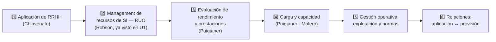

# 🏠 U3 — La administración de recursos de SI/TI: Subsistema de Aplicación

> [!info] Cómo usar esta wiki
> Cada concepto es una nota atómica conectada por wikilinks. Empezá por acá o por el [[ASI U3 - Subsistema de Aplicación (Súper Resumen)|Súper Resumen U3]], y usá el **Graph View** filtrando por `tag:#ASI-U3`. La carpeta **99 Examen** tiene el [[Cuestionario U3 (27 preguntas)|cuestionario]] con cada pregunta linkeada a su respuesta, las [[Preguntas de final U3|preguntas de final]] y los [[Comodines y cruces de examen U3|comodines]].

## 🧭 Recorrido sugerido

## 1️⃣ Aplicación de RRHH (Chiavenato)
- [[Subsistema de aplicación de RRHH]]
- [[Socialización organizacional]] · [[Programa de integración]]
- [[La empresa como sistema de roles]] · [[Cargo (concepto)]] · [[Diseño de cargos]]
- [[Modelos de diseño de cargos]]
  - [[Modelo clásico de diseño de cargos]] · [[Modelo humanista de diseño de cargos]] · [[Modelo situacional de diseño de cargos]]
  - [[Enriquecimiento de cargos]]
- [[Descripción y análisis de cargos]] · [[Métodos de descripción y análisis de cargos]] · [[Etapas del análisis de cargos]]
- [[Equipos formales (grupos vs equipos)]] · [[Equipo efectivo de trabajo]] · [[Equipos de proyecto]]
- [[Evaluación del desempeño humano]] · [[Responsables de la evaluación del desempeño]] · [[Métodos de evaluación del desempeño]]

## 2️⃣ Management de recursos de SI (Robson T4 Cap. 9)
- [[RUO — Rol, Ubicación y Organización del área de SI-TI]] *(hub que enlaza las notas de U1)*
- [[Estructura del área de SI-TI (elementos de diseño)]]
- [[Rol de IS — relaciones con los usuarios y estructuras]] · [[SI delegados]]
- [[Niveles de administración del área de SI-TI]] · [[Enfoques estructurales — detalle U3]]
- De U1: [[Administración de recursos de IS]] · [[Rol de los IS]] · [[Ubicación de los IS]] · [[Centralizados vs no centralizados]] · [[Organización de los IS (enfoques estructurales)]]

## 3️⃣ Evaluación de rendimiento y prestaciones (Puigjaner)
- [[Subsistema de aplicación de SI-TI]]
- [[Rendimiento y prestaciones]] · [[Evaluación de prestaciones]]
- [[Magnitudes y variables de medida]] · [[Mejora del comportamiento de un sistema]]
- [[Sistemas batch, transaccional e interactivo]]
- [[Técnicas de evaluación de sistemas]] · [[Monitores]] · [[Benchmarking]]
- De finales: [[Herramienta top]] · [[Ley de Amdahl]]

## 4️⃣ Carga y capacidad (Puigjaner · Molero)
- [[Carga del sistema]] · [[Caracterización de la carga]]
- [[Modelo de carga y representatividad]] · [[Cargas de test]]
- [[Planificación de la capacidad]]
- [[Patrones de la carga y métodos de predicción]] · [[Técnicas cuantitativas de predicción de la carga]]
- [[Unidades de predicción natural (UPN)]]

## 5️⃣ Gestión operativa y marco normativo
- [[Explotación de sistemas]]
- [[Modelo de administración de recursos (políticas y normas)]]

## 6️⃣ Relaciones entre subsistemas ("para pensar")
- [[Aplicación y provisión de RRHH]] (I.9)
- [[Aplicación de RRHH vs aplicación de SI-TI]] (II.13.a)
- [[Aplicación y provisión de SI-TI]] (II.13.b)

## 7️⃣ Conceptos complementarios
- [[Glosario U3]] · [[Autores y modelos clave U3]] · [[Diferencias que se confunden U3]]

## 🎓 Examen
- [[Preguntas U3]] (checklist → Súper Resumen) · [[Cuestionario U3 (27 preguntas)]]
- [[Preguntas de final U3]] · [[Comodines y cruces de examen U3]]
- [[Bibliografía U3]] · [[Índice alfabético U3]]

## 🔗 Otras unidades
- [[00 Home — U1 Planificación estratégica SI-TI|🏠 Home U1]] · U6: [[Auditoría de la función informática]] · [[Políticas de seguridad]] · [[Control interno]]
