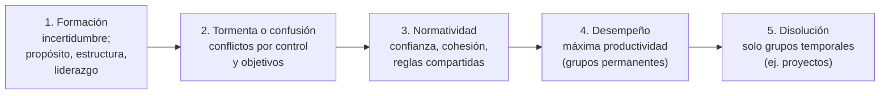

# Equipos formales — grupos vs equipos

Los equipos surgen como **necesidad organizacional**: por más estructuras que se armen, tienen componentes fijos; cuando se forma un equipo, **el objetivo se alcanza con mayor rapidez**.

| **Grupo de trabajo** | **Equipo de trabajo** |
|---|---|
| Interactúa para **compartir información y tomar decisiones** que ayuden a cada uno a ejecutar sus tareas | Sus miembros trabajan **intensamente** en un **objetivo común específico** (producto o servicio) |
| **No** hay necesidad ni oportunidad de trabajo colectivo con esfuerzo conjunto | **Sinergia positiva**, responsabilidad **individual y mutua**, habilidades **complementarias** |

> [!quote] Definición (apunte sistematizado)
> "Un **equipo de trabajo** es una unidad de dos o más personas con **habilidades complementarias**, comprometidas con un **propósito común** y con una serie de **metas de rendimiento** y de expectativas que hay que cumplir: no se trata solo de llegar al objetivo, sino de hacerlo cumpliendo estas condiciones. Además, existe una **norma colectiva** sobre cómo responde cada uno."

> [!important] Todo equipo es un grupo formal; no todo grupo formal es un equipo
> Grupo formal = oficialmente definido y estructurado. El personal de un departamento es un grupo formal, pero eso **no** lo convierte automáticamente en equipo.

## Características de un equipo de trabajo
Es **pequeño** · habilidades **complementarias** · **propósito común** · **metas de desempeño** bien definidas (comunicación, manejo de conflictos, enfoque a resultados) · **metodología compartida** · cada uno se siente **responsable ante los demás** · **sinergia** (el todo es más que la suma de las partes).

## Etapas de desarrollo

- En la **tormenta**, el gerente debe procurar que sea **breve**, trabajando sobre metas y propósito.

## 🔗 Relacionado
- [[Equipo efectivo de trabajo]] · [[Equipos de proyecto]] · [[Socialización organizacional]] *(el grupo como "escuela informal")*
