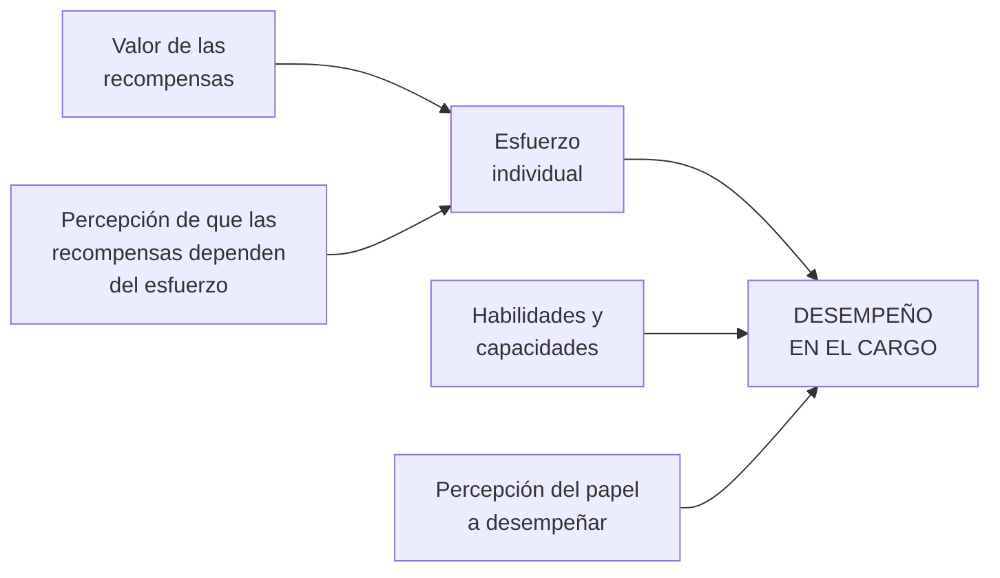

# Evaluación del desempeño humano

> [!quote] Definición (Chiavenato)
> "Es la **apreciación sistemática del desempeño** de cada persona en el cargo o de su **potencial de desarrollo futuro**. Es un proceso para estimar o juzgar el valor, la excelencia y las cualidades de una persona."

- Es una **responsabilidad de línea**, centrada en el período en que la persona se integra al cargo (vínculo con la [[Socialización organizacional]]).
- No interesa el desempeño en general sino el **desempeño del cargo** = el **comportamiento de rol** del ocupante.
- Es un concepto **dinámico** (siempre se evalúa, formal o informalmente) y un **medio** para localizar problemas de supervisión, de integración al cargo, etc. **No es un fin en sí misma.**

## El desempeño es situacional

El valor de las recompensas y la percepción de que dependen del esfuerzo determinan cuánto esfuerzo pone la persona ("relación costo-beneficio"); ese esfuerzo depende de sus **habilidades** y de su **percepción del papel**.

## ¿Quién evalúa?
Gerente (línea + staff) · empleado (autoevaluación) · empleado y gerente (APO) · equipo de trabajo · órgano de RRHH · comité de evaluación · 360° → [[Responsables de la evaluación del desempeño]].

## Objetivos
**Propósitos tradicionales:** justificar el procedimiento salarial y dar oportunidad de reexaminar el desempeño y discutir la superación.

**Objetivos intermedios (12):** adecuación del individuo al cargo · entrenamiento · promociones · incentivo salarial · relaciones supervisor–subordinado · autoperfeccionamiento · información para investigación de RRHH · cálculo del potencial · estímulo a la productividad · reconocimiento de los patrones de desempeño · retroalimentación al evaluado · otras decisiones (transferencias…).

**Objetivos fundamentales (3):**
1. Permitir condiciones de **medición del potencial humano**.
2. Tratar a los RRHH como **recurso básico** y **ventaja competitiva** cuya productividad puede desarrollarse indefinidamente.
3. Dar **oportunidades de crecimiento y participación** a todos, considerando objetivos empresariales e individuales.

## Beneficios

| Para el **jefe** | Para el **subordinado** | Para la **empresa** |
|---|---|---|
| Evaluar con un sistema que **neutraliza la subjetividad** | Conoce qué comportamientos **valora** la empresa | Evalúa su **potencial humano** a corto, mediano y largo plazo |
| Proponer medidas de mejora | Conoce las **expectativas** del jefe, sus fortalezas y debilidades | Identifica quién necesita **reciclaje** y quién puede ser **promovido o transferido** |
| Comunicarse con los subordinados | Sabe qué medidas toma el jefe y cuáles debe tomar él | Estimula la **productividad** y las relaciones humanas |
| | Adquiere condiciones de **autoevaluación** y autocrítica | |

## Métodos
Escalas gráficas · elección forzada · investigación de campo · incidentes críticos · mixtos (+ comparación por pares y frases descriptivas) → [[Métodos de evaluación del desempeño]].

## Elemento integrador de las prácticas de ARH

| Proceso | Qué le aporta la evaluación |
|---|---|
| **Provisión** | Seguir y localizar personas con características adecuadas |
| **Aplicación** | Indicar si las personas están bien integradas en sus cargos |
| **Mantenimiento** | Indicar el desempeño y los resultados alcanzados |
| **Desarrollo** | Fortalezas, debilidades y potencialidades a desarrollar |
| **Seguimiento** | Retroalimentación a las personas |

## La entrevista de evaluación
**Última etapa**: de nada sirve evaluar si el empleado no conoce los resultados. Propósitos: comunicar con claridad el **estándar de desempeño** esperado (calidad, cantidad, métodos) · mostrar cómo está trabajando (fortalezas y debilidades vs estándares) · discutir **planes de desarrollo** · estimular relaciones francas jefe–subordinado · **eliminar o reducir discrepancias**, ansiedades e incertidumbres.

> [!example] Pregunta real de final
> "¿Cuáles de estas frases pueden traer problemas al evaluar el desempeño? a) basarse **solo** en la descripción y análisis del cargo; b) basarse **solo** en estándares de trabajo; c) una inadecuada herramienta de selección en la provisión; d) falta de discrecionalidad del evaluador."
> Respuesta de alumnos para (a) y (b): el control necesita **ambos** —estándares basados en la DyAC **y** seguimiento del desempeño real comparado contra ellos—; usar uno solo deja la evaluación incompleta. Para (c), conectá con [[Aplicación y provisión de RRHH]]: una mala selección se manifiesta como problema de desempeño.

**Cuestionario:** responde la **I.8**.

## 🔗 Relacionado
- [[La empresa como sistema de roles]] · [[Evaluación de prestaciones]] *(su análogo en SW/HW)* · [[Control interno]] · [[Aplicación y provisión de RRHH]]
