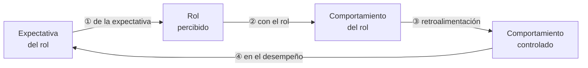

# La empresa como sistema de roles

> [!quote] Definición (Chiavenato)
> "**Rol** es el conjunto de actividades y comportamientos que se solicitan a un individuo que ocupa determinada posición en la organización."

La empresa es una serie de roles y de **conjuntos de roles** (grupos superpuestos de personas cuyas expectativas giran en torno a un individuo) → **la empresa es un sistema de roles**.

## Proceso de desempeño del rol
1. El jefe explica lo que debe hacerse → **expectativa del rol**.
2. El empleado lo interpreta, con distorsiones de la comunicación → **rol percibido**.
3. Hace lo que entendió → **comportamiento del rol**.
4. El jefe lo evalúa → **comportamiento controlado**, y lo compara con la expectativa.

## Las 4 discrepancias

| Discrepancia | Entre… | Por qué ocurre |
|---|---|---|
| **1. De la expectativa** | Expectativa transmitida ↔ rol percibido | El subordinado no siempre entiende lo que explica el jefe |
| **2. Con el rol** | Rol percibido ↔ comportamiento del rol | No siempre consigue ejecutar lo que entiende (capacitación, cuestiones personales) |
| **3. Retroalimentación de la discrepancia** | Comportamiento del rol ↔ comportamiento controlado | El jefe no siempre evalúa adecuadamente todo lo que hace el subordinado |
| **4. En el desempeño** | Comportamiento controlado ↔ expectativa del rol | El subordinado no siempre realiza lo que se le indica |

> [!tip] Para relacionar
> Las discrepancias son la razón de ser de la **evaluación del desempeño** y de la **entrevista de evaluación** (que busca "eliminar o reducir discrepancias"). En SW/HW, su equivalente son los **cuellos de botella** → [[Aplicación de RRHH vs aplicación de SI-TI]].

Rol y cargo son **distintos pero relacionados**; de aquí en adelante Chiavenato habla de **cargos** → [[Cargo (concepto)]].

**Cuestionario:** responde la **I.3**.

## 🔗 Relacionado
- [[Cargo (concepto)]] · [[Evaluación del desempeño humano]] · [[Rol de los IS]] *(otro "rol": el del área de SI, Robson)*
