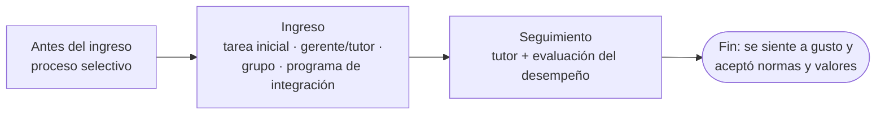

# Socialización organizacional

> [!quote] Definición (Chiavenato)
> "Es el **proceso permanente** de inculcar en todos los empleados las **actitudes, normas, valores y patrones de conducta** —incluidos los relativos al cargo— que espera la organización y sus departamentos."

**En criollo:** enseñarle al que entra "cómo se juega acá" para que el ingreso no sea traumático.

## Aspectos clave

| Aspecto | Qué dice el material |
|---|---|
| **Finalidad** | Integrar al nuevo miembro de manera que su incorporación **no sea traumática** |
| **Importancia** | Aporta **estabilidad y eficacia**: las organizaciones dependen en gran medida de su habilidad para socializar a su personal |
| **Finalización** | Cuando el nuevo miembro **se siente a gusto** con la organización y su puesto, y **aceptó** sus normas y valores |
| **Socialización vs personalización** | La organización trata de adaptar el comportamiento del individuo a sus necesidades; el individuo trata de influir para lograr satisfacción y sus objetivos personales → suelen **entrar en conflicto** |
| **Plan de carrera** | Ofrece caminos para que la personalización conviva con lo que la organización necesita |

## Métodos para promover la socialización

| Método | En qué consiste |
|---|---|
| **1. Planeación del proceso selectivo** *(para tramos finales)* | Entrevistas que permiten al candidato, **antes de ser admitido**, saber cómo funciona la organización: se empieza a socializar dentro de la selección |
| **2. Contenido inicial de la tarea** | Tareas **retadoras** que garanticen éxito al comienzo y luego gradualmente más exigentes (las tareas fáciles no motivan) |
| **3. Papel del gerente** | Representa la imagen de la organización; puede designar un **tutor**. Tres funciones: **descripción clara de la tarea**, **información técnica** y **retroalimentación** sobre el desempeño |
| **4. Grupos de trabajo** | La aceptación del grupo satisface necesidades sociales; el grupo es una **"escuela informal"** |
| **5. Programas de integración** | Entrenamiento intensivo inicial → [[Programa de integración]] |

> [!warning] "Momentos" de la socialización
> El cuestionario (I.1) pide "concepto, **momentos**, aspectos claves", pero el material **no enumera momentos** con ese nombre. Lectura defendible (elaboración, no textual): **antes del ingreso** (planeación del proceso selectivo) → **al ingreso** (tarea inicial, gerente/tutor, grupo, programa de integración, de 1 a 5 días) → **seguimiento a mediano plazo** del tutor, que se responsabiliza de evaluar el desempeño, hasta que la persona se siente a gusto (fin de la socialización).

**Cuestionario:** responde la **I.1**.

## 🔗 Relacionado
- [[Programa de integración]] · [[Subsistema de aplicación de RRHH]] · [[Evaluación del desempeño humano]] · [[Aplicación y provisión de RRHH]]
