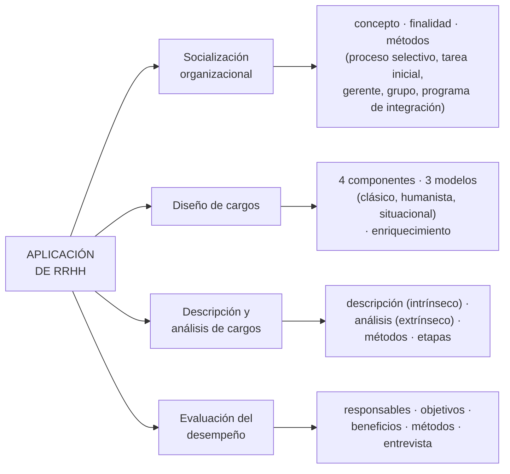

# Subsistema de aplicación de RRHH

> [!quote] Definición (Chiavenato)
> "Los procesos de aplicación de personas incluyen los **primeros pasos de la integración** de los nuevos miembros en la organización, el **diseño del cargo** que deben desempeñar y la **evaluación del desempeño** en el cargo."

> [!quote] Finalidad (apunte sistematizado)
> "Emplear los recursos humanos y designar al personal del área de acuerdo con los **esquemas de trabajo y de explotación de la infraestructura de información**."

**En criollo:** es el puente entre **conseguir** personas (provisión) y **mantenerlas y motivarlas** (mantenimiento): define cómo se hacen funcionar los recursos dentro de la estructura existente, según normas y reglas, para que **efectivamente estén trabajando**. Asegura que cada persona ocupe un cargo.

## Cuadro sinóptico (I.2)

| Dimensión | Qué hace | Nota |
|---|---|---|
| **Socialización organizacional** | Integra a la persona en el contexto laboral y cultural | [[Socialización organizacional]] |
| **Diseño de cargos** | Elabora y diseña los cargos del área de SI/TI (organigrama) | [[Diseño de cargos]] · [[Descripción y análisis de cargos]] |
| **Evaluación del desempeño** | Evalúa a cada miembro respecto de su cargo; se vincula con la socialización | [[Evaluación del desempeño humano]] |

Además el temario incluye los **equipos formales** (concepto, características, conformación) → [[Equipos formales (grupos vs equipos)]].

## Relaciones con otros subsistemas
- **Se nutre de la provisión:** después de reclutadas y seleccionadas, las personas deben ser integradas, destinadas a sus cargos y evaluadas.
- **Indica cuándo aprovisionar:** es donde se detecta si hacen falta personas (movimientos de personal) o HW/SW (según la carga → [[Subsistema de aplicación de SI-TI]]).
- Se alimenta de la **planificación estratégica** y de la **gestión** de los recursos aplicados.

**Cuestionario:** responde la **I.2**.

## 🔗 Relacionado
- [[Aplicación y provisión de RRHH]] · [[Aplicación de RRHH vs aplicación de SI-TI]] · [[Recursos organizacionales]] · [[00 Home — U3 Subsistema de aplicación|🏠 Home U3]]
