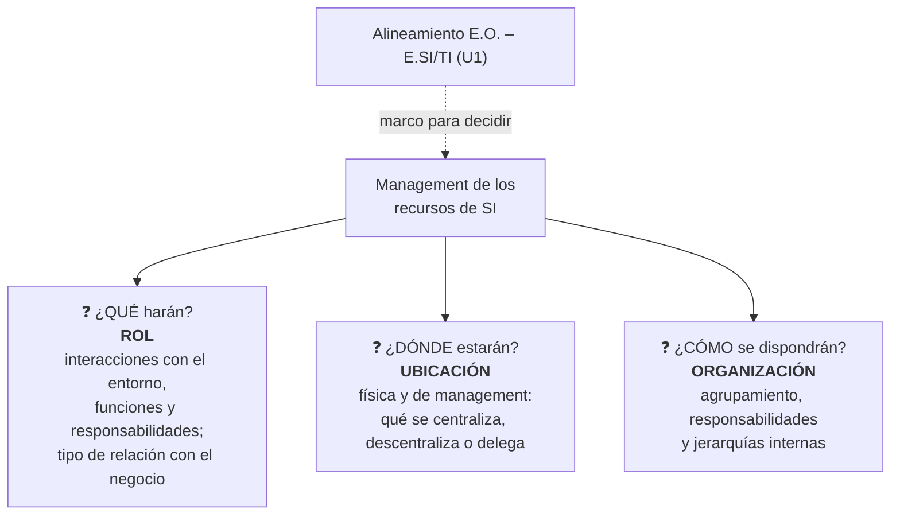

# RUO — Rol, Ubicación y Organización del área de SI/TI

> [!info] Hub
> El Robson T4 Cap. 9 se desarrolló en la **Unidad 1**. Esta nota **resume y enlaza** esas notas y agrega lo que trae el apunte de U3. PDF: [[ROBSON_Tomo4-Cap9-Management de IS (RUO).pdf|Robson T4 Cap. 9]].

> [!warning] Aclaración de la cátedra
> **"IS" = el ÁREA de sistemas**, no las aplicaciones. Es una decisión sobre **cómo disponer los RRHH**: **organizativa, no tecnológica**.

## Los tres temas (I.11)

| Tema | Concepto | Preguntas típicas (apunte U3) | Notas |
|---|---|---|---|
| **Rol** | Naturaleza de las interacciones del área con su entorno: cómo se relaciona con las demás, qué funciones y responsabilidades tiene | ¿Modelo de negocio o soporte? ¿Define las aplicaciones de las áreas usuarias? | [[Rol de los IS]] (U1) · [[Rol de IS — relaciones con los usuarios y estructuras]] |
| **Ubicación** | Perspectiva empresarial: dónde está el área **física y de management** | ¿Cuánto centralizar o descentralizar? Con sucursales, ¿qué decisiones se delegan y cuáles se retienen? | [[Ubicación de los IS]] (U1) · [[Centralizados vs no centralizados]] (U1) · [[SI delegados]] |
| **Organización** | Estructura **interna**: cómo se agrupan las personas, responsabilidades y jerarquías | ¿Cómo departamentalizar, qué niveles gerenciales, bajo qué criterio? | [[Organización de los IS (enfoques estructurales)]] (U1) · [[Enfoques estructurales — detalle U3]] · [[Niveles de administración del área de SI-TI]] |

> [!tip] Dicho en clase
> Consejo de la profesora: **plantear la organización, verificar si esa organización ayuda al rol y si está relacionada con la ubicación**. Y para el TP: indicar **qué decisiones se descentralizan, se centralizan o se delegan**.

## Síntesis rápida para el cuestionario

- **I.10 Roles desde el gerenciamiento:** dos visiones (estratégica y crítica vs apoyo a la eficiencia); evolución "hacerles algo a ellos → … → mantener un depósito de información"; 5 modelos (servicio, participación, vendedor, expansión, ventaja estratégica); 3 roles a estructurar diferenciados (infraestructura; I+D a largo plazo; facilitar la informática del usuario final).
- **I.11 RUO:** la tabla de arriba.
- **I.12 Decisiones de ubicación:** confrontar con la **estrategia de SI** y decidir **qué centralizar, cómo y en qué medida**, según **localización**, **control** y **estructura**; tres tipos: centralizada, descentralizada, delegada.
- **I.13 Comparación:** control (más en centralizados), entorno (eficiencia → centralizar; efectividad, velocidad y flexibilidad → no centralizar), costos (economías de escala vs duplicación).
- **I.14 Enfoques estructurales:** tradicional · bases de datos · grupos de proyectos funcionales · centro de información y apoyo a decisiones · estructuras externas (pueden coexistir).

## Lo que agrega el apunte de U3 (no está en las notas de U1)
- **Qué es el management de recursos de SI** y los **elementos de diseño de la estructura** (especialización, departamentalización, cadena de mando, tramo de control, centralización, formalización), qué tareas **centralizar** y cuáles **descentralizar** → [[Estructura del área de SI-TI (elementos de diseño)]].
- La tabla **rol ↔ relación ↔ estructura**, con ejemplos (BI, CRM, data warehouse), y la diferencia **participación vs ventaja estratégica** → [[Rol de IS — relaciones con los usuarios y estructuras]].
- **"Los delegados son los que verdaderamente se oponen a los centralizados"**; entornos para cada ubicación; detalle de beneficios y riesgos → [[SI delegados]].
- Niveles **información / uso / tecnología** con **CIO** y **CTO** → [[Niveles de administración del área de SI-TI]].
- Detalle de cada enfoque estructural (máxima virtud del tradicional, carga despareja en proyectos funcionales, management híbrido, dos aspectos de las externas) → [[Enfoques estructurales — detalle U3]].

**Cuestionario:** responde la **I.10, I.11, I.12, I.13 y I.14** (junto con las notas de U1 enlazadas).

## 🔗 Relacionado
- [[Administración de recursos de IS]] (U1) · [[Alineamiento E.O. – E.SI-TI (esquema general)]] · [[Auditoría de la función informática]] *(audita la organización del área)* · [[00 Home — U3 Subsistema de aplicación|🏠 Home U3]]
