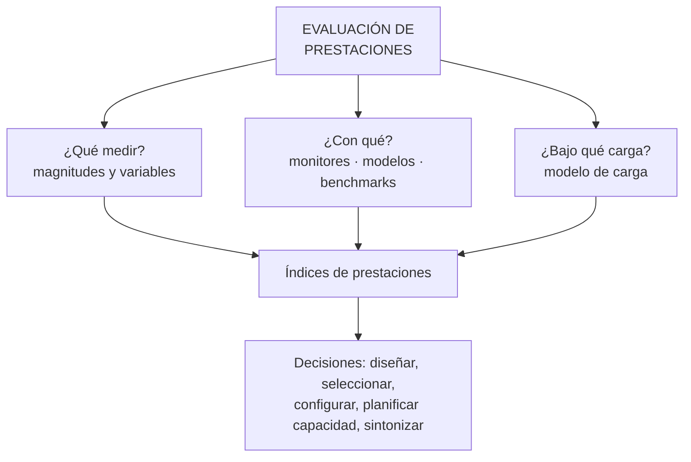

# Evaluación de las prestaciones

**Concepto:** el conjunto de actividades que estudian el **comportamiento** de un sistema informático —cómo el SW usa el HW bajo una carga— y obtienen **índices de prestaciones** mediante **técnicas de evaluación** (monitorización, modelado, benchmarking).

## Objeto de estudio
Los autores toman como objeto los componentes **hardware**, **software** y la **carga** (las aplicaciones que se ejecutan): el resultado de cualquier medición es **función de los tres** y es inseparable de la carga.

## ¿Por qué evaluar? — objetivos
1. **Comprobar** que el funcionamiento es correcto (el esperado).
2. **Encontrar los factores** que impiden un funcionamiento adecuado (**cuellos de botella**).
3. **Predecir** el comportamiento con **nuevas cargas** (planificación de la capacidad).

## ¿Para qué fines se recurre a la evaluación?
Influye en las decisiones de **diseño, implantación, compra y modificación**. Es necesario evaluar cuando se quiere:

| Fin | Ejemplo |
|---|---|
| **Diseñar una máquina** | — |
| **Diseñar un sistema informático** | — |
| **Seleccionar y configurar** un sistema | Cruce con provisión (U2) |
| **Planificar la capacidad** | [[Planificación de la capacidad]] |
| **Sintonizar o ajustar** un sistema | [[Mejora del comportamiento de un sistema]] |

> [!info] Fines adicionales (cuestionario resuelto de alumnos)
> Obtener mejores prestaciones al **mínimo costo**; saber qué opción de diseño de HW o de SW es mejor; mejorar el comportamiento del sistema.

> [!tip] Cruces
> - Es el **análogo** de la [[Evaluación del desempeño humano]] en el subsistema de RRHH.
> - Sus resultados sirven como **evidencia de auditoría** (¿los sistemas usan los recursos de forma eficiente?) → [[Auditoría de sistemas de información]] · [[Auditoría de sistemas de aplicación instalados]].

**Cuestionario:** responde la **II.4**.

## 🔗 Relacionado
- [[Rendimiento y prestaciones]] · [[Magnitudes y variables de medida]] · [[Técnicas de evaluación de sistemas]] · [[Carga del sistema]]
