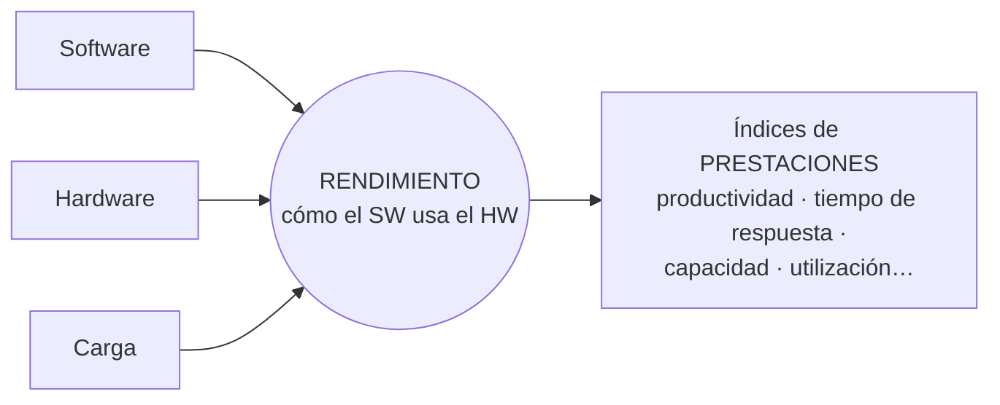

# Rendimiento y prestaciones de un sistema informático

> [!quote] Definición (Puigjaner)
> "La evaluación del **rendimiento** de un sistema informático se define como la **medida de cómo un software determinado está utilizando el hardware** con una determinada combinación de programas, que constituyen lo que se denomina **carga del sistema**."

**Rendimiento — en criollo:** la **eficacia con la que un SW aprovecha los recursos de HW bajo una carga de trabajo dada**.

**Prestaciones — concepto elaborado:** el **nivel de servicio** que el sistema efectivamente brinda a sus usuarios, expresado mediante **índices de prestaciones** (productividad, tiempo de respuesta, capacidad, disponibilidad…), que **siempre deben informarse junto con la carga** bajo la que se obtuvieron.

> [!warning] Las fuentes no definen "prestaciones" textualmente
> La II.2 pide **elaborar** ambos conceptos. Un cuestionario resuelto de alumnos dice: "Prestaciones: el conjunto de funcionalidades/servicios que brinda un SI a sus usuarios". El apunte sistematizado usa "prestaciones" como la performance **medida con índices**. Armá tu definición con: servicio al usuario + índices + inseparable de la carga.

## Dificultades de medir
- La **carga real cambia continuamente**.
- Las variables o índices **varían de una instalación y configuración a otra**.

**Cuestionario:** responde la **II.2**.

## 🔗 Relacionado
- [[Evaluación de prestaciones]] · [[Magnitudes y variables de medida]] · [[Carga del sistema]] · [[Sistemas batch, transaccional e interactivo]]
