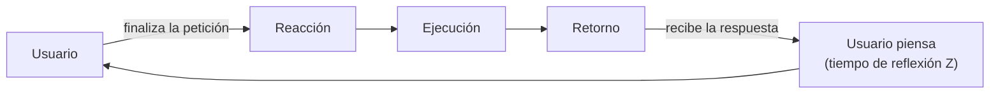

# Sistemas de referencia — batch, transaccional e interactivo

| | **Por lotes (batch)** | **Transaccional** | **Interactivo o por demanda** |
|---|---|---|---|
| **Funcionamiento** | Ciclos continuos de CPU y disco hasta terminar | El más común: las partes interactúan por **transacciones de datos** | Usuarios en **terminales remotas** acceden a programas en un servidor; solicitudes y respuestas; **la nueva petición depende de la respuesta anterior** |
| **Tiempo** | **Turnaround time**: desde que se lanza el trabajo hasta que finaliza (equivale al tiempo de respuesta) | **Tiempo de respuesta** = reacción + ejecución + retorno | **Tiempo de respuesta** = reacción + ejecución + retorno, **+ tiempo de reflexión Z** (del usuario) |
| **Productividad** | **Trabajos** por unidad de tiempo | **Transacciones** por unidad de tiempo (normalmente por segundo) | **Peticiones cumplidas** por unidad de tiempo |

## Desglose del tiempo de respuesta

| Componente | Transaccional | Interactivo |
|---|---|---|
| **Reacción** | Desde que la transacción **llega al sistema** hasta que empieza a ejecutarse | Desde que el usuario **finaliza la petición** hasta que empieza la ejecución |
| **Ejecución** | Desde que empieza hasta que termina la ejecución | Ídem |
| **Retorno** | Desde que termina la ejecución hasta que **se completa la respuesta** al usuario | Hasta que el usuario **termina de recibir** la respuesta |

## El sistema interactivo por dentro
- **Subsistema de terminales:** modela el **tiempo de reflexión** del usuario.
- **Subsistema central:** los dispositivos físicos del computador.
- **Tiempo de reflexión (think time, Z):** desde que un trabajo **abandona** el subsistema central hasta que **vuelve a entrar**. El sistema **espera las órdenes** del usuario para continuar.

**Cuestionario:** responde la **II.8**.

## 🔗 Relacionado
- [[Magnitudes y variables de medida]] · [[Caracterización de la carga]] *(variables de cargas conversacionales)* · [[Rendimiento y prestaciones]]
