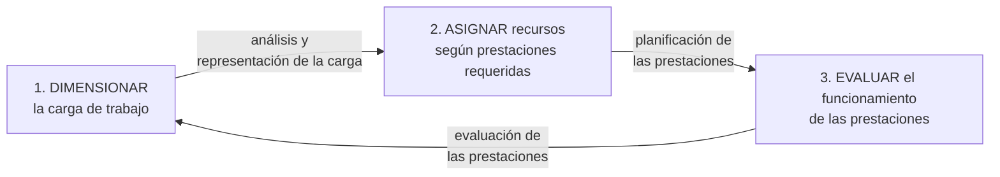

# Subsistema de aplicación de SI/TI (SW y HW)

> [!quote] Definición (apunte sistematizado)
> "Es el subsistema cuya finalidad es **disponer los recursos de SI/TI (hardware y software) en función de la carga de trabajo y de los niveles de servicio requeridos** para satisfacer el nivel de prestaciones de la organización."

**Qué lo conforma:** las actividades de **asignar, configurar, planificar la capacidad, explotar y evaluar** los recursos de SW y HW.

## Las tres tareas

| Tarea | Se resuelve con | Notas |
|---|---|---|
| Dimensionar la carga | Análisis y representación de la carga | [[Carga del sistema]] · [[Caracterización de la carga]] · [[Modelo de carga y representatividad]] |
| Asignar recursos según prestaciones | Planificación de las prestaciones (capacidad) | [[Planificación de la capacidad]] |
| Evaluar las prestaciones | Evaluación de las prestaciones | [[Evaluación de prestaciones]] · [[Técnicas de evaluación de sistemas]] |
| (Explotar) | Operación diaria | [[Explotación de sistemas]] |

> [!tip] Dicho en clase
> "Existen diferentes cargas de trabajo y formas de procesamiento que difieren no solo en su tipo sino también en las condiciones en que deben ejecutarse: **los sistemas también DIFIEREN EN SUS PRESTACIONES**."

> [!info] Otra formulación (cuestionario resuelto de alumnos)
> "Asignación, Configuración, **Explotación** y Evaluación de recursos de SW y HW" (no menciona la planificación de la capacidad). El apunte sistematizado incluye las cinco actividades: usá esa.

**Cuestionario:** responde la **II.1**.

## 🔗 Relacionado
- [[Subsistema de aplicación de RRHH]] · [[Aplicación de RRHH vs aplicación de SI-TI]] · [[Aplicación y provisión de SI-TI]] · [[00 Home — U3 Subsistema de aplicación|🏠 Home U3]]
