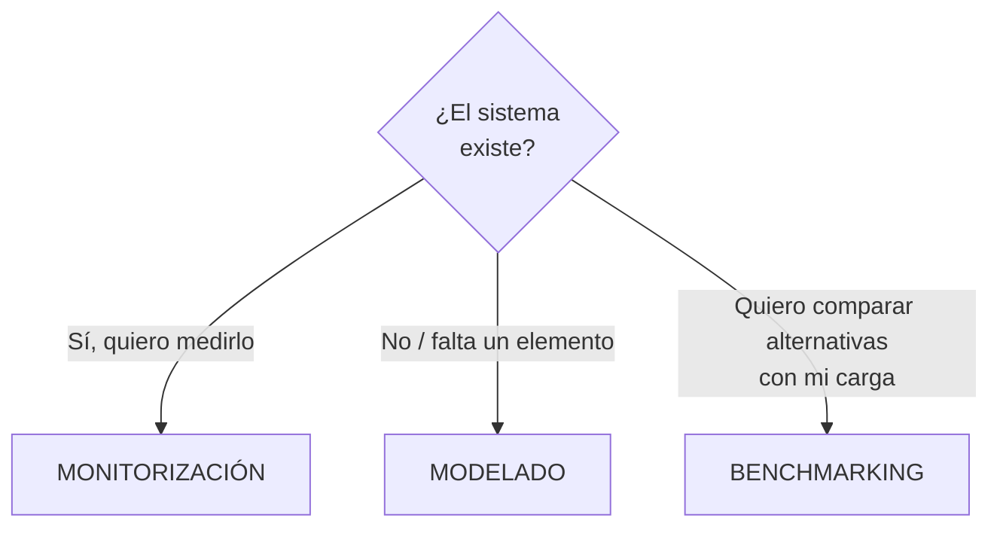

# Técnicas de evaluación — monitorización, modelado y benchmarking

> [!quote] Definición (Puigjaner)
> "Se denominan **técnicas de evaluación** los métodos y herramientas que permiten obtener los **índices de prestaciones** de un sistema que está ejecutando una **carga dada**, con unos valores determinados de los **parámetros del sistema**."

| Técnica | Qué es | Cuándo se usa | Nota |
|---|---|---|---|
| **Monitorización** | Los **monitores** son herramientas de medición que permiten **seguir el comportamiento** de los principales elementos de un sistema sometido a una carga | El sistema **existe** y está funcionando | [[Monitores]] |
| **Modelado** | Representación (analítica o por simulación) del sistema | Hay algún elemento (HW o SW) **que no está instalado** | — |
| **Benchmarking** | **Comparar** sistemas frente a una **carga característica** de una instalación, básicamente por el **tiempo de ejecución**; "medición sobre un **prototipo**" | Selección, comparación | [[Benchmarking]] |

> [!tip] Las tres técnicas en otros subsistemas
> Según respuestas de finales, monitores, benchmarks y modelado se usan en la **aplicación** de SI/TI (evaluar el sistema) y también en el **seguimiento** de SI/TI. La planificación de la capacidad empieza por **instrumentar con monitores** → [[Planificación de la capacidad]].

> [!info] ¿Y la ley de Amdahl?
> **No es una técnica de evaluación** (respuesta de final): es una relación que estima la mejora global al mejorar una parte → [[Ley de Amdahl]].

## 🔗 Relacionado
- [[Evaluación de prestaciones]] · [[Monitores]] · [[Benchmarking]] · [[Cargas de test]]
