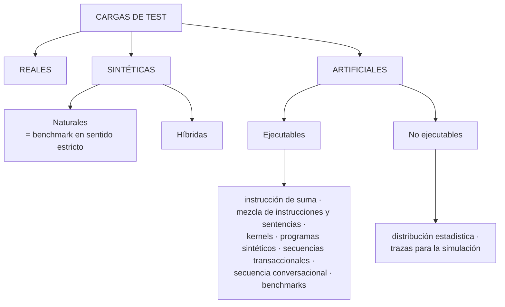

# Cargas de test (tipos de carga)

**Carga de test o de prueba:** la que procesa el sistema durante la **sesión de medida**; puede ser la carga **real** o un **modelo** de ella.

| Tipo | Qué es | Pros / contras |
|---|---|---|
| **Real** | La carga observada en funcionamiento normal | **La más representativa y la más barata** de implantar; puede considerarse un modelo de carga. Problema: **reproducir** las situaciones al repetir un experimento |
| **Sintética** | Programas **extraídos o no** de la carga real que la reproducen de forma **compacta** | Se usa más: se puede **repetir y modificar** sin afectar la operación |
| ↳ **Natural** | Programas **extraídos de la carga real** ("benchmark en sentido estricto") | Estudios de **selección y aplicación** |
| ↳ **Híbrida** | Parte conocida con programas reales + parte inexistente con elementos artificiales | Cuando la carga a modelar **no existe completamente** |
| **Artificial** | Componentes diseñados para cargar el sistema real o un modelo matemático; **ningún componente de la carga real** | — |

## Artificiales (detalle de un cuestionario resuelto de alumnos)
- **Instrucción de suma:** la primera; cuando lo que importaba era la velocidad del procesador. Obsoleta.
- **Mezcla de instrucciones y sentencias:** según frecuencias de ejecución de cargas reales (ej. *Gibson mix*); muy ligadas al sistema, solo orientan sobre velocidad de CPU.
- **Kernels:** programa o fragmento representativo de la carga.
- **Programas sintéticos:** no hacen trabajo útil, **consumen recursos** según parámetros (CPU, E/S, memoria); muy flexibles.
- **Secuencias transaccionales:** para entornos de usuarios remotos; un sistema simula la red y los usuarios.
- **Secuencia conversacional:** guion de trabajo de cada usuario descrito a nivel funcional.
- **Benchmarks:** programas estándar que simulan una carga genérica.
- **No ejecutables:** **distribución estadística** (parámetros como variables aleatorias, para modelado y simulación) y **trazas** (secuencia cronológica de acontecimientos; alta representatividad, pero recogerlas causa **overhead**).

> [!warning] ¿La real sirve o no?
> El apunte dice que la real "difícilmente" sirve como carga de prueba (no se puede repetir) y también que es "la más representativa y barata". Las dos cosas son ciertas: **es la más fiel, pero no es reproducible**.

> [!info] "Tipos de carga" vs "patrones de comportamiento"
> La II.9 pregunta **tipos de carga** (esta nota). En finales también preguntan "**tipos de comportamiento de la carga**" (tendencia, cíclico, estacional, estacionario) → [[Patrones de la carga y métodos de predicción]].

**Cuestionario:** responde la **II.9**.

## 🔗 Relacionado
- [[Modelo de carga y representatividad]] · [[Benchmarking]] · [[Carga del sistema]]
