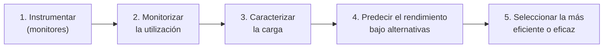

# Planificación de la capacidad (planificación de las prestaciones)

> [!quote] Definición (Molero, Juiz y Rodeño)
> "Es el proceso de **identificar la configuración de un sistema que permita suministrar un rendimiento satisfactorio ante las cargas de trabajo futuras proyectadas**." Consiste en **asignar los recursos en función de las prestaciones requeridas**.

**En criollo:** saber qué CPU, memoria, disco y red vas a necesitar cuando crezca el trabajo, **antes** de que el sistema se sature o aparezcan cuellos de botella.

## ¿Para qué sirve?
- El **plan de capacidad predice qué dispositivos podrían ser el cuello de botella** y **anticipa soluciones** antes de la saturación.
- Bien hecha y revisada periódicamente, **minimiza el ajuste de rendimiento**.
- Recursos sobre los que se pone el foco: **procesador, memoria, disco, redes de área local o de almacenamiento, redes de comunicaciones**.
- Depende de una **caracterización correcta de la carga** → [[Caracterización de la carga]].

## Metodología básica

## Capacidad adecuada
Es función de **tres elementos**:

| Elemento | Qué es |
|---|---|
| **SLA / ANS** (acuerdos de nivel de servicio) | Umbrales de **productividad, rendimiento y disponibilidad** pactados entre usuarios y la organización de soporte. Calidad de servicio: `Desviación QoS = (QoS conseguida − QoS deseada) / QoS deseada` *(fórmula tomada de resúmenes de alumnos; en el apunte la ecuación es una imagen)* |
| **Arquitectura del sistema** | La capacidad se puede lograr con distintos dispositivos; la elección depende de la aplicación, la **madurez en la explotación**, la facilidad de administración, etc. |
| **Presupuesto** | **Costo total de la propiedad** = costo de **implementación** (HW, SW, formación inicial) + costo de **operación** (mantenimiento, personal, electricidad) |

> [!quote] Capacidad adecuada
> Un sistema tiene capacidad adecuada "si los **niveles de servicio se cumplen continuamente** para una tecnología y unos estándares especificados, y si los servicios se suministran **dentro de los límites de costo acordados**".

## Niveles de gestión y planificación (Molero)

| Nivel | Situación |
|---|---|
| **0** | No hay programa de gestión de la capacidad; se gestiona **ocasionalmente** |
| **1** | Medidas de **tendencia** y predicción en **periodos pico**; revisiones periódicas |
| **2** | Se conocen **exactamente las utilizaciones** de cada recurso por cada carga significativa |
| **3** | Sistema **automático** de análisis y predicción de la carga |
| **4** | Se predicen **automáticamente los niveles de servicio** a partir de las predicciones de capacidad |
| **5** | Se usan **criterios de las aplicaciones de negocio** en un modelo que predice los niveles de servicio (cruce con [[Unidades de predicción natural (UPN)]]) |

> [!warning] "Niveles de planificación": dos respuestas posibles
> La II.12 habla de "planificación de las **prestaciones**" y pide "sintetizar los **niveles de planificación**". El apunte sistematizado responde con los **niveles 0–5 de Molero** (arriba). Un cuestionario resuelto de alumnos (otra versión del cuestionario) responde con los niveles de planificación de la **explotación** según Puigjaner: **largo plazo**, **corto plazo o diaria** y **microplanificación** por estación de trabajo → [[Explotación de sistemas]]. Priorizá Molero y mencioná la otra si la pregunta apunta a explotación.

> [!example] Pregunta oral de final
> "¿En qué momento hacemos una planificación de la capacidad?" → cuando se proyectan **cargas futuras** (crecimiento del negocio, nuevas aplicaciones) y periódicamente para anticipar **cuellos de botella**; parte de **monitorizar** y **caracterizar la carga**, y usa los **patrones** de comportamiento para predecir.

**Cuestionario:** responde la **II.12**.

## 🔗 Relacionado
- [[Patrones de la carga y métodos de predicción]] · [[Técnicas cuantitativas de predicción de la carga]] · [[Unidades de predicción natural (UPN)]] · [[Monitores]] · [[Ley de Amdahl]] · [[Aplicación y provisión de SI-TI]]
