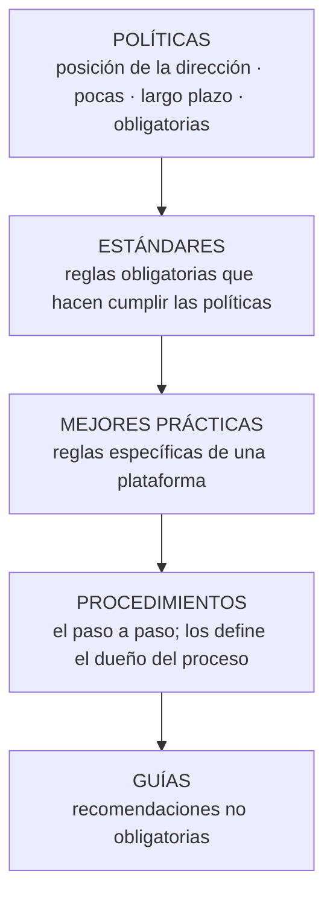

# Modelo de administración de recursos — políticas y normas

> [!warning] Fuentes de esta nota
> El apunte sistematizado de U3 **no desarrolla** este punto del programa. Las **definiciones** son del apunte sistematizado de la **U6** (sección "Política de seguridad — definición de política"), aplicadas aquí a la administración de recursos en general. La organización en pirámide y los ejemplos vienen del **"Complemento a los apuntes"** *(fuente: Complemento a los apuntes — no es material de cátedra)*.

**Idea:** para que la **explotación de sistemas** y el **desempeño de las personas** funcionen de manera **predecible, segura y eficiente**, la dirección de SI establece un **marco normativo** que regula cómo se usan los recursos (RRHH y SW/HW) una vez aplicados. En la aplicación de RRHH ya aparece: la socialización inculca **normas**, y el [[Programa de integración]] incluye **políticas** y **normas y reglamentos internos**.

## Jerarquía (de lo más estratégico y permanente a lo más operativo)

| Instrumento | Definición (apunte U6) | Obligatorio | Ejemplo *(Complemento — no cátedra)* |
|---|---|---|---|
| **Política** | "Declaración general de principios que presenta la **posición de la administración** para un área de control definida." Largo plazo; guía reglas más específicas; **pocas**; aprobadas por las autoridades; lineamientos para toda la organización | **Sí**: incumplirla exige una **excepción aprobada** | Política de uso aceptable de recursos informáticos; política de actualización tecnológica |
| **Estándar** | "Regla que especifica una **acción o respuesta** que se debe seguir ante una situación dada"; hace cumplir las políticas (no crea nuevas) | **Sí** | No superar el 80 % de uso de disco; nomenclatura de servidores; licenciamiento |
| **Mejor práctica** | Regla específica de una **plataforma**, aceptada en la industria, para que los sistemas estén configurados y administrados de manera **uniforme** | Se adopta como norma técnica | Configuraciones recomendadas para Linux, Windows Server, Oracle, ITIL |
| **Procedimiento** | Define **cómo** se implementan políticas, estándares, prácticas y guías en una situación dada; dependen de la tecnología o proceso; los desarrolla y supervisa el **dueño del proceso o sistema** | Sí, en su ámbito | Backup nocturno; alta de usuario; pasaje a producción |
| **Guía** | Declaración general para **recomendar o sugerir** un enfoque de implementación | **No**, pero se sigue salvo argumentos **documentados y aprobados** | Recomendaciones para usuarios y técnicos |

> [!tip] Cruces
> - En U6 este mismo esquema se aplica a la seguridad → [[Políticas de seguridad]]; las políticas son de la **primera línea de defensa** (prevención) según respuestas de final.
> - Las **normas** son la referencia contra la que la [[Auditoría de la función informática]] verifica "si existen **estándares de actuación** y su adecuación y vigencia".
> - En aplicación de SW/HW, los **SLA** son el "estándar" de las prestaciones → [[Planificación de la capacidad]]; en RRHH, los **estándares de desempeño** → [[Evaluación del desempeño humano]].

## 🔗 Relacionado
- [[Explotación de sistemas]] · [[Políticas de seguridad]] · [[Jerarquía normativa de seguridad (política, estándar, mejor práctica, guía y procedimiento)]] *(la misma jerarquía en U6)* · [[Líneas de defensa]] · [[Control interno]] · [[Estructura del área de SI-TI (elementos de diseño)]] *(formalización)*
