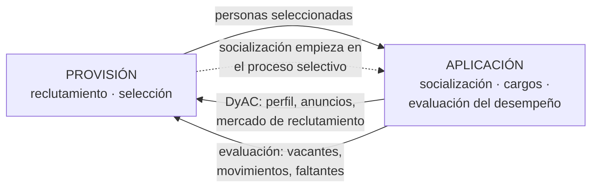

# Relación aplicación ↔ provisión de RRHH (para pensar)

| Desde la aplicación hacia la provisión | Desde la provisión hacia la aplicación |
|---|---|
| La **descripción y análisis de cargos** es base para el **reclutamiento** (anuncios, mercado de mano de obra) y la **selección** (perfil ideal del ocupante) | Entrega a las personas que serán **integradas, destinadas a sus cargos y evaluadas** ("a los procesos de provisión les siguen los de aplicación") |
| La **evaluación del desempeño** ayuda a "seguir y localizar a las personas con características adecuadas" y detecta **movimientos de personal** → nueva provisión | La **planeación del proceso selectivo** ya es un método de **socialización** |
| La aplicación "es la que determina si hay que incorporar recursos humanos" | Una **mala herramienta de selección** se manifiesta luego como **problema de desempeño** (pregunta real de final) |

> [!example] Conclusión sugerida (I.9)
> La provisión y la aplicación forman un **ciclo**: la provisión decide **quién entra**; la aplicación decide **dónde y cómo trabaja** y **si rinde**. La aplicación se nutre de la provisión, pero también la **orienta** (la DyAC define qué perfil buscar) y la **dispara** (la evaluación y los movimientos de personal muestran cuándo hace falta aprovisionar). Por eso un error en una etapa aparece en la otra: un perfil mal descripto lleva a una mala selección, y una mala selección aparece como discrepancia entre la expectativa del rol y el desempeño.

**Cuestionario:** responde la **I.9**.

## 🔗 Relacionado
- [[Subsistema de aplicación de RRHH]] · [[Descripción y análisis de cargos]] · [[Evaluación del desempeño humano]] · [[Socialización organizacional]] · [[Aplicación y provisión de SI-TI]]
