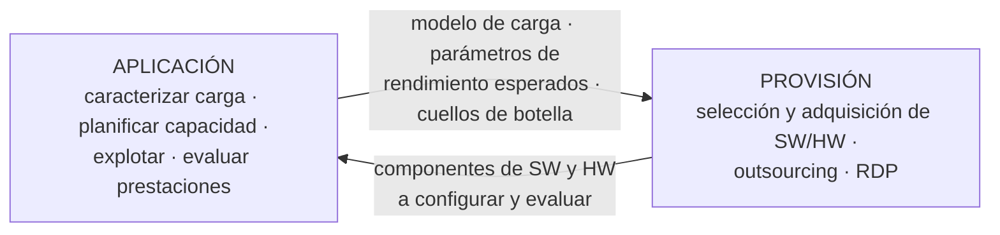

# Relación aplicación ↔ provisión de SI/TI (para pensar)

> Material de la **U2** (Provisión de SW y HW) usado solo para relacionar: [[01_AdmRR-Unidad2-SW-HW-Secc1.pdf|Secc. 1]] · [[02_AdmRR-Unidad2-SW-HW-Secc2.pdf|Secc. 2]] · [[03_AdmRR-Unidad2-SW-HW-Secc2-EjemploMEM.pdf|Ejemplo MEM]] · [[04_AdmRR-Unidad2-SW-HW-Secc3.pdf|Secc. 3]] · [[05_AdmRR-Unidad2-SW-HW-Secc3-Anexos.pdf|Secc. 3 Anexos]] · [[06_AdmRR-Unidad2-SW-HW-Secc4.pdf|Secc. 4]] · [[07_AdmRR-Unidad2-SW-HW-Secc5.pdf|Secc. 5]].

## Puntos de contacto con evidencia del material de U2
- **Provisión ← aplicación (carga):** las **características obligatorias** de una oferta son "el **mínimo requerido para cubrir la carga de trabajo proyectada** por el equipo de evaluación" (Secc. 1).
- **Selección de paquetes:** "requiere **obligatoriamente considerar la carga de trabajo representativa**"; los criterios se evalúan con cuestionarios "**y/o los resultados del benchmarking de paquetes**"; el criterio **performance** es el "**nivel de respuesta** del paquete, dependiendo de una carga de trabajo representativa" y siempre está **en conflicto con capacidad** (Secc. 2).
- **Pruebas de referencia:** los elementos tangibles (velocidad, capacidad) están sujetos a **tests de referencia**, que deben ajustarse al **uso real** (los vendedores pueden optimizar para el test) (Secc. 1).
- **Parámetros cuantitativos** de la evaluación de ofertas: medidas o proyecciones de capacidad (ej. **tps, tasa de transferencia, capacidad de almacenamiento**) — el mismo idioma que las variables de rendimiento (Secc. 1).
- **Dimensionamiento de HW:** el anexo de HW calcula cuántas impresoras hacen falta a partir de la **carga de trabajo** mensual de impresión de cada sector y su **capacidad neta** (Secc. 3 Anexos).
- **RDP:** se pide al oferente describir el potencial de **expansión** del HW y SW "que podría aumentar la **capacidad de carga de trabajo**" (Secc. 5).
- **Ubicación ↔ provisión:** "la elección de la estructura y la organización de los SI influye significativamente en las alternativas de selección"; los SI **delegados** difícilmente puedan proveer los elementos principales desde su experiencia interna (Secc. 1).

> [!example] Conclusión sugerida (II.13.b)
> La **aplicación dice qué y cuánto hace falta; la provisión lo consigue; la aplicación verifica que rinda.** Desde la aplicación se obtiene la **caracterización y el modelo de la carga**, de donde salen los **parámetros de rendimiento esperados** que la provisión debe exigir a las ofertas (características obligatorias, criterios de capacidad y performance, benchmarking). A su vez, la **planificación de la capacidad** y la **evaluación de prestaciones** detectan **cuellos de botella** futuros: si la **sintonización** no alcanza, se dispara una **nueva provisión** (ampliar o sustituir componentes, justificándolo con la [[Ley de Amdahl]]). Y los componentes provistos vuelven a la aplicación para ser **configurados, explotados y evaluados** con modelos de carga. Es la misma relación de ida y vuelta que en RRHH.

> [!info] Respuesta de alumnos en final
> "Desde la aplicación de SW y HW obtenemos una caracterización de la carga junto con un modelo de carga, que permite establecer parámetros de rendimiento esperados a tener en cuenta en la provisión. De la provisión obtenemos los componentes de SW y HW que se deberán someter a caracterización para obtener modelos de carga."

**Cuestionario:** responde la **II.13 (b)** (y es pregunta de final).

## 🔗 Relacionado
- [[Subsistema de aplicación de SI-TI]] · [[Planificación de la capacidad]] · [[Benchmarking]] · [[Caracterización de la carga]] · [[Aplicación y provisión de RRHH]]
