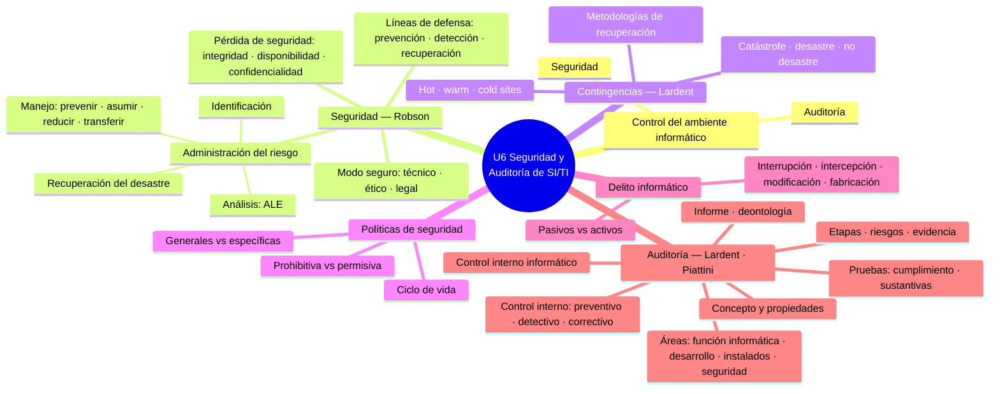
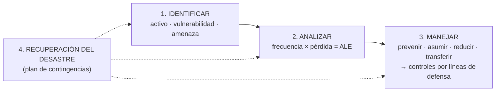

# ASI · U6 — Seguridad y Auditoría de los SI/TI (Súper Resumen)

> [!info] Datos de la unidad
> **Materia:** Administración de Sistemas de Información — 4° Nivel, ISI, UTN FRRe
> **Unidad:** La Administración de Recursos de SI/TI – Seguridad y Auditoría de Sistemas de Información
> **Bibliografía:** Robson T5 Cap. 13 "Management responsable de IS" (M1, Material de Estudio N° 7) · Lardent (2001) "Sistemas de Información para la Gestión Empresaria — Procedimientos, Seguridad y Auditoría" (M2) · Piattini & Del Peso (2006) "Auditoría Informática. Un enfoque práctico" (M3) · Apunte sistematizado de la cátedra y apuntes de clase de la Ing. Soria Ojeda (M4).
> **Etiquetas:** cada sección indica qué pregunta del cuestionario oficial responde con `[I.n]` (Parte I — Seguridad) o `[II.n]` (Parte II — Auditoría).
> **Fuentes de alumnos:** lo que proviene del *Complemento a los apuntes* (hecho con IA) está marcado como tal.

## 🗺️ Mapa de la unidad

---

# 1. Control del ambiente informático

## 1.1 Concepto y procesos de control

> [!quote] Definición (apunte sistematizado)
> El control del ambiente informático es el **conjunto conformado por la seguridad, la auditoría y los controles** aplicados sobre el **área de SI y sus recursos**, así como sobre **todos los sectores asociados al procesamiento de información** de la organización.

- El **ambiente informático** no es solo el departamento de procesamiento de datos: incluye los sectores que le **proveen datos**, que **usan** la información procesada o que **procesan localmente** y envían resúmenes al procesador central. Cualquier punto donde se procese información, **aunque sea en papel**, debe cumplir las pautas de control.
- **¿Por qué se controla?** Como **prevención de riesgos** (evitar pérdidas), para que las actividades se hagan **según procedimientos y normas**, y para **comprobar los niveles de servicio**.
- **Los procesos de control son dos:** la **gestión de la seguridad** de los SI/TI y la **auditoría** de los SI/TI.
- Según el Apunte Supremo, las dos metodologías de evaluación de sistemas son el **análisis de riesgos** (evalúa riesgos y recomienda acciones por costo-beneficio) y la **auditoría informática** (identifica el nivel de **exposición** por falta de controles).

→ [[Control del ambiente informático]]

---

# 2. Management responsable de IS (Robson)

## 2.1 Las tres cuestiones del modo seguro

> Preguntas: `[I.1]`

> [!quote] Robson, T5 Cap. 13
> "Nos centraremos en cuestiones que se relacionan con el management de los IS de un modo 'seguro'. Cuando nos referimos a los IS seguros, hablamos de: 'seguros' desde un punto de vista **organizacional**; 'seguros' desde un punto de vista **social, es decir, ético**; 'seguros' desde un punto de vista **judicial, es decir, legal**."

| Punto de vista | Contenido | Ejemplo |
|---|---|---|
| **Organizacional (técnico)** | Proteger los recursos de SI/TI con herramientas, formularios y procedimientos internos (el resto de la unidad) | Backups off-site, control de accesos, repositorios protegidos |
| **Social (ético)** | Uso correcto de la información según lo que la sociedad considera correcto | No usar datos de clientes para fines no informados |
| **Judicial (legal)** | Cumplir los **requisitos legales** de ciertos procedimientos | Ley de protección de datos; multas y juicios por filtraciones |

> [!important] Se superponen
> "El marco legislativo actual de los IS **codifica una perspectiva social de lo que es correcto**, es decir, de la ética. Mantener la seguridad de los IS puede plantear **dilemas legales y éticos**." Es frecuente que existan **obligaciones legales y morales** sobre el almacenamiento, procesamiento y recuperación de la información.

**En criollo:** la gestión de la seguridad es **gestionar los recursos de SI/TI de modo responsable**: técnicamente protegidos, éticamente usados y legalmente cumplidores.

→ [[Management responsable de IS]]

## 2.2 La pérdida de seguridad

> Preguntas: `[I.2]`

> [!quote] Robson
> "La **falla de los elementos de un sistema de información computarizado para realizar la función o brindar el o los servicios para los cuales estaba destinado**."

Dicha falla puede referirse a la pérdida de uno de estos aspectos **o de todos**:

| Aspecto | Qué destruye la pérdida |
|---|---|
| **Integridad** | La capacidad de **confiar en los datos** (o deja datos de **precisión incierta**) |
| **Operatividad / disponibilidad** | La capacidad, total o parcial, de **acceder** a datos e información |
| **Confidencialidad** | La **posesión exclusiva** de los datos → se pierde **poder y confianza**; cada rol debe acceder solo a lo que le corresponde |

- La pérdida de un aspecto **puede impactar en los demás**; el peor caso siempre es la **incertidumbre**.
- El manejo de la seguridad "se refiere a la **visualización y el management de los riesgos** en términos de las **causas, los efectos y los costos** que implica una pérdida de seguridad".
- Davis y Olson (1985): tras una pérdida de seguridad importante, la pregunta ya no es si la empresa sobrevive sino **en cuánto tiempo dejará de funcionar**.

→ [[Pérdida de seguridad]]

## 2.3 La administración del riesgo y su relación con la seguridad

> Preguntas: `[I.3]`

**Qué es:** de la definición de pérdida de seguridad "se desprende la noción de que las organizaciones necesitan **administrar el riesgo de exposición** de cada uno de los elementos de los IS. Este management deberá considerar el **equilibrio entre los costos resultantes de una falla en la seguridad y los costos de las medidas necesarias para aumentar la seguridad**. El punto central es identificar el **equilibrio óptimo**" (Robson).

> [!quote] Robson
> "El costo de tener seguridad queda relativamente claro de antemano, mientras que el costo de no tener seguridad puede ser difícil de definir, aun cuando las fallas ocurran. **El management del riesgo intenta reducir estas pérdidas.** [...] **Ningún sistema puede ser completamente seguro.** El management sistemático permite elegir e implementar las contra medidas de una forma **planeada y administrada, y no sobre una base ad hoc**."

**Relación con la seguridad:**
- **No se administra la seguridad en sí, sino el nivel de riesgo**: a menor riesgo, mayor seguridad.
- Premisas: **la seguridad total es imposible** (solo un **nivel razonable**) y se busca el **mejor manejo del riesgo** (equilibrio de costos).
- La administración del riesgo es **el mecanismo** que permite llegar a ese nivel razonable al menor costo neto; cualquier cambio en el portfolio de IS o en el entorno **mueve el punto de equilibrio** y obliga a revisarlo.

**Metodologías** (Robson): **CRAMM** (CCTA; la más usada; cuestionarios + software; consume mucho tiempo), **RiskPAC** (EE. UU.), **MARION** (Francia), **SRA** (Reino Unido). Todas modelan **amenazas y consecuencias** para calcular la gravedad del riesgo y equilibrarla con el costo de las contramedidas.

→ [[Administración del riesgo]]

---

# 3. Etapas de la administración del riesgo

> Preguntas: `[I.4]`

"Cualquiera sea la metodología que se siga, el management de la seguridad de los IS se reduce a **cuatro etapas**" (Robson):

| # | Etapa | Síntesis |
|---|---|---|
| 1 | **Identificación del riesgo** | Identificar **todos** los riesgos a los que la organización está potencialmente expuesta |
| 2 | **Análisis del riesgo** | **Cuantificar la probabilidad y frecuencia** de cada riesgo y la **gravedad** de sus consecuencias |
| 3 | **Manejo del riesgo** | **Seleccionar controles y contramedidas** para alcanzar la posición de seguridad óptima |
| 4 | **Recuperación del desastre** | Como ningún proceso es absoluto, **en paralelo** a las otras tres: **plan de contingencias** controlado, revisado y probado en forma continua |

## 3.1 Identificación del riesgo

- Requiere **conocimiento detallado del trabajo** de la organización + **reconocimiento de las áreas vulnerables**. Los **consultores externos** aportan amplio conocimiento (riesgo probable); el **personal interno**, comprensión profunda (amenazas específicas). Pregunta de Robson: **¿quién vigila a los que vigilan?**
- "Se trata de encontrar los **puntos débiles**": identificar **fuentes de amenazas potenciales**, **activos vulnerables a la pérdida** y **ubicación de esos riesgos** (orden de Robson). El apunte propone el orden activos → ubicación/vulnerabilidades → fuentes: "**tengo este activo, con esta vulnerabilidad, que puede sufrir esta amenaza**".
- **Matriz de toma de conciencia** (Fig. 13.3):

| | Físico | Lógico |
|---|---|---|
| **Accidental** | Fallas de equipos y de energía, relámpagos, inundación, incendio | Error del usuario, de programación, de configuración |
| **Deliberada** | Robo, sabotaje | Virus, piratería, fraude, hacking |

- Método alternativo por vulnerabilidad: **activo específico** ("¿qué le puede pasar a este activo en particular?") o **riesgo genérico** ("¿cómo somos vulnerables a este tipo de riesgo?").
- **La mayoría del hacking lo hace personal interno.** Vulnerabilidad según: **el personal**, **el tamaño de la red** y **la calidad (valor) de la transmisión de datos**. *Tiger teams*: expertos que irrumpen deliberadamente para exponer vulnerabilidades (plantean cuestiones éticas).

→ [[Identificación del riesgo]]

## 3.2 Amenaza, vulnerabilidad y riesgo

- **Amenaza:** condición del entorno (persona, máquina, suceso o idea) que, dada una oportunidad, podría producir una **violación de seguridad**. **Un ataque es la realización de una amenaza.**
- **Riesgo (ISACA):** potencial de que una amenaza **explote las vulnerabilidades** de un activo y ocasione **pérdida o daño**. Se relaciona con la **materialidad** (magnitud del error, en términos monetarios).
- **Elementos del riesgo:** activos · amenazas · **vulnerabilidades** (lo atacable) · **impactos** · **riesgo global** · **riesgo residual** (lo que queda tras los controles; muestra dónde falta control o dónde hay sobrecontrol).
- **Activos y su valuación (Robson):** hardware (fácil, suele estar asegurado) · software (su costo de reemplazo **no se relaciona con el costo de desarrollo**; incluye pérdida de capacidad) · **datos e información (la pérdida más seria y difícil de cuantificar)** · capacidad de procesamiento (la **duración** de la interrupción es clave) · personal (el costo **más pasado por alto**) · fondos.

→ [[Amenaza, vulnerabilidad y riesgo (definiciones)]]

## 3.3 Análisis del riesgo

> [!quote] Robson
> "Si la etapa de identificación del riesgo constituye una forma de '**pensamiento creativo y espontáneo**', entonces la etapa del análisis del riesgo es un **proceso más estructurado**, aunque a menudo de una manera **cualitativa y no cuantitativa**."

| Fórmula | |
|---|---|
| **Pérdida esperada** | **Pérdida potencial (en pesos) × Frecuencia de pérdida** |
| **Frecuencia de pérdida** | **Probabilidad de agresión × Probabilidad de éxito** ("agresión" = cualquier falla, no solo abuso humano) |
| **Exposición anual de pérdidas (ALE)** | **Costo de las consecuencias × Frecuencia** |

- Dos etapas: (1) **evaluar los costos empresariales** de una brecha; (2) **estimar la frecuencia** (de tablas de actuarios, evidencia empírica o cálculos razonados). Mejor **medidas relativas** (alto 70 %, mediano 50 %…) que "precisión espuria y engañosa". Ej.: incendio 50 % × 70 % = **35 %**; hacking 20 % × 50 % = **10 %**.
- **Tabla ALE** (Fig. 13.7): una baja de energía que cuesta **100 pesos** y ocurre **una vez al día** → **30.000 pesos/año** → se justifican contramedidas que cuesten **menos de 30.000 pesos anuales**. Si no se puede cuantificar: **matriz de gravedad de la amenaza** (ranking cualitativo, escala logarítmica). Se prioriza lo **frecuente** (rédito neto alto) y las **catástrofes absolutas**.
- Las pérdidas se relacionan con los **atributos de valor agregado** de la información: pérdida de **disponibilidad**, falla de **integridad/precisión**, pérdida de **confidencialidad**.
- "El análisis del riesgo establece **un lado** del punto de equilibrio óptimo; el manejo del riesgo elige el conjunto de contramedidas para ese **trueque óptimo**."

→ [[Análisis del riesgo]] · [[Tabla de pérdida anual (ALE)]]

## 3.4 Consecuencias primarias y secundarias

| Primarias (directas, inmediatas) | Secundarias (derivadas, tardías, más costosas) |
|---|---|
| Interrupción del procesamiento · corrupción de registros · destrucción de medios · uso de software no autorizado · revelación de información confidencial · desaparición de equipos, datos o software · pérdida de registros contables | Pérdida en la producción · retraso en entregas · problemas de flujo de efectivo · pérdida de confianza del cliente · impuestos imprecisos · información gerencial inútil · sanciones legales · incapacidad de continuar la función · pérdida de posición competitiva · **incapacidad de continuar con el negocio** |

- **Pérdida total = primarias + secundarias.** Las secundarias se valoran con **clasificaciones cualitativas**.
- **Doble ganancia:** si se minimizan las primarias (buena recuperación, backups), **también bajan las secundarias**.

→ [[Consecuencias primarias y secundarias]]

## 3.5 Manejo del riesgo

> [!quote] Robson
> "El manejo del riesgo consiste en la **aplicación de controles y contra medidas apropiadas para el riesgo, de acuerdo con el tiempo, el dinero y otros límites**." El propósito es identificar el "mejor" método: el **efectivo en cuanto al costo**.

| Estrategia | Qué es | Cuándo |
|---|---|---|
| **Prevenir** | **Evitar la amenaza** | Sistemas lejos de áreas peligrosas, datos en áreas protegidas, **no descentralizar**, antivirus |
| **Asumir** | Tolerar la pérdida esperada ("**reír y soportar**") | Riesgos de **bajo costo**; a menudo se adopta **inadvertidamente** |
| **Reducir** | **Controles y contramedidas** que bajan probabilidad y/o pérdida | **La más común**; solo si la baja en ALE **supera el aumento anual de costos** (desarrollo, operación, mantenimiento) |
| **Transferir** | Pasar el costo a un **tercero** (seguros, contratos de mantenimiento) | **Alto costo y baja probabilidad**, recuperación imposible |

- **Portfolio de management del riesgo:** conjunto **heterogéneo** de estrategias; se ordenan los riesgos por ALE descendente y los desastres son prioridad. Típico: prevención + transferencia para calamidades; asumir lo de pérdida muy baja; reducción + transferencia para el resto. Apunte: "**por cada riesgo, una sola estrategia**".
- La seguridad es un **tema estratégico**: si las pérdidas evitadas superan su costo, hay **contribución neta a las ganancias**. **Ley de disminución de ganancias**: cuanto más seguro, más caro el siguiente paso. Medidas **baratas y de espectro amplio** > caras y restringidas.
- La **política de seguridad** documenta el resultado de la identificación, el análisis y las estrategias elegidas (§5).

→ [[Manejo del riesgo (4 estrategias)]]

## 3.6 Controles y contramedidas

- Implementan las estrategias; se evalúan por **costo neto** y por los **nuevos riesgos** que generan.
- **Generales** (reducen la amenaza sobre todas las actividades de IS; costo **compartido**; un punto débil afecta a cualquier sistema) vs **de aplicación** (área específica; un **subconjunto** de los generales).
- **Capas de control** según: **plataforma de hardware** (tipo y cantidad de controles), **grado de distribución** (énfasis), **integración de la infraestructura** (naturaleza de las amenazas).
- **Lógicos** (desarrollo, integridad de datos y operaciones sin tropiezos; el más común y a menudo inadecuado: usuario + contraseña) vs **físicos** (personal, vigilancia, cerraduras, tarjetas; **más costosos, menos efectivos y generan resentimiento**).
- **Objetivo:** "crear una **situación equilibrada entre los costos de riesgo y los costos de control**"; si los controles no se ajustan **nivel por nivel** a las amenazas, la política es **ineficaz**. Un conjunto demasiado "pesado" desperdicia; uno demasiado "liviano" deja riesgo inaceptable.
- Ejemplos (Robson): **estándares de operatividad · división de responsabilidades · seguridad de la red · contraseñas · encriptación · antivirus · detección y prevención de incendios**.
- La seguridad de los IS **atañe a toda la organización** y requiere participación de la **gerencia superior** (ej.: Courtney vincula delitos y salarios).

→ [[Controles y contramedidas]] · [[Controles y contramedidas específicos (Robson)]]

## 3.7 Las líneas de defensa

| Línea | Etapa | Ejemplo (Robson) |
|---|---|---|
| **1ª** | **Prevención**: evitar que la amenaza ocurra | Prohibir fumar en el centro de datos; políticas de seguridad |
| **2ª** | **Detección**: detectar la falla a pesar de la 1ª línea | Detector de humo; registro de intentos fallidos |
| **3ª** | **Recuperación**: volver a la normalidad con pérdidas mínimas | Backups de datos off-site |

- **Son los controles y contramedidas** para **evitar, reducir o transferir** el impacto del riesgo, organizados según su intención. Se aplican a **cada capa y cada elemento** (Fig. 13.14: bloquean los efectos de la amenaza en cada eslabón hacia las pérdidas).
- Una herramienta puede cubrir las tres: el software de autorización **previene**, **registra** ingresos fallidos y usa **encriptación** para minimizar el daño.
- Equivalen a la clasificación de control interno de Lardent: **preventivos · detectivos · correctivos** (§8.1).

→ [[Líneas de defensa]]

---

# 4. Recuperación ante el desastre y plan de contingencias

## 4.1 Planificación de contingencias según Robson

> [!quote] Robson
> La recuperación "**asume que la prevención total del riesgo es poco práctica o imposible**" y que la empresa debe planificar cómo enfrentar las rupturas de seguridad y recuperarse: esto es la **planificación de contingencias**, que incluye **métodos de trabajo para sobrevivir al desastre** y **procesos a largo plazo** para recuperarse.

- **Etapa 1:** incrementar la seguridad, minimizar daños y facilitar el regreso al trabajo. **Etapa 2:** minimizar los **efectos secundarios**.
- Términos: **tiempo de inhabilitación** · **respaldo o mantenimiento** (operar con sistemas clave) · **reinstalación** (actualizar con lo generado durante la inhabilitación).
- "Cuando las consecuencias del riesgo son bajas, **la prevención no es mejor que la cura**": la recuperación puede ser una estrategia en sí.
- **Primer paso:** clasificar sistemas y aplicaciones según la **necesidad del negocio** (tolerancia) → **cronograma de prioridades** basado en la **importancia del negocio, no en la dificultad técnica**. El plan debe cubrir **todos** los aspectos del uso y management de los IS; es parte del **management estratégico**.
- **Dos problemas:** mantenerse actualizado con los **tipos de desastre** y con los **cronogramas de prioridades**.
- La continuidad depende de la **disponibilidad de los datos** → **backups off-site** (que se hagan, se prueben y se guarden fuera). El **80 %** de los planes falla en la primera prueba. **Todos los enfoques de desarrollo deben ofrecer puntos de recuperación.**
- **Soluciones de respaldo:** instalaciones **de emergencia** (todo instalado, inmediato), **intermedias** (centro vacío pero equipado, más barato y lento), **móviles** (vehículos o prefabricados).

→ [[Recuperación ante el desastre]]

## 4.2 El plan de contingencias según Lardent

- **Formular el plan** = definir planes para sobrevivir a un desastre y procesos de recuperación, previendo **tiempo de inhabilitación, respaldo, reinstalación y tolerancia del sistema**. Es responsabilidad de la **gerencia superior**.
- **Evaluación de riesgos:** probabilidad de **desastre** (suceso incierto que puede interrumpir seriamente la operación); clasificar por **sensibilidad al tiempo**; **tolerancia** expresable en dinero; **lapso crítico de recuperación** (hasta cuándo se puede extender una interrupción antes de incurrir en pérdidas).
- Las organizaciones **muy automatizadas** enfrentan **mayores riesgos**.
- **Contenido del plan:** orden de **prioridades de recuperación** según tolerancia · orden de procesamiento de tareas complejas · **acoplamiento manual** en interrupciones cortas · equipos de **todo** el ambiente informático y personal entrenado · **hardware alternativo** · **telecomunicaciones** (rutas alternativas y diversificadas) · **sede alternativa** para backups y documentación. (Soria agregó **telecomunicaciones y redes de energía**.)

→ [[Plan de contingencias]]

## 4.3 Niveles de emergencia y hardware alternativo

| Nivel | Qué es | Respuesta |
|---|---|---|
| **Catástrofe** | Destrucción de las instalaciones | Instalación alternativa transitoria + equipar una nueva |
| **Desastre** | Más de un día, con posibilidad de volver a la instalación original | Instalación alternativa con copias guardadas fuera |
| **No desastre** | Menos de un día (falla de dispositivo o software) | Corrección inmediata |

**Hardware alternativo (Lardent):** **centro duplicado propio** (crítico, eficaz, costoso) o **centros de terceros**: **hot site** (completo, activación rápida), **warm site** (parcial, suele faltar la CPU; más barato), **cold site** (solo el lugar físico, sin infraestructura).

→ [[Niveles de emergencia (catástrofe, desastre y no desastre)]] · [[Hardware alternativo y sitios de respaldo]]

## 4.4 Metodologías de recuperación y rol del auditor

**Pasos en la emergencia:** **protección de la vida humana** → evaluación de daños y tiempos → coordinación (datos vitales y críticos, reconstruir BD, software en sede alternativa) → restaurar software de base y de aplicación → recuperar telecomunicaciones → preparación de datos y registro → almacenamiento en sede alternativa → condiciones de seguridad → apoyo administrativo y balanceo de datos → aspectos legales.

**El auditor en la continuidad:** evaluar el plan (adecuación, actualización, desastres de distinto grado, **tolerancia por aplicación**) · inventario de la sede alternativa · capacitación del personal · mecanismos de **fusión de datos** del período de emergencia · seguridad física de la instalación alternativa · **contrato** de procesamiento alternativo · resultados de **pruebas anteriores** · **cobertura de seguros**.

→ [[Metodologías de recuperación]] · [[Auditoría de la continuidad de las operaciones]]

---

# 5. Políticas de seguridad

## 5.1 Concepto y clasificación

> Preguntas: `[I.5]`

> [!quote] Definición (apunte de la profesora)
> "El conjunto de **requisitos definidos por los responsables directos o indirectos de un sistema** que indica, **en términos generales, qué está permitido y qué no** en el área de seguridad durante la operación general de dicho sistema."

> [!quote] Robson
> "Una política de seguridad define el **nivel de seguridad que se ajusta al valor de lo que se debe proteger y al gasto e inconveniencia de las medidas de protección**. Esas políticas **documentan el resultado de la identificación y el análisis del riesgo, y de las estrategias elegidas** para manejarlo."

- Son **medidas preventivas** → **primera línea de defensa**.
- **Por su amplitud:** **generales** y **específicas** (por activo, situación o perfil de usuario: "de aplicación específica", funcionan como **reglas**). Ej.: "atención al cliente no puede cambiar el estado de un cliente; lo hace el jefe de sección".
- **Por su tipo:**

| Prohibitiva | Permisiva |
|---|---|
| **Todo lo que no está expresamente permitido está denegado** | **Todo lo que no está expresamente prohibido está permitido** |
| "Al área de TIC solo entra el personal del área"; "internet solo para sitios de trabajo" | "No se puede tomar mate en el laboratorio" (café sí); "no se permiten USB personales" |
| **Más restrictiva y más efectiva en seguridad** | Más libertad |

- **Contenido mínimo** (Saunders, en Robson): **protección, valor, acceso y recuperación** de la información; suele incluir tablas con la estrategia para cada amenaza.

→ [[Políticas de seguridad]]

## 5.2 Los seis elementos clave

Toda política debe contemplar: **disponibilidad** (recursos disponibles cuando se necesitan) · **utilidad** (útiles para alguna función) · **integridad** (tal como lo almacenó un agente autorizado) · **autenticidad** (el sistema verifica a los usuarios y viceversa) · **confidencialidad** (solo agentes autorizados) · **posesión** (los propietarios controlan el sistema en todo momento).

## 5.3 Política, estándar, mejor práctica, guía y procedimiento

| Instrumento | Qué es | Obligatorio |
|---|---|---|
| **Política** | Declaración general de principios de la administración; largo plazo; **pocas** y aprobadas por la autoridad | Sí (excepciones aprobadas) |
| **Estándar** | Regla que especifica una acción ante una situación; **especifica cómo cumplir la política** | Sí |
| **Mejor práctica** | Regla específica de una **plataforma**, aceptada en la industria | Uniformidad |
| **Guía** | **Recomendación** de enfoque | No (salvo argumento documentado) |
| **Procedimiento** | **Cómo** se implementa todo lo anterior en una situación; lo hace el **dueño del proceso** | Sigue a los anteriores |

Ejemplo: política "garantizar la seguridad del correo confidencial" → estándar "criptografía aprobada y borrado seguro" → mejor práctica "configuración en Windows/Linux" → procedimiento "en la Oficina de Control Interno" → guía "técnicas y comandos recomendados".

→ [[Jerarquía normativa de seguridad (política, estándar, mejor práctica, guía y procedimiento)]]

## 5.4 Ciclo de vida de una política

**Desarrollo** (creación, revisión, aprobación) → **Implementación** (comunicación, cumplimiento, excepciones documentadas) → **Mantenimiento** (concientización, monitoreo, garantía de cumplimiento, mantenimiento —la política es contingente—) → **Eliminación** (retiro).

→ [[Ciclo de vida de una política de seguridad]]

---

# 6. Delito informático y ataques

## 6.1 Definición de delito informático

> Preguntas: `[I.6]`

> [!quote] Definición (apunte sistematizado)
> "Se denomina delito informático a **toda acción culpable realizada por un ser humano** que **cause perjuicio a otras personas** —sin que necesariamente se beneficie el autor— o que, por el contrario, **produzca un beneficio ilícito a su autor** aunque no perjudique de forma directa o indirecta a la víctima; está **tipificada por la ley**, se realiza **en un entorno informático** y está **sancionada con una pena**."

Claves: **humano** · **culpable** · **perjuicio o beneficio ilícito** · **tipificado** · **entorno informático** · **pena**. El sistema puede ser **medio** o **fin** del delito *(Complemento)*.

→ [[Delito informático]]

## 6.2 Clasificación de los ataques

"**Un ataque no es más que la realización de una amenaza.**"

| Categoría | Ataca | Ejemplo |
|---|---|---|
| **Interrupción** | Disponibilidad | Destruir un disco, cortar una línea |
| **Intercepción** | Confidencialidad | Pinchar una línea, copiar ficheros, leer cabeceras (identidad) |
| **Modificación** | Integridad | Cambiar valores de un archivo, alterar un programa o mensaje |
| **Fabricación** | Autenticidad | Insertar mensajes espurios o registros falsos |

- **Pasivos:** solo **escuchan o monitorizan** (intercepción de datos, **análisis de tráfico**); **muy difíciles de detectar**; se evitan con **cifrado**.
- **Activos:** modifican el flujo o crean uno falso → **suplantación de identidad**, **reactuación** (repetir mensajes legítimos), **modificación de mensajes** (alterar, retardar, reordenar), **degradación fraudulenta del servicio** (suprimir o inundar).

→ [[Tipos de ataques contra los SI]]

## 6.3 Artífices y modalidades

> Preguntas: `[I.6]`

- **Respaldado por Robson:** la **mayoría del hacking la realiza personal interno**; el hacking es la **entrada no autorizada o su intento**, muchas veces por curiosidad, pero una vez dentro el intruso puede robar, modificar resultados, implantar virus o alterar datos; la **piratería** y el **fraude** son amenazas deliberadas lógicas.
- **Modalidad (cátedra):** los ataques de §6.2 (pasivos y activos).
- *(fuente: Complemento a los apuntes — no es material de cátedra)* **Artífices:** personal interno y ex empleados, hackers, crackers, phreakers, piratas informáticos, lamers/script kiddies, intrusos remunerados/espías/ciberterroristas. **Técnicas:** manipulación de datos de entrada, caballo de Troya, técnica del salami, bombas lógicas, puertas falsas, llave maestra (*superzapping*), suplantación e ingeniería social, recolección de residuos, pinchado de líneas y reactuación.

→ [[Artífices y modalidades del delito informático]]

---

# 7. Auditoría de sistemas de información

## 7.1 Concepto general de auditoría

> [!quote] Definición (apunte de clase)
> "Es la **emisión de una opinión profesional y fundamentada** (en procedimientos preestablecidos) **sobre una información concreta** recogida en un determinado soporte, **plasmada en un informe** cuyo fin es determinar si dicha información **presenta adecuadamente la realidad** o si **responde a las expectativas** (objetivos de funcionamiento, rendimiento, fiabilidad) que se le atribuyen."

| Contenido | Condición | Justificación | Objeto | Finalidad |
|---|---|---|---|---|
| Una **opinión** | **Profesional** | **Procedimientos** | Información en un soporte (informe) | Su **fiabilidad** |

- Tipos: **financiera, administrativa, de RR. HH., de calidad, operativa, de SI**. Auditoría **global** = contable + operativa (la de sistemas forma parte). Auditoría **general** = externa + interna (coordinadas).
- **Controles buenos → pruebas de cumplimiento; controles débiles → más pruebas sustantivas.**
- **Auditoría ≠ certificación** y **auditoría ≠ seguridad**.

→ [[Auditoría — concepto y tipos]]

## 7.2 Auditoría de SI según Lardent

> Preguntas: `[II.1]`

> [!quote] Lardent (según el apunte)
> "La auditoría de sistemas de información ha sido definida como la **revisión sistemática y organizada de los sistemas en funcionamiento** para ver si ellos verifican las propiedades de: **vigencia** de los objetivos planteados como base del diseño original; **concordancia** del sistema con los objetivos (**efectividad**); **permanencia del diseño** por no haber sufrido alteraciones que lo degradaran operativamente; **eficiencia** del sistema (costo-beneficio)."

- Es un **componente de la Auditoría General**. Algunas versiones del apunte agregan **seguridad** como quinta propiedad.
- **Finalidad:** operatividad **efectiva (fiable) y segura según las normas** (ej.: Banco Central). "Una información errónea ya no es información."
- **Debe asegurar:** pistas de auditoría · controles de entrada e integridad · manejo de excepciones y rechazos · cumplimiento de políticas y reglamentos · comportamiento según lo definido · interconexión · **modificaciones autorizadas** · condiciones de seguridad.
- **Auditoría informática (Piattini):** "proceso de **recolección y evaluación de evidencias** para determinar cuándo se **salvaguardan los activos**, se mantiene la **integridad de los datos**, se logran **eficazmente los objetivos** y se usan **eficientemente los recursos**".
- **Objeto de audito:** recursos informáticos, la **función de SI** (la gerencia de sistemas), aplicaciones, proyectos, planes de contingencia, almacenamientos de datos.

→ [[Auditoría de sistemas de información]]

## 7.3 Auditoría interna y externa

| | **Interna** | **Externa** |
|---|---|---|
| Auditor | **Con vínculo laboral** | **Sin vínculo laboral** (informático y/o contador) |
| Fin | Informes y sugerencias; **auxiliar de la dirección** | **Opinión independiente** para terceros |
| Informe | **Circulación interna**; reporta al **más alto nivel** | Destinado a terceros; **fe pública**, implicancias legales, certificaciones |
| Frecuencia | **Permanente**, con cronograma | **Puntual** |
| Autoridad | **Staff** (asesora), sin autoridad de línea | Designada desde afuera |

**Independencia de criterio** en la interna: por **estructura** (autoridad suficiente, no depender de la gerencia auditada) y por **objetividad** (no participar en desarrollar lo que luego evaluará, aunque **sí** en definir los **puntos de control**).

→ [[Auditoría interna y externa]]

---

# 8. Control interno

## 8.1 Concepto y clasificaciones de control

> Preguntas: `[II.2]`

> [!quote] Definición clásica (cuestionario, apunte)
> "El control interno comprende el **plan de organización, los métodos coordinados y las medidas** adoptadas dentro de una empresa para **salvaguardar sus activos**, **verificar la confiabilidad y corrección de los datos** contables, **promover la eficiencia operativa** y **fomentar la adhesión a las políticas** administrativas."

> [!quote] Definición operativa (apunte)
> "**Cualquier actividad o acción, realizada manual o automáticamente, para prevenir o corregir errores o irregularidades** que puedan afectar el funcionamiento de un sistema para cumplir sus objetivos." Se asemeja a las **líneas de defensa**.

**Clasificación por intencionalidad (Lardent):**

| Tipo | Qué hace | Ejemplo |
|---|---|---|
| **Preventivo** | **Evita** el error, la omisión o el acto malicioso | Control de acceso lógico a archivos sensibles solo para autorizados y desde lugares autorizados; segregar tareas |
| **De detección** | **Detecta e informa** que ocurrió; actúa cuando fallan los preventivos | Software que **registra los intentos de acceso no autorizado** |
| **Correctivo** | **Corrige** y restablece el funcionamiento (los que corrigen y los que recuperan) | Campo de fecha que corrige el formato; **recuperar un archivo desde el backup** |

**Otras clasificaciones:** por **alcance** — **generales** vs **de aplicación/específicos**; por **naturaleza** — **lógicos** vs **físicos**; por **ejecución** — **manuales** vs **automáticos**. Los controles deben ser **completos, simples, fiables, revisables, adecuados y rentables** (Piattini). Todo control interno da solo **seguridad razonable**.

→ [[Control interno]]

## 8.2 Control interno informático (Piattini)

- **Como unidad organizativa:** el área que **controla diariamente** que las actividades de SI/TI cumplan **procedimientos, estándares, normas y requerimientos legales**. **Misión:** que las medidas implementadas sean **correctas y válidas**.
- **Objetivos:** colaborar con las auditorías (les da el **principal insumo**) · controlar el cumplimiento · asesorar · intervenir en los **niveles de servicio** · controlar actividades operativas (**cambios de versiones**, **producción diaria**, calidad en desarrollo y mantenimiento, redes y software de base, seguridad, **licencias y outsourcing**).
- **Implantación:** (1) **conocer el entorno** (red, ordenador base, aplicaciones, productos y herramientas, seguridad del ordenador base); (2) **definir**: gestión de SI (políticas y normas técnicas), administración de sistemas (centros de datos, redes), seguridad (**integridad, confidencialidad, disponibilidad**), **gestión del cambio** (separar pruebas de producción; migración controlada; preserva el diseño original).
- **Roles:** Dirección de SI → **política**; Dirección de Informática → **normas, estándares, procedimientos**; CII → **controles periódicos**; auditor → **revisa** controles y cumplimiento. Crear el sistema de control es **responsabilidad de la Gerencia**.

→ [[Control interno informático (Piattini)]]

## 8.3 Auditoría informática vs control interno informático

| | **Control interno informático** | **Auditor informático** |
|---|---|---|
| Momento | **Día a día** | **Un momento determinado** |
| Informa a | **Dirección de Informática** | **Dirección General** |
| Personal | **Solo interno** | Interno o externo |
| Alcance | **Departamento de Informática** | **Todos los componentes de SI** |

**Similitudes:** personal especializado en TI; verifican cumplimiento de controles, normativa y procedimientos. **Auditoría (Piattini):** vigilancia y evaluación **mediante dictámenes**, plan auditor, metodologías **cualitativas**, **planes quinquenales**, repetición según exposición y último resultado. **CII:** funciones propias (seguridad lógica), **control dual**, función **normativa**. "El CII vive en el día a día; la auditoría llega después, toma muestras y dictamina."

→ [[Auditoría informática vs control interno informático]]

---

# 9. Planificación y ejecución de la auditoría

## 9.1 Etapas y plan de auditoría

- **ISACA:** **planeación** → **trabajo de campo y documentación** → **reporte y seguimiento**.
- **Seis pasos (clase):** (1) **alcance y objetivos** respecto del objeto (qué entra, para qué) · (2) **estudio inicial del entorno** (controles clave, fuentes de evidencia; reduce el riesgo inherente) · (3) **programa de revisión** · (4) **cierre** (evidencias y hallazgos) · (5) **informe final** (favorable, con salvedades o no conformidades; **firmado**) · (6) **seguimiento** de recomendaciones.
- **Planificación (Lardent):** **conocimiento del negocio y su ambiente** (incluido el normativo: recorridas, entrevistas, planes estratégicos) y **evidencia y auditabilidad**; determinar **área**, **objetivo**, **alcance** y **recursos**. Prioridad de áreas según impacto en el negocio, activos controlados, dimensión e impacto en decisiones.

→ [[Etapas de la auditoría (plan y programa de revisión)]]

## 9.2 Riesgos de auditoría

Posibilidad de que la información contenga **errores materiales** o de que el auditor **no los detecte**:
- **Inherente:** por la **naturaleza de la actividad**; el auditor no lo elimina; se reduce con el **estudio inicial** y especialización.
- **De control:** el **sistema de control interno** no evitó ni detectó el error; se reduce con las **recomendaciones**.
- **De detección:** pruebas "exitosas" con **procedimientos inadecuados**; **exclusivo del auditor**.

→ [[Riesgos de auditoría (inherente, de control y de detección)]]

## 9.3 Programa de revisión, procedimientos y evidencia

- **Programa de revisión:** "**conjunto de instrucciones que guía a los auxiliares** y sirve para **controlar y registrar** la ejecución del trabajo"; **flexible**; deriva del plan general; **uno por área**; detalla procedimientos, objetivos, **fuentes de evidencia**, **equipo**, programa de trabajo (pruebas, tiempos estimado y real, **papel de trabajo**, rúbrica, fecha) y situaciones de decisión.
- **Procedimientos (Soria Ojeda):** fundamento y justificación de la opinión; dan **seguridad razonable** y determinan la **trascendencia**. Se establecen para planificar y supervisar, evaluar el control interno y obtener **evidencia suficiente y adecuada**.
- **Evidencia:** todo dato, documento, registro o testimonio para determinar el cumplimiento de los criterios. Calidad: **relevante, fiable, suficiente (cuantitativa), adecuada (cualitativa)**. Más confiable si es **externa**, **objetiva** y de **buena fuente**. **Las pruebas son el método para obtener la evidencia.**

→ [[Procedimientos y evidencia de auditoría]]

## 9.4 Tipos de pruebas

> Preguntas: `[II.3]`

| | **Cumplimiento** | **Sustantivas** |
|---|---|---|
| Objeto | ¿Los controles se ajustan a **políticas y procedimientos** y se aplican **según la documentación**? | ¿Los controles **protegen de actividades fraudulentas**? ¿El sistema procesa bien? |
| Insumo | **Documentación** | **Tratamiento de la información** (herramientas informáticas) |
| Subtipos / ejemplos | **De detalle** (revisar documentos; verificar que el programa en uso sea la misma versión que la de la biblioteca) · **De indagación y observación** (entrevistar al personal y volver a observar; simular errores de ingreso) | **Procesamiento en paralelo** en dos servidores y comparar; **cruce de datos**; revisar cómo se hacen los backups; inventario de la biblioteca de cintas |

→ [[Tipos de pruebas de auditoría]]

## 9.5 Informe de auditoría

- **Comunicación formal** del auditor al cliente sobre **alcance** y **resultados**; separa lo significativo según el riesgo; sin formato vinculante.
- **Estructura (Lardent):** introducción · hallazgos y recomendaciones (con fuentes de evidencia) · acciones correctivas · **opinión** (respaldada por evidencias) · anexos. **Soria: primero la opinión, después los hallazgos.**
- **Tipos:** **sin salvedades** · **con salvedades** · **con opinión adversa** · **sin opinión** (alcance limitado o posible disolución).

→ [[Informe de auditoría]]

## 9.6 Deontología del auditor

- Principios y reglas éticas que fijan los **deberes mínimamente exigibles**. Destacados: **beneficio del auditado** (sin prejuicios) e **independencia de criterio** (no auditar nada con lo que se tenga vínculo; en la interna, garantizada por la estructura: no depender de la gerencia auditada, sin autoridad lineal, no subordinado al CII, fuera del área de desarrollo).
- V/F típico: "el responsable de sistemas debe participar en todos los procedimientos de auditoría" → **Falso**.

→ [[Deontología del auditor]]

---

# 10. Áreas de auditoría

> Preguntas: `[II.4]`

## 10.1 Objetos y áreas según Lardent

1. **Función informática** (organización y administración del ambiente informático).
2. **Sistemas y procedimientos:** a) **desarrollo**; b) **sistemas instalados**.
3. **Proceso de datos**, sistemas y equipos.
4. **Seguridad** (un objeto de audito más).
5. **Aspectos legales** de los sistemas y de la información.

Aspectos a revisar: controles generales · operaciones de procesamiento · seguridad lógica y física · software del sistema operativo · metodología de desarrollo · controles del software de aplicación · plan de contingencias. Piattini & Del Peso recorren además auditoría física, ofimática, de la dirección, explotación, desarrollo, mantenimiento, bases de datos, técnica de sistemas, calidad, seguridad, redes, aplicaciones, EIS/DSS y jurídica.

→ [[Objetos y áreas de la auditoría de SI]] · [[Otras áreas de auditoría (Extras del apunte)]]

## 10.2 Auditoría de la función informática

| | |
|---|---|
| **i. Concepto** | Analizar la **organización y la administración del ambiente informático**: recursos de TI **bien gestionados, alineados** con los objetivos y operando de forma **eficiente y efectiva**; corresponde al **área de sistemas** |
| **ii. Funciones del auditor** | Comprender el ambiente (áreas que procesan información, asignaciones y responsabilidades) · evaluar la **estructura organizacional** y su adecuación a las políticas · evaluar el **ambiente de control** · **probar controles** · detectar **debilidades** de gestión. Propósitos: **separación de funciones**, protección de archivos, buen diseño de control interno, **niveles de autorización**, **estándares de actuación**, **formación del personal** |
| **iii. Elementos a auditar** | **Plan de organización** (división de responsabilidades) · **segregación de funciones** · **ambiente informático** (ampliado: políticas, estructura, acceso físico, documentación, personal, funciones de proyecto, procesamiento y **soporte técnico**, estándares, controles) |

**Separación de funciones:** ningún individuo debe configurar, implementar y vigilar los controles **y** usar los sistemas (Robson); si una persona domina todas las operaciones del centro de cómputos, **aumenta el riesgo de fraude** (Lardent); una **función incompatible** es la que no está debidamente separada.

→ [[Auditoría de la función informática]] · [[Separación de funciones]]

## 10.3 Auditoría del desarrollo de sistemas

| | |
|---|---|
| **i. Concepto** | **Lardent:** identificar, analizar y evaluar los **requerimientos del usuario**, los **riesgos**, las exposiciones y los **controles** a incorporar durante el desarrollo. **Piattini:** la función auditora **comprueba la existencia** de procedimientos de control y **verifica su definición y aplicación**, determinando deficiencias y riesgos. **Lo importante: los puntos de control.** "Se audita para mejorar." |
| **ii. Funciones del auditor (Lardent)** | Determinar objetivos y requerimientos de usuarios · **clasificar riesgos** · identificar **controles necesarios** · **asesorar** sobre controles y **módulos de auditoría** (pistas) · asegurar que se siga la **metodología** · verificar la **factibilidad**. El que asesora **no** debe ser quien luego audita |
| **iii. Elementos a auditar** | **Plan maestro** · **estudio de factibilidad** · documentación · **ERS** · metodología · cada fase (requerimientos, diseño lógico, diseño físico, prueba, implantación, posinstalación) · adquisición · modificación de programas |

**Cuatro niveles de Lardent:** revisión del **ciclo de vida** (plan maestro → factibilidad → fases) · **documentación** · **adquisición** de software (solvencia, código fuente y propiedad, documentación, satisfacción, actualizaciones) · **modificación de programas** (autorización, trazabilidad, concordancia fuente–objeto, documentación).

→ [[Auditoría del desarrollo de sistemas]]

## 10.4 Cuadro comparativo Lardent vs Piattini

> Preguntas: `[II.5]`

| Criterio | **Lardent** | **Piattini & Del Peso** |
|---|---|---|
| Objetivo | Identificar, analizar y evaluar requerimientos, riesgos y **controles a incorporar** | **Comprobar existencia** y **verificar** definición y aplicación de procedimientos de control |
| Estructura | **Propuestas generales**: qué revisar, no cómo → **flexible** | **Pasos definidos**, listas de verificación → **estructurado** |
| Metodología | Áreas con **puntos de control** | **ISACA**: riesgos → objetivos de control → técnicas → **pruebas de cumplimiento** |
| Rol del auditor | **Asesor activo** en la definición de puntos de control (otro audita después) | **Verificador** del grado de cumplimiento |
| Alcance | **4 niveles**: ciclo de vida (hasta posinstalación), documentación, adquisición, modificación | **Doble foco**: organización y gestión del área (**8 objetivos de control, niveles A–G**) + **proyectos** (aprobación, planificación y gestión; análisis, diseño, construcción, implantación); **sin** explotación ni mantenimiento |
| Mirada | **Institucional/organizacional**: productividad, costos, normativa | **Técnica**: ingeniería de software y calidad |
| Fuente | Lardent (cap. citado en el apunte: 25) | **Cap. 12 "Auditoría del desarrollo"** (no "cap. 22", como dicen los apuntes de clase) |

→ [[Auditoría del desarrollo — Lardent vs Piattini]]

## 10.5 Auditoría de sistemas de aplicación instalados

| | |
|---|---|
| **i. Concepto** | Auditoría de las aplicaciones **en operación**: funciones de **captura/ingreso, procesamiento, almacenamiento y salida**, con controles que aseguren datos **completos, exactos, válidos, autorizados y por única vez**, actualización oportuna, procesamiento **a tiempo y según el diseño**, datos protegidos y salidas que cumplan las expectativas |
| **ii. Funciones del auditor** | Comprender cada aplicación (componentes y **flujo de datos**) · evaluar controles (**fortalezas y debilidades**) · **probar** controles · evaluar el ambiente de control · analizar **eficiencia y eficacia** vs estándares de programación · verificar el cumplimiento de **objetivos de la gerencia** |
| **iii. Elementos a auditar** | **Entrada y captura** · **procesos y métodos de procesamiento** · **control de la salida** (y archivos/BD, validaciones) |

Se les hacen sobre todo **pruebas sustantivas**.

→ [[Auditoría de sistemas de aplicación instalados]]

## 10.6 Auditoría de seguridad y técnicas de evaluación

| | |
|---|---|
| **i. Concepto** | Rama especializada que verifica el funcionamiento **correcto, eficaz y eficiente** con foco en seguridad **física, lógica, de redes y de desarrollo y mantenimiento**, y el cumplimiento de **políticas, normas y estándares** |
| **ii. Funciones del auditor** | Evaluar **controles de acceso** · comprobar protección contra **ataques** · revisar **políticas**, **encriptación** y **backups** · verificar **normativas** (ISO 27001, privacidad) · revisar la **continuidad** |
| **iii. Elementos a auditar** | Accesos · amenazas externas e internas · políticas · **plan de recuperación** y copias · cumplimiento normativo |

**Técnicas de evaluación y auditoría** (con o sin computadora): verificación de la **segregación de funciones**, revisión de la **documentación de sistemas** y un **plan de documentación** (problema, descripción del sistema y de los programas, registros y diccionarios, instrucciones de operación, **descripción de controles**, **registro de aceptación**). Se dictan en forma coordinada con **Ingeniería de Software**.

→ [[Auditoría de seguridad]] · [[Auditoría de la continuidad de las operaciones]]

---

# 11. Laboratorio — líneas de defensa sobre un análisis de riesgo

Consigna: **"Diseño e implementación de esquemas de líneas preventivas, de detección y recuperación de accesos a recursos sobre la base de un análisis de riesgo para un caso de estudio."**

1. Listar **activos** y su ubicación. 2. **Identificar** (activo–vulnerabilidad–amenaza; matriz físico/lógico × accidental/deliberada). 3. **Analizar** (frecuencia × pérdida → ALE). 4. Elegir **una estrategia por riesgo**. 5. Diseñar, por recurso, controles de **prevención** (perfiles, política prohibitiva, firewall, cerraduras), **detección** (logs, intentos fallidos, alarmas) y **recuperación** (backups off-site, restauración, sitio alternativo). 6. Estimar el **riesgo residual** y redactar la **política**. 7. **Verificar** con pruebas de cumplimiento y sustantivas.

→ [[Guía del laboratorio U6 (líneas de defensa sobre análisis de riesgo)]]

---

# 12. Cierres y conclusiones para las preguntas de elaboración

> Preguntas: `[I.1]` `[I.3]` `[II.4]` `[II.5]`

> [!example] ¿Cuándo funciona el management de SI en modo seguro? (conclusión sugerida)
> Cuando los IS son seguros desde los **tres puntos de vista** de Robson a la vez: **organizacional/técnico** (recursos protegidos con controles elegidos por un análisis de riesgo), **social/ético** (uso correcto de la información) y **judicial/legal** (cumplimiento de las obligaciones legales). Como los tres **se superponen** —la ley codifica la ética y la ley muchas veces exige medidas técnicas—, una falla en uno arrastra a los otros: una filtración por un repositorio desprotegido es a la vez una falla técnica, una exposición a multas y juicios y un dilema ético sobre cómo informar a los afectados.

> [!example] Administración del riesgo y seguridad (conclusión sugerida)
> Como la **seguridad total es imposible**, la organización no "administra la seguridad" sino el **nivel de riesgo**. La administración del riesgo identifica, analiza y maneja los riesgos (y planifica la recuperación) buscando el **equilibrio óptimo** entre el costo de las pérdidas y el costo de los controles. Por eso la seguridad deja de verse como gasto y pasa a ser un **tema estratégico**: si las pérdidas evitadas superan el costo de las medidas, hay **contribución neta a las ganancias**.

> [!example] Interacciones del subsistema de seguridad y auditoría con el seguimiento de recursos (pregunta de final)
> 1. Los **resultados de la monitorización** de los sistemas (monitores, U3) sirven como **evidencia de vulnerabilidades** (picos de carga anómalos, accesos fuera de horario) → alimentan la identificación del riesgo y la detección (2ª línea).
> 2. Los **resultados de la evaluación de rendimiento** son **fuente de auditoría** para determinar si los sistemas usan los recursos de forma **óptima/eficiente** (propiedad de **eficiencia** de Lardent; auditoría de sistemas instalados).

> [!example] Por qué auditar el desarrollo y cómo difieren los autores (conclusión sugerida)
> Se audita el desarrollo **para mejorar**: incorporar desde el diseño los **puntos de control** y las **pistas de auditoría** es más barato que agregarlos después. Lardent ofrece un **marco flexible e institucional** (qué revisar: plan maestro, factibilidad, documentación, adquisición, modificaciones) con un auditor **asesor**; Piattini un **método estructurado** basado en ISACA (objetivos de control, técnicas y pruebas) con un auditor **verificador**. Combinados, Lardent dice **qué mirar** y Piattini **cómo medirlo**, siempre preservando la **independencia**: quien ayudó a definir los controles no es quien los audita.

---

# 13. Cruces con otras unidades

| Unidad | Cruce |
|---|---|
| **U1 — Valor de la información (Robson T3)** | La **seguridad** es una categoría de la **lista de control de costos** de Hochstrasser y Griffiths (prevención de daños accidentales o deliberados, **recuperación de desastres**) → [[Costos de los IS]]. La [[Auditoría de costos de IS]] (balance de activos de IS, software ilegal, robo de componentes) es pariente de la auditoría de esta unidad. Los **datos y el software** son los activos más valiosos y más difíciles de valuar también en el análisis del riesgo. La seguridad bien gestionada genera **beneficios** (pérdidas evitadas) → [[Beneficios de los IS]] |
| **U1 — Management de recursos de IS (Robson T4)** | En la [[Centralizados vs no centralizados\|ubicación no centralizada]] (delegados) se recomienda **automatizar al máximo la seguridad** y el management de la red; "no descentralizar" aparece como medida de **prevención** del riesgo. La auditoría de la función informática evalúa la [[Organización de los IS (enfoques estructurales)\|organización del área]] |
| **U3 — Subsistema de aplicación** | La auditoría de la función informática revisa el **RUO** y la **explotación** → [[RUO — Rol, Ubicación y Organización del área de SI-TI]] · [[Explotación de sistemas]]. Las políticas de seguridad se apoyan en el [[Modelo de administración de recursos (políticas y normas)]]. Los [[Monitores]] y la [[Evaluación de prestaciones]] aportan evidencia a la auditoría (eficiencia) y a la detección (2ª línea); la [[Planificación de la capacidad]] se relaciona con la disponibilidad y la continuidad |
| **U2 — Provisión de SW y HW** | La **auditoría de adquisición de software** (solvencia del proveedor, código fuente, contratos, licencias) y el control de **outsourcing** del CII |
| **Ingeniería de Software** | "Técnicas de evaluación y auditoría" se dicta coordinadamente; auditoría del desarrollo, pruebas y calidad |
